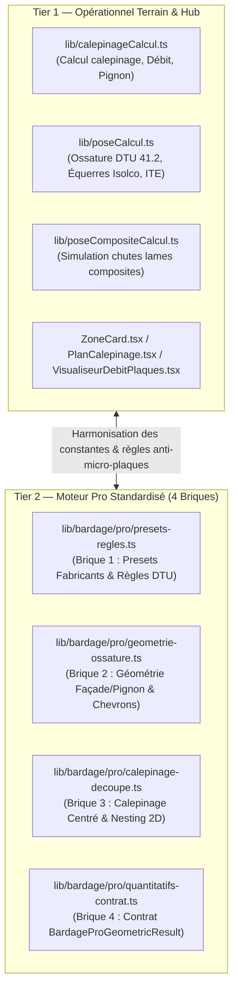
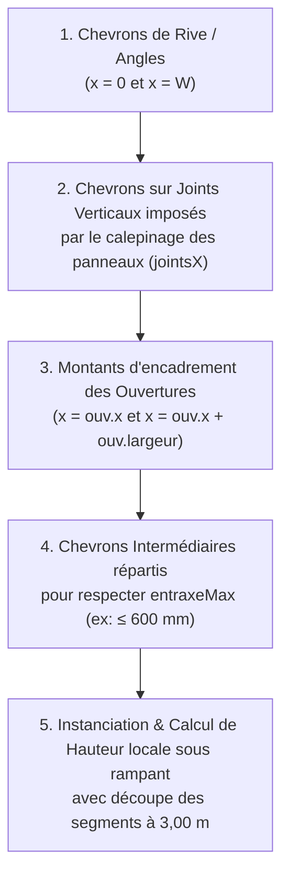
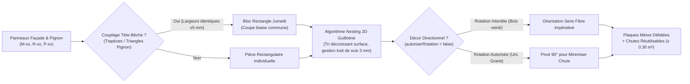
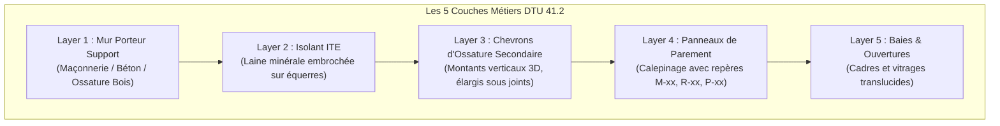

# Dossier d'Étude Technique & Architecture Système — BNA Bardage Pro
## Référentiels Normatifs NF DTU 41.2, NF DTU 31.2 & Cahiers CSTB 3194 / 3316

> [!IMPORTANT]
> **Périmètre du Document :** Synthèse exhaustive d'ingénierie logicielle et métier du module **Bardage** de l'application BNA Dashboard.
> - **Référentiels réglementaires couverts :** **NF DTU 41.2** (Revêtements extérieurs en bois et dérivés), **NF DTU 31.2** (Construction de maisons et bâtiments à ossature bois), **Cahiers du CSTB 3194 et 3316** (Ossatures bois et bardages ventilés sur maçonnerie/béton), règles de sécurité incendie et ITE (Isolation Thermique par l'Extérieur).
> - **Statut architectural :** Cloisonnement strict vis-à-vis du module **Terrasse** (NF DTU 51.4), double niveau de calcul (Moteur Opérationnel Terrain vs Moteur Pro en 4 Briques), visualisation bi-moteur (2D vectoriel / nesting plaques + 3D éclatée multi-couches DTU) et exports industriels (Bordereaux de débit atelier, PDF vectoriels, exports tableur Excel).

---

## Table des Matières

1. [Arborescence & Périmètre Fonctionnel du Domaine Bardage](#1-arborescence--périmètre-fonctionnel-du-domaine-bardage)
   - 1.1 Cartographie exhaustive des fichiers du domaine Bardage
   - 1.2 Cloisonnement Métier strict Bardage vs Terrasse
   - 1.3 Modèle de données & Persistance Supabase
2. [Moteurs de Calepinage, Physique du Bâtiment & Règles Métiers](#2-moteurs-de-calepinage-physique-du-bâtiment--règles-métiers)
   - 2.1 Dualité d'architecture : Moteur Historique/Terrain vs Moteur Pro en 4 Briques
   - 2.2 Géométrie des Façades : Murs rectangulaires & Pignons
   - 2.3 Déduction et Encadrement des Ouvertures
   - 2.4 Sens et Styles de Pose (HPL Compact, Lames Composites, Bois Massif, Claire-voie, Clin)
   - 2.5 Conception de l'Ossature Secondaire & Règle d'Or de l'alignement sur joints verticaux
   - 2.6 Équerres de Fixation (Isolco 3000 P2), Points Fixes, Points Glissants & Bande EPDM
   - 2.7 Isolation Thermique par l'Extérieur (ITE) & Lame d'Air Ventilée
   - 2.8 Trame Centrée et Règle Anti-Micro-Panneaux
   - 2.9 Imbrication 2D Guillotine (Nesting), Couplage Tête-Bêche des Pignons & Sens de Fibre
3. [Visualisation Graphique & Expérience Utilisateur (2D / 3D)](#3-visualisation-graphique--expérience-utilisateur-2d--3d)
   - 3.1 Visualiseur 2D Façade & Calepinage
   - 3.2 Visualiseur Débit d'Atelier & Imbrication sur Plaques Mères
   - 3.3 Moteur 3D Vectoriel Multi-Couches & Bâtiment Multi-Façades
   - 3.4 Vue 3D Légère Mobile (CSS 3D Transforms)
4. [Chiffrage, Catalogue Fournisseurs & Exports](#4-chiffrage-catalogue-fournisseurs--exports)
   - 4.1 Séparation tripartite des Quantitatifs : $Q_{\text{net}}$, $Q_{\text{tech}}$, $Q_{\text{appro}}$
   - 4.2 Connexion avec le Catalogue Fournitures BNA
   - 4.3 Génération des Fiches de Débit d'Atelier
   - 4.4 Génération des Exports Fichiers Serveur (Excel & PDF)
   - 4.5 Conversion Devis Commercial → Chantier Bardage
5. [Limites Actuelles & Feuille de Route d'Évolution (Roadmap)](#5-limites-actuelles--feuille-de-route-dévolution-roadmap)
   - 5.1 Limites Architecturales Identifiées
   - 5.2 Piste 1 : Unification Moteur Historique ↔ Moteur Pro 4 Briques
   - 5.3 Piste 2 : Moteur 3D Three.js PBR avec Matériaux Réalistes et Ombres Portées
   - 5.4 Piste 3 : Algorithme Nesting 2D Avancé avec Réemploi Actif des Chutes
   - 5.5 Piste 4 : Calepinage Automatisé des Habillages d'Ouvertures et Profilés d'Arrêt

---

## 1. Arborescence & Périmètre Fonctionnel du Domaine Bardage

### 1.1 Cartographie exhaustive des fichiers du domaine Bardage

Le domaine Bardage est structuré en modules modulaires complémentaires, répartis entre les moteurs mathématiques (`lib/`), les interfaces utilisateurs d'atelier et de chantier (`components/`), et les routes API / pages de l'application Next.js (`app/`).

```
bna-dashboard/
├── lib/
│   ├── bardage/                                 # Cœur métier Bardage Pro
│   │   ├── pro/
│   │   │   ├── index.ts                         # Point d'entrée public du module Bardage Pro
│   │   │   ├── presets-regles.ts                # Brique 1 : Presets fabricants, DTU 31.2/41.2, dilatation
│   │   │   ├── geometrie-ossature.ts            # Brique 2 : Géométrie façades/pignons, chevrons alignés sur joints
│   │   │   ├── calepinage-decoupe.ts            # Brique 3 : Calepinage centré, anti-micro-plaques, nesting 2D
│   │   │   └── quantitatifs-contrat.ts          # Brique 4 : Contrat BardageProGeometricResult (Q_net, Q_tech, Q_appro)
│   │   ├── corbeilleService.ts                  # Soft delete sécurisé, archivage traçable et restauration
│   │   └── facadesConfig.ts                     # Configuration dynamique multi-façades et avancement en 4 étapes
│   ├── calepinage/                              # Services annexes de calepinage et export
│   │   ├── bordereau.ts                         # Libellés matières, finitions et mise en forme bordereau
│   │   ├── css3d.ts                             # Mathématiques de projection CSS 3D Transforms pour mobile
│   │   ├── export.ts                            # Générateurs Node.js PDF vectoriel (pdf-lib) et Excel (exceljs)
│   │   ├── modules.ts                           # Transformation géométrique des panneaux en modules de base
│   │   ├── palette.ts                           # Gestion des couleurs par groupe et familles de calepinage
│   │   └── percages.ts                          # Algorithme de perçage des points fixes et glissants CSTB
│   ├── calepinageCalcul.ts                      # Moteur opérationnel de nesting 2D guillotine et couplage pignon
│   ├── poseCalcul.ts                            # Moteur opérationnel d'ossature chevrons, équerres Isolco et ITE
│   └── poseCompositeCalcul.ts                   # Moteur spécialisé découpe et réemploi de chutes de lames composites
├── components/
│   ├── bardage/
│   │   ├── hub/                                 # Hub mobile-first d'exécution chantier Bardage
│   │   │   ├── BardageCardNavigation.tsx        # Grille de navigation tactile vers les sous-modules terrain
│   │   │   ├── BardageCalepinageModule.tsx      # Intégration métrés, calepinage 2D/3D et débits en direct
│   │   │   ├── BardageAvancementModule.tsx      # Suivi d'avancement par façade (ossature, isolation, bardage, finitions)
│   │   │   ├── BardageGeneralDeplacementsModule.tsx # Gestion des déplacements, logistique et pointage terrain
│   │   │   ├── BardageHeuresModule.tsx          # Gestion et imputation des heures d'équipe chantier
│   │   │   ├── BardageMeteoModule.tsx           # Vigilance météo, vent et intempéries (DTU 41.2)
│   │   │   ├── BardagePhotosNotesModule.tsx     # Prise de vues horodatées et consignes de pose
│   │   │   ├── BardageRapportClientModule.tsx   # Génération du rapport de passage pour le client
│   │   │   └── BardageDocumentsModule.tsx       # Gestion des plans de pose et documents contractuels
│   │   ├── CorbeilleBardageModal.tsx            # Modale de visualisation et restauration de chantiers archivés
│   │   └── ModifierChantierBardageModal.tsx     # Modale d'édition des paramètres administratifs et techniques
│   ├── calepinage/
│   │   ├── BardagePlan3D.tsx                    # Moteur de rendu 3D vectoriel (5 couches DTU, bâtiment assemblé)
│   │   ├── Vue3DFacade.tsx                      # Composant de bascule Vue Légère CSS3D / Rendu Éclaté SVG 3D
│   │   ├── PlanCalepinageCanvas.tsx             # Canvas 2D haute performance pour plans de façade
│   │   ├── BordereauDebit.tsx                   # Tableau interactif des pièces à débiter avec repères
│   │   ├── CalepinageLayout.tsx                 # Conteneur d'onglets (Plan 2D, Vue 3D, Bordereau, Paramètres)
│   │   ├── CalepinageZoneForm.tsx               # Formulaire de configuration technique de façade/pignon
│   │   ├── OuvertureSheet.tsx                   # Tiroir latéral de saisie des cotes d'ouvertures
│   │   └── ZoneListCard.tsx                     # Carte récapitulative des zones d'un chantier
│   ├── ZoneCard.tsx                             # Carte opérationnelle unifiée (Métré, Calepinage, 2D/3D, Chiffrage)
│   ├── PlanCalepinage.tsx                       # Moteur de rendu SVG 2D de façade avec cotations complètes
│   ├── VisualiseurDebitPlaques.tsx              # Rendu visuel interactif des plaques mères imbriquées
│   ├── FicheDebitPDF.tsx                        # Fiche d'atelier A4 prête pour impression et découpe
│   └── CommandeModal.tsx                        # Modale de génération des lignes d'achat fourniture
├── app/
│   ├── (dashboard)/calepinage/
│   │   ├── page.tsx                             # Liste des zones de calepinage de l'entreprise
│   │   └── [zoneId]/page.tsx                    # Page dynamique d'édition d'une façade/zone
│   ├── terrain/chantier/
│   │   ├── page.tsx                             # Liste terrain des chantiers Bardage (filtrage strict métier)
│   │   └── [id]/page.tsx                        # Page Hub Chantier Bardage multi-modules
│   ├── bureau/
│   │   ├── catalogue/page.tsx                   # Gestion du catalogue Fournitures Bardage (`catalogue_ouvrages`)
│   │   └── devis-factures/page.tsx              # Qualification stricte du corps d'état lors de la conversion
│   └── api/calepinage/
│       ├── calculer/route.ts                    # API de recalcul serveur et persistance des modules
│       ├── export/excel/route.ts                # API de génération du bordereau XLSX
│       └── export/pdf/route.ts                  # API de génération du dossier de fabrication PDF
└── __tests__/
    ├── bardage/                                 # 120 tests unitaires et d'intégration validés
    └── metier/bardage-pignon-couplage.test.ts   # Tests de découpe pignon et couplage tête-bêche
```

---

### 1.2 Cloisonnement Métier strict Bardage vs Terrasse

Le projet applique une étanchéité complète entre les deux corps d'état : **Bardage** (ITE, façades ventilées, pignons) et **Terrasse** (platelages extérieurs bois/composite, plots, lambourdes, terrasse mobile).

| Vecteur d'Isolation | Mécanisme de Cloisonnement | Fichiers Sources Vérifiés |
| :--- | :--- | :--- |
| **Base de Données (PostgreSQL)** | Colonne discriminante `chantiers.metier` (`'bardage'` ou `'terrasse'`). Tables dédiées : les façades résident dans `chantier_zones`, tandis que la terrasse réside dans `chantier_terrasses`. | [proposition_technique_cloisonnement_metiers.md](file:///data/data/com.termux/files/home/bna-dashboard/proposition_technique_cloisonnement_metiers.md#L11-L40) |
| **Conversion Devis Commercial** | Détection automatique basée sur les mots-clés du devis avec confirmation explicite de l'utilisateur par sélecteur de mode. Les checklists générées sont hermétiques (`{tasseaux, pare_pluie, pose, finition}` pour le bardage). | [app/bureau/devis-factures/page.tsx](file:///data/data/com.termux/files/home/bna-dashboard/app/bureau/devis-factures/page.tsx#L750-L818) |
| **API Endpoints & Guards** | Les routes d'API terrasse rejettent immédiatement tout chantier bardage par un statut HTTP 400 (`Incohérence métier : le chantier est de type bardage, impossible de charger une terrasse`). | [app/api/chantiers/[id]/terrasse/route.ts](file:///data/data/com.termux/files/home/bna-dashboard/app/api/chantiers/[id]/terrasse/route.ts#L187-L191) |
| **Routing Terrain** | La page terrain bardage applique un filtre SQL strict `.or("metier.eq.bardage,metier.is.null")` avec exclusion active de tout chantier étiqueté `'terrasse'`. | [app/terrain/chantier/page.tsx](file:///data/data/com.termux/files/home/bna-dashboard/app/terrain/chantier/page.tsx#L121-L144) |
| **Catalogues Fournitures** | Séparation des tables et des interfaces : `catalogue_ouvrages` pour les panneaux HPL, chevrons et équerres bardage vs `catalogue_terrasse_lames` / `catalogue_terrasse_accessoires` pour la terrasse. | [components/catalogue/types.ts](file:///data/data/com.termux/files/home/bna-dashboard/components/catalogue/types.ts#L42-L100) |

---

### 1.3 Modèle de données & Persistance Supabase

Les entités métiers du bardage sont persistées dans plusieurs tables relationnelles de Supabase :

1. `chantiers` : Entité racine. Contient `metier: "bardage"`, les dates, le statut, les adresses et le JSONB `checklist` décrivant l'avancement global.
2. `chantier_zones` : Chaque façade ou mur traité. Stocke les dimensions ($L, H_{\text{mur}}, H_{\text{faîte}}$), le flag `est_pignon`, la famille de matériau (`hpl`, `composite`, `bois_naturel`, `cassette`), la trame de module souhaitée, le format de plaque brute sélectionné et les options ITE (épaisseur isolant, type).
3. `chantier_zones_openings` : Ouvertures traversantes positionnées sur chaque façade ($x, y, \text{largeur}, \text{hauteur}$, type fenêtre/porte/baie).
4. `chantier_zones_modules` : Modules posés après exécution de l'algorithme de calepinage (coordonnées d'implantation, dimensions réelles, repères $M\text{-}xx$, $R\text{-}xx$, $P\text{-}xx$).
5. `chantier_zones_module_groups` : Regroupements fonctionnels de modules pour l'assignation des finitions, teintes et schémas de perçage.
6. `catalogue_ouvrages` : Base de prix et fiches articles (Panneaux Trespa, Fundermax, Rockpanel, Chevrons bois massif traités classe 2/3, Équerres Isolco, Visserie inox A2/A4, bandes EPDM).

---

## 2. Moteurs de Calepinage, Physique du Bâtiment & Règles Métiers

### 2.1 Dualité d'architecture : Moteur Historique/Terrain vs Moteur Pro en 4 Briques

L'application intègre une architecture à double détente :



- **Moteur Opérationnel (`lib/calepinageCalcul.ts` & `lib/poseCalcul.ts`) :** Relié à `ZoneCard.tsx`, au Hub Chantier terrain et aux API d'export PDF/Excel. Il calcule le placement en coordonnées entières millimétriques, gère le nesting 2D en temps réel et génère les repères de débit d'atelier.
- **Moteur Pro en 4 Briques (`lib/bardage/pro/`) :** Conçu selon le même patron d'ingénierie rigoureux que le moteur Terrasse Pro (`lib/terrasse/pro/`). Il formalise les contrats typés TypeScript stricts et garantit la séparation des niveaux quantitatifs ($Q_{\text{net}}, Q_{\text{tech}}, Q_{\text{appro}}$).

---

### 2.2 Géométrie des Façades : Murs rectangulaires & Pignons

Le calcul altimétrique d'un mur dépend de sa typologie :
- **Façade rectangulaire standard :** Hauteur constante $H(x) = H_{\text{mur}}$.
- **Pignon symétrique ou asymétrique :** La hauteur sous rampant $H(x)$ est déterminée par interpolation linéaire selon la position du faîtage $X_{\text{ridge}} = W / 2$ (ou $X_{\text{peak}}$ arbitraire dans les pignons asymétriques).

Dans [lib/bardage/pro/geometrie-ossature.ts](file:///data/data/com.termux/files/home/bna-dashboard/lib/bardage/pro/geometrie-ossature.ts#L57-L72) et [lib/calepinageCalcul.ts](file:///data/data/com.termux/files/home/bna-dashboard/lib/calepinageCalcul.ts#L362-L378) :

$$\text{Pente}_{\text{gauche}} = \frac{H_{\text{faite}} - H_{\text{mur}}}{X_{\text{ridge}}}$$

$$\text{Pente}_{\text{droite}} = \frac{H_{\text{faite}} - H_{\text{mur}}}{W - X_{\text{ridge}}}$$

$$H(x) = \begin{cases} 
H_{\text{mur}} + x \cdot \text{Pente}_{\text{gauche}} & \text{si } x \le X_{\text{ridge}} \\ 
H_{\text{faite}} - (x - X_{\text{ridge}}) \cdot \text{Pente}_{\text{droite}} & \text{si } x > X_{\text{ridge}} 
\end{cases}$$

Une garde de ventilation haute sous rampant de **$30\text{ mm}$** est automatiquement déduite pour assurer l'évacuation de la lame d'air ventilée selon le DTU 41.2.

---

### 2.3 Déduction et Encadrement des Ouvertures

Pour chaque baie, porte ou fenêtre définie par $(x_{\text{ouv}}, y_{\text{ouv}}, L_{\text{ouv}}, H_{\text{ouv}})$ :
1. **Déduction géométrique de surface :** La surface brute du mur est décomptée précisément :
   $$S_{\text{nette}} = S_{\text{brute\_facade}} - \sum (L_{\text{ouv}} \times H_{\text{ouv}})$$
2. **Imposition d'ossature dédiée :** L'algorithme place automatiquement des chevrons verticaux renforcés au nu gauche ($x = x_{\text{ouv}}$) et au nu droit ($x = x_{\text{ouv}} + L_{\text{ouv}}$) de l'ouverture pour reprendre la fixation des tableaux de fenêtres et les profilés de raccordement étanche.
3. **Protection contre les micro-panneaux en imposte/allège :** Si l'intervalle entre le haut de l'ouverture et la sous-face de toiture (ou entre le bas et le sol) est inférieur au seuil critique ($< 150\text{ mm}$), une alerte technique est levée pour imposer une pièce d'imposte filante.

---

### 2.4 Sens et Styles de Pose

Le module Bardage prend en charge les quatre grandes familles de parements extérieurs visées par le DTU 41.2 et les avis techniques :

| Famille de Pose | Type de Matériau | Sens de Pose | Entraxe Chevrons Admissible | Mode de Fixation |
| :--- | :--- | :--- | :--- | :--- |
| **Panneaux HPL Compacts** (Trespa Meteon, Fundermax Max Exterior) | Stratifié haute pression $8\text{ mm}$ | Trame orthogonale en plaques | Courant : $600\text{ mm}$ / Rive : $450\text{ mm}$ | Vissage apparent sur chevrons bois (vis Torx inox laquées avec 1 point fixe $\varnothing 6\text{ mm}$ et $N-1$ points coulissants $\varnothing 8{,}5\text{ mm}$) |
| **Laines Minérales Haute Densité** (Rockpanel) | Fibres de basalte compressées $8\text{ mm}$ | Trame orthogonale en plaques | Courant : $600\text{ mm}$ / Rive : $400\text{ mm}$ | Vis spécifiques Rockpanel $\varnothing 4{,}5\text{ mm}$ (dilatation plus faible, 1 point fixe $\varnothing 5{,}5\text{ mm}$, coulissants $\varnothing 8\text{ mm}$) |
| **Lames Composites Coextrudées** (WEO, Silvadec) | Bois composite polymère | Horizontal ou Vertical | Entraxe maximal : $400\text{ mm}$ ($300\text{ mm}$ en angle/rive) | Clips invisibles inox vissés en rainure ou vissage direct prépercé |
| **Bardage Bois Massif** (Clin ou Claire-voie) | Douglas, Mélèze, Red Cedar, Pin traité autoclave | Horizontal ou Vertical | Entraxe standard DTU 41.2 : $600\text{ mm}$ ($400\text{ mm}$ pour claire-voie) | Pointes inox annelées ou vis inox traversantes avec garde au sol $\ge 150\text{ mm}$ |

---

### 2.5 Conception de l'Ossature Secondaire & Règle d'Or de l'alignement sur joints verticaux

> [!CAUTION]
> **Règle d'or absolue DTU 41.2 / Cahier CSTB 3194 :**
> Un joint vertical entre deux panneaux HPL ou dalles de bardage ne doit **JAMAIS** flotter dans le vide. Un montant d'ossature (chevron large $\ge 90\text{ mm}$ ou double chevron) doit **OBLIGATOIREMENT** être positionné pile au droit de chaque joint vertical afin d'assurer l'appui continu des deux rives de panneaux contigus et la pose de la bande d'étanchéité EPDM.

L'algorithme de génération de l'ossature ([lib/bardage/pro/geometrie-ossature.ts](file:///data/data/com.termux/files/home/bna-dashboard/lib/bardage/pro/geometrie-ossature.ts#L81-L154)) fonctionne selon l'ordre de priorité strict suivant :



1. **Placement des rives :** $x = 0$ et $x = W$ (chevrons d'angle/extrémité).
2. **Placement des joints panneaux :** Injection de tous les joints verticaux issus du calepinage ($jointsVerticauxX$). Ces chevrons reçoivent le rôle `joint_panneau` et une largeur majorée ($90\text{ mm}$ ou $100\text{ mm}$ au lieu de $60\text{ mm}$).
3. **Placement des encadrements d'ouvertures :** Insertion des montants d'allège et de linteau.
4. **Comblement par chevrons intermédiaires :** L'algorithme mesure chaque sous-intervalle $[x_i, x_{i+1}]$. Si la distance excède l'entraxe maximal admissible ($600\text{ mm}$ en courant, $450\text{ mm}$ ou $400\text{ mm}$ en zone de rive vent), il insère le nombre exact de chevrons intermédiaires nécessaires par subdivision équidistante :
   $$N_{\text{intervalles}} = \left\lceil \frac{x_{i+1} - x_i}{\text{entraxeMax}} \right\rceil, \quad \text{Pas} = \frac{x_{i+1} - x_i}{N_{\text{intervalles}}}$$
5. **Segmentation mécanique aux 3,00 m :** Conformément au DTU 41.2, aucun chevron bois continu ne doit dépasser **$3{,}00\text{ m}$** afin de limiter les déformations hygrométriques. Les chevrons plus hauts sont fractionnés en plusieurs tronçons indépendants avec un jeu de dilatation de **$15\text{ mm}$** entre abouts.

---

### 2.6 Équerres de Fixation (Isolco 3000 P2), Points Fixes, Points Glissants & Bande EPDM

La reprise des charges de l'ossature sur le gros œuvre (maçonnerie ou béton) est dimensionnée par le moteur [lib/poseCalcul.ts](file:///data/data/com.termux/files/home/bna-dashboard/lib/poseCalcul.ts#L80-L100) :

- **Équerres Isolco 3000 P2 :**
  - **Équerre porteuse (Point Fixe) :** Positionnée en tête de chevron (1 par segment de $3\text{ m}$). Elle reprend le poids propre du bardage et la charge de vent. Fixée au chevron par **4 vis inox**.
  - **Équerres guides (Points Coulissants) :** Réparties le long du chevron avec un entraxe vertical standard de **$1{,}35\text{ m}$** ($0{,}90\text{ m}$ en zone de rive vent). Leurs trous oblongs permettent la libre dilatation verticale du bois. Fixées au chevron par **2 vis inox**.
- **Ancrage mural :** Chaque équerre Isolco est ancrée dans le support béton/parpaing par **2 chevilles métalliques Spit MP3-S $\varnothing 12\text{ mm}$** (couple de serrage réglementaire de $15\text{ Nm}$).
- **Bande EPDM :** Une bande élastomère EPDM noire de largeur $80\text{ mm}$ à $100\text{ mm}$ est obligatoirement agrafée sur toute la hauteur de chaque chevron (+5% de recouvrement aux aboutements) pour protéger le bois des infiltrations d'eau au travers des joints ouverts et garantir la discrétion visuelle du fond de joint.

---

### 2.7 Isolation Thermique par l'Extérieur (ITE) & Lame d'Air Ventilée

Le module intègre le calcul physique de l'isolation thermique sous bardage rapporté (CSTB 3194 / 3316) :

- **Matériau de l'isolant :** Laine de roche hydrophobe ou laine de verre haute densité semi-rigide (panneaux certifiés ACERMI).
- **Dimensionnement du talon de l'équerre :** La portée utile de l'équerre doit compenser l'épaisseur de l'isolant plus la lame d'air minimale réglementaire de **$20\text{ mm}$** :
  $$\text{Portée}_{\text{équerre}} = \text{Épaisseur}_{\text{isolant}} + 20\text{ mm}$$
  La fonction `getModeleEquerre(epaisseurIsolantMm)` sélectionne automatiquement le modèle standard du commerce (ex: pour un isolant de $120\text{ mm}$, sélection de l'équerre Isolco $140\text{ mm}$).
- **Quantitatif d'approvisionnement isolant :** Calculé avec une majoration technique forfaitaire de **$+8\%$** pour absorber les découpes d'angles, les chutes et le calfeutrement d'ouvertures :
  $$S_{\text{isolant\_appro}} = S_{\text{nette\_façade}} \times 1{,}08$$
- **Fixations d'isolant :** Calcul de **5 à 6 chevilles rosaces à frapper par $\text{m}^2$**.

---

### 2.8 Trame Centrée et Règle Anti-Micro-Panneaux

Pour des raisons esthétiques et structurelles (résistance à l'arrachement au vent), un bardage ne commence jamais par un panneau plein à gauche pour se terminer par une découpe résiduelle minuscule à droite.

L'algorithme de calepinage centré ([lib/bardage/pro/calepinage-decoupe.ts](file:///data/data/com.termux/files/home/bna-dashboard/lib/bardage/pro/calepinage-decoupe.ts#L81-L122) et [lib/poseCalcul.ts](file:///data/data/com.termux/files/home/bna-dashboard/lib/poseCalcul.ts#L120-L158)) résout ce problème géométriquement :

1. L'axe de symétrie du bâtiment reçoit soit le centre d'un module plein, soit un joint central.
2. Le nombre de modules entiers au centre est :
   $$N_{\text{pleins}} = \lfloor W / L_{\text{module}} \rfloor$$
   $$\text{Reste} = W - N_{\text{pleins}} \times L_{\text{module}}$$
   $$\text{Largeur}_{\text{rive}} = \text{Reste} / 2$$
3. **Règle Anti-Micro-Panneaux (Seuil critique $250\text{ mm}$) :**
   Si la largeur de rive calculée $\text{Largeur}_{\text{rive}} < 250\text{ mm}$ (ou $< 150\text{ mm}$ selon preset fabricant), la configuration est jugée non conforme. L'algorithme retire automatiquement un module plein au centre ($N_{\text{pleins}} \leftarrow N_{\text{pleins}} - 1$) et réalloue la matière excédentaire sur les deux rives :
   $$\text{Largeur}_{\text{rive\_sécurisée}} = \frac{W - (N_{\text{pleins}} - 1) \times L_{\text{module}}}{2} \ge 250\text{ mm}$$

---

### 2.9 Imbrication 2D Guillotine (Nesting), Couplage Tête-Bêche des Pignons & Sens de Fibre

Le moteur de débit d'atelier convertit les panneaux théoriques en calepinage de coupe sur plaques mères brutes du commerce (ex: Trespa $3050 \times 1300\text{ mm}$, Fundermax $2800 \times 1300\text{ mm}$ ou $4100 \times 1854\text{ mm}$) :



1. **Couplage Tête-Bêche des Pignons (`couplage pignon`) :**
   Les pièces coupées en rampant (repères $P\text{-}xx$) forment des trapèzes ou triangles rectangles. Deux pièces de pente symétrique ou de même largeur de coupe sont appariées tête-bêche pour former un pseudo-rectangle parfait. Cette technique réduit le taux de chute sur pignon de près de **$40\%$**.
2. **Algorithme de Guillotine 2D :**
   Les pièces sont triées par surface décroissante puis calées par rangées et colonnes dans chaque plaque mère, en réservant une épaisseur de **$3\text{ mm}$ pour le trait de scie de la lame de panneau**.
3. **Gestion du sens de décor / fibre (`autoriserRotation`) :**
   - Décors uniformes (gris anthracite, blanc, sable, finitions métallisées sans sens) : `autoriserRotation: true`. Le moteur autorise le pivotement à 90° des panneaux pour maximiser le taux d'utilisation de la plaque.
   - Décors directionnels (bois veiné, imitation chêne, métaux brossés) : `autoriserRotation: false`. La rotation à 90° est **strictement proscrite** pour garantir un sens de veinage homogène sur l'ensemble de la façade.
4. **Classification des chutes :**
   - **Chute réemployable :** Longueur $\ge 800\text{ mm}$ ou surface $\ge 0{,}30\text{ m}^2$ (réutilisable pour les tableaux et sous-faces de fenêtres).
   - **Chute déchet (perte sèche) :** Morceaux résiduels inférieurs aux seuils.

---

## 3. Visualisation Graphique & Expérience Utilisateur (2D / 3D)

### 3.1 Visualiseur 2D Façade & Calepinage

Le composant [components/PlanCalepinage.tsx](file:///data/data/com.termux/files/home/bna-dashboard/components/PlanCalepinage.tsx) et son pendant haute performance [components/calepinage/PlanCalepinageCanvas.tsx](file:///data/data/com.termux/files/home/bna-dashboard/components/calepinage/PlanCalepinageCanvas.tsx) génèrent un plan d'élévation complet du mur :
- **Ligne de silhouette :** Tracé du mur avec ligne de pente de pignon et cotes hors-tout.
- **Trame d'ossature secondaire :** Représentation des chevrons verticaux avec repères de numérotation de segments (1 à $N$), marquage des joints de fractionnement aux $3\text{ m}$ et position des équerres porteuses (carrés pleins) et guides (croix).
- **Panneaux de parement :** Rectangles et polygones de coupe repérés ($M\text{-}01$, $R\text{-}01$, $P\text{-}01$) avec cotes individuelles de largeur et hauteur.
- **Lignes de cotes :** Cotation continue au sol (entraxes réels entre chevrons en mm) et cotation verticale (hauteur d'allège, de linteau, hauteur d'égout et de faîtage).

---

### 3.2 Visualiseur Débit d'Atelier & Imbrication sur Plaques Mères

Le composant [components/VisualiseurDebitPlaques.tsx](file:///data/data/com.termux/files/home/bna-dashboard/components/VisualiseurDebitPlaques.tsx) offre une interface d'atelier interactive :
- **Navigation plaque par plaque :** Carrousel permettant de visualiser chaque plaque mère numérotée ($1/N, 2/N\dots$).
- **Mise en plan de coupe :** Dessin à l'échelle de la plaque mère avec affichage des pièces imbriquées, de leurs repères, des traits de scie et des pièces couplées tête-bêche.
- **Tableau de bord de chute en temps réel :** Calcul immédiat de la surface utile ($m^2$), de la surface de chute ($m^2$), du taux de déchet ($\%$) et de la ventilation en chutes réutilisables.
- **Fonctions d'atelier :** Outils de zoom interactif, bascule plein écran et impression directe de la fiche de coupe.

---

### 3.3 Moteur 3D Vectoriel Multi-Couches & Bâtiment Multi-Façades

Le moteur [components/calepinage/BardagePlan3D.tsx](file:///data/data/com.termux/files/home/bna-dashboard/components/calepinage/BardagePlan3D.tsx) implémente un visualiseur 3D sans dépendance lourde, basé sur des projections affines vectorielles et un algorithme du peintre (Painter's Algorithm) trié par calques :



#### Caractéristiques clés du moteur 3D :
1. **Curseur interactif « Éclaté DTU » (`eclateFactor` 0 à 100%) :**
   - À 0% : Rendu compact réel du système constructif tel que posé sur chantier.
   - À 100% : Les 5 couches se décollent dans l'axe $Z$ selon une cinématique calculée, permettant d'inspecter visuellement l'alignement des chevrons derrière les joints de panneaux et la pose de l'isolant.
2. **Mode Bâtiment 3D Complet Multi-Façades :**
   Le moteur ne se limite pas à une façade isolée : il assemble automatiquement les 4 façades configurées du chantier (Nord, Est, Sud, Ouest) dans l'espace tridimensionnel pour former le volume complet du pavillon ou du bâtiment industriel.
3. **Navigation orbitale fluide :** Rotation libre en azimut (`yawDeg` -180° à +180°) et élévation (`pitchDeg` -80° à +80°) par glisser-déposer de la souris ou toucher tactile mobile.
4. **Hiérarchie stricte des faces (Painter's Algorithm) :** Résolution optique par calcul de normale : les chants latéraux et supérieurs des panneaux sont extrudés et dessinés dans un ordre rigoureux, empêchant tout artefact de clignotement ou de superposition d'un chevron sur un panneau de parement.

---

### 3.4 Vue 3D Légère Mobile (CSS 3D Transforms)

Pour les smartphones de chantier à ressources limitées, [components/calepinage/Vue3DFacade.tsx](file:///data/data/com.termux/files/home/bna-dashboard/components/calepinage/Vue3DFacade.tsx) exploite les transformations matérielles CSS 3D (`perspective: 1200px`, `transform-style: preserve-3d`) :
- **Budget DOM maîtrisé :** Plafonné à 200 nœuds DOM (`MAX_ELEMENTS_DOM = 200`). Au-delà, l'affichage bascule automatiquement en mode simplifié (seuls les contours de groupes sont rendus).
- **Zéro re-render pendant les gestes :** L'orientation et le zoom sont manipulés directement via des références directes (`ref.style.transform`), assurant une fluidité à 60 fps sans recalcul React.

---

## 4. Chiffrage, Catalogue Fournisseurs & Exports

### 4.1 Séparation tripartite des Quantitatifs : $Q_{\text{net}}$, $Q_{\text{tech}}$, $Q_{\text{appro}}$

Conformément aux normes contractuelles de métré du bâtiment, le moteur [lib/bardage/pro/quantitatifs-contrat.ts](file:///data/data/com.termux/files/home/bna-dashboard/lib/bardage/pro/quantitatifs-contrat.ts) sépare strictement trois niveaux quantitatifs :

```
┌──────────────────────────────────────────────────────────────────────────────────┐
│                             MÉTRÉ BARDAGE PRO                                    │
├────────────────────────┬────────────────────────┬────────────────────────────────┤
│ 1. Quantité Nette      │ 2. Quantité Technique  │ 3. Quantité Approvisionnement   │
│      (Q_net)           │        (Q_tech)        │           (Q_appro)            │
├────────────────────────┼────────────────────────┼────────────────────────────────┤
│ Surface géométrique    │ Surface brute des      │ Nombre entier de plaques       │
│ posée au mur (m²)      │ plaques mères découpées│ mères à commander (unités)     │
│                        │ avec chutes (m²)       │                                │
│ Linéaire net d'axe     │ Linéaire brut de bois  │ Nombre de barres de chevrons   │
│ des chevrons posés (ml)│ débité avec chutes (ml)│ de 3,00 m entières à livrer    │
│                        │                        │                                │
│ Nombre exact de vis    │ Chutes réelles         │ Boîtes de vis complètes        │
│ calculées (unités)     │ quantifiées (m²)       │ (colisage de 100 ou 500 pcs)   │
└────────────────────────┴────────────────────────┴────────────────────────────────┘
```

- **Quantités Nettes Géométriques ($Q_{\text{net}}$) :**
  - Surface utile posée au mur : $S_{\text{posée}} = \sum S_{\text{panneaux}}$.
  - Linéaire effectif de chevrons en place.
  - Fixations réelles : $N_{\text{vis\_net}} = N_{\text{points\_fixes}} + N_{\text{points\_glissants}}$.
- **Quantités Techniques Débitées ($Q_{\text{tech}}$) :**
  - Surface brute de panneaux débités (surface totale des plaques mères consommées).
  - Taux de chute réel de l'atelier :
    $$\tau_{\text{chute}} = \frac{S_{\text{brute\_plaques}} - S_{\text{nette}}}{S_{\text{brute\_plaques}}} \times 100$$
  - Volume des chutes réemployables isolées.
- **Quantités d'Approvisionnement ($Q_{\text{appro}}$) :**
  - Plaques entières à commander au fournisseur.
  - Nombre de barres de chevrons standardisées (ex: barres de $3{,}00\text{ m}$ ou $4{,}00\text{ m}$).
  - Colisage des fixations : arrondi à la boîte supérieure avec marge de sécurité chantier de $+4\%$.

---

### 4.2 Connexion avec le Catalogue Fournitures BNA

Le chiffrage du bardage est connecté à la table `catalogue_ouvrages` de Supabase, administrée depuis [app/bureau/catalogue/page.tsx](file:///data/data/com.termux/files/home/bna-dashboard/app/bureau/catalogue/page.tsx) :

- **Articles Parement :** Plaques Trespa Meteon, Fundermax Exterior, Rockpanel (prix d'achat HT au $\text{m}^2$, prix de vente HT, finitions, formats de plaques disponibles en JSONB).
- **Articles Ossature & Métal :** Chevrons sapin/mélèze traités classe 2/3 (au ml), équerres Isolco 3000 P2 (à la pièce par taille de portée).
- **Articles Fixations & Étanchéité :** Vis autoperceuses Torx inox avec laquage RAL coordonné (boîte de 100/500), bandes EPDM (rouleaux de 20 ml), chevilles Spit MP3-S.
- **Liaison temps réel :** Lors de la saisie d'une zone, les prix de vente unitaire HT et coûts de revient sont instantanément injectés pour alimenter la marge commerciale du chantier.

---

### 4.3 Génération des Fiches de Débit d'Atelier

Le composant [components/FicheDebitPDF.tsx](file:///data/data/com.termux/files/home/bna-dashboard/components/FicheDebitPDF.tsx) produit une fiche technique de fabrication d'atelier A4 comprenant :
- En-tête entreprise avec logo BNA, coordonnées du chantier et date d'édition.
- Synthèse des surfaces (Brute, Ouvertures déduites, Nette, Chutes).
- Tableau exhaustif de débit des panneaux : Repère de la pièce, Largeur brute, Hauteur brute, Type (Pleine / Rive / Pignon), N° de plaque mère associée, Statut d'appariement tête-bêche.
- Schéma du plan de façade côté en projection directe pour le contrôle qualité des découpes.

---

### 4.4 Génération des Exports Fichiers Serveur (Excel & PDF)

Les routes serveur [app/api/calepinage/export/excel/route.ts](file:///data/data/com.termux/files/home/bna-dashboard/app/api/calepinage/export/excel/route.ts) et [app/api/calepinage/export/pdf/route.ts](file:///data/data/com.termux/files/home/bna-dashboard/app/api/calepinage/export/pdf/route.ts) génèrent à la volée des documents de production professionnels :

- **Bordereau Excel (.xlsx via `exceljs`) :**
  - Feuille 1 : Récapitulatif du chantier et métriques clés ($Q_{\text{net}}, Q_{\text{tech}}$).
  - Feuille 2 : Liste des panneaux ordonnancée par repère et dimension pour intégration sur scie numérique ou centre d'usinage.
  - Feuille 3 : Nomenclature des fournitures (chevrons, équerres, vis, isolant).
- **Dossier PDF A4 vectoriel (via `pdf-lib`) :**
  - Mise en page vectorielle haute fidélité avec polices incorporées et cartouche réglementaire.
  - Intégration du mini-plan de façade avec rendu vectoriel de secours automatique si la bibliothèque de rendu d'image native (`sharp`) est indisponible.
  - Schéma détaillé des perçages par panneau (position des points fixes et oblongs selon prescriptions du CSTB).

---

### 4.5 Conversion Devis Commercial → Chantier Bardage

La transformation d'un devis client en chantier opérationnel ([app/bureau/devis-factures/page.tsx](file:///data/data/com.termux/files/home/bna-dashboard/app/bureau/devis-factures/page.tsx#L750-L818)) applique une procédure sécurisée :
1. Analyse lexicale des lignes du devis : détection automatique de la présence de termes bardage (panneaux, chevrons, équerres, ITE).
2. Présentation d'une modale de validation à l'utilisateur : choix explicite entre `Bardage` ou `Terrasse`.
3. Création atomique du chantier dans la table `chantiers` avec `metier = "bardage"`, initialisation des 4 phases de suivi terrain (`{ tasseaux, pare_pluie, pose, finition }`) et synchronisation automatique avec le Hub Terrain Bardage.

---

## 5. Limites Actuelles & Feuille de Route d'Évolution (Roadmap)

### 5.1 Limites Architecturales Identifiées

L'analyse approfondie du code source met en évidence plusieurs axes d'amélioration technique :

1. **Dualité des Moteurs Mathématiques :** Coexistence du moteur historique terrain ([lib/calepinageCalcul.ts](file:///data/data/com.termux/files/home/bna-dashboard/lib/calepinageCalcul.ts)) et du nouveau moteur Pro en 4 Briques ([lib/bardage/pro/](file:///data/data/com.termux/files/home/bna-dashboard/lib/bardage/pro/)). Bien que synchronisés sur les seuils anti-micro-plaques, une convergence complète vers le contrat `BardageProGeometricResult` est recommandée.
2. **Visualisation 3D Vectorielle SVG vs WebGL :** Le moteur 3D actuel ([components/calepinage/BardagePlan3D.tsx](file:///data/data/com.termux/files/home/bna-dashboard/components/calepinage/BardagePlan3D.tsx)) est d'une grande élégance technique (0 dépendance, rendu SVG), mais il atteint ses limites sur de très grands projets (plus de 1 000 modules) et ne gère pas les textures photoréalistes PBR, l'éclairage dynamique ni les ombres portées réelles entre façades.
3. **Calepinage des Profilés d'Encadrements d'Ouvertures :** Les appuis de fenêtres aluminium, cornières de tableaux et profils linteaux avec goutte d'eau sont actuellement calculés sous forme de linéaires forfaitaires, sans calepinage pièce par pièce.
4. **Réemploi Circulaire des Chutes de Pignons :** Bien que les panneaux triangulaires soient couplés tête-bêche, les chutes rectangulaires résiduelles de pignon ne sont pas encore automatiquement réinjectées dans les panneaux de tableaux de fenêtres de la même zone.

---

### 5.2 Piste 1 : Unification Moteur Historique ↔ Moteur Pro 4 Briques

#### Objectif technique :
Faire de `lib/bardage/pro/` le cœur de calcul universel de toute l'application :
- Remplacer les appels historiques de `calculerCalepinage()` dans `ZoneCard.tsx` et `app/api/calepinage/calculer/route.ts` par `calculerBardagePro()`.
- Unifier le type de sortie vers `BardageProGeometricResult`, qui expose nativement $Q_{\text{net}}$, $Q_{\text{tech}}$ et $Q_{\text{appro}}$.

---

### 5.3 Piste 2 : Moteur 3D Three.js PBR avec Matériaux Réalistes et Ombres Portées

#### Objectif technique :
Fournir une expérience immersive identique à celle mise en place sur la Terrasse Mobile Three.js :
- Intégrer un canvas **Three.js** (`@react-three/fiber` ou Three.js natif) pour le mode Bâtiment 3D.
- Rendu réaliste des matières : textures HPL rainurées ou brossées, brillance de l'aluminium des rails et profils, reflets sur les vitrages des fenêtres.
- Éclairage solaire directionnel avec ombres portées douces (`castShadow` / `receiveShadow`) pour mettre en valeur les retraits de tableaux et le relief des joints ouverts.

---

### 5.4 Piste 3 : Algorithme Nesting 2D Avancé avec Réemploi Actif des Chutes

#### Objectif technique :
Passer du nesting par rangées guillotine à un algorithme de type **MaxRects Best Short Side Fit (BSSF)** ou **Clipper2** :
- Récupérer les chutes de découpe de pignons présentant une surface $\ge 0{,}30\text{ m}^2$.
- Vérifier automatiquement si ces chutes peuvent combler les besoins de découpe des tableaux de fenêtres ou des allèges de la façade.
- Gain estimé : **3 à 6% de matière économisée** sur chaque chantier complexe comportant des pignons et de nombreuses baies.

---

### 5.5 Piste 4 : Calepinage Automatisé des Habillages d'Ouvertures et Profilés d'Arrêt

#### Objectif technique :
Générer automatiquement le plan de débit des pièces de finition métalliques ou composites :
- **Profil de départ ventilé bas :** Découpe optimisée des barres de départ perforées avec grille anti-rongeurs en pied de bardage.
- **Cornières d'angle sortant et rentrant :** Calepinage des cornières d'angle en aluminium laqué coordonné au RAL des panneaux.
- **Tableaux et bavettes d'appuis :** Calepinage précis des tablettes d'appuis avec oreilles de fixation et relevés d'étanchéité latéraux.

---

## Conclusion & Synthèse

Le module **Bardage** de BNA Dashboard constitue un ensemble technologique et normatif de premier ordre. Il allie :
1. Une rigueur normative stricte alignée sur les **DTU 41.2**, **DTU 31.2** et **CSTB 3194 / 3316**.
2. Une sécurité structurelle sans compromis (ossature alignée obligatoirement sur les joints de panneaux, seuils anti-micro-plaques à $250\text{ mm}$).
3. Une chaîne logicielle complète et étanche, depuis la qualification du devis jusqu'à la fiche de coupe d'atelier et la gestion de chantier sur le Hub mobile.
