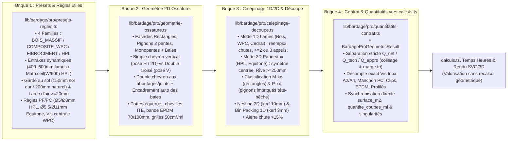

# Dossier d'Étude Technique & Référentiel Normatif — NF DTU 41.2, NF DTU 45.4, Cahiers CSTB & DTA Composite pour BNA Bardage Pro

> [!IMPORTANT]
> **Statut de la mission : Étude documentaire, ingénierie normative et spécification moteur uniquement (Zéro modification de code ou de base de données).**
> - **Périmètre normatif multi-familles** :
>   1. **Bardage Bois massif & dérivés** : **NF DTU 41.2 (indice de classement P65-210, édition homologuée de juillet 2015)** — Parties P1-1 (CCT), P1-2 (CGM) et P2 (CCS), complété par **NF EN 14915**, **FD P 20-651**, **NF EN 1995-1-1 (Eurocode 5)** et **NF DTU 31.2 / 31.4** (support COB).
>   2. **Bardage Panneaux HPL (Stratifié Haute Pression)** : **NF DTU 45.4 (octobre 2020 — Systèmes d'isolation thermique extérieure par bardage ventilé avec lame d'air continue)** + **Cahier du CSTB 3799_V2** (Ossatures bois et isolation thermique des bardages rapportés faisant l'objet d'un ATec/DTA) + **Cahier du CSTB 3194_V2 / 3316_V3** (Ossatures métalliques) + Avis Techniques / DTA (**Trespa Meteon**, **Fundermax Max Exterior**, **Prodema**).
>   3. **Bardage Fibrociment (Ciment-cellulose autoclavé NF EN 12467)** : **NF DTU 41.2 §6.5 (Lames à clin en fibres-ciment)** + **NF DTU 45.4** + **Cahier CSTB 3799_V2** + DTA / Cahiers des charges fabricants (**Cedral Lap / Click**, **Equitone Tectiva / Natura / Pictura**, **Swisspearl**).
>   4. **Bardage Composite de bois (WPC / Coextrudé)** : **Explicitement exclu du NF DTU 41.2 (P1-1 §1)** — régi exclusivement par **ATec / DTA du CSTB** et référentiels `PRESCRIPTION_FABRICANT` (**Silvadec Atmosphère / Élégance**, **NewTechWood UltraShield**, **Fiberdeck WEO 35 / WEO 60**, **Neowood**).
> - **Séparation stricte Lames linéaires (1D) vs Panneaux grand format (2D)** : Les lames à clin ou emboîtement (Bois massif, Composite, Fibrociment Cedral) relèvent d'un **calepinage linéaire 1D** par rangées/colonnes avec gestion des aboutages sur tasseaux, tandis que les plaques grand format (HPL Trespa/Fundermax, Fibrociment Equitone) relèvent d'un **calepinage matriciel 2D et d'un imbricateur de débit sur feuille entière (2D Nesting)** avec gestion des points fixes et points coulissants.

---

## Table des Matières

1. **Inventaire et Critique Documentaire des Sources Exploitées (§1–§2)**
2. **Vérité Normative Multi-Matériaux par Domaine Métier (§3–§20)**
   - §3. Domaine d'application croisé (NF DTU 41.2, NF DTU 45.4, Cahier CSTB 3799_V2 & Exclus DTA)
   - §4. Sollicitations mécaniques : Vent (Eurocode 1 NF EN 1991-1-4), Chocs ($Q_1$ à $Q_4$) et Sismique
   - §5. Dimensionnement de l'ossature secondaire (Tasseaux / Chevrons bois C18/C24 & Profilés métal)
   - §6. Dimensionnement des éléments d'habillage par famille (Bois, Composite, Fibrociment, HPL)
   - §7. Types d'ossature et sens de pose (Simple tasseautage, Double tasseautage croisé, Pose sur COB)
   - §8. Continuité, aboutages des lames et joints entre panneaux (Simple vs Double tasseau, Bande EPDM)
   - §9. Lame d'air ventilée, drainage, grilles anti-rongeurs et recoupement coupe-feu (IT 249)
   - §10. Hygrométrie, stabilités dimensionnelles et jeux de dilatation thermique (Bois vs WPC vs Fibrociment vs HPL)
   - §11. Fixations (Pointes annelées, Vis inox A2/A4, Clips invisibles, Vis/Rivets HPL & Fibrociment avec Point Fixe / Coulissant)
   - §12. Supports porteurs, pattes-équerres, chevilles et Isolation Thermique par l'Extérieur (ITE)
   - §13. Garde au sol ($150\text{–}200\text{ mm}$), bavettes, larmiers et rejaillissement
   - §14. Durabilité biologique, classes d'emploi (3.1, 3.2), pare-pluie (UV) et essences (NF DTU 41.2 P1-2)
   - §15. Singularités de façade : Angles, Tableaux, Linteaux, Appuis de baie et Rives
   - §16. Tolérances de l'ouvrage fini et du support
   - §17. Contours complexes de façades, Pignons trapézoïdaux, Ouvertures et Chevêtres (Algorithmes 2D)
   - §18. Optimisation des découpes : Bin Packing 1D (Lames) & Nesting Guillotine 2D (Panneaux HPL / Equitone)
   - §19 & §20. Référentiel Comparatif par Famille & Prescriptions Fabricants (Bois / Composite / Fibrociment / HPL)
3. **Architecture Cible Allégée du Moteur Bardage Pro en 4 Briques Terrain & Contrat `BardageProGeometricResult` (§21)**
   - Brique 1 — Presets & Règles utiles (`lib/bardage/pro/presets-regles.ts`)
   - Brique 2 — Moteur géométrique 2D Ossature : Chevrons, Double liteaunage, Équerres & Encadrements (`lib/bardage/pro/geometrie-ossature.ts`)
   - Brique 3 — Calepinage Lames (1D) / Panneaux (2D) & Optimiseur de découpe (`lib/bardage/pro/calepinage-decoupe.ts`)
   - Brique 4 — Contrat de sortie `BardageProGeometricResult` vers `calculs.ts` (`lib/bardage/pro/quantitatifs-contrat.ts`)

---

## 1. Inventaire et Critique Documentaire des Sources Exploitées

| Réf. Source | Titre exact & Auteur | Édition / Date | Statut & Usage dans ce dossier | Familles couvertes |
| :--- | :--- | :--- | :--- | :--- |
| **S1 — NF DTU 41.2** | *NF DTU 41.2 P1-1 (CCT), P1-2 (CGM) et P2 (CCS) : Revêtements extérieurs en bois* (AFNOR / BNBA, indice P65-210) | **Juillet 2015** (Amendé) | **Source normative primaire n°1 (`NORME_DTU_41_2`)** | Bois massif, BMA, BLC, LVL, Contreplaqué CTB-X, **Clins Fibrociment (§6.5)** |
| **S2 — NF DTU 45.4** | *NF DTU 45.4 P1-1 (CCT), P1-2 (CGM) et P2 (CCS) : Systèmes d'isolation thermique extérieure par bardage ventilé avec lame d'air continue* (AFNOR / CSTB) | **Octobre 2020** | **Source normative primaire n°2 (`NORME_DTU_45_4`)** | ITE sous bardage, pattes-équerres, ossatures bois/métal, **Panneaux HPL**, **Plaques Fibrociment** |
| **S3 — e-Cahier CSTB 3799_V2** | *Conditions générales de conception et de mise en œuvre de l'ossature bois et de l'isolation thermique des bardages rapportés faisant l'objet d'un Avis Technique ou Document Technique d'Application* (CSTB) | **Novembre 2021** | **Source réglementaire pivot (`CAHIER_CSTB_3799`)** pour toutes les ossatures bois sous HPL, Fibrociment et Composite sous DTA | HPL, Fibrociment grand format, Composite sous DTA |
| **S4 — e-Cahier CSTB 3316_V3 & 3194_V2** | *Ossatures métalliques et isolation thermique des bardages rapportés sous ATec/DTA* (CSTB) | **2019–2021** | **Source réglementaire (`CAHIER_CSTB_3316`)** pour chevrons aluminium/acier et pattes-équerres | HPL, Fibrociment, Composite sur rail alu |
| **S5 — Guide FCBA / Bois PE** | *Bardages en bois — Guide de conception et de mise en œuvre conforme au NF DTU 41.2* (FCBA / LCB / CODIFAB) | **Édition mise à jour DTU 2015** | **Source secondaire officielle de rang 1** (abaques de vent, clouage/vissage, claire-voie, pare-pluie) | Bois massif, clins, claire-voie, panneaux dérivés du bois |
| **S6 — DTA & Notices HPL** | *DTA CSTB & Guides techniques Trespa Meteon (Pose TS110/TS150 sur bois), Fundermax Max Exterior (Pose ME01/ME02), Rockpanel* | **2020–2025** | **Sources primaires HPL (`DTA_FABRICANT_HPL`)** : entraxes, dilatations, diamètres perçage Point Fixe (PF) vs Point Coulissant (PC), bandes EPDM | Panneaux HPL (épaisseurs $6$, $8$, $10$, $13\text{ mm}$) |
| **S7 — DTA & Notices Fibrociment** | *DTA CSTB & Guides de pose Cedral Lap / Cedral Click (Etex) et Equitone Tectiva / Natura / Pictura* | **2021–2025** | **Sources primaires Fibrociment (`DTA_FABRICANT_FIBRO`)** : clins (recouvrement $30\text{ mm}$ ou clips) et plaques grand format | Clins Fibrociment ($190 \times 3\,600\text{ mm}$) & Panneaux ($1\,220/1\,250 \times 2\,500/3\,050\text{ mm}$) |
| **S8 — DTA & Notices Composite** | *DTA CSTB & Notices techniques Silvadec (Bardage Atmosphère / Élégance), Fiberdeck (WEO 35 / WEO 60), NewTechWood (UltraShield UH61/UH46), Neowood* | **2021–2025** | **Sources primaires Composite (`PRESCRIPTION_FABRICANT`)** : entraxes ($400 \text{ à } 600\text{ mm}$), jeux thermiques, vis point fixe central | Lames Composite alvéolaires et coextrudées |

> [!WARNING]
> **Alerte critique d'obsolescence documentaire (NF DTU 41.2 de 1996 vs Juillet 2015 & apparition du NF DTU 45.4 en Octobre 2020)** :
> 1. **NF DTU 41.2 (Juillet 2015 vs 1996)** : L'édition juillet 2015 a intégré officiellement le **bardage à claire-voie** (horizontal et vertical), la pose sur **Constructions à Ossature Bois (COB)** de plus de $R+2$ jusqu'à $28\text{ m}$ (avec pare-pluie rigide ou souple haute performance), redéfini l'épaisseur minimale de la **lame d'air à $20\text{ mm}$ minimum en tout point** (au lieu de $22\text{ mm}$ ponctuel), abaissé la garde au sol à **$150\text{ mm}$ sur sol dur drainant aménagé** ($200\text{ mm}$ en terrain naturel), et encadré les **clins en fibres-ciment (§6.5)**.
> 2. **Entrée en vigueur du NF DTU 45.4 (Octobre 2020)** : Les bardages rapportés en panneaux HPL et plaques de fibres-ciment traditionnels avec ITE, autrefois uniquement sous le régime des Cahiers CSTB 3316/3799, disposent désormais d'un DTU dédié (**NF DTU 45.4**) qui fixe les règles de continuité de la lame d'air, d'affaiblissement maximal de la lame d'air ($\le 20\%$), de résistance aux chocs ($Q_1$ à $Q_4$) et de fixation sur ossature bois ou métal.
> 3. **Exclusion stricte du Composite (WPC)** : Ni le NF DTU 41.2 ni le NF DTU 45.4 ne couvrent les lames en bois composite (WPC), qui restent régies par leurs **DTA/ATec CSTB ou prescriptions fabricants** (notamment pour la dilatation longitudinale thermique et l'interdiction d'abouter deux lames sur un seul clip sans double tasseau).

---

## 2. Analyse Technique Approfondie par Domaine Métier (§3 à §20)

### §3. Domaine d'Application Croisé & Matrice d'Applicabilité (`ApplicabilityChecker`)

#### 3.1 Conditions d'appartenance par référentiel
1. **Domaine du NF DTU 41.2 (Juillet 2015 — P1-1 Art. 1)** :
   - Parois verticales ou inclinées vers l'extérieur d'au plus **$15^\circ$ par rapport à la verticale**.
   - Supports : Maçonnerie / Béton (NF DTU 20.1 / 23.1) ou Parois à Ossature Bois (NF DTU 31.2 / 31.4).
   - Matériaux inclus : Lames bois massif (clins à recouvrement, emboîtement, mi-bois, claire-voie), BMA, BLC, LVL, bardeaux bois, panneaux contreplaqués (CTB-X), panneaux de particules/fibres/bois ciment, et **lames à clin en fibres-ciment conformes à NF EN 12467 (Catégorie A, Classe 2 minimum — P1-1 §6.5)**.
   - Hauteur maximale couverte par les règles forfaitaires sans calcul spécifique de vent : jusqu'à **$18\text{ m}$ ($R+5$)** ou **$28\text{ m}$** en zone de vent 1 à 3 selon exposition et support (au-delà ou en zone 4/5, dimensionnement aux Eurocodes obligatoire).
2. **Domaine du NF DTU 45.4 (Octobre 2020) & Cahier CSTB 3799_V2** :
   - Systèmes de bardage rapporté ventilé avec lame d'air continue (avec ou sans ITE) utilisant des **panneaux HPL** (NF EN 438-6 / 438-7, épaisseur $\ge 6\text{ mm}$ ou $\ge 8\text{ mm}$) ou des **plaques de fibres-ciment** (NF EN 12467, Catégorie A, Classe $\ge 2$, épaisseur $\ge 8\text{ mm}$) fixés par vis ou rivets sur ossature verticale bois (Cahier 3799_V2) ou métallique.
3. **Domaine `PRESCRIPTION_FABRICANT` / DTA CSTB (Composite WPC)** :
   - Lames de bardage en bois composite monoextrudées ou coextrudées (pleines ou alvéolaires) posées par clips invisibles ou vis autoforeuses en fond de gorge sur liteaux bois Classe 3.2 minimum ou rails aluminium.

#### 3.2 Matrice d'Applicabilité et de Bascule Normative

| Cas d'entrée utilisateur | Statut Normatif | Référentiel applicable dans Bardage Pro | Comportement attendu du moteur |
| :--- | :--- | :--- | :--- |
| **Bois massif** (clins, emboîtement, claire-voie), $e \ge 15\text{ mm}$ (ou $18/21\text{ mm}$), ossature bois, lame d'air $\ge 20\text{ mm}$ | **INCLUS** | `NORME_DTU_41_2` | Validation complète selon NF DTU 41.2 (Juillet 2015). |
| **Bois massif en pose verticale** sur simple tasseautage horizontal **sans délardage** (tasseau rectangulaire plat) | **INTERDIT** | Violation NF DTU 41.2 §5.1.2 / §5.3 | **Bascule obligatoire en double tasseautage croisé** (vertical + horizontal) ou tasseaux horizontaux délardés (usinés en pente $\ge 15^\circ$) avec ventilation discontinue pour éviter la stagnation d'eau et le blocage de la lame d'air verticale ! |
| **Bardage à claire-voie** (bois massif) sans pare-pluie résistant aux UV (5000 h) | **INTERDIT** | Violation NF DTU 41.2 §5.2 & P1-2 §5 | **Rejet bloquant** (`ERR_CLAIRE_VOIE_PARE_PLUIE_UV`) : exiger pare-pluie certifié UV pour joints ouverts + bande EPDM noire sur tous les tasseaux. |
| **Clins Fibrociment** (type Cedral Lap / Click) sur ossature bois | **INCLUS** | `NORME_DTU_41_2` (§6.5) + `DTA_FABRICANT_FIBRO` | Calepinage linéaire 1D : recouvrement $\ge 30\text{ mm}$ (Lap) ou pose bord à bord sur agrafes (Click), entraxe chevrons $\le 600\text{ mm}$, bande EPDM obligatoire aux jonctions. |
| **Plaques Fibrociment grand format** (type Equitone $8\text{ mm}$ ou $12\text{ mm}$) | **INCLUS DTU 45.4 / DTA** | `NORME_DTU_45_4` + `CAHIER_CSTB_3799` + `DTA_FABRICANT_FIBRO` | Bascule en **moteur matriciel 2D Panneaux** : gestion Point Fixe / Point Coulissant, bande EPDM $100\text{ mm}$ aux joints verticaux, profilé de joint horizontal en $Z/L$. |
| **Panneaux HPL** (Trespa Meteon, Fundermax, $6$, $8$, $10$, $13\text{ mm}$) | **INCLUS DTU 45.4 / DTA** | `NORME_DTU_45_4` + `CAHIER_CSTB_3799` + `DTA_FABRICANT_HPL` | Bascule en **moteur matriciel 2D Panneaux** : entraxe chevrons selon épaisseur ($400 \text{ à } 600\text{ mm}$ en $6\text{ mm}$, $600 \text{ à } 800\text{ mm}$ en $8\text{–}10\text{ mm}$), joint ouvert $\ge 8 \text{ à } 10\text{ mm}$, interdiction des micro-rives $< 150\text{–}250\text{ mm}$. |
| **Lames Composite de bois (WPC)** (Silvadec, Fiberdeck WEO, NewTechWood) | **EXCLUS DTU 41.2** | `PRESCRIPTION_FABRICANT` / DTA CSTB | Bascule stricte vers le profil fabricant : entraxe $400 \text{ à } 600\text{ mm}$, jeu de dilatation thermique en bout ($5 \text{ à } 10\text{ mm}$), double liteau obligatoire aux aboutages, blocage du point fixe central de chaque lame. |
| **Garde au sol $< 150\text{ mm}$** (sol fini dur drainant) ou **$< 200\text{ mm}$** (sol naturel non aménagé) | **HORS DTU** | Violation NF DTU 41.2 §5.5 / NF DTU 45.4 / CSTB 3799 | **Alerte / Rejet paramétrable** (`ERR_GARDE_AU_SOL_INSUFFISANTE`) : rehausse obligatoire du départ de bardage sur soubassement maçonné/étanché. |

---

### §4. Sollicitations Mécaniques : Vent (Eurocode 1), Chocs ($Q_1$ à $Q_4$) et Sismique

1. **Action du vent (NF EN 1991-1-4/AN, NF DTU 41.2 Annexe A & Cahier CSTB 3799_V2)** :
   - Zones de vent en France métropolitaine : **Zones 1 à 4** ($v_{b,0} = 22$, $24$, $26$, $28\text{ m/s}$) et **Zone 5** (DROM).
   - Catégories de rugosité de terrain : **0** (mer/littoral), **II** (rase campagne), **IIIa** (campagne boisée / périphérie urbaine), **IIIb** (zone urbaine dense), **IV** (centre-ville grands immeubles).
   - **Majoration en zones de rives de façade (Zone A de l'Eurocode 1)** : sur une bande verticale de largeur $\min(b, 2h) / 5$ à partir des arêtes verticales du bâtiment, la dépression au vent (succion $c_{pe,1}$) est majorée d'environ **$+30\% \text{ à } +50\%$** ($c_{pe,1} = -1{,}4$ en rive contre $-1{,}0$ en zone courante).
   - **Conséquence directe pour le moteur géométrique (`geometrie-ossature.ts`)** : en zone exposée ou bâtiment haut ($> 10\text{ m}$), possibilité de resserrer l'entraxe des chevrons ou de doubler les fixations dans la bande de rive d'angle !
2. **Résistance aux chocs de corps mou et corps dur (NF DTU 45.4 & Cahier CSTB 3546_V2)** :
   - **Classe d'exposition $Q_4$ (la plus sévère — RDC exposé aux chocs publics, écoles, voirie jusqu'à $H = 2{,}00\text{ m}$)** :
     - En **HPL** : épaisseur minimale obligatoire **$e \ge 8\text{ mm}$** (ou $10\text{ mm}$ selon DTA et entraxe) ; le $6\text{ mm}$ est limité aux étages ou aux zones privatives protégées ($Q_1 / Q_2$) ou requiert un entraxe réduit à $\le 400\text{ mm}$.
     - En **Fibrociment plaques (Equitone)** : épaisseur **$8\text{ mm}$** avec entraxe réduit ou **$12\text{ mm}$** en RDC public très exposé ($Q_4$).
     - En **Bois massif** : épaisseur minimale **$18\text{ mm}$ à $22\text{ mm}$** sans porte-à-faux en pied.
3. **Zones sismiques (Zones 1 à 5 — Arrêté du 22 octobre 2010 & NF DTU 45.4)** :
   - Pour les bâtiments de catégories d'importance III et IV en zones de sismicité 3 et 4 (ou II à IV en zone 5), le système de bardage rapporté (notamment HPL et Fibrociment en plaques) doit justifier sa tenue sismique selon son DTA (fixations mécaniques traversantes ou rivets qualifiés ; les systèmes collés seuls sont restreints).

---

### §5. Dimensionnement de l'Ossature Secondaire (Tasseaux / Chevrons Bois & Profilés Métal)

#### 5.1 Prescriptions normatives sur les chevrons et tasseaux en bois (NF DTU 41.2 §5.1 & Cahier CSTB 3799_V2 §3)

| Paramètre de l'ossature bois | Sous Bardage **Bois massif / Clins Fibrociment** (NF DTU 41.2) | Sous **Panneaux HPL / Plaques Fibrociment** (NF DTU 45.4 & CSTB 3799_V2) | Sous **Bardage Composite WPC** (DTA / Fabricants) |
| :--- | :--- | :--- | :--- |
| **Classe mécanique minimale** | **C18** minimum (NF EN 338 / NF B 52-001) | **C18** (ou **C24** recommandé pour grandes portées entre équerres) | **C18** minimum |
| **Classe d'emploi biologique** | **Classe 2** si protégé derrière pare-pluie continu et joint fermé ; **Classe 3.1 ou 3.2** obligatoire derrière claire-voie ou joint ouvert | **Classe 2** (joint fermé) ou **Classe 3.1 / 3.2** (joint ouvert $> 5\text{ mm}$ sans bande EPDM débordante ; en pratique **bande EPDM obligatoire** sur chaque chevron) | **Classe 3.1 ou 3.2** (ou Rail Aluminium) |
| **Humidité cible à la pose** | **$\le 18\%$** (avec écart max de $4\%$ entre pièces, NF DTU 41.2 P1-2 §3.2) | **$\le 18\%$** (Cahier CSTB 3799_V2 §2.1 — critique pour éviter le vrillage des panneaux HPL !) | **$\le 18\%$** |
| **Épaisseur minimale du tasseau ($h_{\text{tasseau}}$)** | **$\ge 22\text{ mm}$** (fixation directe sur support continu ou COB) ; **$\ge 27\text{ mm}$** (si clouage/vissage de clins épais ou pose sur équerres : section min typique **$40 \times 50\text{ mm}$ ou $45 \times 60\text{ mm}$**) | **Pose directe chevillée** : épaisseur $\ge 27\text{ mm}$ ;<br>**Pose sur pattes-équerres** : chevron de section minimale **$40 \times 60\text{ mm}$ ou $45 \times 65\text{ mm}$** (épaisseur d'ancrage dans l'équerre $\ge 40\text{ mm}$, Cahier 3799_V2 §3.2) | Épaisseur **$\ge 25 \text{ à } 38\text{ mm}$** (pour garantir la lame d'air $\ge 20\text{ mm}$ et l'ancrage de la vis de clip sans traverser vers le pare-pluie) |
| **Largeur minimale de la face d'appui ($b_{\text{tasseau}}$)** | - **Tasseau courant (sans aboutage ou simple clouage)** : **$\ge 35 \text{ à } 40\text{ mm}$** ($35\text{ mm}$ sur COB §5.1.1, $40\text{ mm}$ courant) ;<br>- **Tasseau d'aboutage simple (2 fixations en bout)** : **$\ge 60 \text{ à } 65\text{ mm}$** (pour respecter $d_{\text{bord}} \ge 15\text{ mm}$ de chaque côté + jeu) — sinon **double tasseau accolé** ($2 \times 40\text{ mm}$) ! | - **Chevron courant intermédiaire** : **$\ge 40 \text{ à } 50\text{ mm}$** ($45\text{ mm}$ standard) ;<br>- **Chevron de jonction verticale de 2 panneaux (HPL / Equitone)** : **$\ge 65 \text{ à } 75\text{ mm}$ minimum** (ou **double chevron $2 \times 45\text{ mm} = 90\text{ mm}$**) pour respecter la distance au bord du panneau ($20\text{ mm}$) + distance au bord du chevron ($15\text{ mm}$) + joint ouvert ($8\text{–}10\text{ mm}$) ! | - **Liteau courant** : **$\ge 40 \text{ à } 50\text{ mm}$** ;<br>- **Aboutage de 2 lames** : **Double liteau obligatoire** ($2 \times 40\text{ mm}$ ou liteau $\ge 75\text{–}80\text{ mm}$ recevant 2 clips indépendants). |
| **Entraxe vertical max entre pattes-équerres ($L_{\text{équerre}}$)** | **$900\text{ mm}$ à $1\,350\text{ mm}$** selon section du chevron ($40\times60$ à $60\times80\text{ mm}$) et dépression de vent (NF DTU 41.2 Annexe A) | **$1\,000\text{ mm}$ à $1\,350\text{ mm}$** max en zone courante selon abaques CSTB 3799_V2 (avec porte-à-faux en extrémité de chevron **$\le 150 \text{ à } 250\text{ mm}$**) | Selon support (chevillé tous les $500\text{–}600\text{ mm}$ ou sur équerres tous les $1\,000\text{–}1\,200\text{ mm}$) |

---

### §6. Dimensionnement des Éléments d'Habillage par Famille (Entraxes d'ossature $E_{\text{oss}}$)

#### 6.1 Bardage Bois Massif & Dérivés (NF DTU 41.2 P1-1 §5.3 & Tableau 1)
1. **Épaisseurs minimales des lames bois et entraxes maximaux de tasseaux ($E_{\text{oss}}$)** :
   - **Épaisseur $15\text{ mm} \le e < 18\text{ mm}$** (admis uniquement pour largeur utile $l_u \le 125\text{ mm}$ et essences stables) : entraxe maximal **$E_{\text{oss}} \le 400\text{ mm}$**.
   - **Épaisseur $18\text{ mm} \le e \le 21\text{ mm}$** (cas standard pour largeur utile $l_u \le 150\text{ mm}$) : entraxe maximal **$E_{\text{oss}} \le 600\text{ mm}$** (souvent ramené à **$400\text{ mm}$** pour les lames à claire-voie étroites ou les bois peu stables).
   - **Épaisseur $e \ge 22\text{ mm}$** : entraxe maximal **$E_{\text{oss}} \le 650\text{ mm}$** ($600\text{ mm}$ en standard).
2. **Rapport d'élancement maximal et recouvrements des lames bois (NF DTU 41.2 P1-2 §3.1 & P1-1 §5.3)** :
   - **Rapport largeur / épaisseur ($l / e$)** : en général **$l / e \le 8$** (au-delà de $125\text{ mm}$ de largeur utile exposée, nécessité de **2 fixations sur la hauteur/largeur de la lame** à chaque croisement de tasseau).
   - **Recouvrement minimal des clins (pose à recouvrement sans rainure)** : **$\ge 20\text{ mm}$** (si largeur $\le 150\text{ mm}$) ou **$\ge 25\text{ mm}$** (si largeur $> 150\text{ mm}$).
   - **Languette d'emboîtement (rainure et languette / mi-bois)** : longueur de languette **$\ge 10\text{ mm}$** en pose horizontale et **$\ge 12\text{ mm}$** en pose verticale (profil devant permettre l'évacuation gravitaire de l'eau : languette systématiquement tournée **vers le haut** en pose horizontale !).
   - **Bardage à claire-voie (§5.3.4)** : largeur des lames **$50\text{ mm} \le l \le 120\text{ mm}$**, épaisseur **$e \ge 18 \text{ à } 21\text{ mm}$**, espace libre entre lames **$5\text{ mm} \le j_{\text{claire\_voie}} \le 30\text{ mm}$** (au-delà de $10\text{ mm}$, pare-pluie haute résistance aux UV $5\,000\text{ h}$ obligatoire).

#### 6.2 Bardage Composite de Bois — WPC (`PRESCRIPTION_FABRICANT`)
- **Silvadec (Bardage Atmosphère / Élégance)** :
  - Entraxe maximal des liteaux : **$E_{\text{oss}} \le 400\text{ mm}$** (ou **$500\text{ mm}$ à $600\text{ mm}$** uniquement avec profil de renfort raidisseur aluminium inséré dans les lames selon DTA).
- **Fiberdeck (Gammes WEO 35 & WEO 60 — profil faux claire-voie coextrudé)** :
  - Entraxe maximal des liteaux : **$E_{\text{oss}} \le 600\text{ mm}$** d'axe en axe (réduit à **$400\text{ mm}$** en zone de vent très exposée ou grande hauteur).
- **NewTechWood (UltraShield UH61 / UH46)** & **Neowood** :
  - Entraxe maximal des liteaux : **$E_{\text{oss}} \le 400\text{ mm}$ à $500\text{ mm}$** d'axe en axe selon profil.
- **Règle du nombre d'appuis minimal** : toute lame ou coupe de lame composite doit reposer sur **au moins 3 liteaux d'appui** (ou 2 liteaux uniquement pour un segment court $< 500\text{ mm}$ encadrant une baie, fixé mécaniquement aux deux extrémités).

#### 6.3 Bardage Fibrociment — Clins (Cedral) vs Plaques (Equitone)
1. **Clins en fibres-ciment (Cedral Lap $190 \times 3\,600 \times 10\text{ mm}$ & Cedral Click $186 \times 3\,600 \times 12\text{ mm}$)** :
   - **Entraxe maximal des chevrons ($E_{\text{oss}}$)** : **$\le 600\text{ mm}$** d'axe en axe (réduit à **$400\text{ mm}$** en pose verticale sur double ossature ou en zone de vent très sévère).
   - **Recouvrement en pose à clin (Cedral Lap)** : **$\ge 30\text{ mm}$** minimum obligatoire (soit un pureau utile de $190 - 30 = 160\text{ mm}$).
   - **Nombre minimal d'appuis par clin coupé** : tout segment de clin doit franchir **au moins 2 travées (3 chevrons)** en partie courante ; un segment sur 2 chevrons est toléré uniquement en habillage court entre deux baies.
2. **Plaques grand format en fibres-ciment (Equitone Tectiva / Natura / Pictura — épaisseur $8\text{ mm}$ ou $12\text{ mm}$)** :
   - Formats commerciaux standards : **$1\,220 \times 2\,500\text{ mm}$**, **$1\,220 \times 3\,050\text{ mm}$**, **$1\,250 \times 2\,500\text{ mm}$**, **$1\,250 \times 3\,050\text{ mm}$** (après équerrage usine ou chantier de $10\text{–}15\text{ mm}$ sur les 4 bords si livré non équerré).
   - **Entraxe horizontal maximal des chevrons ($E_{\text{oss}}$)** : **$\le 600\text{ mm}$** pour $e = 8\text{ mm}$ (et jusqu'à $625\text{ mm}$ pour s'adapter au format $1\,250\text{ mm}$ en 2 travées de $625\text{ mm}$) ; jusqu'à **$800\text{ mm}$** pour $e = 12\text{ mm}$ selon DTA et zone de vent.
   - **Espacement vertical des fixations sur un même chevron ($E_{\text{fix,v}}$)** : **$\le 400\text{ mm}$ à $600\text{ mm}$** selon hauteur et zone de vent.

#### 6.4 Bardage Panneaux HPL (Trespa Meteon / Fundermax Max Exterior — NF EN 438-6 EDF)
1. **Formats commerciaux de référence (pour l'optimiseur de Nesting 2D)** :
   - **Trespa Meteon** : **$2\,550 \times 1\,860\text{ mm}$**, **$3\,050 \times 1\,530\text{ mm}$**, **$3\,650 \times 1\,860\text{ mm}$**, **$4\,270 \times 2\,130\text{ mm}$**.
   - **Fundermax Max Exterior** : **$2\,800 \times 1\,300\text{ mm}$**, **$4\,100 \times 1\,300\text{ mm}$**, **$2\,800 \times 1\,854\text{ mm}$**, **$4\,100 \times 1\,854\text{ mm}$**.
2. **Entraxes maximaux d'ossature ($E_{\text{oss}}$) et d'espacement de fixations selon l'épaisseur du panneau HPL (DTA Trespa TS110 / Fundermax ME01)** :

| Épaisseur panneau HPL | Entraxe max sur **2 appuis** (1 seule travée) | Entraxe max sur **$\ge 3$ appuis** (multi-travées) | Porte-à-faux latéral/vertical max au-delà de l'axe de fixation | Classe de choc maximale typique |
| :---: | :---: | :---: | :---: | :--- |
| **$6\text{ mm}$** | **$400 \text{ à } 450\text{ mm}$** | **$500 \text{ à } 550\text{ mm}$** ($600\text{ mm}$ sous conditions DTA) | **$20\text{ mm} \le d_{\text{bord}} \le 60\text{ mm}$** ($10 \times e$) | $Q_1$ à $Q_3$ (interdit en RDC public $Q_4$ si entraxe $> 400\text{ mm}$) |
| **$8\text{ mm}$** | **$550 \text{ à } 600\text{ mm}$** | **$600 \text{ à } 750\text{ mm}$** (standard BNA : **$600\text{ mm}$**) | **$20\text{ mm} \le d_{\text{bord}} \le 80\text{ mm}$** ($10 \times e$) | **$Q_4$** (RDC et étages courants) |
| **$10\text{ mm}$** | **$650 \text{ à } 750\text{ mm}$** | **$750 \text{ à } 900\text{ mm}$** (standard BNA : **$600 \text{ à } 750\text{ mm}$**) | **$20\text{ mm} \le d_{\text{bord}} \le 100\text{ mm}$** ($10 \times e$) | **$Q_4$** (Forte exposition au vent) |
| **$13\text{ mm}$** | **$750 \text{ à } 800\text{ mm}$** | **$800 \text{ à } 900\text{ mm}$** | **$20\text{ mm} \le d_{\text{bord}} \le 100\text{ mm}$** | **$Q_4$** |

> [!TIP]
> **Règle d'or BNA pour l'entraxe dynamique sous Panneaux HPL (`geometrie-ossature.ts`)** :
> Au lieu d'un pas rigide aveugle de $600\text{ mm}$ qui créerait un porte-à-faux en bord de module, l'ossature sous un panneau de largeur `moduleLargeurMm` est sous-divisée dynamiquement en $N_{\text{travées}} = \lceil \text{moduleLargeurMm} / E_{\text{max}}(e) \rceil$ travées égales d'entraxe `moduleLargeurMm / N_travées`, garantissant que **tous les joints verticaux de panneaux tombent exactement sur un chevron d'aboutage** et que les chevrons intermédiaires sont équidistants !

---

### §7. Types d'Ossature et Sens de Pose (Simple Tasseautage vs Double Tasseautage Croisé)

La règle fondamentale du **NF DTU 41.2 (§5.1.2)**, du **NF DTU 45.4** et du **Cahier CSTB 3799_V2** est double :
1. **Les éléments d'habillage en lames (1D) se fixent toujours perpendiculairement aux tasseaux qui les portent directement.**
2. **La lame d'air ventilée de $\ge 20\text{ mm}$ derrière le bardage doit toujours circuler librement de bas en haut (verticalement) sans obstacle horizontal continu.**

Il en résulte la matrice constructive impérative suivante pour la **Brique 2 (`geometrie-ossature.ts`)** :

| Sens de pose du Bardage | Structure d'ossature obligatoire | Description géométrique 2D/3D et impact sur le métré |
| :--- | :--- | :--- |
| **Pose Horizontale des lames** (Bois, Composite, Clins Cedral) ou **Panneaux 2D** (HPL, Equitone) | **Simple tasseautage vertical (`SIMPLE_VERTICAL`)** | Un seul lit de chevrons/tasseaux **verticaux** (entraxe $400 \text{ à } 600\text{ mm}$). La lame d'air monte librement entre les chevrons verticaux. |
| **Pose Verticale des lames** (Bois massif, Composite, Clins Cedral verticaux) | **Double tasseautage croisé (`DOUBLE_CROISE`)** *(Recommandé / Standard BNA)* | **Lit primaire (1)** : Tasseaux **verticaux** (épaisseur $\ge 22 \text{ à } 27\text{ mm}$) assurant la circulation ascendante de la lame d'air.<br>**Lit secondaire (2)** : Liteaux **horizontaux** (épaisseur $\ge 22 \text{ à } 27\text{ mm}$) fixés sur le lit vertical pour recevoir les lames verticales.<br>*Exigence NF DTU 41.2 §5.1.2* : le profil de la face supérieure des liteaux horizontaux doit être **délardé (usiné en biseau d'angle $\ge 15^\circ$ à $30^\circ$ vers l'extérieur)** en pose à claire-voie ou joint ouvert pour éviter toute rétention d'eau ! |
| **Pose Verticale des lames** (Variante économique autorisée sous conditions par NF DTU 41.2 §5.1.2) | **Simple tasseautage horizontal discontinu délardé (`SIMPLE_HORIZONTAL_DISCONTINU`)** | Autorisé **uniquement en bardage bois à joint fermé** (interdit en claire-voie, interdit en HPL/Fibrociment, déconseillé en composite) : tasseaux horizontaux délardés en pente $\ge 15^\circ$ vers l'extérieur, interrompus régulièrement par des réservations verticales de $10\text{ cm}$ tous les $1{,}50\text{ m}$ en quinconce pour laisser monter l'air. *(Dans BNA Bardage Pro, on privilégie le `DOUBLE_CROISE` par défaut pour la pose verticale).* |
| **Pose Diagonale ($45^\circ$)** (Bois massif NF DTU 41.2) | **Simple tasseautage vertical resserré** | Tasseaux verticaux avec **entraxe réduit de $\times \cos(45^\circ) \approx 0{,}70$** (soit **$400\text{ mm}$ max** au lieu de $600\text{ mm}$). |

---

### §8. Continuité, Aboutages des Lames et Joints entre Panneaux

#### 8.1 Règles d'aboutage des lames linéaires (Bois, Composite, Clins Fibrociment)
1. **Interdiction absolue des aboutages dans le vide** :
   - Toute jonction en bout entre deux lames (en pose horizontale comme en pose verticale) doit impérativement s'effectuer **au droit d'un appui d'ossature** (NF DTU 41.2 §5.3.1, §6.5).
2. **Largeur d'appui sous aboutage : Simple tasseau large vs Double tasseau accolé** :
   - **En Bois massif (NF DTU 41.2 §5.3.1 & Figure 12)** :
     - Distance minimale de la fixation à l'extrémité de la lame : **$d_{\text{bout}} \ge 15\text{ mm}$ à $20\text{ mm}$** (avec **pré-perçage obligatoire** en bout de lame pour toutes les essences et tous les types de fixation afin d'éviter la fente !).
     - Distance minimale de la fixation au bord du tasseau : **$d_{\text{bord\_tasseau}} \ge 15\text{ mm}$**.
     - Largeur minimale d'un tasseau unique sous aboutage : **$b \ge 2 \times 15 + 2 \times 15 = 60 \text{ à } 65\text{ mm}$**. Si le tasseau courant fait $40$ ou $45\text{ mm}$ de large, il est **obligatoire de doubler le tasseau** (ajout d'un fourreau / tasseau accolé de $\ge 40\text{ mm}$) au droit de chaque aboutage !
     - **Lames usinées en bout (rainure-languette en bout — « bouvetage 4 faces »)** : seules les lames bois disposant d'un bouvetage rainure-languette en bout certifié NF B 54-041 / NF EN 14915 pour cet usage peuvent être aboutées entre deux tasseaux en pose horizontale à condition que chaque pièce de lame soit fixée sur **au moins 2 tasseaux** et que les joints soient décalés d'au moins 1 travée (§5.3.1.2).
   - **En Composite WPC (`PRESCRIPTION_FABRICANT`)** :
     - **Double liteau obligatoire** (ou liteau large $\ge 75\text{–}80\text{ mm}$) à chaque jonction bout à bout, car **chaque extrémité de lame doit posséder son propre clip ou sa propre vis de maintien** à $15\text{–}20\text{ mm}$ de son extrémité, plus le jeu de dilatation thermique de **$5 \text{ à } 8\text{ mm}$** entre les deux lames.
   - **En Clins Fibrociment (Cedral Lap / Click — NF DTU 41.2 §6.5)** :
     - Pose bord à bord en bout sur un chevron de largeur **$\ge 60\text{ mm}$** (ou double chevron $2 \times 40\text{ mm}$), garni d'une **bande EPDM débordante d'au moins $10\text{ mm}$ de chaque côté du chevron** (largeur EPDM $\ge 80\text{–}100\text{ mm}$).

#### 8.2 Règles des joints ouverts et fermés entre Panneaux 2D (HPL & Fibrociment Equitone)
1. **Largeur réglementaire des joints entre panneaux (NF DTU 45.4, DTA Trespa / Fundermax / Equitone)** :
   - **Joints verticaux et horizontaux en HPL** : **$\ge 8\text{ mm}$ à $10\text{ mm}$** (**$10\text{ mm}$** nominal standard dans BNA pour garantir l'absorption de la variation hygrothermique de $2{,}5\text{ mm/m}$ et l'insertion de l'outil de pose).
   - **Joints en Fibrociment Equitone** : **$8\text{ mm}$ à $10\text{ mm}$** ($10\text{ mm}$ standard).
2. **Traitement de l'étanchéité et de la protection de l'ossature bois sous les joints de panneaux (Cahier CSTB 3799_V2 §3.4)** :
   - **Sous tous les chevrons verticaux** : pose obligatoire d'une **bande de protection EPDM noire** résistante aux UV (épaisseur $\ge 0{,}8 \text{ à } 1{,}0\text{ mm}$), débordant d'au moins **$10\text{ mm}$ de part et d'autre du chevron** :
     - Sur chevron courant de $45\text{ mm}$ $\implies$ bande EPDM largeur **$70\text{ mm}$** (ou $65\text{ mm}$) ;
     - Sur chevron de jonction verticale de 2 panneaux ($65 \text{ à } 75\text{ mm}$ ou double chevron $90\text{ mm}$) $\implies$ bande EPDM largeur **$100\text{ mm}$ à $110\text{ mm}$**.
   - **Dans les joints horizontaux entre panneaux (si le système n'est pas certifié « joint horizontal ouvert » avec pare-pluie UV)** : pose d'un **profilé métallique rejingot en Z ou en L (larmier d'étanchéité de joint horizontal)** en aluminium thermolaqué, interrompu au droit des chevrons ou filant devant les chevrons selon DTA, qui recouvre le chant supérieur du panneau inférieur sur $\ge 10\text{–}15\text{ mm}$ tout en laissant un jeu de dilatation de $8\text{–}10\text{ mm}$ sous le panneau supérieur.

---

### §9. Lame d'Air Ventilée, Drainage, Grilles Anti-Rongeurs et Recoupement Coupe-Feu (IT 249)

1. **Épaisseur minimale de la lame d'air continue (NF DTU 41.2 §5.1.2 & NF DTU 45.4 §5.2)** :
   - **$\ge 20\text{ mm}$ en tout point** entre le nu extérieur du pare-pluie (ou de l'isolant ITE rigide) et la sous-face de l'habillage (ou des liteaux horizontaux en double tasseautage).
   - En présence de profilés horizontaux (ou d'accessoires) dans la lame d'air, la réduction ponctuelle de section ne doit pas dépasser **$20\%$ de l'épaisseur de la lame d'air** (NF DTU 45.4).
2. **Sections minimales d'entrée d'air en pied et de sortie d'air en tête (NF DTU 41.2 §5.1.2 & Cahier CSTB 3799_V2)** :
   - Ouverture libre continue en pied de bardage, sous appui de baie, au-dessus des linteaux et en tête de bardage (sous égout / acrotère) : **$\ge 50\text{ cm}^2$ par mètre linéaire horizontal de façade** (soit une fente libre équivalente de $\ge 5\text{ mm}$, portée à $\ge 10\text{ mm}$ réel une fois déduite l'obturation de $40\text{–}50\%$ de la grille anti-rongeurs !).
3. **Grilles anti-rongeurs / anti-insectes obligatoires** :
   - Pose obligatoire en pied de bardage et à chaque départ/arrêt de lame d'air ventilée d'un **profilé perforé (aluminium ou inox)** à mailles $\le 4 \text{ à } 5\text{ mm}$, garantissant au moins $50\text{ cm}^2/\text{ml}$ de passage d'air net.
4. **Recoupement coupe-feu de la lame d'air (Instruction Technique IT 249 — Façades)** :
   - Pour les bâtiments d'habitation de 3e et 4e famille et certains ERP à étages soumis à la règle du **$C+D$**, la lame d'air ventilée doit être recoupée horizontalement (tous les niveaux ou tous les 2 niveaux selon système) par des **bavettes coupe-feu en acier galvanisé ($\ge 1{,}5\text{ mm}$)** ou des bandes intumescentes expansives homologuées (qui laissent passer l'air à froid et obturent la lame d'air en cas d'incendie).

---

### §10. Hygrométrie, Stabilités Dimensionnelles et Jeux de Dilatation par Matériau

C'est ici que réside la **différence physique majeure** entre les 4 matériaux, que le moteur `presets-regles.ts` doit modéliser sans jamais les confondre :

| Matériau de bardage | Phénomène physique dominant | Variation longitudinale (dans le sens de la longueur) | Variation transversale (dans le sens de la largeur) | Jeux de pose obligatoires dans BNA Bardage Pro |
| :--- | :--- | :--- | :--- | :--- |
| **1. Bois massif** (NF DTU 41.2) | **Hygrométrique anisotrope** (humidité pose $12\text{–}18\%$ ; retrait tangentiel $0{,}20 \text{ à } 0{,}30\%/\%$) | Négligeable ($\approx 0{,}1\%$ sur toute l'amplitude hygrométrique) | **Forte** ($\pm 3 \text{ à } 5\text{ mm}$ sur une lame de $135\text{ mm}$) | - **Jeu en bout d'aboutage** : **$0 \text{ à } 2\text{ mm}$** (pose jointive sur tasseau ou bouvetée en bout) ;<br>- **Jeu au fond de la rainure d'emboîtement transversal** : **$\ge 2\text{ mm}$** à la pose pour absorber le gonflement hivernal sans flamber ! ;<br>- **Jeu contre dormants / rives** : **$5 \text{ à } 10\text{ mm}$**. |
| **2. Composite de bois (WPC)** (`PRESCRIPTION_FABRICANT`) | **Dilatation thermique longitudinale** ($\alpha \approx 30 \text{ à } 45 \times 10^{-6}\text{ K}^{-1}$, soit **$1{,}5 \text{ à } 2{,}5\text{ mm/m}$** pour $\Delta T = 50^\circ\text{C}$) | **Forte** ($\approx 6 \text{ à } 8\text{ mm}$ pour une lame de $3{,}60\text{ m}$) | Faible ($\approx 1\text{ mm}$) | - **Jeu en bout d'aboutage entre 2 lames ($z$)** : **$5 \text{ à } 8\text{ mm}$** selon température de pose ($8\text{ mm}$ à $< 10^\circ\text{C}$, $5\text{ mm}$ à $20^\circ\text{C}$, $3\text{ mm}$ à $> 30^\circ\text{C}$) ;<br>- **Jeu en extrémité contre profil de rive / mur** : **$8 \text{ à } 10\text{ mm}$** ;<br>- **Point fixe obligatoire** : **1 vis de blocage au milieu de chaque lame** (dans le liteau central) pour répartir la dilatation moitié-moitié vers les deux extrémités ! |
| **3. Fibrociment** (Cedral / Equitone — NF EN 12467) | **Hygrothermique isotrope faible** ($\approx 1{,}0 \text{ à } 1{,}5\text{ mm/m}$) | Modérée ($\approx 3{,}6\text{ mm}$ sur un clin de $3{,}60\text{ m}$) | Modérée ($\approx 1{,}5\text{ mm/m}$) | - **Clins Cedral Lap / Click** : pose **bord à bord en bout sans serrage** (jeu $\approx 0 \text{ à } 2\text{ mm}$ sur bande EPDM) ; jeu de **$5 \text{ à } 10\text{ mm}$** contre profils d'angle/tableau si non recouverts ;<br>- **Plaques Equitone** : joints périphériques ouverts de **$8 \text{ à } 10\text{ mm}$** sur les 4 côtés + **Points Fixes / Points Coulissants**. |
| **4. Panneaux HPL** (Trespa / Fundermax — NF EN 438-6) | **Hygrothermique plane (gonflement humide + retrait sec)** : **$2{,}5\text{ mm/m}$** dans les deux directions X et Y | **$2{,}5\text{ mm}$ par mètre linéaire** de panneau ($\approx 7{,}6\text{ mm}$ sur un panneau de $3{,}05\text{ m}$) | **$2{,}5\text{ mm}$ par mètre linéaire** ($\approx 4{,}6\text{ mm}$ sur $1{,}86\text{ m}$) | - **Joint ouvert obligatoire entre panneaux** : **$8 \text{ à } 10\text{ mm}$** ($10\text{ mm}$ standard BNA) sur les 4 côtés ;<br>- **Système obligatoire Point Fixe (PF) + Points Coulissants (PC)** sur chaque panneau pour permettre la libre dilatation sans voilement ! |

---

### §11. Fixations (Bois, Composite, Fibrociment, HPL & Règle Point Fixe / Point Coulissant)

#### 11.1 Fixations du Bardage Bois Massif (NF DTU 41.2 P1-1 §5.3.2 & P1-2 §4)
1. **Matériau et protection anticorrosion obligatoires** :
   - En **fixation apparente** (traversante) : **Acier inoxydable A2** (atmosphère extérieure courante) ou **Inox A4** obligatoire (atmosphère marine/saline à moins de $3\text{ km}$ du littoral — dont le **Bassin d'Arcachon et la côte girondine !** —, atmosphère industrielle sévère, ou essences acides riches en tanins telles que **Western Red Cedar, Chêne, Châtaignier**).
   - En **fixation cachée** (dans la languette ou par clip titane/inox qualifié) : Inox A2/A4 ou acier galvanisé à chaud Classe C minimum (hors essences acides et bord de mer où l'Inox reste exigé).
   - **Interdiction absolue des pointes lisses** : seules les **pointes annelées ou torsadées** et les **vis à bois** sont autorisées !
2. **Dimensionnement géométrique des pointes et vis sur bois massif** :
   - **Ancrage minimal dans le tasseau bois ($L_{\text{ancrage}}$)** :
     - **Pointes annelées / torsadées** : **$L_{\text{ancrage}} \ge 22\text{ mm}$** (et au moins $1{,}25 \times e_{\text{lame}}$), diamètre minimal **$d \ge 2{,}5\text{ mm}$** (jusqu'à $e = 22\text{ mm}$) ou **$2{,}8 \text{ à } 3{,}1\text{ mm}$** ;
     - **Vis inox** : **$L_{\text{ancrage}} \ge 20\text{ mm}$**, diamètre minimal **$d \ge 3{,}5\text{ mm}$** (pose cachée dans languette) ou **$4{,}0 \text{ à } 4{,}5\text{ mm}$** (pose traversante apparente).
   - **Nombre de fixations par croisement lame / tasseau (NF DTU 41.2 §5.3.2.2)** :
     - **Largeur utile exposée $l_u \le 125\text{ mm}$** : **1 seule fixation** par tasseau (dans le tiers inférieur ou l'axe pour un clin, ou dans la languette si profil autorisant la fixation cachée $\le 125\text{ mm}$).
     - **Largeur utile exposée $l_u > 125\text{ mm}$** : **2 fixations obligatoires sur la largeur de la lame** à chaque tasseau (placées entre $1/4$ et $1/3$ des bords, **sans jamais traverser simultanément deux lames superposées** afin de laisser chaque lame jouer librement sans fendre !).
     - **Bardage à claire-voie** : **2 vis Inox apparentes de face** obligatoires par appui dès que la largeur de lame $l \ge 75\text{ mm}$ (ou 1 vis axiale uniquement pour les tasseaux ajourés étroits $50 \le l < 75\text{ mm}$ selon DTU 41.2 §5.3.4).
   - **Distances minimales aux bords de la lame bois** :
     - Distance au bord longitudinal (haut/bas de lame) : **$\ge 15\text{ mm}$** (en vissage/clouage de face) ;
     - Distance à l'extrémité (bout de lame) : **$\ge 15 \text{ à } 20\text{ mm}$** avec **pré-perçage obligatoire**.

#### 11.2 Fixations du Bardage Composite WPC (`PRESCRIPTION_FABRICANT`)
- **Pose par clips invisibles inox** (ex. Silvadec, NewTechWood) : 1 clip + 1 vis inox par croisement liteau, **2 clips aux aboutages** sur double liteau, et **1 vis de blocage (Point Fixe)** au centre de chaque lame.
- **Pose par vissage direct en fond de rainure de faux claire-voie** (ex. Fiberdeck WEO 35 / WEO 60) :
  - Vis inox laquée de tête adaptée, vissée dans la rainure à travers la languette pré-percée ou avec pré-perçage oblong (**$\varnothing 6\text{ mm}$** pour une vis de $\varnothing 4\text{ mm}$) sur tous les liteaux **sauf sur le liteau central** où le perçage est ajusté au diamètre de la vis pour créer le **Point Fixe central** !

#### 11.3 Fixations des Clins Fibrociment (Cedral Lap / Click)
- **Cedral Lap (pose à recouvrement de $30\text{ mm}$)** :
  - Fixation par **1 vis Inox A2/A4 auto-perceuse avec ailettes d'alésage** ($\varnothing 4{,}0 \times 45\text{ mm}$) ou pointe annelée inox ($\varnothing 2{,}8 \times 45/50\text{ mm}$) placée en partie haute du clin (à **$20\text{ mm}$ du bord supérieur**, donc recouverte par les $30\text{ mm}$ du clin supérieur).
  - Distance minimale à l'extrémité du clin : **$\ge 20\text{ mm}$** (sans pré-perçage si à $\ge 50\text{ mm}$ du bout avec vis à ailettes ; pré-perçage $\varnothing 5\text{ mm}$ obligatoire si entre $20\text{ mm}$ et $50\text{ mm}$ du bout).
- **Cedral Click (pose emboîtée bord à bord)** :
  - Fixation par **1 agrafe (clip) Inox Cedral Click** + 1 vis Inox à chaque chevron, plus **profil de départ ventilé spécifique** en pied.

#### 11.4 Fixations des Panneaux 2D HPL (Trespa / Fundermax) & Fibrociment (Equitone) : Algorithme Point Fixe (PF) / Point Coulissant (PC)

> [!IMPORTANT]
> **Règle mécanique fondamentale des Panneaux 2D (NF DTU 45.4, Cahier CSTB 3799_V2 & DTA Trespa/Fundermax/Equitone)** :
> Un panneau rigide de grand format (HPL ou Fibrociment Equitone) qui se dilate de $1{,}5 \text{ à } 2{,}5\text{ mm/m}$ **ne doit jamais être bridé rigidement sur tous ses points de fixation**, sous peine de flambement (bombement des façades au soleil) ou de cisaillement des vis !
> Chaque panneau découpé (module `M-xx` ou pignon `P-xx`) doit impérativement comporter :
> 1. **Exactement 1 ou 2 Points Fixes (PF)** placés au plus près du **centre géométrique du panneau** (sur le chevron central ou à mi-hauteur du panneau), où le trou dans le panneau est **ajusté au diamètre du fût de la vis/rivet** ;
> 2. **Tous les autres points de fixation en Points Coulissants (PC)**, où le trou percé dans le panneau est **surdimensionné** pour laisser le panneau glisser librement autour de la vis équipée d'un manchon de centrage ou à tête large plate laquée !

| Paramètre de perçage & bordure (Panneaux 2D) | **Panneaux HPL** (Trespa Meteon TS110 / Fundermax ME01 sur ossature bois) | **Plaques Fibrociment** (Equitone Tectiva / Natura sur ossature bois) |
| :--- | :--- | :--- |
| **Type de fixation sur ossature bois** | Vis Inox A2/A4 à tête plate large laquée Torx (ex. **$\varnothing 4{,}8 \times 38\text{ mm}$** ou **$\varnothing 5{,}5 \times 35/45\text{ mm}$** selon DTA) | Vis Inox A2/A4 spécifique Equitone à tête plate large laquée (**$\varnothing 5{,}5 \times 45\text{ mm}$** avec manchon/canon de centrage pour les PC) |
| **Diamètre de perçage du panneau au Point Fixe ($d_{\text{PF}}$)** | **$5{,}0\text{ mm}$** (pour vis $\varnothing 4{,}8\text{ mm}$) | **$5{,}5\text{ mm}$** (sans manchon, ou avec manchon de point fixe ajusté) |
| **Diamètre de perçage du panneau aux Points Coulissants ($d_{\text{PC}}$)** | **$8{,}0\text{ mm}$** (soit **$d_{\text{vis}} + 3{,}2\text{ mm}$**, permettant $\pm 1{,}6\text{ mm}$ de course radiale dans toutes les directions — jusqu'à $3{,}05\text{ m}$ de panneau !) | **$11{,}0\text{ mm}$** dans le panneau + insertion d'un **manchon de centrage en laiton/inox** (diamètre extérieur $7\text{ mm}$ dans le trou de $11\text{ mm}$, offrant $\pm 2\text{ mm}$ de jeu libre) |
| **Outil de centrage de pose obligatoire** | Canon de perçage centré dans le trou de $8\text{ mm}$ pour visser exactement au centre du trou de dilatation | Canon de perçage + manchon d'appui limitant le serrage de la tête sur la plaque |
| **Distance minimale axe-fixation / bord latéral ou vertical du panneau ($d_{\text{bord\_panneau}}$)** | **$20\text{ mm} \le d_{\text{bord}} \le 10 \times e_{\text{panneau}}$** (soit **$20\text{ mm}$ à $80\text{ mm}$** en HPL $8\text{ mm}$ ; nominal standard BNA : **$25 \text{ à } 30\text{ mm}$** du bord du panneau) | - **Distance au bord latéral (horizontal)** : **$\ge 30\text{ mm}$** ($\max 100\text{ mm}$) ;<br>- **Distance au bord haut/bas (vertical)** : **$\ge 70 \text{ à } 80\text{ mm}$** ($\max 100\text{ mm}$) pour éviter la casse d'angle du fibrociment ! |
| **Distance minimale axe-fixation / bord du chevron bois ($d_{\text{bord\_chevron}}$)** | **$\ge 15\text{ mm}$** minimum du bord du chevron bois (Cahier CSTB 3799_V2 §3.2) | **$\ge 15 \text{ à } 20\text{ mm}$** minimum du bord du chevron bois |
| **Largeur minimale du chevron bois sous joint vertical de 2 panneaux** | $2 \times d_{\text{bord\_chevron}} + 2 \times d_{\text{bord\_panneau}} + j_{\text{ouvert}} = 2(15) + 2(20) + 10 = \mathbf{80\text{ mm}}$ (d'où chevron de **$75\text{–}90\text{ mm}$** ou **double chevron $2 \times 45\text{ mm} = 90\text{ mm}$** !) | $2(15) + 2(30) + 10 = \mathbf{100\text{ mm}}$ (d'où chevron de **$95\text{–}100\text{ mm}$** ou **double chevron $2 \times 50\text{ mm} = 100\text{ mm}$** !) |

---

### §12. Supports Porteurs, Pattes-Équerres, Chevilles et ITE (NF DTU 41.2 Annexe A, NF DTU 45.4 & CSTB 3799_V2)

1. **Types de parois porteuses admises** :
   - **Béton banché** (NF DTU 23.1), **Maçonnerie de petits éléments** en blocs béton pleins ou creux, briques, pierre (NF DTU 20.1), ou **Paroi à Ossature Bois — COB** (NF DTU 31.2 / 31.4).
   - *Règle spécifique sur COB (NF DTU 41.2 §5.1.1)* : Les tasseaux verticaux se fixent directement au droit des montants d'ossature bois (entraxe $400$ ou $600\text{ mm}$) à travers le voile travaillant et le pare-pluie, par pointes annelées ou vis structurelles pénétrant d'au moins **$35\text{ mm}$ à $40\text{ mm}$ dans les montants de la COB**.
2. **Dimensionnement et disposition des pattes-équerres en acier galvanisé (Z275 min) ou Inox (sous ITE ou rattrapage de planéité)** :
   - **Principe du Point Fixe et des Points Coulissants sur le chevron (si ossature métallique) / Liaison souple sur ossature bois** :
     - Sur **ossature bois** (Cahier CSTB 3799_V2 §3.2), chaque chevron vertical est repris par des **pattes-équerres disposées en quinconce (alternées de part et d'autre du chevron)**, plus **2 équerres face à face en extrémité de chevron ou de part et d'autre des joints de fractionnement des chevrons**.
     - **Longueur maximale d'un chevron bois continu** : **$\le 6{,}00\text{ m}$** (ou hauteur d'un à deux niveaux), avec un **joint de fractionnement vertical de $\ge 10 \text{ à } 15\text{ mm}$** entre deux chevrons superposés (chaque extrémité de chevron étant reprise par une équerre située à $100\text{–}200\text{ mm}$ du bout).
     - **Fixation du chevron bois sur la patte-équerre** : **1 tirefond $\varnothing 8 \times 40\text{ mm}$** (avec pré-perçage $\varnothing 5\text{ mm}$) ou **2 à 3 vis/pointes annelées $\varnothing 4 \text{ à } 5\text{ mm}$** selon avis technique de l'équerre.
     - **Ancrage de l'équerre dans la maçonnerie/béton** : cheville qualifiée **ETE (Évaluation Technique Européenne)** adaptée au support (béton plein vs parpaing creux).
3. **Isolation Thermique par l'Extérieur (ITE — NF DTU 45.4 & Cahier CSTB 3799_V2 §4)** :
   - Isolants semi-rigides ou rigides certifiés **ACERMI** (classe minimale **WS, IS, Ch** — non hydrophiles, tenus mécaniquement).
   - Fixation par **chevilles étoilées à rosace ($\varnothing \ge 60\text{ mm}$)** à raison d'au moins **2 à 5 fixations par panneau isolant** (ou $\ge 4/\text{m}^2$) pour plaquer l'isolant contre le mur porteur et empêcher tout empiètement dans les $20\text{ mm}$ de la lame d'air ventilée !

---

### §13. Garde au Sol ($150\text{–}200\text{ mm}$), Bavettes, Larmiers et Rejaillissement

1. **Hauteur minimale de garde au sol en pied de bardage (NF DTU 41.2 §5.5, NF DTU 45.4 §6.1 & Cahier CSTB 3799_V2 §5.1)** :
   - **Cas général (sol naturel, terre, gazon, gravier non drainé ou zone à fort rejaillissement)** :
     $$H_{\text{garde\_sol}} \ge \mathbf{200\text{ mm}} \quad (20\text{ cm})$$
   - **Cas d'un sol extérieur fini dur, aménagé avec pente d'évacuation vers l'extérieur ($\ge 1 \text{ à } 2\%$) ou dispositif drainant (caniveau, bande de gravier drainée) ou sur balcon/terrasse étanchée** :
     $$H_{\text{garde\_sol}} \ge \mathbf{150\text{ mm}} \quad (15\text{ cm})$$
   - *Dérogation DTA HPL / Fibrociment sur profilé métallique de départ* : certains DTA HPL (Trespa/Fundermax) tolèrent localement une garde au sol réduite à **$50 \text{ à } 100\text{ mm}$** sur revêtement dur drainé en zone non inondable **uniquement pour le panneau HPL imputrescible lui-même**, mais **jamais pour l'extrémité basse des chevrons en bois** qui doit toujours rester à $\ge 150\text{ mm}$ du sol ! Dans BNA Bardage Pro, la garde au sol par défaut est fixée à **$150\text{ mm}$ (sol dur) ou $200\text{ mm}$ (terrain naturel)** et retranchée automatiquement de la hauteur brute du mur si l'utilisateur active `appliquerGardeAuSol: true`.
2. **Façonnage du pied de bardage (Larmier / Goutte d'eau)** :
   - En bardage bois horizontal ou vertical (NF DTU 41.2 §5.5 Fig. 25), le bord inférieur de la première lame basse doit être usiné en **biseau formant goutte d'eau (angle $\ge 30^\circ$)** et dépasser d'au moins **$15 \text{ à } 20\text{ mm}$ en contrebas du dernier tasseau horizontal ou de la grille anti-rongeurs**.

---

### §14. Durabilité Biologique, Classes d'Emploi, Pare-Pluie (UV) et Essences (NF DTU 41.2 P1-2)

1. **Classe d'emploi biologique minimale des bois de bardage (NF EN 335 & FD P 20-651)** :
   - **France métropolitaine** :
     - **Classe 3.1** : bardages bois en conception drainante ventilée standard (clins à recouvrement ou emboîtement vertical/horizontal dont le profil évacue l'eau sans stagnation, en zone climatique sèche ou modérée, ou abrité).
     - **Classe 3.2** : bardages en climat humide/maritime exposé (façades Ouest/Sud-Ouest sur le littoral atlantique / Gironde), bardages à **claire-voie horizontale** dont l'usinage supérieur présente une pente $< 15^\circ$, ou **tasseaux d'ossature** exposés aux infiltrations derrière un joint ouvert sans bande EPDM.
   - **DROM** : **Classe 3.2 ou Classe 4** obligatoire + résistance aux termites.
2. **Exigences sur le Pare-Pluie (NF DTU 41.2 P1-2 §5 & Cahier CSTB 3799_V2 §2.3)** :
   - **Obligatoire** sur toutes les Constructions à Ossature Bois (COB) et sur maçonnerie avec ITE lorsque l'isolant ou le support le requiert :
     - Perméabilité à la vapeur d'eau : **$S_d \le 0{,}18\text{ m}$** (Hautement Perméable à la Vapeur — HPV) ;
     - Étanchéité à l'eau : classe **W1**.
   - **Cas spécifique des bardages à claire-voie ou à joints ouverts $> 5\text{ mm}$ (HPL, Equitone, Bois claire-voie)** :
     - Si la largeur du joint ouvert dépasse **$5\text{ mm}$** (et jusqu'à $30\text{ mm}$ en claire-voie, avec un taux d'ajourement maximal de la façade $\le 30 \text{ à } 40\%$), le pare-pluie classique est interdit : il faut impérativement un **pare-pluie spécifique « Joints Ouverts / Claire-voie » résistant au vieillissement UV artificiel de $5\,000\text{ heures}$** (de teinte noire sans marquage publicitaire apparent) ET une **bande EPDM noire** sur tous les tasseaux/chevrons bois !

---

### §15. Singularités de Façade : Angles, Tableaux, Linteaux, Appuis de Baie et Rives

Dans le moteur BNA Bardage Pro, les **singularités** impactent directement à la fois la **géométrie de découpe**, le **métré des profilés d'habillage (en barres de $2{,}50\text{ m}$ ou $3{,}00\text{ m}$)** et les **temps de main-d'œuvre chantier** :

1. **Angles sortants et rentrants (`ANGLE_SORTANT`, `ANGLE_RENTRANT`)** :
   - **En Bois massif (NF DTU 41.2 §5.6)** :
     - Habillage par **cornière bois en L**, par **tasseau d'angle carré ($45\times45$ ou $60\times60\text{ mm}$)**, ou par **profilé métallique d'angle** avec jeu de $5\text{–}8\text{ mm}$ en bout de lame (la coupe d'onglet à $45^\circ$ bord à bord en angle sortant bois massif extérieur est **déconseillée par le DTU 41.2** car elle s'ouvre au retrait et expose le bois de bout aux infiltrations d'eau !).
   - **En Composite WPC** : profilé d'angle aluminium ou composite en L/F absorbant la dilatation longitudinale des lames ($8\text{ mm}$ de jeu caché dans l'aile du profil).
   - **En Clins Fibrociment (Cedral)** : profilé d'angle symétrique ou asymétrique en aluminium thermolaqué à la teinte du clin.
   - **En Panneaux HPL / Equitone** : joint ouvert d'angle ($8\text{–}10\text{ mm}$) avec chants de panneaux traités/ébavurés sur double chevron d'angle garni d'EPDM noir, ou profilé d'angle aluminium.
2. **Encadrements d'ouvertures : Linteaux, Tableaux et Appuis de baie (`BAIE_MENUISERIE`)** :
   - **Linteau (tête de baie)** :
     - Interruption du bardage et des chevrons au-dessus de la baie ;
     - Pose obligatoire d'une **bavette / larmier de linteau en aluminium ou acier laqué** (pente vers l'extérieur $\ge 10\%$) + **grille anti-rongeurs de reprise de ventilation haute/basse** ($\ge 50\text{ cm}^2/\text{ml}$) pour que la lame d'air sous l'appui et au-dessus du linteau ne soit jamais bloquée !
   - **Appui de baie (sous fenêtre)** :
     - Bavette d'appui en aluminium/zinc ou appui béton avec **goutte d'eau débordant d'au moins $30\text{ mm}$ à $40\text{ mm}$ par rapport au nu extérieur fini du bardage**, et **relevés latéraux (« oreilles ») d'au moins $25\text{ mm}$** encastrés derrière le retour de tableau pour éviter les coulures (« moustaches ») sur le bardage.
   - **Tableaux latéraux (joues verticales de baie)** :
     - Retour en bois massif, pliage aluminium thermolaqué ou bande de panneau HPL/Equitone découpée à la profondeur du tableau ($P_{\text{tableau}}$), reprise sur un **chevron d'encadrement vertical dédié** placé le long de chaque jambage de baie.

---

### §16. Tolérances de l'Ouvrage Fini et du Support (NF DTU 41.2 §5.1.3 & NF DTU 45.4)

1. **Planéité de l'ossature réglée avant pose de l'habillage** :
   - Flèche maximale sous la règle de **$2{,}00\text{ m}$** : **$\le 5\text{ mm}$** (en bardage bois NF DTU 41.2 comme en panneaux HPL/Fibrociment NF DTU 45.4 / Cahier 3799_V2).
   - Désaffleurement maximal entre deux chevrons adjacents (et en particulier sous un joint de 2 panneaux HPL/Equitone) : **$\le 1\text{ mm}$ à $2\text{ mm}$**.
2. **Tolérances de l'habillage fini** :
   - **Planéité générale** : **$\le 5\text{ mm}$ sous la règle de $2{,}00\text{ m}$** ;
   - **Horizontalité / Verticalité des lignes de joints ou de clins** : **$\le 2\text{ mm/m}$** sans dépasser **$10\text{ mm}$ sur $10\text{ m}$** ;
   - **Largeur des joints ouverts entre panneaux HPL / Equitone ($10\text{ mm}$ nominal)** : tolérance de **$\pm 1{,}5\text{ mm}$ à $\pm 2\text{ mm}$** ;
   - **Alignement des croix de joints (joints continus)** : décalage maximal **$\le 2\text{ mm}$**.

---

### §17. Contours de Façades, Pignons Trapézoïdaux, Ouvertures et Règle Anti-Micro-Pièces (Algorithmes 2D)

Le moteur géométrique BNA Bardage Pro (`geometrie-ossature.ts` & `calepinage-decoupe.ts`) modélise chaque pan de façade comme un domaine polygonal 2D exact dans le repère $(X = \text{longueur horizontale en mm}, Z = \text{hauteur altimétrique en mm})$ :

1. **Typologie géométrique des pans de façade (`FacadeWallShape`)** :
   - **Rectangle standard (`RECTANGLE`)** : $L \times H$ (avec déduction automatique en pied de la garde au sol $Z_{\min} = H_{\text{garde\_sol}} \in [150, 200]\text{ mm}$ si `appliquerGardeAuSol: true`).
   - **Pignon symétrique ou asymétrique à 2 pentes (`PIGNON_DOUBLE_PENTE`)** : défini par $(L, H_{\text{égout\_gauche}}, H_{\text{faîtage}}, X_{\text{faîtage}}, H_{\text{égout\_droite}})$.
   - **Monopente / Trapèze (`TRAPÈZE_MONOPENTE`)** : défini par $(L, H_{\text{gauche}}, H_{\text{droite}})$.
   - **Soustraction des ouvertures (`FacadeOpening[]`)** : fenêtres, portes, baies vitrées, portes de garage définies par $(x_{\text{left}}, z_{\text{bottom}}, \text{widthMm}, \text{heightMm})$.
2. **Règles impératives de calepinage et de symétrie des Panneaux 2D (HPL / Equitone) — Standard BNA verrouillé** :
   - **Continuité des joints verticaux et horizontaux** : les joints entre panneaux forment une grille orthogonale continue d'espacement `jointMm` ($10\text{ mm}$ par défaut).
   - **Centrage symétrique gauche/droite avec anti-micro-rive (`minRiveWidthMm`)** :
     - Si le reste de division de la longueur de façade par le pas horizontal `(moduleLargeurMm + jointMm)` produit en extrémité gauche et droite deux bandes de rive de largeur inférieure au seuil **`minRiveWidthMm`** (**$150\text{ mm}$ minimum normatif absolu** pour loger 2 axes de chevrons à $d_{\text{bord}} \ge 20\text{ mm}$ ; **$250\text{ mm}$ seuil esthétique pro BNA**), l'algorithme **fusionne un pas central et élargit les deux rives symétriques** :
       $$W_{\text{rive}} = \frac{R_{\text{brut}} + \text{moduleLargeurMm} - j_{\text{ouvert}}}{2} \ge \text{minRiveWidthMm}$$
     - Ainsi, aucune micro-bande de $< 250\text{ mm}$ n'est jamais générée en rive de façade ni en rampant de pignon !
   - **Classification stricte des pièces de panneaux (`M-xx` vs `P-xx`)** :
     - **`M-xx` (Module rectangulaire)** : panneau ou sous-panneau à 4 angles droits ($90^\circ$), issu de la grille courante, des rives ou des découpes d'allège/linteau autour des baies ;
     - **`P-xx` (Pièce de pignon trapézoïdale ou triangulaire)** : panneau intersecté par la droite de rampant d'un pignon ou d'un monopente, caractérisé par ses deux hauteurs latérales $(h_{\text{gauche}}, h_{\text{droite}})$ et sa largeur $w$.
3. **Encadrement automatique d'ossature autour de chaque ouverture et rampant (`FramingGenerator`)** :
   - Ajout automatique d'un **chevron vertical de tableau gauche** et d'un **chevron vertical de tableau droit** à chaque baie (en retrait de $15\text{–}20\text{ mm}$ du bord de baie) ;
   - Ajout automatique des **chevêtres/liteaux de linteau et d'appui** (en restant discontinus ou avec grille de ventilation de $50\text{ cm}^2/\text{ml}$ pour ne pas bloquer la lame d'air) ;
   - En rampant de pignon, ajout d'un **tasseau/chevron de rive biais sous rampant** (ou arrêt des chevrons verticaux à $20\text{ mm}$ sous le rampant avec entretoise d'appui) afin qu'aucune pointe de panneau `P-xx` ou de lame ne reste en porte-à-faux de plus de $60\text{–}80\text{ mm}$.

---

### §18. Optimisation des Découpes : Bin Packing 1D (Lames) & Nesting Guillotine 2D (Panneaux HPL / Equitone)

#### 18.1 Optimiseur 1D pour Lames Linéaires (Bois, Composite, Clins Fibrociment)
- **Trait de scie (`kerfMm`)** : **$3\text{ mm}$** par coupe transversale ;
- **Purge d'équerrage en bout (`endTrimMm`)** : **$10 \text{ à } 15\text{ mm}$** sur bois massif brut ($0\text{ mm}$ sur clins Cedral ou lames composite calibrées d'usine) ;
- **Alignement obligatoire des coupes sur la grille des chevrons/liteaux** : en pose à coupe perdue ou décalée, la longueur coupée d'une lame en partie courante est calculée pour que son extrémité droite tombe **exactement sur l'axe du dernier chevron franchi** (moins la moitié du jeu d'aboutage $z/2$) ;
- **Réemploi en cascade inter-rangées** : la chute droite $r_i$ de la rangée $i$ démarre la rangée $i+1$ si et seulement si $r_i \ge L_{\text{min\_lame}}$ ($400\text{ mm}$ en bois massif couvrant $\ge 2$ appuis ; $\ge 2$ travées / $3$ appuis en composite et fibrociment) et si le décalage des joints d'aboutage avec la rangée $i$ est d'au moins **1 travée d'ossature**.

#### 18.2 Optimiseur 2D (Guillotine Nesting + Coupe Tête-Bêche des Pignons) pour Panneaux HPL & Equitone
L'optimiseur 2D des plaques commerciales (ex. $3\,050 \times 1\,530\text{ mm}$ ou $2\,800 \times 1\,854\text{ mm}$) applique les règles industrielles suivantes :
1. **Équerrage de sécurité des 4 bords de feuille brute (`sheetTrimMm`)** : paramétrable ($0\text{ mm}$ si feuilles commandées équerrées d'usine, ou **$10\text{ mm}$ par bord** selon DTA si bords bruts de presse).
2. **Trait de scie circulaire / panneau (`sawKerfMm`)** : **$4\text{ mm}$ à $10\text{ mm}$** (standard BNA verrouillé : **$10\text{ mm}$** de marge de coupe/fraisage entre pièces sur la feuille mère).
3. **Respect du sens du décor / fil (`respectGrainDirection: boolean`)** :
   - **Obligatoire (`true`)** pour les HPL aspect bois veiné (Trespa Wood Decors, Fundermax Authentic/Wood), les HPL métallisés orientés et l'Equitone Tectiva (ponçage linéaire) : **rotation à $90^\circ$ interdite** (seule la rotation à $180^\circ$ est permise si le décor est symétrique) ;
   - **Optionnel (`false`)** pour les teintes unies mates sans sens préférentiel (permettant la rotation à $90^\circ$ des bandeaux de linteaux et retours de tableaux dans les chutes latérales).
4. **Imbrication Tête-Bêche des Trapèzes de Pignons (`P-xx` Head-to-Tail Pairing)** :
   - Deux pièces trapézoïdales de même pente $\tan\alpha$ et de hauteurs $(h_1, h_2)$ et $(h_3, h_4)$ issues des rampants gauche et droit d'un pignon symétrique (ou deux rampants consécutifs retournés à $180^\circ$ lorsque la face du panneau est réversible double-face ou symétrique) sont **imbriquées tête-bêche par coupe diagonale** dans un rectangle englobant unique de hauteur $\max(h_1 + h_4, h_2 + h_3) + \text{kerfMm}$, réduisant de près de **$40\%$ la chute sur les pignons** !
5. **Plafond d'alerte de chute BNA (`MAX_ACCEPTABLE_WASTE_PERCENT = 15%`)** :
   - Le moteur calcule le **taux de chute réel honnête** :
     $$\tau_{\text{chute}} = \frac{S_{\text{feuilles\_achetées}} - S_{\text{nette\_posée}}}{S_{\text{feuilles\_achetées}}} \times 100$$
   - Si le format de feuille sélectionné dépasse $15\%$ de chute en façade rectangulaire courante, l'optimiseur teste automatiquement les **autres formats commerciaux du catalogue fabricant** (ex. passage de $3\,050 \times 1\,530$ à $3\,650 \times 1\,860$ ou $2\,550 \times 1\,860$) et remonte les **2 meilleurs scénarios admissibles** dans `topAdmissibleScenarios`.

---

### §19 & §20. Tableau Comparatif de Synthèse des 4 Familles de Matériaux (Vérité Moteur `presets-regles.ts`)

| Critère Normatif & Métier | **1. BARDAGE BOIS MASSIF** (Douglas, Mélèze, Red Cedar, Pin Cl.3.2/4, Ayous THT) | **2. COMPOSITE DE BOIS — WPC** (Silvadec, Fiberdeck WEO 35/60, NewTechWood) | **3. FIBROCIMENT — CLINS & PLAQUES** (Cedral Lap / Click & Equitone 8/12mm) | **4. PANNEAUX HPL** (Trespa Meteon, Fundermax Max Exterior — 6/8/10/13mm) |
| :--- | :--- | :--- | :--- | :--- |
| **Référentiel normatif primaire** | **NF DTU 41.2 (Juillet 2015)** + NF EN 14915 | **DTA CSTB / `PRESCRIPTION_FABRICANT`** (Exclu DTU 41.2) | **NF DTU 41.2 §6.5** (Clins) + **NF DTU 45.4 / CSTB 3799_V2** (Plaques) + NF EN 12467 | **NF DTU 45.4 (Oct. 2020)** + **Cahier CSTB 3799_V2** + DTA + NF EN 438-6 |
| **Type géométrique de calepinage** | **Linéaire 1D** (lames horizontales ou verticales) | **Linéaire 1D** (lames horizontales ou verticales) | **1D** (Clins Cedral $190\times3\,600$) ou **Matriciel 2D** (Plaques Equitone) | **Matriciel 2D** (Panneaux grand format découpés `M-xx` / `P-xx`) |
| **Entraxe max de l'ossature ($E_{\text{oss}}$)** | - **$400\text{ mm}$** si $15 \le e < 18\text{ mm}$ ou pose à $45^\circ$<br>- **$600\text{ mm}$** si $e \ge 18\text{ mm}$ | - **$400\text{ mm}$** (Silvadec std, NewTechWood)<br>- **$600\text{ mm}$** (Fiberdeck WEO 35/60 ou Silvadec avec raidisseur alu) | - **Clins Cedral** : **$\le 600\text{ mm}$** ($400\text{ mm}$ en vertical)<br>- **Plaques Equitone $8\text{ mm}$** : **$\le 600 \text{ à } 625\text{ mm}$** | - **$6\text{ mm}$** : $400\text{ mm}$ (2 app.) / $500\text{–}550\text{ mm}$ ($\ge 3$ app.)<br>- **$8\text{ mm}$** : **$600\text{ mm}$** std ($\le 750\text{ mm}$)<br>- **$10\text{–}13\text{ mm}$** : **$600 \text{ à } 800\text{ mm}$** |
| **Ossature pour Pose Horizontale vs Verticale** | - **Horizontale** : Simple chevron vertical<br>- **Verticale** : **Double tasseautage croisé** (vertical + horizontal délardé $\ge 15^\circ$) | - **Horizontale** : Simple liteau vertical<br>- **Verticale** : **Double liteaunage croisé** obligatoire | - **Clins Horizontaux / Plaques 2D** : Simple chevron vertical<br>- **Clins Verticaux** : Double ossature croisée | **Simple chevronnage vertical** (que le panneau 2D soit orienté en portrait ou en paysage !) |
| **Largeur min du chevron Courant / Aboutage** | - Courant : **$40\text{ mm}$** ($35\text{ mm}$ sur COB)<br>- Aboutage : **$\ge 60\text{–}65\text{ mm}$** ou **Double tasseau $2\times 40\text{ mm}$** | - Courant : **$40 \text{ à } 50\text{ mm}$**<br>- Aboutage : **Double liteau obligatoire** ($2\times 40\text{ mm}$ ou $\ge 75\text{ mm}$) | - **Clins Cedral** : $40\text{ mm}$ courant / $\ge 60\text{ mm}$ (ou $2\times 40$) en bout<br>- **Plaques Equitone** : $50\text{ mm}$ courant / **$\ge 95\text{–}100\text{ mm}$** en jonction | - Chevron intermédiaire : **$\ge 45\text{ mm}$**<br>- Chevron de jonction entre 2 panneaux : **$\ge 75 \text{ à } 90\text{ mm}$** (ou **double chevron $2\times 45\text{ mm}$**) |
| **Protection des chevrons bois (Bande EPDM)** | Obligatoire en **claire-voie** (bande EPDM noire UV débordant de $10\text{ mm}$) ; recommandée aux aboutages | Recommandée sur liteaux bois (obligatoire aux aboutages à joints ouverts) | **Obligatoire** sous tous les joints verticaux de clins et sur tous les chevrons de plaques Equitone (débord $\ge 10\text{ mm}$) | **Obligatoire sur 100 % des chevrons bois** (largeur **$70\text{ mm}$** sur chevron simple, **$100\text{–}110\text{ mm}$** sur chevron de jonction) |
| **Jeu d'aboutage / Joint entre éléments** | - En bout : **$0 \text{ à } 2\text{ mm}$**<br>- Fond rainure : **$\ge 2\text{ mm}$**<br>- Claire-voie : **$5 \text{ à } 30\text{ mm}$** | - En bout ($z$) : **$5 \text{ à } 8\text{ mm}$** (thermique)<br>- En rive/mur : **$8 \text{ à } 10\text{ mm}$** | - **Cedral Lap** : recouvrement vertical **$\ge 30\text{ mm}$**, bout à bout en longueur<br>- **Equitone** : joint ouvert **$8 \text{ à } 10\text{ mm}$** | **Joint ouvert $8 \text{ à } 10\text{ mm}$** ($10\text{ mm}$ standard BNA) sur les 4 côtés + profilé larmier horizontal si joint non ouvert |
| **Fixations & Règle Point Fixe / Coulissant** | Pointes annelées ($\varnothing 2{,}5\text{–}2{,}8$) ou Vis Inox A2/A4 ($\varnothing 3{,}5\text{–}4{,}5$) : 1/appui si $l_u \le 125\text{ mm}$, **2/appui si $l_u > 125\text{ mm}$** | Clips Inox ou Vis fond de gorge + **1 Vis de Point Fixe au centre de chaque lame** (trous oblongs aux autres appuis) | - **Cedral Lap** : 1 vis Inox à ailettes $\varnothing 4\times 45$ en haut sous recouvrement<br>- **Equitone** : Vis $\varnothing 5{,}5$ (**PF $\varnothing 5{,}5$ / PC $\varnothing 11\text{ mm}$** avec manchon) | Vis Inox laquée tête large $\varnothing 4{,}8 \times 38\text{ mm}$ :<br>- **1 à 2 Points Fixes (perçage $\varnothing 5{,}0\text{ mm}$)** au centre<br>- **Points Coulissants (perçage $\varnothing 8{,}0\text{ mm}$)** partout ailleurs |
| **Garde au sol & Lame d'air ventilée** | Garde au sol **$\ge 150\text{ mm}$** (sol dur) / **$\ge 200\text{ mm}$** (sol naturel) ; Lame d'air **$\ge 20\text{ mm}$** ; Grille **$50\text{ cm}^2/\text{ml}$** | Garde au sol **$\ge 150 \text{ à } 200\text{ mm}$** ; Lame d'air **$\ge 20\text{ mm}$** ; Grille **$50\text{ cm}^2/\text{ml}$** | Garde au sol **$\ge 150 \text{ à } 200\text{ mm}$** ; Lame d'air **$\ge 20\text{ mm}$** ; Grille **$50\text{ cm}^2/\text{ml}$** | Garde au sol **$\ge 150 \text{ à } 200\text{ mm}$** (chevrons bois $\ge 150\text{ mm}$) ; Lame d'air **$\ge 20\text{ mm}$** ; Grille **$50\text{ cm}^2/\text{ml}$** |

---

## 3. Architecture Cible Allégée du Moteur Bardage Pro (4 Briques Terrain) & Contrat `BardageProGeometricResult` (§21)

> [!IMPORTANT]
> **Alignement architectural direct avec le dépôt BNA (`lib/bardage/pro/`)** :
> Exactement sur le modèle de `lib/terrasse/pro/`, le moteur **BNA Bardage Pro** est structuré en **4 briques terrain 100 % dédiées au calepinage 2D/SVG et au chiffrage chantier**, placées en amont de `calculs.ts` et `ZoneCard.tsx` :
> 1. `lib/bardage/pro/presets-regles.ts`
> 2. `lib/bardage/pro/geometrie-ossature.ts`
> 3. `lib/bardage/pro/calepinage-decoupe.ts`
> 4. `lib/bardage/pro/quantitatifs-contrat.ts`



---

### Détail des 4 Briques du Moteur Bardage Pro

#### Brique 1 — Presets & Règles utiles (`lib/bardage/pro/presets-regles.ts`)
- **Séparation stricte des 4 familles et de leurs régimes normatifs** :
  - `BOIS_MASSIF` (`NORME_DTU_41_2` — Juillet 2015) ;
  - `COMPOSITE_WPC` (`PRESCRIPTION_FABRICANT` — Silvadec, Fiberdeck WEO, NewTechWood) ;
  - `FIBROCIMENT_CLIN` (`NORME_DTU_41_2` §6.5 + DTA Cedral Lap / Click) et `FIBROCIMENT_PANNEAU` (`NORME_DTU_45_4` + DTA Equitone) ;
  - `HPL_PANNEAU` (`NORME_DTU_45_4` Octobre 2020 + `CAHIER_CSTB_3799` + DTA Trespa Meteon / Fundermax Max Exterior).
- **Règles paramétrées par défaut** :
  - **Garde au sol** : **$150\text{ mm}$** (sol fini dur drainant) ou **$200\text{ mm}$** (terrain naturel) ;
  - **Lame d'air ventilée** : **$\ge 20\text{ mm}$** en tout point + section de ventilation haute/basse **$\ge 50\text{ cm}^2/\text{ml}$** ;
  - **Seuils anti-micro-pièces (`REGLE_METIER_INTERNE` + exigences d'appui DTU/DTA)** :
    - En **Panneaux 2D (HPL / Equitone)** : largeur minimale de rive latérale ou de pointe de pignon **`minRiveWidthMm = 250 mm`** (seuil pro BNA ; minimum absolu normatif `150 mm`) ;
    - En **Lames 1D (Bois / Composite / Cedral)** : longueur minimale d'un segment de lame **`minBladeLengthMm = 400 mm`** en bois massif ($\ge 2$ chevrons) et **$\ge 3$ chevrons** en composite / clin fibrociment courant (sauf trumeau court entre deux baies).

#### Brique 2 — Moteur géométrique 2D Ossature : Chevrons, Double Liteaunage, Équerres & Encadrements (`lib/bardage/pro/geometrie-ossature.ts`)
- **Géométrie de la paroi et déduction de la garde au sol** :
  - Prise en charge des façades rectangulaires, trapézoïdales (monopente) et pignons à double pente, avec soustraction exacte des ouvertures (`FacadeOpening[]`) et application de la garde au sol ($Z_{\min} = 150\text{ ou }200\text{ mm}$).
- **Génération d'objets d'ossature 2D/3D distincts** :
  - **Pose horizontale de lames ou Pose 2D de panneaux** $\implies$ génération du lit de **chevrons verticaux** :
    - Pour les **lames 1D** : pas régulier $E_{\text{oss}} \in [400, 600]\text{ mm}$ ;
    - Pour les **panneaux 2D (HPL / Equitone)** : positionnement d'un **chevron de jonction large ($\ge 75\text{–}90\text{ mm}$) ou d'une paire de chevrons accolés ($2 \times 45\text{ mm}$)** sous chaque joint vertical de panneau, puis subdivision dynamique de chaque largeur de module en $\lceil W_{\text{module}} / 600 \rceil$ travées égales !
  - **Pose verticale de lames (Bois, WPC, Cedral vertical)** $\implies$ génération automatique du **double tasseautage croisé (`DOUBLE_CROISE`)** :
    - Couche primaire 1 : chevrons **verticaux** (entraxe $600\text{ mm}$, assurant la lame d'air ascendante) ;
    - Couche secondaire 2 : liteaux **horizontaux** délardés $\ge 15^\circ$ (entraxe $400 \text{ à } 600\text{ mm}$, portant les lames verticales).
  - **Encadrement automatique des baies et rampants** : chevrons verticaux de tableaux gauche/droit, chevêtres de linteau/appui avec maintien du passage d'air ($50\text{ cm}^2/\text{ml}$), et chevron biais sous rampant de pignon.
  - **Implantation des pattes-équerres et chevilles ITE** : calcul des coordonnées exactes des pattes-équerres en quinconce le long de chaque chevron (entraxe vertical $\le 1\,200\text{ mm}$ + doublage aux extrémités et aux joints de fractionnement des chevrons tous les $6\text{ m}$).

#### Brique 3 — Calepinage Lames (1D) / Panneaux (2D) & Optimiseur de découpe (`lib/bardage/pro/calepinage-decoupe.ts`)
- **Branche 1 — Calepinage 1D Lames (Bois massif, Composite WPC, Clins Fibrociment Cedral)** :
  - Calcul du nombre de rangées (pureau utile = largeur totale $-$ recouvrement ou languette, ex. $190 - 30 = 160\text{ mm}$ pour Cedral Lap) ;
  - Découpage des rangées par les ouvertures et les rampants de pignons ;
  - Optimisation 1D (*First-Fit Decreasing* avec réemploi en cascade des chutes de fin de rangée, trait de scie $3\text{ mm}$, purge en bout $0 \text{ à } 15\text{ mm}$), et affectation du **Point Fixe central** sur chaque lame composite.
- **Branche 2 — Calepinage 2D Panneaux (HPL Trespa/Fundermax, Fibrociment Equitone)** :
  - Génération de la grille 2D centrée symétriquement en largeur avec application de la règle anti-micro-rive ($W_{\text{rive}} \ge 250\text{ mm}$), des joints continus ($10\text{ mm}$) et de l'orientation choisie (`PORTRAIT` vs `PAYSAGE`, insensible à la casse) ;
  - Découpage booléen exact contre les rampants de pignon et les baies, produisant la nomenclature normalisée :
    - **`M-01`, `M-02`...** pour les modules rectangulaires (`cutWidthMm`, `cutHeightMm`) ;
    - **`P-01`, `P-02`...** pour les trapèzes/triangles de pignons (`cutWidthMm`, `cutHeightLeftMm`, `cutHeightRightMm`).
  - Positionnement automatique sur chaque panneau des coordonnées exactes de perçage : **Points Fixes (`PF`, $\varnothing 5{,}0\text{ mm}$ HPL / $\varnothing 5{,}5\text{ mm}$ Equitone)** au centre du panneau et **Points Coulissants (`PC`, $\varnothing 8{,}0\text{ mm}$ HPL / $\varnothing 11{,}0\text{ mm}$ Equitone)** sur tout le reste de la grille de chevrons ;
  - **Nesting Guillotine 2D** dans les feuilles mères commerciales avec **coupe tête-bêche des trapèzes `P-xx`**, marge de coupe `kerfMm = 10 mm`, respect du sens du fil (`respectGrainDirection`) et calcul du linéaire exact de coupe (`quantite_coupes_ml`).

#### Brique 4 — Contrat de sortie `BardageProGeometricResult` vers `calculs.ts` (`lib/bardage/pro/quantitatifs-contrat.ts`)
- **Séparation stricte des 3 niveaux de quantitatifs ($Q_{\text{net}}$, $Q_{\text{tech}}$, $Q_{\text{appro}}$)** :
  1. **$Q_{\text{net}}$ (Géométrique net)** : surface nette de façade habillée (`surface_m2`, baies et garde au sol déduites), surface brute murale, linéaire net d'ossature par couche, linéaire exact de coupe (`quantite_coupes_ml`), décompte unitaire des singularités (angles, tableaux, linteaux, appuis, rives rampantes).
  2. **$Q_{\text{tech}}$ (Technique découpé)** : nombre exact de lames commerciales ou de feuilles mères 2D débitées par format, surface totale de panneaux achetée, **taux de chute réel honnête (`wasteRatePercent`)**, liste des chutes réemployées et des chutes perdues.
  3. **$Q_{\text{appro}}$ (Approvisionnement commercial)** : quantités commandées arrondies au colisage/palette, boîtes de vis Inox A2/A4 (avec distinction vis standards, vis/manchons Points Coulissants, clips composites), rouleaux de bande EPDM ($70\text{ mm}$ et $100\text{ mm}$), rouleaux de pare-pluie (standard HPV ou Spécial UV $5\,000\text{ h}$), profilés de départ, grilles anti-rongeurs ($2{,}50\text{ m}$ ou $3{,}00\text{ m}$), bavettes et pattes-équerres.

---

### Contrat TypeScript Figé (`BardageProGeometricResult`)

```typescript
export type CladdingMaterialFamily =
  | 'BOIS_MASSIF'
  | 'COMPOSITE_WPC'
  | 'FIBROCIMENT_CLIN'
  | 'FIBROCIMENT_PANNEAU'
  | 'HPL_PANNEAU';

export type CladdingRuleNature =
  | 'NORME_DTU_41_2'
  | 'NORME_DTU_45_4'
  | 'CAHIER_CSTB_3799'
  | 'DTA_FABRICANT'
  | 'PRESCRIPTION_FABRICANT'
  | 'REGLE_METIER_INTERNE';

export interface Point2D {
  xMm: number; // Axe horizontal de la façade
  zMm: number; // Axe altimétrique (hauteur depuis le sol fini)
}

/** Élément posé en mode Linéaire 1D (Bois massif, Composite WPC, Clin Fibrociment Cedral) */
export interface PlacedCladdingBlade1D {
  id: string;
  rowOrColIndex: number;
  segmentIndex: number;
  orientation: 'HORIZONTALE' | 'VERTICALE' | 'DIAGONALE_45';
  polygonMm: Point2D[];
  lengthNetMm: number;            // >= 400 mm (Bois) ou >= 2 travées / 3 appuis (WPC / Cedral)
  exposedWidthPureauMm: number;   // Largeur utile exposée (ex: 160 mm pour Cedral Lap 190 mm)
  totalWidthMm: number;
  thicknessMm: number;
  supportBattenIds: string[];     // Chevrons ou liteaux franchis
  fixedPointBattenId?: string;    // Liteau central recevant la vis de Point Fixe (obligatoire en WPC)
  leftEndType: 'ANGLE_SORTANT' | 'ANGLE_RENTRANT' | 'TABLEAU_BAIE' | 'ABOUTAGE_DOUBLE_TASSEAU' | 'RIVE_PIGNON';
  rightEndType: 'ANGLE_SORTANT' | 'ANGLE_RENTRANT' | 'TABLEAU_BAIE' | 'ABOUTAGE_DOUBLE_TASSEAU' | 'RIVE_PIGNON';
  sourceCommercialBarId: string;
  isFromOffcutReuse: boolean;
}

/** Élément posé en mode Matriciel 2D (Panneau HPL Trespa/Fundermax ou Plaque Fibrociment Equitone) */
export interface PlacedCladdingPanel2D {
  id: string;                     // Nomenclature stricte : "M-01", "M-02" (rectangle) ou "P-01", "P-02" (pignon)
  classification: 'M_RECTANGLE' | 'P_PIGNON_TRAPEZE';
  rowIndex: number;
  colIndex: number;
  orientation: 'PORTRAIT' | 'PAYSAGE';
  polygonMm: Point2D[];
  cutWidthMm: number;             // >= 250 mm garanti en rive (minRiveWidthMm)
  cutHeightLeftMm: number;
  cutHeightRightMm: number;       // Égal à cutHeightLeftMm pour M-xx ; différent pour P-xx
  thicknessMm: number;            // 6 | 8 | 10 | 12 | 13 mm
  netAreaM2: number;
  cutPerimeterLinearMeters: number;
  supportBattenIds: string[];
  fastenerPoints: Array<{
    xMm: number;
    zMm: number;
    battenId: string;
    role: 'POINT_FIXE_PF' | 'POINT_COULISSANT_PC';
    panelHoleDiameterMm: number;  // HPL: 5.0 (PF) / 8.0 (PC) | Equitone: 5.5 (PF) / 11.0 (PC)
  }>;
  sourceMotherSheetId: string;
  pairedHeadToTailPanelId?: string; // Renseigné si 2 trapèzes P-xx sont imbriqués tête-bêche
}

/** Segment d'ossature bois ou métal (Chevron vertical, Liteau horizontal délardé, Chevêtre de baie) */
export interface PlacedSubstructureBatten {
  id: string;
  layer: 'PRIMARY_VERTICAL_CHEVRON' | 'SECONDARY_HORIZONTAL_LITEAU' | 'ENCADREMENT_BAIE_RAMPANT';
  role:
    | 'COURANT_INTERMEDIAIRE'
    | 'JONCTION_ABOUTAGE_SIMPLE_LARGE'
    | 'JONCTION_ABOUTAGE_DOUBLE_GAUCHE'
    | 'JONCTION_ABOUTAGE_DOUBLE_DROITE'
    | 'RIVE_EXTREMITE'
    | 'TABLEAU_BAIE'
    | 'LINTEAU_APPUI_BAIE'
    | 'RAMPANT_PIGNON';
  startMm: Point2D;
  endMm: Point2D;
  lengthNetMm: number;
  widthMm: number;                // >= 40-45mm courant ; >= 65-90mm (ou 2x45mm) sous joint de panneau/aboutage
  thicknessMm: number;            // >= 22-27mm (fixation directe) ou >= 40-60mm (sur pattes-équerres)
  isBeveledDelarde15Deg: boolean; // true obligatoire sur liteaux horizontaux en double tasseautage
  epdmStripWidthMm: 0 | 70 | 100; // 70mm sur chevron simple, 100mm sur chevron de jonction HPL/Equitone/Claire-voie
  bracketAnchorPointsMm: Point2D[]; // Positions exactes des pattes-équerres sur le chevron
}

/** Plan de débit 1D (Lames ou Chevrons) */
export interface CuttingBarPlan1D {
  barId: string;
  componentType: 'LAME_1D' | 'CHEVRON_LITEAU' | 'PROFIL_ALU';
  commercialLengthMm: number;
  endTrimMm: number;
  cuts: Array<{
    pieceId: string;
    cutLengthMm: number;
    kerfMm: number;               // 3 mm
  }>;
  offcutLengthMm: number;
  offcutStatus: 'REUSED_IN_PLAN' | 'REUSABLE_STOCK' | 'WASTE_SCRAP';
}

/** Plan de débit 2D (Feuilles mères HPL ou Equitone) */
export interface CuttingSheetPlan2D {
  sheetId: string;
  commercialWidthMm: number;      // ex: 3050, 2550, 3650, 4270 (Trespa) | 2800, 4100 (Fundermax)
  commercialHeightMm: number;     // ex: 1530, 1860, 2130 (Trespa) | 1300, 1854 (Fundermax)
  edgeTrimMm: number;             // 0 mm (équerré usine) ou 10 mm
  kerfMm: number;                 // 10 mm standard BNA
  respectGrainDirection: boolean;
  placedPieces: Array<{
    panelId: string;              // "M-01", "P-01"...
    xOnSheetMm: number;
    yOnSheetMm: number;
    widthOnSheetMm: number;
    heightOnSheetMm: number;
    rotated90Deg: boolean;
    inverted180DegHeadToTail: boolean;
  }>;
  sheetUtilizationPercent: number;
  wasteAreaM2: number;
}

export interface CladdingQuantitiesBreakdown {
  /** 1. Quantités nettes géométriques (Q_net — synchronisées avec Métrés & Temps Heures) */
  geometricNet: {
    grossWallAreaM2: number;
    openingsDeductedAreaM2: number;
    groundClearanceDeductedAreaM2: number;
    surface_m2: number;                   // Surface nette de bardage posée
    quantite_coupes_ml: number;           // Linéaire total exact de coupe (scie 1D + délignage 2D)
    totalBladeNetLinearMeters: number;    // Si 1D
    totalPanelPiecesCount: { mRectangles: number; pGables: number }; // Si 2D
    totalBattenNetLinearMetersByLayer: Record<string, number>;
    exactBracketEquerreCount: number;
    exactFastenerCount: {
      standardOrSlidingPc: number;
      fixedPointsPf: number;
      hiddenClips: number;
    };
    singularities: {
      discreteTotalCount: number;         // Compteur discret pour le budget Temps Heures
      externalCornersMl: number;
      internalCornersMl: number;
      windowJambsTableauxMl: number;
      windowLintelsMl: number;
      windowSillsAppuisMl: number;
      bottomVentilationGrilleMl: number;
      topVentilationGrilleMl: number;
      gableRakesRivesMl: number;
    };
  };
  /** 2. Quantités techniques découpées (Q_tech — issues du Bin Packing 1D ou Nesting 2D) */
  technicalCut: {
    commercialBlades1D?: Array<{ lengthMm: number; count: number; totalLinearMeters: number }>;
    commercialSheets2D?: Array<{
      widthMm: number;
      heightMm: number;
      count: number;
      totalPurchasedAreaM2: number;
    }>;
    battensByCommercialLength: Array<{ lengthMm: number; count: number; totalLinearMeters: number }>;
    honestCladdingWasteRatePercent: number; // Alerte si > 15%
    battenWasteRatePercent: number;
  };
  /** 3. Quantités d'approvisionnement commercial (Q_appro — colisage, rouleaux & accessoires) */
  commercialSupply: {
    sortingMarginPercent: number;         // +3% en bois massif (0% sur feuilles HPL calibrées)
    totalBladesOrSheetsToOrderCount: number;
    totalBattensToOrderCount: number;
    fastenerSpec: {
      family: 'POINTE_ANNELEE_INOX' | 'VIS_BOIS_INOX' | 'CLIP_WPC_INOX' | 'VIS_LAQUEE_HPL_INOX' | 'VIS_MANCHON_EQUITONE';
      stainlessGrade: 'A2' | 'A4';        // A4 forcé si Gironde littorale <= 3km, Red Cedar, Chêne ou Châtaignier
      diameterMm: number;
      lengthMm: number;
      slidingSleevesCount?: number;
      boxesToOrderCount: number;
    };
    epdmRolls70mmCount: number;           // Rouleaux de 25 ml ou 50 ml
    epdmRolls100mmCount: number;
    rainscreenParePluie: {
      type: 'HPV_STANDARD' | 'SPECIAL_UV_5000H_JOINTS_OUVERTS';
      areaWithOverlapM2: number;
      rollsCount: number;
    };
    antiRodentGrilleBarsCount: number;    // Barres de 2.50 m ou 3.00 m
    horizontalJointZProfilesCount: number;
    wallBracketsEquerresCount: number;
    iteInsulationDowelsCount?: number;
  };
}

export interface BardageProGeometricResult {
  engineVersion: string;                  // "bardage-pro-dtu41.2-45.4-v1.0.0"
  materialFamily: CladdingMaterialFamily;
  normativeFramework:
    | 'NF_DTU_41_2_JUIL_2015'
    | 'NF_DTU_45_4_OCT_2020_CSTB_3799'
    | 'DTA_COMPOSITE_FABRICANT';
  substructureMode: 'SIMPLE_VERTICAL' | 'DOUBLE_CROISE';
  groundClearanceAppliedMm: number;       // 150 mm (sol dur) ou 200 mm (terrain naturel)
  isValid: boolean;
  blockingErrors: Array<{ code: string; message: string; nature: CladdingRuleNature }>;
  warnings: Array<{ code: string; message: string; nature: CladdingRuleNature }>;
  geometry: {
    blades1D?: PlacedCladdingBlade1D[];
    panels2D?: PlacedCladdingPanel2D[];
    battens: PlacedSubstructureBatten[];
  };
  cuttingPlan1D: CuttingBarPlan1D[];
  cuttingPlan2D?: CuttingSheetPlan2D[];
  topAdmissibleScenarios?: Array<{
    rank: 1 | 2;
    label: string;
    commercialFormatLabel: string;
    orientation: 'PORTRAIT' | 'PAYSAGE' | 'HORIZONTALE' | 'VERTICALE';
    wasteRatePercent: number;
    estimatedTotalCostHt?: number;
  }>;
  quantities: CladdingQuantitiesBreakdown;
}
```