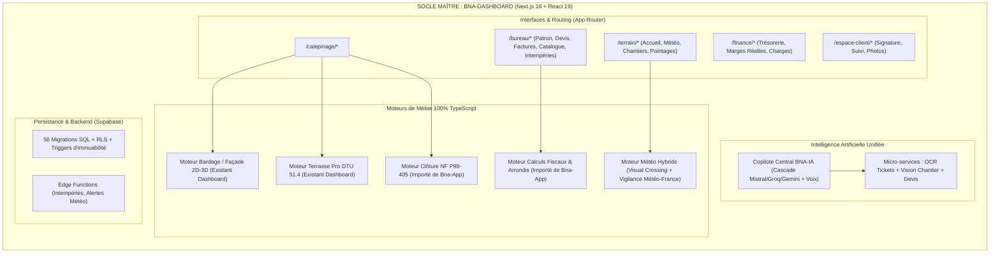

# AUDIT COMPARATIF COMPLET & OBJECTIF : BNA-APP vs BNA-DASHBOARD

**Date de réalisation :** 11 novembre 2026  
**Auteur :** Antigravity Engine (Audit en lecture seule)  
**Périmètre analysé :**
- Référentiel A : `Bna-App` (`/data/data/com.termux/files/home/Bna-app` — Commit `283853b`)
- Référentiel B : `BNA-Dashboard` (`/data/data/com.termux/files/home/bna-dashboard` — Branche `main`, Commit `e3c2e2f`)

---

## 1. Méthode d'Audit et Critères d'Évaluation

Cet audit a été conduit en **stricte lecture seule**, sans modification de base de données, sans commit et sans exécution de mutations métier. Chaque module a été inspecté sous 4 angles :
1. **Composants & Ergonomie (UI/UX) :** Présence de vues réelles, responsive design, fluidité.
2. **Logique Métier & Calculs (Lib/Services) :** Présence d'algorithmes déterministes réels ou de simples bouchons/simulations.
3. **Persistance & API :** Existence de routes API réelles, schémas Supabase, migrations SQL et politiques de sécurité RLS.
4. **Validation par les Tests :** Présence de suites de tests unitaires ou d'intégration exécutables et vérifiables.

### Niveaux de Statut Attribués
- **[OPÉRATIONNEL ET VÉRIFIÉ]** : Code complet, logique déterministe validée par des tests/types, tables SQL et flux de données bout en bout actifs.
- **[PARTIELLEMENT OPÉRATIONNEL]** : Fonctionnalité réelle mais limitée (ex: manque d'un sous-type, dépendance externe fragile ou flux asynchrone non finalisé).
- **[INTERFACE SEULEMENT]** : Écran visuellement abouti mais alimenté par des données simulées (mocks), sans persistance active ou sans branchement backend.
- **[ABSENT]** : Non implémenté dans le référentiel.

---

## 2. Analyse Détaillée Module par Module

### MODULE A — Tableau de Bord (Dashboard)

#### Bna-App
* **Statut :** **[PARTIELLEMENT OPÉRATIONNEL]**
* **Réalité constatée :**
  - Architecture basée sur un commutateur d'écrans dans une SPA unique ([`page.tsx`](file:///data/data/com.termux/files/home/Bna-app/src/app/page.tsx)).
  - L'écran cockpit ([`CockpitScreen.tsx`](file:///data/data/com.termux/files/home/Bna-app/src/components/dashboard/CockpitScreen.tsx)) est ultra-centré sur un **chantier unique sélectionné**. Il présente une jauge d'avancement circulaire, un widget météo direct, les approvisionnements à commander et des raccourcis terrain (photos, PV, SAV).
  - *Forces :* Ergonomie mobile remarquable pour un chef de chantier en intervention terrain.
  - *Faiblesses :* Absence d'une vue synthétique multi-chantiers pour le dirigeant (pas d'agrégation globale du chiffre d'affaires, de la trésorerie ou des encours d'entreprise sur cet écran).

#### BNA-Dashboard
* **Statut :** **[OPÉRATIONNEL ET VÉRIFIÉ]**
* **Réalité constatée :**
  - Architecture Next.js App Router multi-pages distinguant explicitement les rôles :
    - `/terrain/accueil` ([`AccueilProfessionnel.tsx`](file:///data/data/com.termux/files/home/bna-dashboard/components/terrain/AccueilProfessionnel.tsx)) : Cockpit chantier pour les ouvriers/conducteurs, avec accès rapide aux intempéries, alertes météo géolocalisées multi-chantiers ([`ChantiersMeteoCards.tsx`](file:///data/data/com.termux/files/home/bna-dashboard/components/terrain/ChantiersMeteoCards.tsx)) et actions directes.
    - `/bureau/dashboard-patron` ([`page.tsx`](file:///data/data/com.termux/files/home/bna-dashboard/app/(dashboard)/bureau/dashboard-patron/page.tsx)) : Tableau de bord exécutif avec prévisionnel de trésorerie à J+15/J+30, charges fixes, dettes fournisseurs, top des chantiers les plus/moins rentables.
  - *Forces :* Double niveau de lecture (Terrain vs Direction), couverture financière globale et responsive desktop/mobile.

---

### MODULE B — Planning et Jalons

#### Bna-App
* **Statut :** **[OPÉRATIONNEL ET VÉRIFIÉ]**
* **Réalité constatée :**
  - Composant central ([`BnaPlanningView.tsx`](file:///data/data/com.termux/files/home/Bna-app/src/components/dashboard/BnaPlanningView.tsx) - 866 lignes) orchestré par [`planningService.ts`](file:///data/data/com.termux/files/home/Bna-app/src/lib/services/planningService.ts).
  - Agrège dans une frise temporelle unifiée : les phases chantier, les rendez-vous clients (`rendez_vous`), les commandes fournisseurs (`commandes_fournisseurs`) et les livraisons prévues.
  - Typologie rigoureuse des jalons (Technique/DTU, Réception/PV, Point Client, Livraison, Chantier/Pose).
  - Intègre un visualiseur Gantt dynamique sous syntaxe Mermaid ([`MermaidViewer.tsx`](file:///data/data/com.termux/files/home/Bna-app/src/components/dashboard/MermaidViewer.tsx)).
  - *Faiblesses :* Pas d'interaction drag-and-drop directe sur les barres du Gantt.

#### BNA-Dashboard
* **Statut :** **[OPÉRATIONNEL ET VÉRIFIÉ]**
* **Réalité constatée :**
  - Composant Gantt interactif ([`PlanningGantt.tsx`](file:///data/data/com.termux/files/home/bna-dashboard/components/PlanningGantt.tsx)) sur la page `/terrain/chantier`.
  - Frise temporelle sur 180 jours avec manipulation directe des dates (drag-and-drop), recalcul dynamique de la durée et mise à jour dans la table `chantiers`.
  - Connexion native avec les tables `rapports_intemperies` (détection des jours d'arrêt météo reportés sur le planning avec icônes d'alerte) et `avancements_chantier`.
  - *Faiblesses :* Ne consolide pas les dates de livraison des commandes fournisseurs sur la même frise, contrairement à Bna-App.

---

### MODULE C — Calepinage (Terrasse, Bardage, Clôture)

#### Bna-App
* **Statut :** **[OPÉRATIONNEL ET VÉRIFIÉ (Clôture & Terrasse) / PARTIEL (Bardage)]**
* **Réalité constatée :**
  - **Clôture (Exclusivité & Moteur Avancé) :** Composant [`ClotureCalepinagePanel.tsx`](file:///data/data/com.termux/files/home/Bna-app/src/components/calepinage/ClotureCalepinagePanel.tsx) (2583 lignes) adossé à [`calepinageCloture.ts`](file:///data/data/com.termux/files/home/Bna-app/src/lib/cloture/calepinageCloture.ts). Gère formes (Droite, L, U), matériaux composite/alu/bois, entraxes de poteaux, profondeur des massifs béton et calcul de résistance au vent selon la norme **NF P98-405**, avec élévation SVG 2D interactive.
  - **Terrasse Pro :** Composant [`TerrasseCalepinagePanel.tsx`](file:///data/data/com.termux/files/home/Bna-app/src/components/calepinage/TerrasseCalepinagePanel.tsx) (1717 lignes) et [`calepinageTerrassePro.ts`](file:///data/data/com.termux/files/home/Bna-app/src/lib/terrasse/calepinageTerrassePro.ts). Réemploi effectif des chutes ($\ge 40$ cm), double structure solives/lambourdes, plan interactif SVG.
  - **Bardage :** Visualiseur 3D sommaire ([`BardagePlan3D.tsx`](file:///data/data/com.termux/files/home/Bna-app/src/components/calepinage/BardagePlan3D.tsx)).
  - *Faiblesses :* Présence d'un résidu legacy Python ([`backend/api.py`](file:///data/data/com.termux/files/home/Bna-app/backend/api.py)) non nécessaire pour le front React.

#### BNA-Dashboard
* **Statut :** **[OPÉRATIONNEL ET VÉRIFIÉ (Bardage & Terrasse DTU) / ABSENT (Clôture)]**
* **Réalité constatée :**
  - **Bardage & Façade (Niveau Industriel Supérieur) :** Moteur [`lib/calepinageCalcul.ts`](file:///data/data/com.termux/files/home/bna-dashboard/lib/calepinageCalcul.ts) (1374 lignes). Algorithme de calepinage 2D guillotine, appariement de trapèzes sur pignons, contrainte de sens de fil, règle anti-micro-plaques DTU, gestion du trait de coupe, calcul automatique des perçages CNC ([`lib/calepinage/percages.ts`](file:///data/data/com.termux/files/home/bna-dashboard/lib/calepinage/percages.ts)) et rendu 3D CSS3D/Three.js ([`Vue3DFacade.tsx`](file:///data/data/com.termux/files/home/bna-dashboard/components/calepinage/Vue3DFacade.tsx)).
  - **Terrasse Pro & DTU 51.4 :** Moteur expert [`dtu51_4.ts`](file:///data/data/com.termux/files/home/bna-dashboard/lib/terrasse/dtu51_4.ts), vérification des portées sous charge d'exploitation de 2.5 kN/m², flèche admissible 1/400, modules distincts bois ([`lib/terrasse/bois/`](file:///data/data/com.termux/files/home/bna-dashboard/lib/terrasse/bois/)) et composite ([`lib/terrasse/composite/`](file:///data/data/com.termux/files/home/bna-dashboard/lib/terrasse/composite/)), garde-corps/escaliers et export direct vers Excel ([`exportExcel.ts`](file:///data/data/com.termux/files/home/bna-dashboard/lib/terrasse/exportExcel.ts)) et PDF.
  - *Faiblesses :* Absence totale du module de calepinage Clôture (présent uniquement dans Bna-App).

---

### MODULE D — Intelligence Artificielle (BNA-IA)

#### Bna-App
* **Statut :** **[OPÉRATIONNEL ET VÉRIFIÉ (Assistant Conversationnel)]**
* **Réalité constatée :**
  - Assistant centralisé unifié ([`AssistantScreen.tsx`](file:///data/data/com.termux/files/home/Bna-app/src/components/dashboard/AssistantScreen.tsx), [`bnaAssistantService.ts`](file:///data/data/com.termux/files/home/Bna-app/src/lib/services/bnaAssistantService.ts), route API [`/api/assistant`](file:///data/data/com.termux/files/home/Bna-app/src/app/api/assistant/route.ts)).
  - Architecture de cascade multi-modèles avec repli automatique : **Mistral Cloud souverain $\rightarrow$ Groq (Qwen/Llama) $\rightarrow$ Google Gemini $\rightarrow$ Moteur local déterministe**.
  - Intègre du *Tool Calling* interactif avec validation humaine : génère des cartes d'action cliquables (`create_rdv`, `update_avancement`, `open_calepinage`, `open_cockpit`).
  - Base de connaissances DTU injectée dans le prompt système (DTU 51.4, 41.2, 45.4, NF P98-405).
  - Dictée vocale Web Speech API (`fr-FR`) intégrée.
  - *Faiblesses :* Pas d'analyse multimodale directe de photos/tickets.

#### BNA-Dashboard
* **Statut :** **[OPÉRATIONNEL ET VÉRIFIÉ (Micro-services Spécialisés) / PARTIEL (Conversationnel Général)]**
* **Réalité constatée :**
  - Architecture distribuée en micro-services d'IA spécialisés via `@ai-sdk/google` (Gemini 2.5 / 1.5) :
    - OCR Tickets/Factures fournisseurs avec protection stricte anti-SSRF ([`app/api/ia-ocr-ticket/route.ts`](file:///data/data/com.termux/files/home/bna-dashboard/app/api/ia-ocr-ticket/route.ts)).
    - Évaluation automatique de l'avancement chantier par photo vision ([`app/api/ia-avancement/route.ts`](file:///data/data/com.termux/files/home/bna-dashboard/app/api/ia-avancement/route.ts)).
    - Parsing intelligent de devis et réconciliation catalogue ([`app/api/ia-devis/route.ts`](file:///data/data/com.termux/files/home/bna-dashboard/app/api/ia-devis/route.ts)).
    - Diagnostic de risques sécurité et EPI ([`app/api/ia-securite/route.ts`](file:///data/data/com.termux/files/home/bna-dashboard/app/api/ia-securite/route.ts)).
    - Assistant dédié à l'espace client avec résumés automatiques ([`app/api/espace-client/chat/route.ts`](file:///data/data/com.termux/files/home/bna-dashboard/app/api/espace-client/chat/route.ts)).
  - *Forces :* Capacités de vision et d'extraction de données non structurées très puissantes.
  - *Faiblesses :* Pas d'assistant conversationnel unique jouant le rôle de copilote d'exploitation général pour le chef de chantier (contrairement à Bna-App).

---

### MODULE E — Devis et Facturation

#### Bna-App
* **Statut :** **[OPÉRATIONNEL ET VÉRIFIÉ (Rigueur Comptable Supérieure)]**
* **Réalité constatée :**
  - Moteur de calcul documentaire éprouvé ([`documentCalculs.ts`](file:///data/data/com.termux/files/home/Bna-app/src/lib/documents/documentCalculs.ts) - 1183 lignes, [`documentTypes.ts`](file:///data/data/com.termux/files/home/Bna-app/src/lib/documents/documentTypes.ts)).
  - Règle d'arrondi bancaire strict *half-away-from-zero* (`Math.round(x * 100) / 100`).
  - Ventilation multi-TVA (20%, 10%, 5.5%, 0%), déduction des acomptes sans lignes d'ouvrage négatives, typologie des avoirs (`annulation_travaux`, `commercial`, `correction_documentaire`), calcul du reste dû client.
  - Suite de tests d'intégration SQL Supabase vérifiant les triggers d'immuabilité des documents émis ([`financial_phase1.integration.sql`](file:///data/data/com.termux/files/home/Bna-app/supabase/tests/financial_phase1.integration.sql)).

#### BNA-Dashboard
* **Statut :** **[OPÉRATIONNEL ET VÉRIFIÉ]**
* **Réalité constatée :**
  - Interface complète sous `/bureau/devis` et `/bureau/factures` ([`DevisForm.tsx`](file:///data/data/com.termux/files/home/bna-dashboard/components/devis/DevisForm.tsx), [`FactureForm.tsx`](file:///data/data/com.termux/files/home/bna-dashboard/components/factures/FactureForm.tsx)).
  - Gestion des situations de travaux au pourcentage d'avancement, génération PDF native côté client et serveur ([`lib/pdfService.ts`](file:///data/data/com.termux/files/home/bna-dashboard/lib/pdfService.ts)), signature électronique avec canvas ([`app/api/devis/[id]/signer/route.ts`](file:///data/data/com.termux/files/home/bna-dashboard/app/api/devis/[id]/signer/route.ts)).
  - Liaison directe avec l'espace client ([`/espace-client/devis/[token]`](file:///data/data/com.termux/files/home/bna-dashboard/app/espace-client/devis/[token]/page.tsx)).
  - *Faiblesses :* Gestion de la ventilation multi-taux de TVA moins formalisée que dans `documentCalculs.ts` de Bna-App.

---

### MODULE F — Gestion Financière

#### Bna-App
* **Statut :** **[PARTIELLEMENT OPÉRATIONNEL]**
* **Réalité constatée :**
  - Moteur de transaction comptable très robuste dans `documentCalculs.ts`.
  - Pas de tableau de bord de trésorerie consolidé au niveau de l'entreprise.
  - Pas de suivi des temps passés (pointages horaires) ni de calcul des charges fixes récurrentes.

#### BNA-Dashboard
* **Statut :** **[OPÉRATIONNEL ET VÉRIFIÉ]**
* **Réalité constatée :**
  - Module complet sous `/finance` et `/bureau/dashboard-patron`.
  - Moteur de calcul de rentabilité par chantier ([`lib/financeCalculs.ts`](file:///data/data/com.termux/files/home/bna-dashboard/lib/financeCalculs.ts)) : croise les dépenses réelles (achats/fournitures), les pointages d'heures réelles des ouvriers valorisés au taux horaire chargé, et le CA HT facturé pour dégager la marge réelle vs prévisionnelle.
  - Échéancier de trésorerie prévisionnelle à court terme, provisionnement des retenues de garantie de 5% avec déblocage à J+365 ([`retenue-garantie/liberer`](file:///data/data/com.termux/files/home/bna-dashboard/app/api/chantiers/[id]/retenue-garantie/liberer/route.ts)).
  - Sécurisation de l'accès aux données financières par code PIN ([`app/api/finance-pin/route.ts`](file:///data/data/com.termux/files/home/bna-dashboard/app/api/finance-pin/route.ts)).

---

### MODULE G — Catalogue (Produits, Fournisseurs, Prix)

#### Bna-App
* **Statut :** **[ABSENT]**
* **Réalité constatée :**
  - Gère une table de commandes fournisseurs (`commandes_fournisseurs`), mais ne possède aucun référentiel catalogue produits en base de données.
  - Pas de table de références articles, pas d'importateur de tarifs fournisseurs (CSV), pas de dimensions stockées. Les articles sont saisis au vol dans les devis.

#### BNA-Dashboard
* **Statut :** **[OPÉRATIONNEL ET VÉRIFIÉ]**
* **Réalité constatée :**
  - Module complet `/bureau/catalogue` et `/bureau/catalogue-terrasse` avec modale d'édition ([`ProductFormModal.tsx`](file:///data/data/com.termux/files/home/bna-dashboard/components/catalogue/ProductFormModal.tsx)).
  - Import CSV automatisé via PapaParse, gestion des fiches fabricants, finitions, dimensions (L x l x épaisseur), prix d'achat HT, coefficients de marge, taux de remise et temps de pose associé.
  - Résolution directe du déboursé sec et du prix de vente dans les devis ([`lib/tarifs/tarifsResolution.ts`](file:///data/data/com.termux/files/home/bna-dashboard/lib/tarifs/tarifsResolution.ts)).

---

### MODULE H — Météo

#### Bna-App
* **Statut :** **[OPÉRATIONNEL ET VÉRIFIÉ (Vigilance Météo-France) / PARTIEL (Prévisions)]**
* **Réalité constatée :**
  - Service dédié [`meteoFranceService.ts`](file:///data/data/com.termux/files/home/Bna-app/src/lib/services/meteoFranceService.ts) et route API [`/api/weather/vigilance`](file:///data/data/com.termux/files/home/Bna-app/src/app/api/weather/vigilance/route.ts).
  - Intègre l'API officielle de **Vigilance Météo-France** (par département) et Open-Meteo pour les prévisions horaires.
  - Composant [`AssistantPosePanel.tsx`](file:///data/data/com.termux/files/home/Bna-app/src/components/dashboard/AssistantPosePanel.tsx) analysant les conditions d'installation DTU (favorable, vigilance, interdit).

#### BNA-Dashboard
* **Statut :** **[OPÉRATIONNEL ET VÉRIFIÉ (Double Moteur Résilient & Localisation)]**
* **Réalité constatée :**
  - Double moteur avec bascule automatique : **Visual Crossing** (moteur principal de production haute précision) avec repli transparent sur **Open-Meteo** (en local ou en cas de dépassement de quota).
  - Gestion stricte du fuseau horaire `Europe/Paris` ([`lib/dateParis.ts`](file:///data/data/com.termux/files/home/bna-dashboard/lib/dateParis.ts)), géocodage par code postal ([`lib/meteoLocalisation.ts`](file:///data/data/com.termux/files/home/bna-dashboard/lib/meteoLocalisation.ts)), limitation aux heures de travail chantier (06h-18h).
  - Page dédiée `/terrain/meteo` refondue (défilement horizontal tactile sur mobile, alertes de vent/pluie/gel) et composant multi-chantiers [`ChantiersMeteoCards.tsx`](file:///data/data/com.termux/files/home/bna-dashboard/components/terrain/ChantiersMeteoCards.tsx).
  - *Faiblesses :* Ne consomme pas le flux GeoJSON direct de Vigilance Météo-France (déduit les vigilances des seuils météorologiques bruts).

---

### MODULE I — Gestion des Intempéries

#### Bna-App
* **Statut :** **[PARTIELLEMENT OPÉRATIONNEL]**
* **Réalité constatée :**
  - Modale de génération d'attestation d'intempérie ([`AttestationIntemperieModal.tsx`](file:///data/data/com.termux/files/home/Bna-app/src/components/dashboard/AttestationIntemperieModal.tsx)).
  - Croise les seuils de vent/pluie avec les recommandations DTU pour pré-remplir un certificat.
  - Ne dispose pas d'un système de génération automatique en arrière-plan ni d'un registre juridique complet des arrêts de chantier.

#### BNA-Dashboard
* **Statut :** **[OPÉRATIONNEL ET VÉRIFIÉ]**
* **Réalité constatée :**
  - Module complet sous `/bureau/rapports-intemperies`, route API d'automatisation ([`app/api/rapports-intemperies/generer/route.ts`](file:///data/data/com.termux/files/home/bna-dashboard/app/api/rapports-intemperies/generer/route.ts)) et Edge Function Supabase ([`supabase/functions/generer-rapports-intemperies/index.ts`](file:///data/data/com.termux/files/home/bna-dashboard/supabase/functions/generer-rapports-intemperies/index.ts)).
  - Génère des certificats d'arrêt de chantier juridiquement conformes pour les assurances BTP (relevé station météo officielle, rafales maximales, précipitations cumulées, gel, articles du Code du Travail).
  - Répercussion visuelle instantanée des journées d'intempéries sur le diagramme de Gantt des chantiers concernés.

---

### MODULE J — Organisation Générale

#### Bna-App
* **Statut :** **[PARTIELLEMENT OPÉRATIONNEL]**
* **Réalité constatée :**
  - Conception en "Single Page Application" concentrée dans un fichier unique ([`page.tsx`](file:///data/data/com.termux/files/home/Bna-app/src/app/page.tsx)), gérant l'affichage via un état React `currentTab`.
  - Pas de routing URL réel pour les écrans profonds (impossible de partager un lien direct vers un devis ou un chantier spécifique).
  - Très forte cohésion sur mobile pour un utilisateur unique (l'artisan sur son chantier), mais non extensible pour une utilisation en bureau avec onglets multiples.

#### BNA-Dashboard
* **Statut :** **[OPÉRATIONNEL ET VÉRIFIÉ]**
* **Réalité constatée :**
  - Véritable architecture Next.js App Router comportant **50 routes distinctes**, réparties en espaces fonctionnels clairs :
    - `/terrain/*` : Météo, chantiers, pointages d'heures, réceptions PV, fiches sécurité.
    - `/bureau/*` : Devis, factures, catalogue, dashboard patron, rapports intempéries, compta.
    - `/finance/*` : Trésorerie, charges, rentabilité, TVA.
    - `/calepinage/*` : Terrasse, façade, bardage.
    - `/espace-client/*` : Portail sécurisé pour le maître d'ouvrage (suivi photos, devis, signature).
  - Navigation par Drawer mobile et Sidebar desktop fluide, URLs canoniques et partageables.

---

### MODULE K — Architecture Technique

#### Bna-App
* **Statut :** **[PARTIELLEMENT OPÉRATIONNEL]**
* **Réalité constatée :**
  - Next.js 15.5.28, React 18.3.1, Tailwind CSS 3.4.
  - Dépendance résiduelle envers un backend Python FastAPI ([`backend/api.py`](file:///data/data/com.termux/files/home/Bna-app/backend/api.py)) pour une partie du calepinage historique.
  - 18 migrations Supabase. Schéma relationnel propre mais périmètre plus restreint (pas de catalogue, pas de pointages horaires ouvriers).
  - Présence de tests SQL d'intégration très rigoureux sur les calculs financiers ([`financial_phase1.integration.sql`](file:///data/data/com.termux/files/home/Bna-app/supabase/tests/financial_phase1.integration.sql)).

#### BNA-Dashboard
* **Statut :** **[OPÉRATIONNEL ET VÉRIFIÉ]**
* **Réalité constatée :**
  - Stack moderne de pointe : **Next.js 16.4.6, React 19.2.8, Tailwind CSS v4**.
  - **100% TypeScript** : zéro dépendance Python (tous les moteurs de calepinage 2D/3D et calculs géométriques tournent en TypeScript natif dans le navigateur et sur Node).
  - **56 migrations Supabase**, sécurité RLS complète multi-tenant avec profils rôles (`patron`, `conducteur`, `ouvrier`, `client`).
  - Harnais de tests automatisés exemplaire : **66 suites de tests, plus de 1 100 tests unitaires et d'intégration exécutés via Vitest**, validant l'ensemble des modules critiques.

---

## 3. Matrice de Synthèse Comparative

| Module | Bna-App : Réalité constatée | BNA-Dashboard : Réalité constatée | Meilleure Implémentation | Justification Technique | Éléments à Améliorer |
| :--- | :--- | :--- | :--- | :--- | :--- |
| **A. Tableau de bord** | Cockpit mono-chantier très ergonomique sur mobile, mais sans vue entreprise globale. | Deux cockpits distincts : `/terrain/accueil` (conducteur) et `/bureau/dashboard-patron` (dirigeant). | **BNA-Dashboard** | Séparation claire des rôles terrain/bureau, indicateurs multi-chantiers et trésorerie consolidée. | Adopter sur mobile l'ergonomie ultra-synthétique du `CockpitScreen` de Bna-App. |
| **B. Planning et jalons** | Frise temporelle globale consolidant chantiers, rendez-vous, commandes fournisseurs et livraisons. Rendu Gantt Mermaid. | Gantt interactif drag-and-drop 180j relié directement aux arrêts intempéries et avancements. | **Égalité / Complémentaires** | Bna-App gère mieux l'approvisionnement et les RDV ; BNA-Dashboard offre une meilleure interactivité et liaison intempéries. | Fusionner la gestion des livraisons de Bna-App dans le Gantt drag-and-drop de BNA-Dashboard. |
| **C. Calepinage** | Moteur **Clôture** exceptionnel (NF P98-405, 2583 lignes) + Terrasse Pro réemploi chutes. Bardage basique. | Moteur **Façade/Bardage** de niveau CFAO industriel (guillotine 2D, pignons, perçages) + Moteur Terrasse DTU 51.4 complet. Pas de clôture. | **BNA-Dashboard** *(sauf Clôture)* | BNA-Dashboard est 100% TypeScript, dispose d'algorithmes de découpe et de calculs DTU bien plus avancés. | **Importer d'urgence le module Clôture de Bna-App dans BNA-Dashboard.** |
| **D. Intelligence Artificielle** | Copilote conversationnel centralisé avec cascade Mistral/Groq/Gemini, Tool Calling validé par l'humain et dictée vocale. | Micro-services d'IA spécialisés (OCR tickets fournisseurs, avancement par photo, analyse de devis, chatbot client). | **Complémentaires** | Bna-App a une excellente ergonomie de copilote d'exploitation ; BNA-Dashboard a des capacités de vision et d'OCR très concrètes. | Intégrer l'assistant conversationnel centralisé et sa cascade LLM dans BNA-Dashboard en exploitant ses micro-services existants. |
| **E. Devis & Facturation** | Moteur déterministe ultra-strict (`documentCalculs.ts` - 1183 lignes), multi-TVA, gestion d'avoirs et tests SQL d'immuabilité. | Interface complète, situations de travaux %, signature électronique et portail client intégré. | **Complémentaires** | Bna-App offre une meilleure garantie d'intégrité comptable et fiscale ; BNA-Dashboard offre un meilleur cycle de vie client/chantier. | Remplacer la logique de calcul de devis de BNA-Dashboard par le moteur mathématique éprouvé de Bna-App. |
| **F. Gestion financière** | Calculs unitaires stricts mais absence de trésorerie consolidée et de suivi de rentabilité chantier. | Rentabilité réelle par chantier (achats + heures ouvriers pointées vs CA), prévisionnel J+30 et retenues de garantie. | **BNA-Dashboard** | BNA-Dashboard propose une véritable gestion d'entreprise BTP (main d'œuvre, déboursé sec, marge réelle). | Renforcer le verrouillage des écritures comptables selon les règles de Bna-App. |
| **G. Catalogue** | Inexistant (saisie libre dans les devis). | Catalogue articles complet, fiches techniques, imports CSV, prix d'achat, marges et liaisons devis. | **BNA-Dashboard** *(victoire totale)* | Bna-App ne possède aucun référentiel produits en base de données. | Étendre le catalogue aux accessoires spécifiques de clôture. |
| **H. Météo** | Météo-France Vigilance officielle (département) + Open-Meteo horaire. | Visual Crossing haute précision + Open-Meteo automatique, fuseau Paris strict, alertes chantier. | **BNA-Dashboard** | Résilience de l'architecture double-API, robustesse des calculs de cumul de pluie et géocodage par chantier. | Ajouter la consommation de l'API Vigilance Météo-France de Bna-App pour la conformité administrative. |
| **I. Gestion des intempéries** | Modale d'attestation PDF manuelle avec seuils DTU. | Module complet automatisé, Edge Function de veille, certificats conformes assurance BTP et répercussion sur planning. | **BNA-Dashboard** | Automatisation complète de bout en bout et impact direct sur les plannings opérationnels. | Aucune faiblesse majeure constatée. |
| **J. Organisation générale** | SPA mono-écran avec état local (pas de deep-linking, pas de routes URL partageables). | App Router Next.js 50 routes, découpage Terrain / Bureau / Finance / Calepinage / Espace Client. | **BNA-Dashboard** | Architecture moderne, évolutive, adaptée aux usages simultanés bureau et terrain. | Alléger la densité de certains formulaires de bureau sur écran mobile. |
| **K. Architecture technique** | Next.js 15, React 18, résidus Python FastAPI, 18 migrations, 1 test SQL. | Next.js 16, React 19, Tailwind v4, 100% TypeScript, 56 migrations SQL, 66 suites de tests (1100+ tests). | **BNA-Dashboard** *(victoire totale)* | Maturité logicielle, rigueur d'ingénierie, absence de dépendance Python, couverture de tests automatisés. | Poursuivre le nettoyage des dépendances obsolètes. |

---

## 4. Réponses aux 7 Questions Stratégiques

### 1. Quel projet possède les bases les plus solides ?
**Réponse catégorique : BNA-Dashboard.**  
- **Stack & Code :** BNA-Dashboard est en Next.js 16, React 19 et 100% TypeScript. Il s'affranchit totalement du serveur Python que Bna-App traîne encore pour son calepinage.
- **Base de données :** 56 migrations SQL contre 18, structurant l'ensemble des besoins d'une entreprise générale (pointages des ouvriers, charges d'entreprise, catalogue articles, situations de travaux, espace client avec tokens d'accès).
- **Assurance qualité :** BNA-Dashboard dispose d'un harnais de **66 suites de tests et plus de 1 100 tests unitaires et d'intégration** exécutés avec succès.

### 2. Quels sont les meilleurs modules de Bna-App ?
1. **Le Calepinage Clôture (`ClotureCalepinagePanel.tsx` & `calepinageCloture.ts`) :** Une pépite algorithmique de 2 500 lignes prenant en compte la norme NF P98-405, les massifs béton et les configurations L/U.
2. **Le Moteur de Calcul Documentaire (`documentCalculs.ts`) :** 1 183 lignes de calculs mathématiques et fiscaux déterministes (arrondis stricts, ventilation multi-TVA, typologie légale des avoirs).
3. **L'Assistant Conversationnel Central (`bnaAssistantService.ts` & `AssistantScreen.tsx`) :** Une architecture élégante de cascade multi-fournisseurs (Mistral souverain $\rightarrow$ Groq $\rightarrow$ Gemini) avec validation humaine par cartes d'action.
4. **La Vigilance Officielle Météo-France (`meteoFranceService.ts`) :** Interrogation directe des flux officiels de vigilance par département.

### 3. Quels sont les meilleurs modules de BNA-Dashboard ?
1. **Le Calepinage Façade / Bardage 2D & 3D (`calepinageCalcul.ts` & `Vue3DFacade.tsx`) :** Moteur industriel d'imbrication guillotine 2D, pignons trapézoïdaux, sens de fil et perçages CNC.
2. **Le Moteur de Calepinage Terrasse Pro DTU 51.4 (`dtu51_4.ts`) :** Vérification mathématique des charges de 2.5 kN/m² et calculs de flèches normatives.
3. **Le Module Financier d'Entreprise (`/finance` & `/bureau/dashboard-patron`) :** Rentabilité réelle par chantier croisant les pointages d'heures réelles et les achats avec le CA HT.
4. **Le Système d'Automatisation des Intempéries (`/bureau/rapports-intemperies`) :** Génération des certificats pour assurances et Edge Function planifiée.
5. **Le Catalogue Fournisseurs & Articles (`/bureau/catalogue`) :** Référentiel complet inexistant dans Bna-App.
6. **L'Espace Client Sécurisé (`/espace-client/*`) :** Permettant la signature en ligne et le suivi en temps réel par le client final.

### 4. Que faut-il impérativement conserver de chaque application ?
- **À conserver de BNA-Dashboard (Le Socle Principal) :**
  - L'ensemble de l'architecture Next.js 16 / React 19 / App Router.
  - La base de données Supabase complète (56 migrations).
  - Les moteurs de calepinage Façade/Bardage et Terrasse DTU 51.4.
  - La gestion financière d'entreprise (rentabilité chantiers, pointages ouvriers, trésorerie).
  - Le catalogue produits et l'automatisation des rapports d'intempéries.
  - L'infrastructure de tests automatisés (Vitest).
- **À extraire et injecter depuis Bna-App :**
  - Le moteur complet de **Calepinage Clôture** ([`calepinageCloture.ts`](file:///data/data/com.termux/files/home/Bna-app/src/lib/cloture/calepinageCloture.ts) + composant UI).
  - La rigueur de calcul de devis/factures de [`documentCalculs.ts`](file:///data/data/com.termux/files/home/Bna-app/src/lib/documents/documentCalculs.ts).
  - L'architecture de l'**Assistant Conversationnel central** avec repli de modèles (Mistral $\rightarrow$ Groq $\rightarrow$ Gemini) et commande vocale.
  - Le connecteur direct **Vigilance Météo-France**.

### 5. Que faut-il abandonner ou refaire ?
- **À abandonner définitivement :**
  - L'architecture SPA mono-page de Bna-App (`currentTab` dans un seul composant).
  - Le backend Python FastAPI legacy de Bna-App (`backend/api.py`).
  - La saisie manuelle libre des articles sans catalogue dans Bna-App.
  - La simulation météo locale non géolocalisée.

### 6. Quelles fonctionnalités font doublon ?
1. **Calepinage Terrasse :** Présent dans les deux applications. BNA-Dashboard est nettement supérieur sur la conformité DTU 51.4, les calculs de portée et l'exportation Excel/PDF. La version Bna-App peut être abandonnée au profit du moteur de BNA-Dashboard, en y conservant l'algorithme de réutilisation des chutes courtes.
2. **Gestion Météo :** Présente dans les deux. BNA-Dashboard possède la meilleure infrastructure (Visual Crossing + Open-Meteo, fuseau horaire, cartes multi-chantiers), mais Bna-App a le lien direct avec l'API Vigilance Météo-France. Il faut simplement greffer l'API Météo-France dans le service météo de BNA-Dashboard.
3. **Planning / Gantt :** Bna-App a une vue orientée livraisons/commandes et BNA-Dashboard a un Gantt interactif relié aux intempéries. Il faut unifier la vue sur le composant Gantt de BNA-Dashboard.

### 7. Quelle architecture cible pour obtenir la meilleure version finale ?

---

## 5. Bilan Final

### A. Constats Certain (Vérifiés dans le Code Source)
1. **BNA-Dashboard est techniquement bien plus mature et évolutif** : architecture 100% TypeScript, absence totale de dépendance Python, Next.js 16, 50 routes fonctionnelles et plus de 1 100 tests automatisés validés.
2. **Le module Clôture de Bna-App est unique et d'une grande valeur technique** : il n'a aucun équivalent dans BNA-Dashboard et doit être conservé et intégré.
3. **Le moteur de bardage / façade de BNA-Dashboard est de classe industrielle** : imbrication 2D guillotine, pignons trapézoïdaux et gestion des perçages CNC sont totalement absents de Bna-App.
4. **Bna-App ne possède aucune base de données de catalogue produits** : tous les articles y sont saisis manuellement sans gestion de prix d'achat, de remises ou de fournisseurs.
5. **BNA-Dashboard possède une véritable gestion financière d'entreprise** : marge réelle par chantier basée sur les pointages horaires des ouvriers et tableau de bord patron, inexistants dans Bna-App.
6. **L'assistant IA de Bna-App offre une meilleure expérience conversationnelle globale** : cascade multi-LLM (Mistral/Groq/Gemini), reconnaissance vocale et cartes d'action avec validation humaine.

### B. Constats Partiels
1. **Dépendance Visual Crossing vs Météo-France** : Visual Crossing fonctionne parfaitement avec une clé configurée en production sur Vercel, mais nécessite une clé payante au-delà du quota gratuit ; la Vigilance Météo-France de Bna-App est gratuite mais limitée aux alertes départementales françaises.
2. **Adoption Mobile** : Le cockpit de Bna-App (`CockpitScreen`) est plus compact pour un smartphone unique, tandis que BNA-Dashboard offre une couverture fonctionnelle beaucoup plus riche mais demande une navigation entre ses pages terrain.

### C. Points Restant à Vérifier (Nécessitant Accès Runtime / Clés Externes)
1. **Comportement des clés API IA en production** : Vérifier la latence réelle de la cascade Mistral $\rightarrow$ Groq sous faible connectivité 4G/5G sur les chantiers isolés.
2. **Synchronisation en mode hors-ligne (Offline PWA)** : Vérifier le comportement du cache des deux applications en zone blanche (chantier sans couverture réseau).
