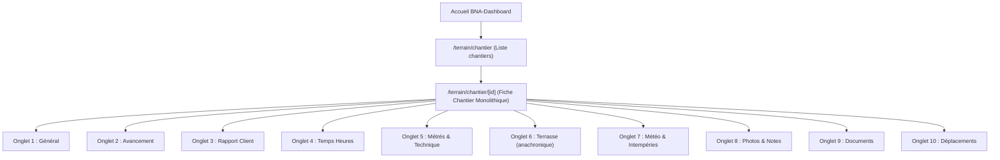
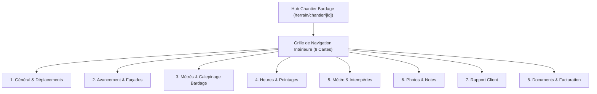

# Audit d'Architecture & Proposition de Refonte — Hub Chantier Bardage

> **Date** : 12 novembre 2026  
> **Contexte** : Refonte visuelle et ergonomique du Hub Chantier Bardage dans **BNA-Dashboard**, en prenant pour référence l'architecture validée du Hub Chantier Terrasse.  
> **Statut** : Phase A (Audit) & Phase B (Proposition d'Organisation) — En attente de validation avant réalisation.

---

## 1. État des Lieux de l'Existant (Hub Bardage Actuel)

### 1.1 Fichiers Maîtres et Routes
* **Page d'accueil / Liste des chantiers** : [app/terrain/chantier/page.tsx](file:///data/data/com.termux/files/home/bna-dashboard/app/terrain/chantier/page.tsx) (531 lignes).
  * Affiche la liste des chantiers (vue liste et vue Gantt), le formulaire de création de chantier et la gestion des dates.
* **Fiche Chantier / Hub Bardage** : [app/terrain/chantier/[id]/page.tsx](file:///data/data/com.termux/files/home/bna-dashboard/app/terrain/chantier/[id]/page.tsx) (1 722 lignes).
  * Actuellement structuré comme un **monolithe** qui charge l'intégralité des données (zones, devis, factures, commandes, météo, pointages, photos, PV) et gère une rangée horizontale de 10 onglets.



---

### 1.2 Analyse Détaillée des 10 Onglets Actuels

| Onglet Actuel | Composants & Logiques Métier Utilisés | Tables Supabase & Services Dépendants | Observations & Inconvénients Actuels |
| :--- | :--- | :--- | :--- |
| **Général** | PPSPS Express IA (`genererSecuriteIA`), statut, adresse Maps, matériau structurel, moyen d'accès, zone de vent, checklist 4 phases, lien PV réception. | `chantiers`, `clients`, API `/api/ia-securite` | Fond sombre opaque, bouton rouge vif, formulaires dispersés. |
| **Avancement** | `<OssaturePosee>` (point d'arrêt ou intempérie du jour) + `<AvancementFacades>` (façades Nord/Sud/Est/Ouest avec dictée vocale IA). | `chantiers`, `journal_chantier`, API speech-to-text | Composant métier très riche mais enfermé sous un onglet horizontal. |
| **Rapport Client** | `<RapportClientWrapper>` -> `<RapportClient>` (synthèse automatisée, météo, photos, envoi client). | `chantiers`, `photos_chantier`, `devis`, `factures` | Composant stable déjà doté d'une `ErrorBoundary`. |
| **Temps Heures** | `<ChantiersCalepinageView>`, `<PointageEquipeView>`, `<TableauDeBordRentabiliteView>`. | `pointages`, `profiles`, `chantiers`, `lib/gaelLogic.ts` | 3 vues empilées très longues verticalement. |
| **Métrés & Technique** | Tiroir configuration technique (`ConfigTechnique`), totaux surfaces, bouton commande quincaillerie, liste `<ZoneCard>` (PlanCalepinage, BardagePlan3D, FicheDebitPDF). | `chantiers`, `chantier_zones`, `chantier_ouvertures`, `catalogue_materiaux` | Cœur du métier Bardage (calculs de surfaces nettes, découpes, ossature). |
| **Terrasse** | `<ChantierTerrasseTab>` | `chantier_terrasses`, `catalogue_terrasse` | **Anomalie d'isolation** : reliquat de l'ancienne version, alors que Terrasse possède désormais son propre Hub (`/terrain/terrasse/[id]`). |
| **Météo & Intempéries**| `fetchMeteo`, alerte vent/hauteur, décision horaire de pose, `<TableauPrecipitations>`, `<RapportsIntemperiesListe>`. | `chantiers`, `rapports_intemperies`, API `/api/meteo` | Cartes sombres historiques avec boutons rouges. |
| **Photos & Notes** | `<PhotosNotes>` (photos avant/pendant/après avec compression canvas, notes terrain, horaires de pose). | `photos_chantier`, `chantiers`, Supabase Storage | Formulaire efficace mais visuellement sombre. |
| **Documents** | Synthèse financière, tables Devis (signature SMS), Factures, PV réception, Retenue de garantie (5%), Commandes fournisseurs. | `devis`, `factures`, `commandes`, `pv_reception`, `comptes_retenue_garantie` | Tableau monolithique imposant dans la page. |
| **Déplacements** | `<FraisDeplacementTab>` (évaluation Nominatim/OSRM, calcul indemnités, liaison devis). | `deplacements_chantier`, `entreprise_settings`, RPC `lier_deplacement_devis` | Isolé dans un onglet séparé alors qu'il concerne la logistique générale. |

---

### 1.3 Identification des Spécificités Métier Bardage (À préserver impérativement)

Contrairement au métier Terrasse (qui repose sur le DTU 51.4, les lambourdes, plots et lames horizontales), le métier Bardage possède ses propres règles strictes :
1. **Réglementation & Normes** : DTU 41.2 (Bardage bois), DTU 45.4 (Isolation thermique par l'extérieur), CPT 3316 et règles feu/vent (Zones 1/2 vs 3/4).
2. **Géométrie des Façades** : Zones de type `facade` ou `pignon` (avec gestion de la hauteur de mur et hauteur de faîte), angles de rives (40 cm), et calcul des ouvertures (portes et fenêtres déduites du métré brut).
3. **Moteurs de Calepinage Bardage** :
   * Lames horizontales / verticales (recouvrement, claire-voie, embrèvement).
   * Panneaux / Plaques composites (optimisation des calepinages et chutes).
   * Rendu visuel technique : `PlanCalepinage` et `BardagePlan3D`.
4. **Ossature et Quincaillerie Bardage** : Calcul des linéaires de chevrons, nombre d'équerres de fixation, chevilles d'ancrage et vis auto-foreuses selon `calculerBesoinsBardage`.
5. **Avancement par Façade** : Découpage par façade géographique (Nord, Sud, Est, Ouest) et par couches successives (Ossature -> Isolation -> Bardage -> Finitions).
6. **Sécurité spécifique aux travaux de façade** : PPSPS Express IA analysant les moyens d'accès en hauteur (échafaudage, nacelle, PIRL) et les risques de chute/vent.

---

### 1.4 Contraintes de Tests & Dépendances Existantes

Plusieurs tests unitaires existants s'appuient sur des conventions de code précises qu'il ne faut pas casser :
* `__tests__/ui/FraisDeplacementTab.test.tsx` : Vérifie que le composant de page lit `entreprise_settings` (`id = 1`) avec `select("adresse, code_postal, ville")` et transmet la prop `adresseDepartDefaut`.
* `__tests__/ia/ia-devis-metre.test.ts` : Vérifie la présence du lien de génération de devis `/bureau/devis-factures?chantier_id=`.
* `__tests__/ui/fond-transparent-opacite.test.ts` : Vérifie l'absence de classe invalide `bg-transparent/<opacité>`.

---

## 2. Architecture Cible Proposée (Harmonisation Hub Terrasse)

### 2.1 Les 8 Modules Cibles du Hub Bardage

Pour éliminer la longue rangée d'onglets (10 onglets) et offrir la même clarté ergonomique que le Hub Terrasse, nous regroupons les fonctionnalités dans **8 modules clairs accessibles par cartes cliquables** :



#### Correspondance et contenu des 8 modules :

1. **Général & Déplacements** (`general`) :
   * Fusion de l'onglet "Général" et de l'onglet "Déplacements" (comme sur Terrasse).
   * Coordonnées chantier, dates, statut, matériau structurel, moyen d'accès, zone de vent.
   * PPSPS Express (Consignes de Sécurité IA).
   * Checklist préparatoire (tasseaux, pare-pluie, pose, finition).
   * Calcul et enregistrement des frais de déplacement / trajets avec liaison devis.
   * Raccourci vers PV de réception fin de chantier.
2. **Avancement & Façades** (`avancement`) :
   * Parcours terrain « Ossature posée » (choix intempéries / choix façade alternative).
   * Suivi d'avancement par façade (Nord, Sud, Est, Ouest) et couches techniques.
   * Dictée vocale IA et calcul du pourcentage global.
3. **Métrés & Calepinage Bardage** (`calepinage`) :
   * Configuration technique persistée (isolant, épaisseur, surface paquet, rives, coef de chute).
   * Synthèse dynamique des surfaces (Façades, Pignons, Ouvertures, Surface nette, À commander).
   * Gestion complète des zones de bardage (`ZoneCard`) : dimensions, matériaux (lames/plaques), ouvertures, `PlanCalepinage`, `BardagePlan3D`, fiches de débit PDF.
   * Générateur de commande quincaillerie (chevrons, équerres, chevilles, vis).
   * Bouton de chiffrage direct vers Devis & Factures.
4. **Heures & Pointages** (`heures`) :
   * Calepinage des temps et cadences (`ChantiersCalepinageView`).
   * Pointage d'équipe par compagnon (`PointageEquipeView`).
   * Tableau de bord de rentabilité prévisionnel vs consommé (`TableauDeBordRentabiliteView`).
5. **Météo & Intempéries** (`meteo`) :
   * Météo en direct géolocalisée pour le chantier (`fetchMeteo`).
   * Décision de pose sur les horaires du chantier.
   * Avertissements matériaux spécifiques bardage.
   * Tableau des précipitations et rafales heure par heure.
   * Rapports d'arrêts intempéries BTP (`RapportsIntemperiesListe`).
6. **Photos & Notes** (`photos`) :
   * Journal visuel avant / pendant / après (`PhotosNotes`).
   * Notes de chantier et consignes terrain.
   * Horaires réels de pose.
7. **Rapport Client** (`rapport`) :
   * Rapport client automatisé (`RapportClientWrapper`).
   * Synthèse d'intervention et partage espace client.
8. **Documents & Facturation** (`documents`) :
   * Synthèse financière (Total Devisé HT, Facturé TTC, Achats Fournisseurs HT).
   * Gestion des devis (avec signature SMS).
   * Factures et acomptes.
   * Procès-verbaux de réception (PV fin de chantier).
   * Retenue de garantie 5% et gestion des réserves (`RetenueGarantieChantier`).
   * Commandes fournisseurs & matériaux.

> [!IMPORTANT]
> **Suppression de l'onglet "Terrasse" du Hub Bardage** :  
> Le sous-onglet anachronique "Terrasse" est retiré de la fiche Bardage. Les chantiers Terrasse sont désormais créés et gérés dans leur espace dédié `/terrain/terrasse/[id]`, garantissant une étanchéité multi-métiers totale.

---

### 2.2 Charte Graphique & Continuité Visuelle

Alignement strict sur la charte claire du Hub Terrasse et de la page Météo :
* **Fond principal** : Gris clair `#F3F3F1` / blanc cassé.
* **Surfaces & Cartes** : Cartes blanches `bg-white` avec bordures subtiles `#E5E5E5`, coins arrondis `rounded-2xl sm:rounded-3xl` et ombres douces `shadow-[0_10px_30px_rgba(0,0,0,0.03)]`.
* **Typographie** : 
  * Titres en anthracite `#23272B`.
  * Sous-titres et métadonnées en gris `#777777`.
* **Couleur d'accent BNA** : Cuivre BNA `#B85B2B` (hover `#D97732`), remplaçant l'ancien rouge agressif `#DC2626`.
* **En-tête permanent** :
  * Bandeau sombre supérieur préservé avec le logo BNA.
  * Bouton de retour clair `← Accueil chantiers` (menant vers `/terrain/chantier`).
  * En-tête chantier permanent indiquant le nom, le client, les dates, le statut, le code d'accès Espace Client, et la jauge d'avancement globale.
  * Fil d'Ariane dynamique : clic sur une carte -> vue du module avec bouton `← Retour aux modules`.

---

### 2.3 Organisation Modulaire des Fichiers dans le Code

Pour assainir le fichier monolithique de 1 722 lignes, nous créons un répertoire dédié [components/bardage/hub/](file:///data/data/com.termux/files/home/bna-dashboard/components/bardage/hub/) :

```
components/bardage/
└── hub/
    ├── BardageCardNavigation.tsx              <-- Grille responsive des 8 cartes cliquables
    ├── BardageGeneralDeplacementsModule.tsx   <-- Module 1 : Général, PPSPS IA, Checklist, Frais déplacement
    ├── BardageAvancementModule.tsx            <-- Module 2 : Ossature posée & Avancement façades Nord/Sud/Est/Ouest
    ├── BardageCalepinageModule.tsx            <-- Module 3 : Métrés, zones, ouvertures, 2D/3D bardage, quincaillerie
    ├── BardageHeuresModule.tsx                <-- Module 4 : Temps calepinage, pointages, rentabilité
    ├── BardageMeteoModule.tsx                 <-- Module 5 : Météo direct, alertes, heures de pose, intempéries
    ├── BardagePhotosNotesModule.tsx           <-- Module 6 : Journal photos & notes de chantier
    ├── BardageRapportClientModule.tsx         <-- Module 7 : Rapport d'intervention client
    └── BardageDocumentsModule.tsx            <-- Module 8 : Devis, factures, PV fin de chantier, retenue 5%
```

Le fichier principal [app/terrain/chantier/[id]/page.tsx](file:///data/data/com.termux/files/home/bna-dashboard/app/terrain/chantier/[id]/page.tsx) devient alors un contrôleur propre et allégé :
* Gestion de l'état global du chantier et de l'URL (`?module=...`).
* Affichage de l'en-tête permanent et du bandeau de navigation.
* Affichage de `BardageCardNavigation` lorsque aucun module n'est sélectionné.
* Délégation de l'affichage au composant de module spécifique lorsqu'une carte est ouverte.

---

## 3. Plan de Réalisation Séquencé (Phase C & D)

Une fois ce plan validé :

1. **Étape 1 : Création des composants modulaires**
   * Créer `components/bardage/hub/BardageCardNavigation.tsx` avec les 8 cartes et leurs compteurs.
   * Extraire et encapsuler chaque module dans son fichier dédié sous `components/bardage/hub/` en appliquant la charte claire (fond blanc, bordures `#E5E5E5`, cuivre `#B85B2B`, texte `#23272B`).
2. **Étape 2 : Refonte du contrôleur `app/terrain/chantier/[id]/page.tsx`**
   * Remplacer la rangée d'onglets horizontaux par la navigation par cartes.
   * Conserver les props et lectures SQL existantes (notamment `entreprise_settings` pour les déplacements et `/bureau/devis-factures?chantier_id=`).
   * Retirer l'onglet Terrasse.
3. **Étape 3 : Vérifications et validation**
   * Vérifier la compilation TypeScript (`tsc --noEmit`).
   * Exécuter l'ensemble des suites de tests (`vitest run`).
   * Vérifier l'isolation stricte et l'absence de régression.

---

## 4. Recommandation & Décision Attendue

> [!TIP]
> Cette proposition permet de retrouver **une harmonisation visuelle et ergonomique totale** entre les deux métiers majeurs de BNA (Bardage et Terrasse), tout en simplifiant drastiquement la maintenance du code et en allégeant la navigation sur mobile.
> 
> **Validation requise** : Merci de confirmer si cette organisation en 8 cartes et ce découpage modulaire vous conviennent pour lancer la Phase C (Réalisation).
