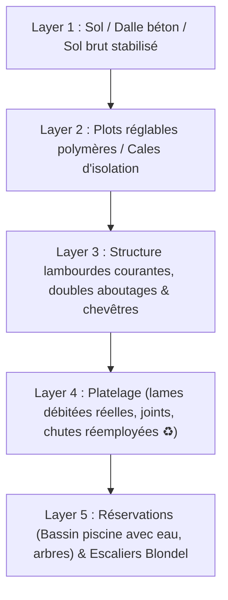
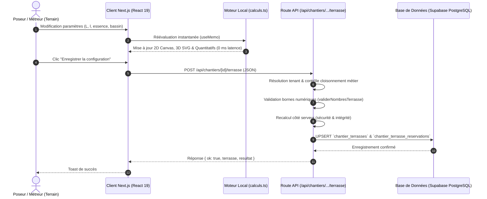

# Architecture & Analyse Technique : Calepinage & Moteur 3D Terrasse

> **Projet :** BNA Dashboard (Next.js 16 / React 19 / Node.js / Supabase)  
> **Domaine Métier :** Terrasse Pro & Aménagements Extérieurs (NF DTU 51.4 / DTA Composites)  
> **Date de rédaction :** 13 Novembre 2026  
> **Statut :** Documentation de référence de l'architecture existante & feuille de route d'évolution  

---

## Sommaire

1. [Arborescence et Stack Technique](#1-arborescence-et-stack-technique)
2. [Architecture du Moteur 3D](#2-architecture-du-moteur-3d)
3. [Algorithme de Calepinage et d'Optimisation des Découpes](#3-algorithme-de-calepinage-et-doptimisation-des-découpes)
4. [Flux de Données Frontend / Backend](#4-flux-de-données-frontend--backend)
5. [Limites Actuelles et Pistes d'Évolution](#5-limites-actuelles-et-pistes-dévolution)

---

## 1. Arborescence et Stack Technique

### 1.1 Cartographie des dossiers et fichiers principaux

L'ensemble des fonctionnalités de calepinage, dimensionnement et visualisation 3D de terrasse est strictement cloisonné pour respecter l'indépendance avec le domaine Bardage :

```text
bna-dashboard/
├── app/
│   ├── terrain/terrasse/
│   │   ├── page.tsx                     # Cockpit terrain des chantiers terrasse
│   │   └── [id]/page.tsx                # Hub Chantier Terrasse (navigation 8 modules)
│   ├── bureau/catalogue-terrasse/
│   │   └── page.tsx                     # Gestion des fournitures (lames, lambourdes, clips, plots)
│   └── api/
│       ├── chantiers/[id]/terrasse/
│       │   ├── route.ts                 # API REST CRUD, validation DTU & persistance Supabase
│       │   └── export/
│       │       ├── excel/route.ts       # Export du bordereau de débit et quantitatif Excel (ExcelJS)
│       │       └── pdf/route.ts         # Export du dossier technique et plan en PDF (pdf-lib)
│       └── catalogue-terrasse/route.ts  # API de consultation des fournitures et grilles tarifaires
├── components/terrasse/
│   ├── ChantierTerrasseTab.tsx          # Orchestrateur central d'état (config, calculs, sous-onglets)
│   ├── TerrasseVue3D.tsx                # Moteur 3D vectoriel SVG (caméra orbitale, mode éclaté DTU)
│   ├── TerrassePlanCanvas2D.tsx         # Moteur 2D HTML5 Canvas (calepinage interactif, cotes, survol)
│   ├── TerrasseConfigForm.tsx           # Formulaire de configuration des paramètres terrasse
│   ├── TerrasseConformiteDTU.tsx        # Audit normatif automatisé NF DTU 51.4 (P1-1 / P1-2)
│   ├── TerrasseQuantitatifTable.tsx     # Tableau de chiffrage structuré (Q_net, Q_tech, Q_appro)
│   ├── NouveauChantierTerrasseModal.tsx # Modale de création rapide
│   └── hub/                             # Modules spécialisés du Hub terrain
│       ├── TerrasseCalepinageModule.tsx # Intégration du calepinage dans le Hub
│       ├── TerrasseAvancementModule.tsx # Suivi des 6 phases DTU 51.4
│       └── ...
└── lib/terrasse/
    ├── types.ts                         # Interfaces TypeScript, modèles de données et contrats
    ├── calculs.ts                       # Point d'entrée de calcul quantitatif et d'orchestration
    ├── dtu51_4.ts                       # Moteur de règles normatives, portées et entraxes admissibles
    ├── compatAccessoires.ts             # Règles de compatibilité fixations / lames / lambourdes
    ├── exportExcel.ts                   # Générateur de classeur Excel multi-onglets
    ├── exportPdf.ts                     # Générateur de planches techniques PDF
    ├── pro/                             # Moteur géométrique & calepinage avancé (Terrasse Pro)
    │   ├── presets-regles.ts            # Brique 1 : Presets, sollicitations mécaniques (1 à 3), règles
    │   ├── geometrie-structure.ts       # Brique 2 : Géométrie 2D, lambourdes, chevêtres et plots
    │   ├── calepinage-decoupe.ts        # Brique 3 : Placement lames, joints, optimiseur 1D et chutes
    │   └── quantitatifs-contrat.ts      # Brique 4 : Contrat Q_net / Q_tech / Q_appro & quincaillerie
    ├── composite/                       # Spécifications pour lames bois polymère (WPC sous DTA)
    │   ├── dilatation.ts                # Modèle thermo-mécanique de dilatation et jeux de pose
    │   ├── fabricants.ts                # Presets fabricants (Silvadec, Fiberdeck, Neowood, Océwood)
    │   └── calculs.ts / audit.ts        # Moteur de calcul et audit DTA
    └── bois/                            # Spécifications bois massif (résineux et feuillus exotiques)
        ├── vissage.ts / clipsBois.ts    # Dimensionnement vis traversantes (Tableau 9) / clips
        └── audit.ts                     # Contrôles de durabilité, séchage et classes d'emploi
```

### 1.2 Dépendances du package.json et choix d'implémentation

L'inspection de `package.json` révèle une caractéristique architecturale majeure :

```json
{
  "dependencies": {
    "next": "^16.4.6",
    "react": "19.2.8",
    "react-dom": "19.2.8",
    "@supabase/ssr": "^0.12.5",
    "@supabase/supabase-js": "^2.112.4",
    "exceljs": "^4.4.0",
    "pdf-lib": "^1.17.1",
    "lucide-react": "^1.31.0",
    "recharts": "^3.10.1",
    "papaparse": "^5.7.0"
  }
}
```

- **Bibliothèques 3D (Three.js, @react-three/fiber, Babylon.js) :** **Aucune**.
- **Bibliothèques géométriques / découpe (Clipper, Earcut, Turf.js, MaxRectsPacker) :** **Aucune**.
- **Choix d'architecture :** L'intégralité du moteur géométrique, de l'optimiseur de découpe 1D et du moteur de rendu 3D vectoriel est **implémentée sur-mesure en TypeScript pur**. Cela évite tout surpoids de bundle, assure une exécution ultra-rapide sur terminaux mobiles (chantier) et garantit une fidélité stricte aux équations du DTU 51.4 sans dépendance tierce.

---

## 2. Architecture du Moteur 3D

Le moteur 3D réside dans [`components/terrasse/TerrasseVue3D.tsx`](file:///data/data/com.termux/files/home/bna-dashboard/components/terrasse/TerrasseVue3D.tsx) (948 lignes). Il s'agit d'un visualiseur 3D temps réel vectoriel SVG développé spécifiquement pour le contrôle technique de pose.

### 2.1 Modélisation de la scène et des couches DTU 51.4

La scène décompose la terrasse en un assemblage volumétrique de parallélépipèdes 3D (polygones à 6 faces générés par la fonction `createBoxPolys`), structurés en 5 couches ordonnées (`layerId`) :



1. **Layer 1 — Sol / Assise :**
   - Représente la dalle béton ou le sol compacté avec une teinte ardoise foncée (`#1e293b` ou `#292524`).
2. **Layer 2 — Plots & Cales :**
   - Positionne les plots polymères réglables aux coordonnées calculées $(X, Y, Z)$ issues du moteur structurel via `InstancedMesh`.
   - Différenciation visuelle par couleur : ambre/jaune pour les plots courants, bleu cyan pour les plots de renfort de chevêtre, vert émeraude pour les cales d'isolation sur dalle.
3. **Layer 3 — Structure porteuse :**
   - Modélise les lambourdes porteuses en bois classe 4, bois exotique ou profilés aluminium.
   - Intègre les **doubles lambourdes d'aboutage** (jumelées à chaque ligne de jonction de lames) et les **chevêtres d'encadrement** des trémies.
4. **Layer 4 — Platelage fixe (InstancedMesh) :**
   - Modélise chaque segment individuel de lame issu de l'optimiseur de découpe en un seul draw call GPU.
   - Met en surbrillance vert émeraude (`#059669`) les **chutes réemployées** (♻️) pour un repérage immédiat par le poseur.
5. **Layer 5 — Réservations, Bassin & Escaliers :**
   - **Bassin de piscine :** Modélisé en volume 3D avec eau cyan semi-transparente (`#0ea5e9`), bordure supérieure et parois latérales réalistes.
   - **Escaliers :** Génération géométrique des marches et contremarches selon la loi de confort de Blondel ($2H + G \in [60, 64]\text{ cm}$).
6. **Layer 6 — Rails Inox et Terrasse Mobile Coulissante :**
   - **Rails inox au sol :** Profilés en Vé ou plats en acier Inox 316L (A4 marine) s'étendant sur le bassin et la zone de refoulement.
   - **Galets de roulement :** Galets inox à gorge sous le châssis alu (dimensionnés selon la charge totale $\ge 2.5\text{ kN/m}^2$).
   - **Châssis aluminium porteur & platelage mobile :** Cadre et traverses en profilés alu recevant les lames de platelage mobile parfaitement alignées sur la plage fixe.
   - **Translation dynamique $T(t)$ :** Curseur interactif d'ouverture (0 à 100 %) appliquant le déplacement cinématique fluide aux plateaux (mode 1 plateau ou 2 demi-plateaux symétriques).

### 2.2 Moteur WebGL Three.js et InstancedMesh (60 FPS)

Le rendu 3D s'appuie désormais sur **Three.js** via **`@react-three/fiber`** et **`@react-three/drei`** :
- **Performance GPU maximale :** Utilisation de `InstancedMesh` pour les centaines de segments de lames et plots, ramenant le nombre de draw calls à l'unité et garantissant **60 FPS constants sur mobile et tablette**.
- **Contrôles caméra :** `<OrbitControls>` avec amortissement physique (`dampingFactor: 0.08`), limites d'angle et presets d'orientation (Isométrique, Coupe rasante DTU, Vue de dessus, Zoom avant/arrière).
- **Z-Buffer matériel & Éclairage :** Plus aucun artefact de masquage ; gestion native des ombres portées et de l'éclairage multidirectionnel (lumière ambiante et directionnelle avec relief).

### 2.3 Gestion des états et fonctionnalités interactives

- **Mode Éclaté DTU 51.4 (`eclate`) :** Introduit un écartement d'altitude réglable ($gapY = 0.35\text{ m}$) entre les couches, permettant d'inspecter visuellement les plots sous les lambourdes et les fixations sous le platelage.
- **Curseur d'ouverture de la terrasse mobile :** Slider fluide de 0 % (bassin complètement fermé et sécurisé) à 100 % (bassin entièrement ouvert), avec bouton Play/Pause pour animation motorisée automatique.
- **Isolation de couches :** Toggles indépendants `showSol`, `showPlots`, `showLambourdes`, `showLames`, et `showRailsMobile` (Layer 6).
- **Inspection au clic (`selectedMeta`) :** Grâce au raycasting Three.js sur `instanceId`, le clic sur n'importe quel segment de lame, plot, rail ou châssis mobile ouvre instantanément sa fiche technique descriptive.

---

## 3. Algorithme de Calepinage et d'Optimisation des Découpes

Le calepinage est gouverné par les 4 briques modulaires de [`lib/terrasse/pro/`](file:///data/data/com.termux/files/home/bna-dashboard/lib/terrasse/pro/) :

```mermaid
flowchart LR
    subgraph B1["Brique 1 : presets-regles.ts"]
        R1["Sollicitations 1, 2, 3"]
        R2["Jeux pose / Dilation"]
        R3["Règle anti-micro-pièces"]
    end

    subgraph B2["Brique 2 : geometrie-structure.ts"]
        G1["Contour I, L, U & Réservations"]
        G2["Lambourdes simples & doubles"]
        G3["Chevêtres & Plots de renfort"]
    end

    subgraph B3["Brique 3 : calepinage-decoupe.ts"]
        C1["Poses Alignée / Perdue / 1/3"]
        C2["Optimiseur 1D Bar-Cutting"]
        C3["Trait scie 3mm & Purge 15mm"]
    end

    subgraph B4["Brique 4 : quantitatifs-contrat.ts"]
        Q1["Q_net : Géométrique"]
        Q2["Q_tech : Découpé + chutes"]
        Q3["Q_appro : Colisage commercial"]
    end

    B1 --> B2 --> B3 --> B4
```



### 3.1 Brique 1 — Presets et règles normatives (`presets-regles.ts`)

- **Catégories de sollicitations (DTU 51.4 §4) :**
  - Catégorie 1 : Privatif résidentiel ($2.5\text{ kN/m}^2$, flèche lame $\le 5\text{ mm}$, plot $F_{Rk} \ge 5\text{ kN}$).
  - Catégorie 2 : ERP / Collectif modéré ($4.0\text{ kN/m}^2$, plot $F_{Rk} \ge 7.5\text{ kN}$).
  - Catégorie 3 : Public lourd ($5.0\text{ kN/m}^2$, plot $F_{Rk} \ge 12.5\text{ kN}$).
- **Règle bloquante anti-micro-pièces ($R\text{-MET-}01$) :**
  - Longueur nette minimale d'un segment de lame : **$L_{\text{net}} \ge 400\text{ mm}$**.
  - Tout segment doit reposer sur **au moins 2 appuis** (bois) ou **3 appuis** (composite ou segment $< 800\text{ mm}$).
  - Porte-à-faux d'extrémité borné : **$20\text{ mm} \le \text{PAF} \le \min(100\text{ mm}, 3 \times e)$**.
  - Si le calepinage en quinconce viole cette règle, il est rejeté et l'algorithme propose automatiquement les 2 meilleurs scénarios admissibles (`topAdmissibleScenarios`).

### 3.2 Brique 2 — Moteur géométrique 2D de structure (`geometrie-structure.ts`)

- **Gestion des formes et réservations :**
  - Support des formes en $I$, $L$, $U$ et polygones orthogonaux.
  - Soustraction des réservations (piscines, skimmers, arbres, trappes techniques) avec calcul exact de la surface nette $S_{\text{net}} = S_{\text{brute}} - S_{\text{reservations}}$.
- **Implantation des lambourdes :**
  - Entraxe maximal calculé selon la charge et l'épaisseur de lame (ex: $40\text{ cm}$ pour lame résineuse de $21\text{ mm}$).
  - **Double lambourdage d'aboutage :** Lorsque deux lames s'aboutent bout à bout, le moteur positionne automatiquement deux lambourdes jumelées espacées de $50\text{ mm}$, garantissant un vissage à plus de $20\text{ mm}$ des rives de bout conformément au DTU 51.4 §5.5.6.
- **Chevêtres automatiques :**
  - Génération de lambourdes transversales d'encadrement à chaque franchissement de trémie de piscine ou d'obstacle.
- **Implantation des plots :**
  - Portée admissible selon la section de lambourde ($L \le 700\text{ mm}$ pour $\ge 3$ appuis, $L \le 600\text{ mm}$ pour 2 appuis).
  - Positionnement systématique de plots de renfort sous chaque angle de chevêtre.

### 3.3 Brique 3 — Calepinage des lames et optimiseur de découpe 1D (`calepinage-decoupe.ts`)

- **Modes de pose :**
  - `ALIGNEE` : Joints d'aboutage alignés sur lignes structurelles continues.
  - `COUPE_PERDUE` : La chute de la dernière lame d'une rangée est réinjectée en départ de rangée suivante si elle mesure $\ge 400\text{ mm}$.
  - `QUINCONCE` : Décalage régulier d'un tiers ou d'une demi-longueur.
- **Optimiseur de découpe linéaire 1D (Bar-Cutting) :**
  - Débit dans les longueurs commerciales disponibles (ex: $3.0\text{ m}, 4.2\text{ m}, 4.8\text{ m}$).
  - Déduction systématique du trait de scie (`kerfMm` = $3\text{ mm}$).
  - Purge d'extrémité (`endTrimMm` = $10\text{ à }15\text{ mm}$) pour éliminer les fentes de séchage en bout de lame.
  - Suivi des statuts de chutes : `REUSED_IN_PLAN`, `REUSABLE_STOCK` ($\ge 1.0\text{ m}$), ou `WASTE_SCRAP` (rebut).
  - Calcul du taux de perte effectif (`bladeWasteRatePercent`).

### 3.4 Brique 4 — Contrat de sortie quantitatif (`quantitatifs-contrat.ts`)

L'algorithme sépare formellement les trois niveaux de métré :
1. **$Q_{\text{net}}$ (Quantités géométriques nettes) :** Surface nette de platelage, linéaire net posé de lambourdes, nombre exact d'appuis.
2. **$Q_{\text{tech}}$ (Quantités techniques découpées) :** Nombre réel de barres commerciales débitées et volume des chutes réelles.
3. **$Q_{\text{appro}}$ (Quantités d'approvisionnement) :** Ajout de la marge de tri chantier ($+3\%$) et colisage commercial fournisseur (boîtes de 200 vis, rouleaux de bande d'étanchéité EPDM de $20\text{ m}$, cartons de 100 clips).
4. **Dimensionnement des vis (Tableau 9 DTU 51.4) :**
   - Épaisseur $21\text{–}25\text{ mm}$ $\rightarrow$ Vis $\varnothing 5\text{ mm}$, longueur $50\text{–}60\text{ mm}$.
   - Épaisseur $> 25\text{ mm}$ $\rightarrow$ Vis $\varnothing 6\text{ mm}$, longueur $70\text{–}80\text{ mm}$.
   - Grade Inox A4 obligatoire en environnement piscine (chlore/sel) et littoral.

---

## 4. Flux de Données Frontend / Backend

Le cycle de vie des données garantit à la fois une réactivité immédiate sur le terrain et l'intégrité technique des devis et PV de réception :



### 4.1 Réactivité 100 % Client
Dans [`ChantierTerrasseTab.tsx`](file:///data/data/com.termux/files/home/bna-dashboard/components/terrasse/ChantierTerrasseTab.tsx) :
```tsx
const resultat = useMemo<ResultatCalculTerrasse>(() => {
  return calculerTerrasse(config, reservations);
}, [config, reservations]);
```
Toute saisie dans le formulaire re-calcule immédiatement le calepinage et rafraîchit la 3D sans aucune latence réseau.

### 4.2 Persistance et validation serveur
- La route API [`app/api/chantiers/[id]/terrasse/route.ts`](file:///data/data/com.termux/files/home/bna-dashboard/app/api/chantiers/[id]/terrasse/route.ts) reçoit le payload.
- Elle valide les bornes géométriques (`longueur_m`, `largeur_m`, entraxes) pour empêcher toute valeur aberrante.
- Elle vérifie le cloisonnement du chantier (`chantier.metier === "terrasse"`).
- Elle **ré-exécute le calcul côté serveur** afin que le snapshot `resultats_techniques` persisté en base de données reflète la vérité normative et ne dépende pas de l'exécution client.

### 4.3 Structure des tables Supabase
- `chantier_terrasses` : Paramètres de configuration, essence, lambourdes, prix catalogue, snapshot JSON des résultats techniques.
- `chantier_terrasse_reservations` : Enregistrements distincts pour chaque trémie/bassin avec position $(X, Y)$, dimensions ($L \times l$ ou diamètre) et type (`piscine`, `skimmer`, `arbre`, `trappe`).

---

## 5. Bilan d'Implémentation & Pistes d'Évolution

| Domaine | Architecture Implémentée | Bénéfices & Caractéristiques | Pistes d'Évolution Futures |
| :--- | :--- | :--- | :--- |
| **Rendu 3D & Performance (60 FPS)** | **Three.js WebGL via `@react-three/fiber` et `@react-three/drei`** avec `InstancedMesh`. | Framerate fluide à 60 FPS sur mobile. Rendu de centaines de lames, plots et vis en un seul draw call GPU. Z-buffer matériel natif, éclairage réaliste et ombres portées. | Ajout de textures PBR photo-réalistes (veinage bois 4K, normal maps de rainures) et shader d'eau de piscine avec caustiques animées. |
| **Terrasse Mobile sur Rails** | **Module complet `terrasse-mobile.ts` + Layer 6 dans `TerrasseVue3D.tsx`**. | Support des modes **1 plateau** et **2 demi-plateaux symétriques**. Calcul exact des rails inox 316L, galets de roulement selon la charge ($\ge 2.5\text{ kN/m}^2$) et châssis aluminium. Curseur interactif d'ouverture ($0\rightarrow 100\%$) avec animation fluide $T(t)$. | Intégration d'un module de simulation de motorisation solaire avec batterie tampon et calcul de couple moteur (Nm). |
| **Géométrie & Découpes 2D** | Bandes orthogonales manuelles (`intersectHorizontalBandWithDomainMm`). | Efficace pour les terrasses et bassins orthogonaux standards ($I, L, U$). | **`clipper2-js`** : À intégrer si le besoin émerge pour des piscines ovales, haricots ou découpes à angles libres non orthogonaux. |
| **Optimisation des découpes 1D** | Algorithme 1D glouton linéaire avec réemploi de chutes ($\ge 400\text{ mm}$, $R\text{-MET-}01$). | Débit direct dans les longueurs commerciales avec prise en compte du trait de scie ($3\text{ mm}$) et purge d'équerrage ($15\text{ mm}$). | Algorithme de recherche opérationnelle globale (type *Branch and Bound* ou *Column Generation*) pour pousser le taux de chute sous $3\%$. |
