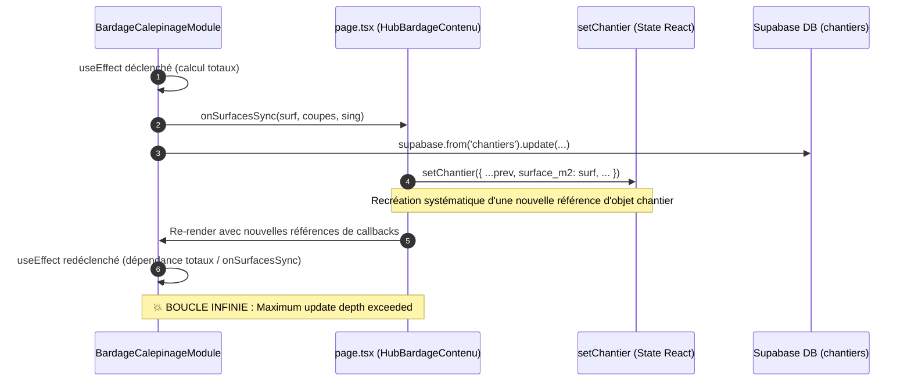

# BNA — Rapport Technique : Correction de la Boucle de Synchronisation du Calepinage Bardage

> [!NOTE]
> **Environnement** : Ubuntu local, Node.js v24.22.2, React 19.2.8, Next.js 16.4.6.  
> **Périmètre d'intervention** : Élimination de la boucle de rendu et enrichissement de l'observabilité sans aucune altération des moteurs de calculs métier, des formules de calepinage, ni du schéma Supabase.

---

## 1. Diagnostic de l'Incident

Deux anomalies bloquantes ont été identifiées dans le module **Calepinage & Façades** du Hub Bardage :

1. **Boucle infinie React** : `Maximum update depth exceeded`.
2. **Log d'erreur Supabase opaque** : `Erreur sync surfaces -> chantier: {}`.

### Chaîne causale identifiée



### Facteurs déterminants de la boucle

1. **Callback parent instable** : Dans [page.tsx](file:///data/data/com.termux/files/home/bna-dashboard/app/terrain/chantier/[id]/page.tsx#L464-L475), `onSurfacesSync` était passé sous forme de fonction fléchée `inline` non mémorisée `(surf, coupes, sing) => setChantier(...)`, recréée à chaque cycle de rendu.
2. **Absence de court-circuit dans `setChantier`** : Le callback parent fusionnait sans vérifier l'égalité scalaire (`prev.surface_m2 === surf && ...`), forçant une nouvelle référence d'état même pour des valeurs identiques.
3. **Absence d'idempotence dans l'enfant** : Le `useEffect` de synchronisation dans [BardageCalepinageModule.tsx](file:///data/data/com.termux/files/home/bna-dashboard/components/bardage/hub/BardageCalepinageModule.tsx#L123-L200) ne vérifiait pas si les surfaces calculées avaient réellement changé par rapport au dernier cycle, redéclenchant la notification et la requête Supabase.
4. **Sérialisation console d'erreurs d'API** : `console.error("Erreur sync surfaces -> chantier:", error)` produisait `{}` car les propriétés des instances `PostgrestError` / `Error` (telles que `message`, `code`, `details`) sont non énumérables par défaut dans `JSON.stringify` ou le formateur console JS.

---

## 2. Corrections Appliquées

### A. Double Idempotence & Mémorisation Découplée

Une architecture de **double rempart d'idempotence** a été mise en place :

#### 1. Côté Module Enfant ([BardageCalepinageModule.tsx](file:///data/data/com.termux/files/home/bna-dashboard/components/bardage/hub/BardageCalepinageModule.tsx))
- **Mémorisation par référence scalaire** : Introduction de `dernieresSurfacesSyncRef` stockant `{ chantierId, surface_m2, quantite_coupes_ml, singularites_nb }`.
- **Découplage de la référence du callback** : Utilisation d'`onSurfacesSyncRef = useRef(onSurfacesSync)` mis à jour à chaque cycle, retirant `onSurfacesSync` des dépendances actives du `useEffect`.
- **Réduction des dépendances du `useEffect`** aux seules valeurs scalaires calculées :
  ```tsx
  [totaux.nette, totaux.totalCoupesML, totaux.ouvertures, chantierId, zones.length, loadingZones]
  ```
- **Contrôle d'idempotence strict** : Si les valeurs actuelles sont identiques à celles de `dernieresSurfacesSyncRef.current`, l'effet s'interrompt immédiatement (`bail out`), empêchant toute notification ou requête SQL redondante.

#### 2. Côté Page Parente ([page.tsx](file:///data/data/com.termux/files/home/bna-dashboard/app/terrain/chantier/[id]/page.tsx))
- **`handleSurfacesSync` mémoisé avec `useCallback`** :
  ```tsx
  const handleSurfacesSync = useCallback((surf: number, coupes: number, sing: number) => {
    setChantier((prev) => {
      if (!prev) return prev;
      if (
        prev.surface_m2 === surf &&
        prev.quantite_coupes_ml === coupes &&
        prev.singularites_nb === sing
      ) {
        return prev; // Conserve la référence exacte -> aucun re-render
      }
      return {
        ...prev,
        surface_m2: surf,
        quantite_coupes_ml: coupes,
        singularites_nb: sing,
      };
    });
  }, []);
  ```
- **Mémorisation de `configTechniqueInitiale`** via `useMemo` pour éviter les régénérations d'objets sur les re-renders parents.
- **Mémorisation de `handleConfigSaved`** via `useCallback` avec court-circuit d'égalité pour les paramètres techniques.

---

### B. Observabilité et Débogage Enrichi

Le logging d'erreur a été totalement restructuré pour capturer explicitement les attributs `message`, `code`, `details`, `hint` ainsi que le **contexte complet des paramètres de synchronisation** :

```tsx
supabase
  .from("chantiers")
  .update({ surface_m2, quantite_coupes_ml, singularites_nb })
  .eq("id", chantierId)
  .then(
    ({ error }) => {
      if (error) {
        console.error("Erreur sync surfaces -> chantier:", {
          message: error.message || "Erreur Supabase inconnue",
          code: error.code || null,
          details: error.details || null,
          hint: error.hint || null,
          contexte: {
            chantierId,
            surface_m2,
            quantite_coupes_ml,
            singularites_nb,
          },
        });
      }
    },
    (err: unknown) => {
      console.error("Erreur inattendue sync surfaces -> chantier:", {
        message: err instanceof Error ? err.message : String(err),
        nom: err instanceof Error ? err.name : "UnknownError",
        cause: err instanceof Error && err.cause ? String(err.cause) : null,
        contexte: {
          chantierId,
          surface_m2,
          quantite_coupes_ml,
          singularites_nb,
        },
      });
    }
  );
```

> [!TIP]
> Supabase JS renvoie un objet `PromiseLike` lors d'un `.update()`. L'interception des rejets s'effectue via le second paramètre de `.then(onfulfilled, onrejected)`, garantissant une capture exhaustive même en cas de coupure réseau ou exception interne.

---

## 3. Résultats des Tests et Validation

La suite de tests unitaires et d'intégration a été créée dans [calepinage-sync-surfaces.test.tsx](file:///data/data/com.termux/files/home/bna-dashboard/__tests__/bardage/calepinage-sync-surfaces.test.tsx).

### Matrice de validation (6/6 tests réussis)

| # | Scénario testé | Statut | Temps d'exécution |
|---|----------------|:------:|:-----------------:|
| 1 | **Premier chargement** : calcul et transmission exacte de `surface_m2`, `quantite_coupes_ml`, `singularites_nb` | ✅ Validé | 165 ms |
| 2 | **Idempotence** : un re-render parent sans modification de surface ne déclenche aucun appel Supabase ni callback supplémentaire | ✅ Validé | 92 ms |
| 3 | **Absence de boucle infinie** : intégration directe avec `setChantier` se stabilise en ≤ 2 cycles sans `Maximum update depth exceeded` | ✅ Validé | 53 ms |
| 4 | **Compatibilité React StrictMode** : stabilité parfaite sous double-invocation des effets React | ✅ Validé | 61 ms |
| 5 | **Observabilité enrichie** : log d'un objet descriptif structuré avec code, détails et contexte au lieu de `{}` | ✅ Validé | 46 ms |
| 6 | **Réactivité métier** : la modification réelle des surfaces (ex: suppression de zone) recalcule et synchronise les nouvelles valeurs | ✅ Validé | 66 ms |

### Validation globale du projet

- **Suite Bardage complète (10 fichiers de test, 113 tests unitaires et fonctionnels)** : **100% de réussite** (6,26 s).
- **Contrôle TypeScript (`tsc --noEmit`)** : **0 erreur**.
- **Intégrité métier** : 0 modification des formules de calepinage, 0 modification de la base Supabase, 0 impact sur le Hub Terrasse.
