```mermaid
flowchart TD
    subgraph Rendu1["Rendu 1 : loading = true"]
        H1_1["Hooks 1 à 17 exécutés"] --> Cond1{"if (loading) ?"}
        Cond1 -- OUI --> Ret1["return Écran de Chargement"]
        Ret1 --> Stop1["Fin Rendu 1 (Total : 17 Hooks)"]
    end

    subgraph Rendu2_Avant["Rendu 2 (AVANT correction) : loading = false"]
        H2_1["Hooks 1 à 17 exécutés"] --> Cond2{"if (loading) ?"}
        Cond2 -- NON --> Cond3{"if (!chantier) ?"}
        Cond3 -- NON --> H2_New["Hook 18 : useMemo (configTechniqueInitiale)<br/>Hook 19 : useCallback (handleSurfacesSync)<br/>Hook 20 : useCallback (handleConfigSaved)"]
        H2_New --> Crash["💥 CRASH REACT : Change in order of Hooks<br/>Rendered more hooks than previous render"]
    end

    subgraph Rendu2_Apres["Rendu 1 & 2 (APRÈS correction)"]
        H_All["TOUS les 20 Hooks exécutés AU TOP-LEVEL<br/>- configTechniqueInitiale gère chantier === null en interne<br/>- handleSurfacesSync et handleConfigSaved stabilisés"] --> Cond_Post{"if (loading) ou (!chantier) ?"}
        Cond_Post -- OUI --> Ret_Load["return Écran Chargement ou Introuvable"]
        Cond_Post -- NON --> Ret_JSX["return JSX Hub Bardage"]
        Note_Stable["✅ Ordre et nombre de Hooks 100% identiques à CHAQUE rendu"]
    end
```

# BNA — Rapport Technique : Correction de la Violation de l'Ordre des Hooks React dans le Hub Bardage

> [!IMPORTANT]
> **Incident traité** : `React has detected a change in the order of Hooks called by HubBardageContenu.`  
> **Composant cible** : [page.tsx](file:///data/data/com.termux/files/home/bna-dashboard/app/terrain/chantier/[id]/page.tsx) (`HubBardageContenu`).  
> **Diagnostic** : Le 21e Hook (`useMemo` pour `configTechniqueInitiale`) ainsi que les Hooks 22 et 23 (`useCallback` pour `handleSurfacesSync` et `handleConfigSaved`) étaient situés **après** deux retours conditionnels (`if (loading) return ...` et `if (!chantier) return ...`).

---

## 1. Cause Exacte de la Violation

Dans la spécification React (« *Rules of Hooks* »), les Hooks doivent être appelés **inconditionnellement au niveau supérieur** du composant afin que React puisse associer leur état interne à chaque rendu via leur indice fixe dans la liste chaînée des fibres.

### Ce qui se produisait :

1. **Rendu initial (Rendu 1 - `loading = true`)** :
   - React exécutait les 17 premiers Hooks (Hooks Next.js de navigation, `useState` du chantier, `useEffect` de chargement, `useMemo` d'`avancementPct`).
   - La condition `if (loading)` à la ligne 223 s'évaluait à `true`.
   - Le composant effectuait un **retour anticipé** affichant l'écran de chargement (« *Chargement du Hub Bardage...* »).
   - **Total de Hooks appelés lors du Rendu 1** : 17 Hooks (20 avec les sous-hooks Next.js internes).

2. **Rendu suivant (Rendu 2 - `loading = false`, données reçues)** :
   - React réexécutait les mêmes 17 premiers Hooks.
   - La condition `if (loading)` s'évaluait maintenant à `false`.
   - La condition `if (!chantier)` s'évaluait à `false`.
   - L'exécution continuait plus bas et rencontrait la déclaration de `configTechniqueInitiale = useMemo(...)` puis de `handleSurfacesSync = useCallback(...)` et `handleConfigSaved = useCallback(...)`.
   - **Erreur React levée immédiatement** :
     ```text
     React has detected a change in the order of Hooks called by HubBardageContenu.
     Rendered more hooks than during the previous render.
     Le 21e Hook est un "useMemo", absent lors du rendu précédent.
     ```



---

## 2. Correction Appliquée

Tous les Hooks ont été repositionnés **strictement au sommet** de `HubBardageContenu`, avant le moindre `return` conditionnel.

### A. Repositionnement et sécurisation de `configTechniqueInitiale` ([page.tsx](file:///data/data/com.termux/files/home/bna-dashboard/app/terrain/chantier/[id]/page.tsx#L216-L241))
La condition de présence du chantier a été déplacée **à l'intérieur** du `useMemo`, avec un fallback typé lorsque `chantier` est `null` pendant le chargement initial :

```tsx
// Configuration technique initiale (toujours appelée au top-level pour respecter l'ordre des hooks React)
const configTechniqueInitiale = useMemo<ConfigTechnique>(() => {
  if (!chantier) {
    return {
      type_isolant: null,
      epaisseur_isolant_mm: null,
      surface_paquet_m2: null,
      zone_vent_rive: null,
      coef_perte_rendement: 1.10,
    };
  }
  return {
    type_isolant: chantier.type_isolant ?? null,
    epaisseur_isolant_mm: chantier.epaisseur_isolant_mm ?? null,
    surface_paquet_m2: chantier.surface_paquet_m2 ?? null,
    zone_vent_rive: chantier.zone_vent_rive ?? null,
    coef_perte_rendement:
      chantier.coef_perte_rendement === 1.8 ? 1.10 : (chantier.coef_perte_rendement ?? 1.10),
  };
}, [
  chantier?.type_isolant,
  chantier?.epaisseur_isolant_mm,
  chantier?.surface_paquet_m2,
  chantier?.zone_vent_rive,
  chantier?.coef_perte_rendement,
]);
```

### B. Maintien et stabilisation des callbacks de synchronisation ([page.tsx](file:///data/data/com.termux/files/home/bna-dashboard/app/terrain/chantier/[id]/page.tsx#L243-L284))
`handleSurfacesSync` et `handleConfigSaved` sont déclarés inconditionnellement au sommet. Les protections anti-boucle et la comparaison d'idempotence scalaire sont intégralement préservées :

```tsx
// Synchronisation idempotente des surfaces pour éviter toute boucle de re-render
const handleSurfacesSync = useCallback((surf: number, coupes: number, sing: number) => {
  setChantier((prev) => {
    if (!prev) return null;
    if (
      prev.surface_m2 === surf &&
      prev.quantite_coupes_ml === coupes &&
      prev.singularites_nb === sing
    ) {
      return prev; // Évite tout re-render si les valeurs sont inchangées
    }
    return {
      ...prev,
      surface_m2: surf,
      quantite_coupes_ml: coupes,
      singularites_nb: sing,
    };
  });
}, []);

const handleConfigSaved = useCallback((nouvelleConfig: ConfigTechnique) => {
  setChantier((prev) => {
    if (!prev) return null;
    if (
      prev.type_isolant === nouvelleConfig.type_isolant &&
      prev.epaisseur_isolant_mm === nouvelleConfig.epaisseur_isolant_mm &&
      prev.surface_paquet_m2 === nouvelleConfig.surface_paquet_m2 &&
      prev.zone_vent_rive === nouvelleConfig.zone_vent_rive &&
      prev.coef_perte_rendement === nouvelleConfig.coef_perte_rendement
    ) {
      return prev;
    }
    return {
      ...prev,
      type_isolant: nouvelleConfig.type_isolant,
      epaisseur_isolant_mm: nouvelleConfig.epaisseur_isolant_mm,
      surface_paquet_m2: nouvelleConfig.surface_paquet_m2,
      zone_vent_rive: nouvelleConfig.zone_vent_rive,
      coef_perte_rendement: nouvelleConfig.coef_perte_rendement,
    };
  });
}, []);
```

---

## 3. Matrice de Validation Réelle par Tests Automatisés

Un fichier de test d'intégration dédié a été conçu pour reproduire fidèlement l'environnement dynamique du composant : [hub-bardage-hooks-order.test.tsx](file:///data/data/com.termux/files/home/bna-dashboard/__tests__/bardage/hub-bardage-hooks-order.test.tsx).

Les tests utilisent le moteur de rendu React 19 (`createRoot` + `act`) et simulent les transitions d'état réelles et les re-renders successifs :

| # | Scénario de test | Statut | Résultat observé |
|---|------------------|:------:|------------------|
| 1 & 2 | **Transition `loading: true` → `loading: false`** | ✅ Validé | Écran de chargement initial rendu, puis résolution des données et affichage complet. 0 erreur de hooks levée. |
| 3 | **Navigation entre les 8 modules du Hub** | ✅ Validé | `general`, `avancement`, `calepinage`, `heures`, `meteo`, `photos`, `rapport`, `documents` puis retour vue globale : invariant de hooks préservé sur 9 transitions successives. |
| 4 | **Ouverture du module Calepinage** | ✅ Validé | Transmission exacte de `configTechniqueInitiale` (isolant, épaisseur, surface paquet, coef) et des callbacks mémoisés. |
| 5 | **Modification des dimensions & Synchronisation des surfaces** | ✅ Validé | Déclenchement de `handleSurfacesSync(140, 50, 6)`. Mise à jour idempotente sans boucle infinie (`renderCount ≤ 4`). |
| 6 | **Aller-retour inter-modules** | ✅ Validé | Calepinage → Météo → Calepinage : transition fluide sans aucune altération de l'ordre des hooks. |
| 7 | **Montage en mode React `StrictMode`** | ✅ Validé | Double-invocation complète des hooks et effets de développement validée sans divergence. |
| 8 | **Audit statique de non-régression** | ✅ Validé | Analyse du code source de [page.tsx](file:///data/data/com.termux/files/home/bna-dashboard/app/terrain/chantier/[id]/page.tsx) : 0 hook présent après `if (loading) { return ...`. |

---

## 4. Tests Globaux du Projet

```bash
# Exécution de l'ensemble des suites Bardage
vitest run __tests__/bardage/
```
- **Fichiers de tests exécutés** : 11 fichiers.
- **Tests exécutés** : **120 tests passés, 0 échec** (8,76 s).
- **TypeScript (`tsc --noEmit`)** : **0 erreur**.
- **Hub Terrasse & Moteurs de calcul** : rigoureusement intouchés.
