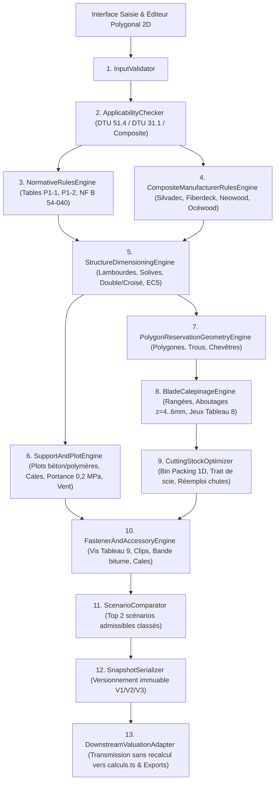

# Dossier d'Étude Technique & Référentiel Normatif — NF DTU 51.4 (Décembre 2018) pour BNA Terrasse Pro

> [!IMPORTANT]
> **Statut de la mission : Étude documentaire, ingénierie normative et spécification moteur uniquement (Zéro modification de code ou de base de données).**
> - **Périmètre normatif** : **NF DTU 51.4 (indice de classement P63-205, édition homologuée de décembre 2018)** — Parties P1-1 (CCT), P1-2 (CGM) et P2 (CCS), complété par **NF B 54-040 (décembre 2018)**, **FD P 20-651**, **NF DTU 31.1**, **NF EN 1991-1-1/AN**, **NF EN 1991-1-4/AN**, **NF EN 1995-1-1 (Eurocode 5)** et un **référentiel Composite (WPC) séparé** sourcé par fabricant (Silvadec, Fiberdeck, Neowood, Océwood).
> - **Séparation stricte Bois massif vs Composite** : Les lames et lambourdes en bois polymères (WPC), bois modifiés thermiquement (TMT), bambous et fixations invisibles par clips sont **explicitement exclus** du NF DTU 51.4 (P1-1 §1). Ils relèvent exclusivement d'un référentiel `PRESCRIPTION_FABRICANT` ou DTA/ATec dédié (§20).

---

## Table des Matières

1. **Inventaire et Critique Documentaire des Sources Exploitées (§1–§2)**
2. **Analyse Technique par Domaine Métier (§3–§22)**
   - §3. Domaine d'application du NF DTU 51.4 & Frontière NF DTU 31.1
   - §4. Catégories de sollicitations mécaniques (Sollicitations 1, 2, 3)
   - §5. Dimensionnement des lambourdes et des solives
   - §6. Dimensionnement des lames de platelage
   - §7. Types de structure et de lambourdage (Simple, Croisé, Double, Combiné)
   - §8. Continuité en bout de lame (Aboutages sur simple et double lambourde)
   - §9. Conception courante vs Conception élaborée
   - §10. Humidité des bois, jeux de pose et cales d'écartement
   - §11. Fixations (Traversantes par le dessus, par le dessous, métal, règles de bord)
   - §12. Supports, cales et plots (Béton, Sol brut stabilisé, Plots polymères $\le 30\text{ cm}$, Bois, Métal)
   - §13. Pente, drainage et ventilation ($1/50^{\text{e}}$, plénum $50\text{ mm}$)
   - §14. Durabilité biologique, classes d'emploi et essences (NF DTU 51.4 P1-2 & NF B 54-040)
   - §15. Vent, neige et efforts horizontaux
   - §16. Tolérances de l'ouvrage fini (Tableau 16)
   - §17. Réservations, trémies, contours complexes et chevêtres (Algorithmes géométriques)
   - §18. Optimisation des découpes 1D et gestion des chutes
   - §19. Séparation Bois massif / Composite & Référentiel Composite Fabricants (§20)
   - §21. Annexe B (Méthode de calcul Eurocode 5 ELU/ELS) & Annexe C (Points d'insalubrité)
   - §22. Architecture cible du moteur Terrasse Pro (13 modules) & Contrat de sortie géométrique
3. **Livrable A — Référentiel Normatif Structuré**
4. **Livrable B — Transcription Intégrale des Tableaux Numériques (P1-1 Tableaux 1 à 16, P1-2 Tableaux 1 à 3, NF B 54-040, Solives & Plots)**
5. **Livrable C — Matrice des Règles Classifiées**
6. **Livrable D — Cahier des Exigences Fonctionnelles et Techniques du Moteur**
7. **Livrable E — Matrice Complète des Tests Unitaires, Géométriques et Normatifs**
8. **Livrable F — Liste des Inconnues, Réponses aux 15 Questions d'Audit & Diagnostic Final**

---

## 1. Inventaire et Critique Documentaire des Sources Exploitées

Toutes les sources primaires et secondaires ont été téléchargées, extraites et inspectées intégralement dans le répertoire d'étude [`scratch/dtu51-4-study/`](file:///data/data/com.termux/files/home/.gemini/antigravity-cli/brain/11202fc9-445c-4b21-8bf6-f1048234acc1/scratch/dtu51-4-study):

| Réf. Source | Titre exact & Auteur | Édition / Date | Statut & Usage dans ce dossier | Fichier local inspecté |
| :--- | :--- | :--- | :--- | :--- |
| **S1 — DTU P1-1** | *NF DTU 51.4 P1-1 : Platelages extérieurs en bois — Partie 1-1 : Cahier des clauses techniques types (CCT)* (AFNOR / BNBA, indice P63-205-1-1) | **Décembre 2018** (texte intégral verbatim + 23 figures PNG) | **Source normative primaire n°1 (`NORME_DTU_51_4`)** | [`dtu_51_4_p1-1_complet.md`](file:///data/data/com.termux/files/home/.gemini/antigravity-cli/brain/11202fc9-445c-4b21-8bf6-f1048234acc1/scratch/dtu51-4-study/clean_md/dtu_51_4_p1-1_complet.md) |
| **S2 — DTU P1-2** | *NF DTU 51.4 P1-2 : Platelages extérieurs en bois — Partie 1-2 : Critères généraux de choix des matériaux (CGM)* (AFNOR / BNBA, indice P63-205-1-2) | **Décembre 2018** (texte intégral verbatim) | **Source normative primaire n°2 (`NORME_DTU_51_4`)** | [`dtu_51_4_p1-2_complet.md`](file:///data/data/com.termux/files/home/.gemini/antigravity-cli/brain/11202fc9-445c-4b21-8bf6-f1048234acc1/scratch/dtu51-4-study/clean_md/dtu_51_4_p1-2_complet.md) |
| **S3 — DTU P2** | *NF DTU 51.4 P2 : Platelages extérieurs en bois — Partie 2 : Cahier des clauses administratives spéciales types (CCS)* (AFNOR / BNBA, indice P63-205-2) | **Décembre 2018** (texte intégral verbatim) | **Source normative primaire n°3 (`NORME_DTU_51_4`)** | [`dtu_51_4_p2_complet.md`](file:///data/data/com.termux/files/home/.gemini/antigravity-cli/brain/11202fc9-445c-4b21-8bf6-f1048234acc1/scratch/dtu51-4-study/clean_md/dtu_51_4_p2_complet.md) |
| **S4 — prNF DTU P1-1 (ATIBT)** | *pr NF DTU 51.4-1-1:2017 (F) — Travaux de bâtiment — Platelage extérieur en bois — Partie 1-1 : CCT* (63 pages, incluant les Tableaux 1 à 16 et la formule de $k_h$) | **Août 2017** (version d'enquête finale avant homologation 2018) | **Source de recoupement intégral des tableaux P1-1** (fournit notamment les Tableaux 2, 4, 10, 13 dont les PNG sont 404 sur `dtu.golgoth.org`) | [`atibt_dtu_p1_1.pdf`](file:///data/data/com.termux/files/home/.gemini/antigravity-cli/brain/11202fc9-445c-4b21-8bf6-f1048234acc1/scratch/dtu51-4-study/atibt_dtu_p1_1.pdf) |
| **S5 — Guide FCBA V4** | *Terrasses en bois — Guide de conception et de réalisation* (Matthieu Lambert & Serge Le Nevé — Président de la commission NF DTU 51.4, FCBA / LCB / ATB / ARBUST / FNB / CODIFAB, 92 pages) | **Version 4 — Mars 2020** (mis à jour selon NF DTU 51.4 et NF B 54-040 de décembre 2018) | **Source secondaire officielle de rang 1** : reproduit les tableaux de décembre 2018 (P1-1, P1-2, NF B 54-040) + tableaux Solives (NF DTU 31.1) et Plots | [`guide_fcba.pdf`](file:///data/data/com.termux/files/home/.gemini/antigravity-cli/brain/11202fc9-445c-4b21-8bf6-f1048234acc1/scratch/dtu51-4-study/guide_fcba.pdf) |
| **S6 — Mémento ARBUST** | *Mémento technique — Platelages extérieurs en bois NF DTU 51.4 et NF B 54-040* (ARBUST / FCBA, 20 pages) | **Mai 2019** (conforme à l'édition décembre 2018) | **Source secondaire officielle de synthèse** (Tableaux 1, 5, 8, 9, coupes et règles de bord) | [`memento_arbust.pdf`](file:///data/data/com.termux/files/home/.gemini/antigravity-cli/brain/11202fc9-445c-4b21-8bf6-f1048234acc1/scratch/dtu51-4-study/memento_arbust.pdf) |
| **S7 — Guide Terrasse Nature** | *Guide d'application du DTU 51.4* (Terrasse Nature, 120 pages, pied de page daté du `25/02/13`) | **Février 2013** (**basé sur le NF DTU 51.4 de décembre 2010 !**) | **ÉCARTÉ pour les valeurs normatives 2018** (conservé uniquement pour identifier les pièges d'obsolescence 2010 vs 2018) | [`guide_terrasse_nature.pdf`](file:///data/data/com.termux/files/home/.gemini/antigravity-cli/brain/11202fc9-445c-4b21-8bf6-f1048234acc1/scratch/dtu51-4-study/guide_terrasse_nature.pdf) |
| **S8 — Notices Composite** | Notices officielles **Silvadec** (`PU7 V27` 12/2025 & `PU26 V6`), **Fiberdeck** (`V1.01-2022`), **Neowood** (*Notice Trocosto Composite*), **Océwood** | **2019–2025** | **Sources primaires du référentiel Composite (`PRESCRIPTION_FABRICANT`)** | [`notice_silvadec_pu7.pdf`](file:///data/data/com.termux/files/home/.gemini/antigravity-cli/brain/11202fc9-445c-4b21-8bf6-f1048234acc1/scratch/dtu51-4-study/notice_silvadec_pu7.pdf), [`notice_fiberdeck.pdf`](file:///data/data/com.termux/files/home/.gemini/antigravity-cli/brain/11202fc9-445c-4b21-8bf6-f1048234acc1/scratch/dtu51-4-study/notice_fiberdeck.pdf), [`notice_neowood.pdf`](file:///data/data/com.termux/files/home/.gemini/antigravity-cli/brain/11202fc9-445c-4b21-8bf6-f1048234acc1/scratch/dtu51-4-study/notice_neowood.pdf) |

> [!WARNING]
> **Alerte critique d'obsolescence documentaire (Piège du Guide Terrasse Nature 2013 vs NF DTU 51.4 de décembre 2018)** :
> Le fichier `GUIDE-D-APPLICATION-DTU-51-4-V1.pdf` hébergé par Terrasse Nature porte en pied de toutes ses pages la date `25/02/13` et commente l'ancienne édition **décembre 2010** du DTU 51.4. L'édition **décembre 2018** a profondément modifié :
> 1. **Les catégories de platelage** : suppression des anciens « Type 1 / Type 2 » au profit du croisement **[Sollicitations 1, 2, 3] $\times$ [Conception courante, Conception élaborée]** (P1-1 §5.2.1).
> 2. **Les critères de flèche** : la flèche finale des lames est unifiée à **$5\text{ mm}$** pour toutes les sollicitations (fin de la flèche $3\text{ mm}$ en ERP de 2010) ; la flèche des lambourdes passe à **$L/300$ (instantanée)** et **$L/200$ (finale)** au lieu de $L/400$ en 2010 (P1-1 §5.5.3.6.3, §5.5.4.1, Annexe B §B.5).
> 3. **La classe mécanique minimale des feuillus** : abaissée à **D18** (au lieu de D24 en 2010) pour valoriser le chêne et le châtaignier français (P1-1 §5.5.3.6.3 et §5.5.4.1).
> 4. **L'humidité et les cales de pose** : remplacement de la carte de France d'humidité par 3 plages d'humidité à la pose ($12\text{–}17\%$, $18\text{–}22\%$, $>\text{PSF}$) couplées au **Tableau 8** des cales de pose (P1-1 §5.5.4.2).
> 5. **Les diamètres de vis** : uniquement **$5\text{ mm}$ et $6\text{ mm}$** selon le **Tableau 9** pour $e \in [21, 45]\text{ mm}$ (au lieu de $4{,}5\text{ mm}$ à $8\text{ mm}$ en 2010).

---

## 2. Analyse Technique Approfondie par Domaine Métier (§3 à §22)

### §3. Domaine d'Application du NF DTU 51.4 (Décembre 2018) & Frontière NF DTU 31.1


#### 3.1 Conditions cumulatives d'appartenance au NF DTU 51.4 (P1-1 Avant-propos particulier & Article 1)
Un ouvrage relève intégralement du **NF DTU 51.4 (décembre 2018)** si et seulement si toutes les conditions suivantes sont réunies :
1. **Matériau des lames** : Bois massif ou bois recomposé (Bois Massif Abouté BMA, Bois Massif Reconstitué BMR, Bois Lamellé-Collé BLC) conforme à **NF B 54-040 (décembre 2018)** et **NF DTU 51.4 P1-2 §3.1** ; épaisseur $21\text{ mm} \le e \le 45\text{ mm}$ (Tableau 9 note $a$).
2. **Matériau des lambourdes** : Bois massif abouté ou non, BLC ou BMR conforme à **NF DTU 51.4 P1-2 §3.2**, ou support linéaire bois (NF DTU 31.1), métal (NF DTU 32.1) ou béton (NF DTU 20.1 / 21 / 13.3).
3. **Altimétrie maximale du platelage** : **$H \le 1{,}00\text{ m}$** en tous points par rapport à la surface continue sous-jacente (P1-1 Avant-propos Fig. 1 et Art. 1).
4. **Portée maximale des lambourdes entre appuis ($L_{\text{appui}}$)** :
   - Sur **3 appuis ou plus** : **$L_{\text{appui}} \le 700\text{ mm}$** ($70\text{ cm}$).
   - Sur **2 appuis** : **$L_{\text{appui}} \le 600\text{ mm}$** ($60\text{ cm}$).
   - *Bascule normative* : Au-delà de $70\text{ cm}$ (3 appuis) ou $60\text{ cm}$ (2 appuis), ou si $H > 1{,}00\text{ m}$, les éléments porteurs ne sont plus des lambourdes mais des **solives structurelles** relevant du **NF DTU 31.1** et de l'**Eurocode 5 (NF EN 1995-1-1)** pour le dimensionnement mécanique, tandis que les autres prescriptions du NF DTU 51.4 (durabilité, fixation, planéité, écartements) demeurent applicables dans la limite $e \le 45\text{ mm}$ (P1-1 Avant-propos Fig. 1).
5. **Hauteur maximale sur plots polymères** : **$H_{\text{plot\_sous\_lame}} \le 30\text{ cm}$** ($300\text{ mm}$) entre le sol d'assise du plot et le nu inférieur de la lame (P1-1 Art. 1 & §5.5.3.4.2).
6. **Pente maximale du platelage** : **$\le 5\%$** (P1-1 Art. 1).
7. **Altitude climatique maximale (neige)** :
   - Zones de neige **A à D** : altitude **$\le 1\,700\text{ m}$** ;
   - Zone de neige **E** : altitude **$\le 1\,000\text{ m}$** (P1-1 Art. 1 & §5.3.3).
8. **Zones géographiques** : France métropolitaine et **DROM** (Guyane, Mayotte, Martinique, Réunion, Guadeloupe), avec règles spécifiques DROM sur la classe d'emploi (classe 4 obligatoire, Tableau 3), le vent (Tableau 2) et le calcul du jeu de pose (Tableau 8 non applicable aux DROM, P1-1 §5.5.4.2.2).

#### 3.2 Matrice d'Applicabilité et de Bascule Normative (Moteur ` ApplicabilityChecker`)

| Cas d'entrée utilisateur | Statut vis-à-vis du NF DTU 51.4 | Référentiel applicable dans Terrasse Pro | Comportement attendu du moteur |
| :--- | :--- | :--- | :--- |
| Bois massif, $H \le 1\text{ m}$, $L_{\text{appui}} \le 700\text{ mm}$ (3 appuis) ou $\le 600\text{ mm}$ (2 appuis), vis dessus/dessous | **INCLUS** | `NORME_DTU_51_4` | Validation complète selon NF DTU 51.4 (Décembre 2018). |
| Bois massif, $H \le 1\text{ m}$, mais $L_{\text{appui}} > 700\text{ mm}$ (3 appuis) ou $> 600\text{ mm}$ (2 appuis) | **BASCULE PARTIELLE** (Supports = Solives) | `NORME_ASSOCIEE` (**NF DTU 31.1 / EC5** pour les solives) + `NORME_DTU_51_4` (lames, fixations, durabilité) | Bascule du calcul des porteurs en mode **Solives NF DTU 31.1** (Tableaux Solives FCBA pp. 43–45) ; conservation des règles DTU 51.4 sur les lames. |
| Bois massif, $H > 1{,}00\text{ m}$ | **HORS DTU 51.4 MÉCANIQUE** | `NORME_ASSOCIEE` (**NF DTU 31.1 + NF EN 1995-1-1** + garde-corps NF P 01-012) | Avertissement explicite : structure et platelage du ressort mécanique du NF DTU 31.1 (ouvrage structural). |
| Plots polymères avec hauteur sous lames $> 300\text{ mm}$ | **EXCLUS DTU 51.4** | Hors domaine plots polymères DTU 51.4 (P1-1 Art. 1 & §5.5.3.4.2) | **Rejet explicite** des plots polymères si $H_{\text{sous\_lame}} > 300\text{ mm}$ ; exiger structure porteuse bois/métal/béton. |
| Lames en **bois composite (WPC)** | **EXCLUS DTU 51.4** | `PRESCRIPTION_FABRICANT` (Référentiel Composite dédié §20) | **Bascule stricte** vers le profil fabricant sélectionné (Silvadec, Fiberdeck, Neowood, Océwood) ; interdiction d'appliquer les entraxes ou jeux bois massif. |
| Bois modifié thermiquement (TMT / Rétifié), bambou | **EXCLUS DTU 51.4** | Avis Technique (ATec) / DTA / Cahier des charges fabricant | Avertissement bloquant sans paramètres fabricant/ATec explicites. |
| Fixations invisibles par clips sur bois massif | **EXCLUS DTU 51.4** | DTA / ATec / Prescription fabricant du système de fixation | Signalé comme hors NF DTU 51.4 (seuls le vissage traversant §5.5.6.2 et le vissage par le dessous §5.5.6.3 sont visés). |
| Pose directe sur support surfacique (dalle, étanchéité) **sans calage** | **INTERDIT** | Violation P1-1 Art. 1 & §5.5.3.1 | **Rejet bloquant** (`ERR_LAMBOURDE_SANS_CALAGE`). |
| Platelage participant à la protection d'étanchéité de toiture-terrasse | **EXCLUS DTU 51.4** | Règles Professionnelles CSFE (Juin 2017) / NF DTU 43.1 | Signalement réglementaire spécifique (exigence de trappes de visite, plots sur étanchéité, etc.). |
| Pente $> 5\%$, escaliers, gradins, garde-corps, usages C4/D2 (dancings, scènes, grands magasins) | **EXCLUS DTU 51.4** | NF DTU 31.1 / Eurocode 5 | **Rejet explicite** hors domaine d'application. |

---

### §4. Catégories de Sollicitations Mécaniques (P1-1 §5.2.1, §5.5, §5.6, §5.7 & Annexe B §B.2)

Le NF DTU 51.4 (décembre 2018) définit **3 catégories de sollicitations mécaniques** (issues de la NF EN 1991-1-1 et de son Annexe Nationale NF P 06-111-2/A1), toutes déclinables en **conception courante** ou en **conception élaborée** :

| Catégorie DTU 51.4 | Catégorie Eurocode 1 couverte | Exemples d'ouvrages visés (P1-1 §5.2.1) | Charge répartie $q_k$ (moyen terme) | Charge concentrée $Q_k$ court terme (ou long terme) | Facteur $\psi_2$ (charge répartie) | Flèche finale max Lames | Flèche max Lambourdes (inst. / finale) |
| :--- | :--- | :--- | :---: | :---: | :---: | :---: | :---: |
| **Sollicitations 1** (§5.5) | **Catégorie A** (habitation, résidentiel, balcons) | Ouvrage intégré attenant à ou à proximité d'une habitation individuelle | **$3{,}5\text{ kN/m}^2$** | **$2{,}0\text{ kN}$** ($1{,}25\text{ kN}$ long terme) | **$0{,}3$** | **$5\text{ mm}$** | **$L/300$** / **$L/200$** |
| **Sollicitations 2** (§5.6) | **Catégorie C1** | Espaces équipés de tables : écoles, cafés, restaurants | **$2{,}5\text{ kN/m}^2$** | **$3{,}0\text{ kN}$** ($1{,}35\text{ kN}$ long terme) | **$0{,}6$** | **$5\text{ mm}$** | **$L/300$** / **$L/200$** |
| **Sollicitations 3** (§5.7) | **Catégorie D1** + couvre **B, C2, C3, C5** | Commerces de détail courants (D1), bureaux (B), sièges fixes (C2), circulation sans obstacles / musées (C3), foules importantes / accès bâtiments publics, gares (C5) | **$5{,}0\text{ kN/m}^2$** | **$5{,}0\text{ kN}$** ($2{,}25\text{ kN}$ long terme) | **$0{,}6$** | **$5\text{ mm}$** | **$L/300$** / **$L/200$** |

> [!NOTE]
> **Règle importante sur les charges concentrées de moyen/long terme (P1-1 §5.5.3.6.3 & §5.5.4.1)** :
> Les charges concentrées du DTU sont affectées à la classe de durée de chargement **« court terme »** ($\psi_2 = 0$, $k_{\text{def}} = 0$, $k_{\text{mod}} = 0{,}7$). Les charges concentrées permanentes ou de moyen/long terme (ex. spa, jacuzzi, abri lourd, poteau de pergola) **ne sont pas couvertes par le DTU 51.4** et nécessitent une justification ou des appuis indépendants sous la structure.

---

### §5. Dimensionnement des Lambourdes et des Solives (P1-1 §5.5.3.6, §5.6.4, §5.7.3)

#### 5.1 Distinction géométrique fondamentale (Zéro confusion possible dans le moteur)
- **Entraxe des lambourdes ($E_{\text{lamb}}$)** : distance d'axe en axe entre deux lambourdes parallèles. C'est la **portée des lames de platelage** (issue des Tableaux 7, 12, 15).
- **Portée des lambourdes / Entraxe des appuis de lambourdes ($L_{\text{appui}}$)** : distance d'axe en axe entre deux supports sous une même lambourde (plots béton, plots polymères, cales sur dalle, solives). C'est la valeur lue dans les **Tableaux 4, 5, 6, 10, 11, 13, 14** (plafonnée à $700\text{ mm}$ sur $\ge 3$ appuis et $600\text{ mm}$ sur $2$ appuis dans le cadre du NF DTU 51.4).

#### 5.2 Règles de section minimale des lambourdes en bois massif (P1-1 §5.5.3.6.1, §5.5.3.6.2, §5.5.3.6.3)
1. **Classe mécanique minimale** : **C18** (résineux) et **D18** (feuillus) (P1-1 §5.5.3.6.3).
2. **Section transversale minimale absolue** : **$b \times h \ge 2\,200\text{ mm}^2$** (pour permettre le classement mécanique selon NF B 52-001-1 ; ex. $40 \times 50\text{ mm} = 2\,000\text{ mm}^2$ est **interdit** et marqué `X` dans les Tableaux 4, 10 et 13 !).
3. **Largeur minimale $b_{\min}$ d'une lambourde (vissage traversant par le dessus)** :
   - **Cas 1 — Une seule vis dans la largeur de la lambourde** (partie courante, rive, ou **double lambourdage** où chaque lambourde ne reçoit qu'un bout de lame) :
     - **$b_{\min} = 45\text{ mm}$** pour les lambourdes de classe mécanique **inférieure à D40 et C30** (soit C18, C24, D18, D24, D30, D35) ;
     - **$b_{\min} = 40\text{ mm}$** pour les lambourdes en bois feuillus de classe **$\ge \text{D40}$** (sous réserve que $40 \times h \ge 2\,200\text{ mm}^2$, donc $h \ge 55\text{ mm}$).
   - **Cas 2 — Deux vis dans la largeur d'une seule lambourde (aboutage sur simple lambourde)** :
     - P1-1 §5.5.3.6.1 impose un seuil général d'au moins **$60\text{ mm}$**, mais la **Figure 19 légende `f` (§5.5.6.2.4)** précise la règle géométrique exacte liée aux distances de bord $c$ et $d$ :
       - Pour vis de diamètre **$d_{\text{vis}} = 5\text{ mm}$** : **$b_{\min} \ge 60\text{ mm}$** ($2 \times c + 2 \times d + g_{\max} = 2 \times 14 + 2 \times 12 + 6 = 58\text{ mm} \to 60\text{ mm}$) ;
       - Pour vis de diamètre **$d_{\text{vis}} = 6\text{ mm}$** : **$b_{\min} \ge 68\text{ mm}$** ($2 \times 17 + 2 \times 14 + 6 = 68\text{ mm}$).
   - **Cas 3 — Vissage par le dessous (§5.5.6.3.1)** :
     - La largeur de la lambourde doit être **augmentée de $+10\text{ mm}$** par rapport à la largeur de base du vissage par le dessus (soit $55\text{ mm}$ en partie courante C18/D18–D35, ou $50\text{ mm}$ en $\ge \text{D40}$).
4. **Hauteur minimale $h_{\min}$ d'une lambourde (§5.5.3.6.2)** :
   - **Lames et lambourdes de masse volumique similaire** (ou lames résineux / feuillus $<\text{D40}$) :
     $$h_{\min} = 1{,}5 \times e_{\text{lame}} + 8\text{ mm}$$
     *(Exemple : pour $e = 21\text{ mm}$, $1{,}5 \times 21 + 8 = 39{,}5\text{ mm}$, relevé à $50\text{ mm}$ pour atteindre $45 \times 50 = 2\,250\text{ mm}^2 \ge 2\,200\text{ mm}^2$ ; pour $e = 34\text{ mm}$, $1{,}5 \times 34 + 8 = 59\text{ mm}$).*
   - **Lames de caractéristiques mécaniques $\ge \text{D40}$ posées sur lambourdes de caractéristiques mécaniques inférieures (ex. lame Ipé D40/D50 sur lambourde Pin C24)** :
     $$h_{\min} = 2{,}2 \times e_{\text{lame}}$$
     *(Exemple : lame exotique D40 de $e = 21\text{ mm}$ sur lambourde Pin C24 $\implies h_{\min} = 2{,}2 \times 21 = 46{,}2\text{ mm}$ ; lame D40 de $e = 27\text{ mm}$ sur lambourde Pin C24 $\implies h_{\min} = 2{,}2 \times 27 = 59{,}4\text{ mm} \to 60\text{ mm}$).*
5. **Réduction de portée sur 2 appuis (§5.5.3.6.3, §5.6.4, §5.7.3)** :
   - Tous les tableaux de lambourdes (Tableaux 4, 5, 6, 10, 11, 13, 14) sont calculés sur **3 appuis simples**.
   - Lorsque la lambourde ne repose que sur **2 appuis** (segment court entre deux plots), l'entraxe maximal entre appuis issu du tableau doit subir une **réduction de $25\%$** ($\times 0{,}75$), tout en restant $\le 600\text{ mm}$.

---

### §6. Dimensionnement des Lames de Platelage (P1-1 §5.5.4.1, §5.6.5, §5.7.4 & NF B 54-040)

1. **Critères mécaniques (Eurocode 5, Classe de service 3)** :
   - Classe mécanique minimale : **C18** (résineux) et **D18** (feuillus).
   - Flèche instantanée et flèche finale maximale entre appuis : **$5\text{ mm}$** (quelle que soit la catégorie de sollicitation 1, 2 ou 3).
   - Calcul sur **3 appuis simples** avec coefficient de semi-encastrement de **$0{,}8$** sur les moments et flèches à mi-travée, et facteur de hauteur $k_h = (150/e)^{0{,}2}$ non plafonné à $1{,}3$ (Annexe B §B.1 et §B.4).
2. **Plage normative d'épaisseur et de largeur des lames** :
   - **Épaisseur $e$** : **$21\text{ mm} \le e \le 45\text{ mm}$** (en dessous de $21\text{ mm}$ ou au-dessus de $45\text{ mm}$, le platelage sort du NF DTU 51.4 — cf. NF B 54-040 & Tableau 9 note $a$).
   - **Cas du vissage par le dessous (§5.5.6.3.1)** : épaisseur minimale **$e > 27\text{ mm}$** (Figure 22 indique $e = 27\text{ mm}$ minimum, texte §5.5.6.3.1 dit « supérieure à $27\text{ mm}$ » — voir analyse d'ambiguïté au Livrable F) et largeur minimale **$l \ge 60\text{ mm}$**.
3. **Contrainte d'élancement maximal $\lambda = l / e$ (NF B 54-040 Décembre 2018 & P1-1 Tableau 1)** :
   - Les Tableaux 7, 12 et 15 ne sont exploitables **que si la lame respecte l'élancement maximal $\lambda_{\max} = l / e$ défini pour son essence dans la norme NF B 54-040** (P1-1 §5.5.4.1) :
     - **Élancement de base $\lambda_{\text{base}} = 7$** (épaisseur min $21\text{ mm}$) : Iroko, Teck, Western Red Cedar, Ipé, Padouk, Doussié, Merbau, Robinier, Itauba, Muiraquatiara.
     - **Élancement de base $\lambda_{\text{base}} = 6$** (épaisseur min $21\text{ mm}$) : Mélèze, Douglas, Pin sylvestre, Pin maritime, Épicéa/Sapin, Chêne, Châtaignier, Frêne, Cumaru, Massaranduba, jatoba, Angélique, Guariuba, Badi/Bilinga, Movingui, Tali, Maçaranduba, etc.
     - **Élancement de base $\lambda_{\text{base}} = 4{,}5$** (épaisseur min $25\text{ mm}$) : Bangkiraï (Yellow Balau), Garapa, Cœur dehors, Gombeira.
   - **Minorations obligatoires du coefficient d'élancement $\lambda$** :
     - En **vissage par le dessous** (§5.5.6.3.1) : **$\lambda_{\text{eff}} = \lambda_{\text{base}} - 1$** (donc $l_{\max} = (\lambda_{\text{base}} - 1) \times e$).
     - En **conception élaborée** (§5.2.3 Tableau 1) :
       - Solution 1 (pente face sup $\ge 4\%$ + RLDC) : **$\lambda_{\text{base}}$** ;
       - Solution 2 (pente face sup $\ge 4\%$ sans RLDC) : **$\lambda_{\text{base}} - 1$** ;
       - Solution 3 (face sup horizontale + RLDC) : **$\lambda_{\text{base}} - 1$** ;
       - Solution 4 (face sup horizontale sans RLDC) : **$\lambda_{\text{base}} - 2$**.
4. **Réduction de portée sur 2 appuis (§5.5.4.1 Tableau 7)** :
   - Toute lame ou segment de lame reposant sur **2 appuis seulement** (au lieu de $\ge 3$ appuis) doit voir son entraxe maximal de lambourdes réduit de **$15\%$** ($\times 0{,}85$).
   - **Conséquence critique pour le moteur géométrique** : si un segment de lame coupé (en rive, autour d'une réservation ou en bout de rangée) ne franchit que 2 lambourdes (1 seule travée), la distance entre ces 2 lambourdes ne doit pas dépasser $0{,}85 \times E_{\text{max\_3appuis}}$ !

---

### §7. Types de Structure et de Lambourdage (P1-1 §5.5.3.2, Figures 7, 8, 9)

Le NF DTU 51.4 (§5.5.3.2) définit **4 techniques constructives de lambourdage** que le moteur Terrasse Pro doit modéliser sous forme d'**objets géométriques 2D/3D individualisés** (et non comme un simple multiplicateur de métré) :

1. **Lambourdage simple (§5.5.3.2 a)** :
   - Un seul lit de lambourdes parallèles entre elles, isolées du support par des cales ou plots, sur lesquelles les lames sont vissées perpendiculairement.
   - Possibilité d'ajouter des **entretoises** entre lambourdes pour améliorer la stabilité.
2. **Lambourdage croisé (§5.5.3.2 b, Figure 7)** :
   - Constitué d'un **premier lit inférieur** de lambourdes (ou solives) sur lequel vient se fixer perpendiculairement un **deuxième lit supérieur** de lambourdes recevant les lames.
   - Crée un **« effet plaque »** solidarisant l'ensemble de l'ouvrage.
   - **Recommandé** en cas d'utilisation de bois peu stable (stabilité `PS` selon NF B 54-040), sur plots polymères, avec faible ventilation en sous-face.
   - **Interdit** dans les configurations « lames seules sur support linéaire bois ou métal » (configurations 3 et 7 de la Figure 2, cf. P1-1 §5.2.1).
   - **Impact altimétrique** : $H_{\text{structure}} = h_{\text{cale/plot}} + h_{\text{lit\_1}} + h_{\text{lit\_2}} + e_{\text{cale\_lame}} + e_{\text{lame}}$. Attention : sur plots polymères, la hauteur sous lames ($h_{\text{plot}} + h_{\text{lit\_1}} + h_{\text{lit\_2}}$) doit rester **$\le 300\text{ mm}$** !
3. **Lambourdage double (§5.5.3.2 c, Figure 3 & Figure 8)** :
   - Doublement des lambourdes au droit des jonctions d'extrémités de lames (aboutages), soit **sur toute la ligne de lambourde**, soit par adjonction d'un **chevêtre / lambourde secondaire** d'appui.
   - **Obligatoire en Conception élaborée** (§5.2.3 a, Figure 3).
   - Chaque lambourde de la paire est positionnée en retrait d'au moins **$20\text{ mm}$** de l'extrémité de la lame qu'elle supporte, avec un maximum de **$30\text{ mm}$** en conception élaborée (§5.2.3 a, Fig. 3) ou **$2 \times e_{\text{lame}}$** en conception courante (§5.5.3.2 c).
4. **Combinaison du double lambourdage et du lambourdage croisé (§5.5.3.2 d, Figure 9)** :
   - Le lit supérieur du lambourdage croisé est doublé au droit des aboutages de lames, reposant directement sur le lit inférieur perpendiculaire (ce qui évite d'avoir à poser deux lambourdes sur une même tête de plot).

---

### §8. Continuité en Bout de Lame — Aboutages (P1-1 §5.2.3 a, §5.5.5, Figure 3 & Figure 19)


> [!CAUTION]
> **Divergence interne du NF DTU 51.4 (décembre 2018) sur le jeu $z$ en double lambourdage — Résolution normative** :
> - Le texte de **P1-1 §5.2.3 a)** (conception élaborée, version homologuée décembre 2018) stipule : *« La distance $z$ entre les extrémités des lames doit être comprise entre **4 et 6 mm** »* et **§5.5.5** stipule : *« Dans tous les cas, un jeu supérieur à **6 mm** ne sera pas admis sauf exigence spécifique mentionnée dans les DPM »*.
> - En revanche, la légende graphique de la **Figure 3** (`fig_ACSU_2_3.png`) et la phrase finale de **§5.5.5** ont conservé la mention du projet 2017 (*« compris entre 3 et 8 mm »*).
> - **Règle retenue pour le moteur Terrasse Pro** : En application du plafond impératif de §5.5.5 (*« Dans tous les cas, un jeu supérieur à 6 mm ne sera pas admis »*) et de §5.2.3 a), le moteur retient l'intersection stricte **$z \in [4\text{ mm}, 6\text{ mm}]$** (valeur nominale par défaut : **$5\text{ mm}$**), qui satisfait simultanément toutes les clauses du DTU !

| Paramètre d'aboutage | Simple lambourde (Conception courante uniquement) | Double lambourde (Conception courante ou élaborée) | Source exacte NF DTU 51.4 P1-1 |
| :--- | :--- | :--- | :--- |
| **Admissibilité en Conception élaborée** | **INTERDIT** | **OBLIGATOIRE** | §5.2.3 a) |
| **Jeu longitudinal en bout de lame ($g$ ou $z$)** | **$5\text{ mm} \pm 1\text{ mm}$** (soit **$4 \text{ à } 6\text{ mm}$**) ; toléré entre **$1\text{ mm et } 5\text{ mm}$** uniquement pour bois de durabilité naturelle **Classe 1** (NF EN 350) ; **jamais $> 6\text{ mm}$** hors DPM | **$4 \text{ à } 6\text{ mm}$** en conception élaborée (§5.2.3 a) ; plafond général **$\le 6\text{ mm}$** (§5.5.5) | §5.2.3 a), §5.5.5 |
| **Distance extrémité de lame / bord de lambourde ($w$ / porte-à-faux)** | Débord longitudinal en rive : **$20\text{ mm} \le w \le 3 \times e_{\text{lame}}$** (Fig. 19) | **$20\text{ mm} \le w \le 30\text{ mm}$** (Conception élaborée §5.2.3 a & Fig. 3) ; ou **$20\text{ mm} \le w \le 2 \times e_{\text{lame}}$** (§5.5.3.2 c) | §5.2.3 a), §5.5.3.2 c), Fig. 3, Fig. 19 |
| **Écartement libre entre les 2 lambourdes sous l'aboutage ($e_{\text{inter}}$)** | Sans objet (1 seule lambourde) | **$e_{\text{inter}} = 2 \times w + z \in [44\text{ mm}, 66\text{ mm}]$** (typiquement **$55\text{ mm}$** pour $w = 25\text{ mm}$ et $z = 5\text{ mm}$) | Géométrie déduite de Fig. 3 (§5.2.3 a) |
| **Distance minimale axe-vis / bout de lame ($c$)** | **$\ge 14\text{ mm}$** ($\varnothing 5\text{ mm}$) ; **$\ge 17\text{ mm}$** ($\varnothing 6\text{ mm}$) | **$\ge 14\text{ mm}$** ($\varnothing 5\text{ mm}$) ; **$\ge 17\text{ mm}$** ($\varnothing 6\text{ mm}$) | §5.5.6.2.4 Figure 19 légende `c` |
| **Distance minimale axe-vis / bord de lambourde ($d$)** | **$\ge 12\text{ mm}$** ($\varnothing 5\text{ mm}$) ; **$\ge 14\text{ mm}$** ($\varnothing 6\text{ mm}$) | **$\ge 12\text{ mm}$** ($\varnothing 5\text{ mm}$) ; **$\ge 14\text{ mm}$** ($\varnothing 6\text{ mm}$) | §5.5.6.2.4 Figure 19 légende `d` |
| **Largeur minimale de la lambourde ($f$)** | **$\ge 60\text{ mm}$** ($\varnothing 5\text{ mm}$) ; **$\ge 68\text{ mm}$** ($\varnothing 6\text{ mm}$) | **$\ge 45\text{ mm}$** ($<\text{D40/C30}$) ou **$\ge 40\text{ mm}$** ($\ge \text{D40}$ avec $h \ge 55\text{ mm}$) pour chaque lambourde | §5.5.3.6.1 & Figure 19 légende `f` |
| **Pré-perçage en bout de lame** | **OBLIGATOIRE** (résineux ET feuillus) | **OBLIGATOIRE** (résineux ET feuillus) | §5.5.6.2.2 a) |

---

### §9. Conception Courante (« Piégeante ») vs Conception Élaborée (« Moyenne ») (P1-1 §5.2.2, §5.2.3, Tableau 1, Tableau 3)


Par défaut, si les DPM ne le précisent pas, la conception est **courante** (« piégeante » au sens du FD P 20-651).
Pour qu'un platelage soit qualifié de **conception élaborée** (« moyenne » au sens du FD P 20-651, permettant de passer de la classe d'emploi 4 à la classe d'emploi **3.2** en climat humide/modéré ou **3.1** en climat sec hors DROM selon le **Tableau 3**), il doit **cumuler obligatoirement les 4 dispositions `a + b + c + d`** de **P1-1 §5.2.3** :

1. **Condition `a` — Double lambourdage aux aboutages** :
   - Double lambourde obligatoire sous toute jonction de bouts de lames en partie courante, avec jeu entre bouts de lames $z \in [4, 6]\text{ mm}$ et distance entre extrémité de lame et lambourde $w \in [20, 30]\text{ mm}$ (Figure 3).
2. **Condition `b` — Limitation de la fissuration et du tuilage des lames (Tableau 1 & Figure 4)** :
   - La lame doit correspondre à l'une des **4 solutions du Tableau 1** combinant :
     - **Profil supérieur** : usinage lisse avec pente $\ge 4\%$ (profil bombé, en pente, ou pente du support) ou horizontal ;
     - **Rainures de Libération de Contrainte (RLDC) en sous-face (Figure 4)** : profondeur comprise entre **$1/3$ et $1/2$ de l'épaisseur $e$** ; **1 rainure** à mi-largeur ($1/2 - 1/2$) si $60\text{ mm} \le l \le 100\text{ mm}$ ; **2 rainures** aux tiers ($1/3 - 1/3 - 1/3$) si $l > 100\text{ mm}$ ;
     - **Minoration de l'élancement maximal $\lambda$** : $\lambda_{\text{base}}$ (Sol. 1 : pente $\ge 4\%$ + RLDC), $\lambda_{\text{base}} - 1$ (Sol. 2 : pente $\ge 4\%$ sans RLDC ; Sol. 3 : horizontale + RLDC), $\lambda_{\text{base}} - 2$ (Sol. 4 : horizontale sans RLDC).
3. **Condition `c` — Interface lame / support linéaire (désolidarisation $\ge 3\text{ mm}$ + protection lambourde)** :
   - Mise en place obligatoire de **cales polymères ou dispositifs pérennes de décollement d'épaisseur $\ge 3\text{ mm}$** entre la sous-face de la lame et le support linéaire ;
   - Si le support linéaire est une lambourde en bois, **protection obligatoire de la face supérieure de la lambourde** (bande bitumineuse débordante ou capotage), **sauf** si la lambourde est en bois de durabilité naturelle **Classe 1** (NF EN 350) ou à durabilité conférée compatible **Classe d'emploi 4** (NF EN 335).
   - *Attention (§5.5.6.2.1)* : Les usinages de formes adaptées en sous-face de lame ou sur la face supérieure de la lambourde (ex. lambourde trapézoïdale), bien que bénéfiques, **ne peuvent pas remplacer la cale de décollement de $3\text{ mm}$** pour justifier une conception élaborée !
4. **Condition `d` — Ventilation de la sous-face du platelage ($1/50^{\text{e}}$ + plénum $\ge 50\text{ mm}$)** :
   - Surface totale des dispositifs d'entrée d'air $\ge \mathbf{1/50^{\text{e}}}$ ($2\%$) de la surface totale du platelage (les jeux entre lames comptant pour l'évacuation) ;
   - Hauteur minimale du **plénum** (distance entre le sol en partie courante et la sous-face de la lambourde inférieure) : **$\ge 50\text{ mm}$**.
5. **Disposition `e` (facultative, §5.2.3 e)** : Le vissage par le dessous avec désolidarisation améliore la durabilité mais n'est pas requis pour valider la conception élaborée.

---

### §10. Humidité des Bois, Jeux de Pose et Cales d'Écartement (P1-1 §5.5.4.2, Tableau 8)

1. **Humidité cible à la mise en œuvre (§5.5.4.2.1)** :
   - **Humidité médiane standard** (bois désaubiérés à durabilité naturelle) : **$18\% \text{ à } 22\%$** (entre le minimum de $8\%$ en période sèche en métropole et le Point de Saturation des Fibres $\text{PSF} \approx 30\%$ pour les essences métropolitaines ou $\approx 25\%$ pour les bois tropicaux).
   - **Séchage renforcé** (amélioration de la stabilité) : **$12\% \text{ à } 17\%$**.
   - **Bois à durabilité conférée (traités par autoclave)** : admis à une humidité supérieure au PSF (jusqu'à **$30\%$**).
   - **Dispersion maximale d'humidité d'un même lot à la pose** : **$\le 6\%$** en valeur absolue (mesurée selon NF EN 13183-2 à l'humidimètre à pointes).
2. **Plage réglementaire d'écartement entre lames en service (§5.5.4.2.2)** :
   - À tout moment de la vie en œuvre du platelage (pour des largeurs standards jusqu'à $140\text{ mm}$) :
     $$\mathbf{3\text{ mm} \le j_{\text{service}} \le 12\text{ mm}} \quad (\text{toléré jusqu'à } \mathbf{15\text{ mm}} \text{ en sécheresse extrême})$$
3. **Épaisseur des cales de pose en France métropolitaine (Tableau 8)** :
   - Humidité des lames de **$12\% \text{ à } 17\%$** $\implies$ Cale de pose = **$7\text{ mm}$ (ou $6\text{ mm}$)** ;
   - Humidité des lames de **$18\% \text{ à } 22\%$** $\implies$ Cale de pose = **$5\text{ mm}$ (ou $4\text{ mm}$)** ;
   - Humidité **$> \text{PSF}$** (uniquement bois traité autoclave) $\implies$ Cale de pose = **$3\text{ mm}$ (ou $2\text{ mm}$)**.
4. **Formule de calcul optimisé du jeu de pose et cas des DROM (§5.5.4.2.2)** :
   - Le Tableau 8 **ne s'applique pas aux DROM** (où l'humidité minimale d'équilibre diffère de $8\%$) ni aux largeurs hors standard ($> 140\text{ mm}$).
   - La variation dimensionnelle théorique entre l'humidité de pose $H_{\text{pose}}$ et les bornes extrêmes ($H_{\min} = 8\%$ en métropole ou $H_{\min,\text{DROM}}$ en outre-mer, et $H_{\max} = \text{PSF}$) est :
     $$\Delta L_{\text{théorique}} = \left\lceil \frac{C_r}{100} \times l \times |\Delta H| \right\rceil \quad (\text{arrondi au millimètre supérieur})$$
     où $C_r$ est le coefficient de retrait/gonflement tangentiel moyen en $\% / \%$ d'humidité selon **NF B 54-040** (ex. Pin = $0{,}25\%/\%$, soit $2{,}5/1\,000$).
   - **Abattement d'hystérésis obligatoire** : la plage théorique arrondie à l'unité supérieure fait l'objet d'un **abattement de $2\text{ mm}$** (oscillation réduite de $-2\text{ mm}$ à $-\Delta L_{\text{théorique}} + 2\text{ mm}$ pour un bois posé au PSF).
   - La cale de pose $j_{\text{pose}}$ doit être choisie de telle sorte qu'après application de l'hystérésis, l'écartement en vie en œuvre reste compris dans **$[3\text{ mm}, 12\text{ mm}]$**.
5. **Jeu périphérique contre les ouvrages émergents (Tableau 16)** :
   - **$\ge 8\text{ mm}$** par rapport au point saillant (murs, poteaux, seuils) pour les platelages en bois massif.

---

### §11. Fixations (P1-1 §5.5.6, Tableau 9, Figures 17 à 22 & P1-2 §4.3, Tableau 3)


#### 11.1 Protection anticorrosion et résistance mécanique des organes de fixation (P1-1 §5.5.6.1 & P1-2 §4.3)
- **Fixation des lames par vissage traversant (par le dessus)** : **Acier inoxydable obligatoire** (**Inox A2** à minima en atmosphère extérieure rurale/urbaine normale ; **Inox A4** obligatoire en atmosphère industrielle ou saline/marine agressives, bord de mer, piscine traitée au sel — P1-1 §5.5.6.1 & P1-2 Tableau 3).
- **Fixation des lames par vissage par le dessous (§5.5.6.3.3) et fixation des lambourdes sur supports bois (§5.5.3.5.1)** : L'inox n'est pas obligatoire hors ambiance agressive ; toutes les solutions du **Tableau 3 de P1-2** sont admises (revêtement **Fe/Zn 40c** selon NF EN ISO 2081 ou galvanisation à chaud **Z350** selon NF EN 10346 en atmosphère normale ; **Inox A4** seul admis en atmosphère industrielle/saline agressive).
- **Résistance mécanique minimale des vis de lames (P1-2 §4.3.1 & P1-1 §5.5.6.2.1)** :
  - Rupture en traction de la vis : **$\ge 600\text{ MPa}$** ;
  - Résistance au déboutonnage / arrachement de la tête (bridage du travail naturel du bois pour $e \le 45\text{ mm}$) : **$\ge 50\text{ daN}$** par vis.
  - Les pointes (clous) ne sont admises que pour le maintien des équerres de lambourdes (crantées ou torsadées, rupture traction $\ge 600\text{ MPa}$). **Le clouage des lames de platelage est interdit.**

#### 11.2 Règles du vissage traversant par le dessus (P1-1 §5.5.6.2, Tableau 9, Figures 17, 18, 19)
1. **Types de filetage admis (Figure 17)** :
   - **Vis à double filetage** : le filetage supérieur sous tête doit avoir une longueur **strictement inférieure à l'épaisseur $e$ de la lame** ($L_{\text{filet\_sup}} < e$) ;
   - **Vis à filetage partiel (congé de filet sous tête)** : la partie lisse (congé) sous tête doit avoir une longueur **strictement supérieure à l'épaisseur $e$ de la lame** ($L_{\text{lisse}} > e$).
   - **Interdiction absolue** : les vis à filetage uniforme et total (de la pointe jusqu'à la sous-face de tête) sont **exclues** (§5.5.6.2.1).
2. **Nombre de vis par appui (§5.5.6.2.1)** :
   - **$2\text{ vis}$ dans la largeur de la lame** à chaque croisement lame/lambourde (en partie courante comme en bout de lame) dès que **$l \ge 60\text{ mm}$**.
   - Si $l < 60\text{ mm}$, pose des vis en quinconce avec élargissement adapté du support.
   - En cas de **double lambourdage** aux aboutages, chaque extrémité de lame reçoit 2 vis sur sa lambourde dédiée (soit 4 vis par joint d'aboutage).
3. **Diamètre extérieur filet minimal $d_{\text{vis}}$ (Tableau 9)** :
   - $e \in [21, 23]\text{ mm}$ : **$5\text{ mm}$** (que $\rho < 600$ ou $\rho \ge 600\text{ kg/m}^3$) ;
   - $e \in [24, 27]\text{ mm}$ : **$5\text{ mm}$** si $\rho < 600\text{ kg/m}^3$, **$6\text{ mm}$** si $\rho \ge 600\text{ kg/m}^3$ ;
   - $e \in [28, 45]\text{ mm}$ : **$6\text{ mm}$** (que $\rho < 600$ ou $\rho \ge 600\text{ kg/m}^3$).
4. **Profondeur d'ancrage $S$ dans le support bois et garde $R$ sous la vis (§5.5.6.2.1, Figure 18)** :
   - Les vis ne doivent **jamais traverser totalement la lambourde** (ne jamais dépasser en dessous).
   - **Lames en résineux** : pénétration dans le support bois **$S \ge 1{,}5 \times e$** (tolérance $5\%$) et épaisseur de lambourde restante sous la pointe **$R \ge 8\text{ mm}$** $\implies$ Longueur minimale de vis $L_{\text{vis}} = e + j_{\text{cale\_lame}} + S$ avec $h_{\text{lamb}} \ge S + 8\text{ mm}$.
   - **Lames en feuillu posées sur support en résineux** : pénétration **$S \ge 2{,}2 \times e$** (tolérance $5\%$) et **$R \ge 0\text{ mm}$** (sans dépasser sous la lambourde).
   - **Position de la tête de vis (Figure 18)** : tête émergente obligatoirement bombée ; tête fraisée affleurante ou désaffleurante d'au plus **$\le 2\text{ mm}$** en retrait sous la face supérieure de la lame.
5. **Pré-perçage obligatoire (§5.5.6.2.2)** :
   - **En bout de lame** : **obligatoire** pour toutes les essences (résineux ET feuillus).
   - **En partie courante de la lame** : **obligatoire** pour toutes les lames en **bois feuillu** (tempéré ou tropical).
   - **Dans le support bois (lambourde/solive)** : **obligatoire** en partie courante dès que la masse volumique du support est **$\rho \ge 600\text{ kg/m}^3$**.
   - **Diamètre de pré-perçage** : $\approx 0{,}8 \times d_{\text{vis}}$ pour vis à double filetage ; égal au diamètre du fût lisse sous tête pour vis à filetage partiel, avec fraisage pour tête fraisée.
6. **Règles de bord et de débord (Figure 19, §5.5.6.2.4)** :
   - Distance vis / rive longitudinale de la lame (**$b$**) :
     - Si $l \ge 90\text{ mm}$ : **$15\text{ mm} \le b \le l/5$** ;
     - Si $l < 90\text{ mm}$ : **$b = 15\text{ mm}$** (le plus proche possible de $15\text{ mm}$).
   - Distance vis / bout de lame (**$c$**) : **$\ge 14\text{ mm}$** pour vis $\varnothing 5\text{ mm}$ ; **$\ge 17\text{ mm}$** pour vis $\varnothing 6\text{ mm}$.
   - Distance vis / bord de lambourde (**$d$**) : **$\ge 12\text{ mm}$** pour vis $\varnothing 5\text{ mm}$ ; **$\ge 14\text{ mm}$** pour vis $\varnothing 6\text{ mm}$.
   - Largeur minimale de lambourde sous aboutage simple (**$f$**) : **$\ge 60\text{ mm}$** pour vis $\varnothing 5\text{ mm}$ ; **$\ge 68\text{ mm}$** pour vis $\varnothing 6\text{ mm}$.
   - Débord longitudinal de la lame en rive d'ouvrage (porte-à-faux) : **$20\text{ mm} \le d_{\text{long}} \le 3 \times e$**.
   - Débord latéral de la lame par rapport à l'extrémité de la lambourde (Figure 19 bas droite) : **$10\text{ mm} \le d_{\text{lat}} \le 15\text{ mm}$** (avec fixation décalée à $28\text{–}33\text{ mm}$ sur une lame de $120\text{ mm}$, ou lambourde en retour).

#### 11.3 Règles du vissage par le dessous (P1-1 §5.5.6.3, Figures 20, 21, 22)
- **Épaisseur minimale de lame** : **$e > 27\text{ mm}$** (texte §5.5.6.3.1 ; légende Fig. 22 : $e = 27\text{ mm}$ minimum) et largeur **$l \ge 60\text{ mm}$**.
- **Minoration d'élancement** : $\lambda_{\text{eff}} = \lambda_{\text{base}} - 1$, soit **$l_{\max} = (\lambda_{\text{base}} - 1) \times e$**.
- **Majoration de largeur de lambourde** : **$+10\text{ mm}$** par rapport à la largeur de base du vissage par le dessus (et calcul de portée tenant compte de l'affaiblissement de la lambourde si rainurée/lamée).
- **Profondeur de pénétration $y$ de la vis dans la lame** :
  $$y \ge 20\text{ mm} \quad \text{ET} \quad \frac{4}{5} e \le y \le \frac{5}{6} e$$
  *(Note mathématique : $\frac{5}{6} e \ge 20\text{ mm} \iff e \ge 24\text{ mm}$ ; avec la condition $e > 27\text{ mm}$, pour $e = 28\text{ mm}$, $y \in [22{,}4\text{ mm}, 23{,}3\text{ mm}]$).*
- **Désolidarisation lame / lambourde** : rondelle de désolidarisation de **$5\text{ mm}$ mini** (Figure 22) ou $\ge 3\text{ mm}$ en conception élaborée (§5.2.3 c & e).
- **Pré-perçage de la lambourde** : obligatoire (en alignement en fond de rainure Fig. 20, ou en quinconce avec lamage ponctuel ou vissage arasant Fig. 21).

#### 11.4 Fixation des lames ou lambourdes sur supports métalliques (P1-1 §5.5.3.5.2 & §5.5.6.4)
- **Boulonnage** : tête bombée émergente ou tête noyée dans un lamage (lamage autorisé dans une lame **uniquement si la lame est en bois de durabilité naturelle compatible Classe 4** !). Pré-perçage de la pièce bois à **$d_{\text{boulon}} + 1\text{ mm}$** et du support métal à **$d_{\text{boulon}} + 2\text{ mm}$** pour absorber les dilatations différentielles métal/bois.
- **Vis auto-perceuse** : pré-perçage de la pièce bois à **$d_{\text{vis}} + 2\text{ mm}$**.

---

### §12. Supports, Cales et Plots (P1-1 §3.7, §5.1, §5.5.3.3, §5.5.3.4, §5.5.3.5 & P1-2 §4.2)

#### 12.1 Synthèse des prescriptions par type de support (P1-1 §5.5.3)

| Type de support | Norme de référence du support | Règles d'isolation, de calage et d'ancrage (NF DTU 51.4 P1-1) |
| :--- | :--- | :--- |
| **Interdictions générales** (§5.5.3.1) | Toutes assises | **Cales en bois interdites**. **Pose de lambourde à même le sol interdite**. **Scellement béton sur les chants latéraux des lambourdes interdit** (piège à eau). |
| **Dalle en béton** (§5.5.3.3, Fig. 10 & 11) | NF DTU 13.3 / DTU 13.11 / NF DTU 21 | Pente minimale **$1{,}5\%$** (neuve) ou **$1{,}0\%$** (dalle préexistante, **à condition qu'aucun bandeau, muret ou ouvrage périmétrique n'obstrue la ventilation périphérique**). Cales solidaires de l'ouvrage : épaisseur **$j \ge 10\text{ mm}$** si lambourdes dans le sens de la pente, ou **$j \ge 20\text{ mm}$** si lambourdes perpendiculaires à la pente. Fixation par chevilles traversantes à l'axe ou équerres latérales. |
| **Plots béton ponctuels sur sol drainant** (§5.5.3.4.1, Fig. 12 & 13) | NF DTU 21 | Section minimale du plot béton : **$\ge 300\text{ cm}^2$** (ex. $17{,}5 \times 17{,}5\text{ cm}$ ou $\varnothing 20\text{ cm}$). Distribution alignée ou en quinconce. Règles de bord (Fig. 13) : **$20\text{ mm}$ mini** entre lambourde et bord du plot, **$80\text{ mm}$ mini** en bout de lambourde. Calage de compensation de planéité. |
| **Supports linéaires béton** (longrines, poutrelles, §5.5.3.5.3, Fig. 16) | NF DTU 20.1 / NF DTU 21 | Lambourdes perpendiculaires aux supports béton. **Calage minimal de $5\text{ mm}$** sous lambourdes. Ancrage par fixation traversante ou équerre en respectant les règles de bord du béton. |
| **Supports linéaires bois** (solives, poutres, §5.5.3.5.1) | **NF DTU 31.1** | Lambourdes (ou lames seules) vissées, clouées, tirefonnées, boulonnées ou fixées par équerres latérales. |
| **Supports linéaires métal** (§5.5.3.5.2) | **NF DTU 32.1** | Fixation par équerres (1 équerre par support en alternant d'une face à l'autre, sauf en rive) ou par tige traversante (boulon avec lamage caché sous lame ou vis auto-perceuse). |
| **Plots polymères réglables** (§5.5.3.4.2, §5.6.3, §5.7.2, Fig. 14 & 15) | **NF DTU 51.4 P1-1 & P1-2 §4.2** | Reposent sur dalle béton ou **sol brut stabilisé continu de portance $\ge 0{,}2\text{ MPa}$ ($2\text{ bars}$)** avec géotextile (Fig. 15). **Hauteur maximale sous lames : $\le 30\text{ cm}$ ($300\text{ mm}$)**. Jonction de 2 lambourdes obligatoirement **centrée sur la tête du plot**. Lambourde solidarisée par au moins 1 vis dans l'ailette verticale. **Exigences bois accrues sur plots polymères** : lames obligatoirement **DM1** et stabilité **S ou MS** (bois peu stable `PS` exclu en lambourdage simple, cf. §5.5.3.4.2 & §5.5.3.2 b) ; lambourdes de $\rho \ge 600\text{ kg/m}^3$ à déformation longitudinale $\le 1\text{ mm/m}$ et gauchissement $\le 1\text{ mm/m}$. |

#### 12.2 Spécifications mécaniques et formule de justification des plots polymères (P1-2 §4.2)
Conformément à **NF DTU 51.4 P1-2 §4.2**, tout plot polymère doit respecter :
- **Surface d'assise minimale de l'embase** : **$\ge 300\text{ cm}^2$** (ajourée au maximum à $20\%$, permettant l'évacuation de l'eau).
- **Surface d'appui de la tête de plot** : doit permettre une surface d'appui minimale de **$40\text{ mm} \times 60\text{ mm}$ par lambourde** (soit $80\text{ mm} \times 60\text{ mm}$ si deux lambourdes s'aboutent sur le plot), avec ailette verticale d'au moins **$20\text{ mm} \times 20\text{ mm}$**.
- **Formule de résistance caractéristique minimale en compression verticale (P1-2 §4.2, Équations 1 et 2)** :
  La résistance caractéristique du plot $F_{Rk}$ (déterminée selon NF EN ISO 8986-2) doit vérifier :
  $$F_{Rk} \ge \gamma_M \cdot k_{\text{red}} \cdot \gamma_Q \cdot Q_k$$
  Avec :
  - $\gamma_M = 2{,}5$ (coefficient partiel matériau plastique incluant le vieillissement thermique et le fluage) ;
  - $k_{\text{red}} = 0{,}67$ (coefficient de répartition de la charge concentrée selon NF EN 12871) ;
  - $\gamma_Q = 1{,}5$ (coefficient partiel sur action variable à l'ELU selon NF EN 1990) ;
  - Soit un produit des coefficients égal à **$2{,}5 \times 0{,}67 \times 1{,}5 = 2{,}5125 \approx 2{,}5$**, d'où :
    $$F_{Rk} \ge 2{,}5 \cdot Q_k \implies \begin{cases} \text{Sollicitations 1 } (Q_k = 2{,}0\text{ kN}) : & F_{Rk} \ge \mathbf{5{,}0\text{ kN}} \text{ (soit } \approx 500\text{ daN)} \\ \text{Sollicitations 2 } (Q_k = 3{,}0\text{ kN}) : & F_{Rk} \ge \mathbf{7{,}5\text{ kN}} \text{ (soit } \approx 750\text{ daN)} \\ \text{Sollicitations 3 } (Q_k = 5{,}0\text{ kN}) : & F_{Rk} \ge \mathbf{12{,}5\text{ kN}} \text{ (soit } \approx 1\,250\text{ daN)} \end{cases}$$
- **Vérification de la portance du sol sous plot ($0{,}2\text{ MPa}$ minimum)** :
  Le Guide FCBA (Mars 2020, pp. 49–50) fournit les tableaux de surface minimale de semelle de plot en fonction du couple $(E_1, E_2) = (\text{entraxe lambourdes}, \text{portée entre plots})$ pour ne pas dépasser la contrainte admissible du sol de $0{,}2\text{ MPa}$ (transcrits intégralement au **Livrable B §B.5**).

---

### §13. Pente, Drainage et Ventilation (P1-1 Art. 1, §5.2.3, §5.5.3.3, Annexe C)

1. **Pente maximale de l'ouvrage** : **$\le 5\%$** (P1-1 Art. 1).
2. **Pente minimale de la dalle béton sous-jacente** : **$\ge 1{,}5\%$** en travaux neufs ; **$\ge 1{,}0\%$** sur dalle préexistante sous réserve d'une ventilation périphérique totalement libre (aucun bandeau ni muret périphérique obstruant, P1-1 §5.5.3.3).
3. **Sens d'écoulement préférentiel** : lambourdes orientées dans le sens de la pente (cales $\ge 10\text{ mm}$) ; si lambourdes perpendiculaires à la pente, cales de hauteur **$\ge 20\text{ mm}$** pour laisser passer le flux d'eau sous les lambourdes (§5.5.3.3).
4. **Ventilation en sous-face et plénum** :
   - En **conception élaborée** (§5.2.3 d) : hauteur minimale du plénum (du sol en partie courante à la sous-face de la lambourde inférieure) = **$\ge 50\text{ mm}$**, et section totale d'entrée d'air = **$\ge 1/50^{\text{e}}$ ($2\%$)** de la surface totale du platelage (les interstices entre lames pouvant être comptés pour l'évacuation de l'air).
   - En **conception courante** : l'Annexe C (§C.1.4) identifie le confinement en sous-face (point D) comme source majeure de tuilage et d'attaque fongique ; le calage minimal sur dalle est de $10\text{ mm}$ ou $20\text{ mm}$.

---

### §14. Durabilité Biologique, Classes d'Emploi et Essences (P1-1 §5.4, Tableau 3, P1-2 Tableau 1 & 2, NF B 54-040)

1. **Affectation de la classe d'emploi selon NF EN 335 et FD P 20-651 (P1-1 §5.4.2, Tableau 3)** :
   - **DROM (Climat très humide)** : **Classe 4 obligatoire** (en conception courante comme en conception élaborée).
   - **France métropolitaine — Conception courante (« piégeante »)** :
     - Climat **Humide** ou **Modéré** : **Classe 4** ;
     - Climat **Sec** : **Classe 3.2**.
   - **France métropolitaine — Conception élaborée (« moyenne »)** :
     - Climat **Humide** ou **Modéré** : **Classe 3.2** (le choix d'une solution Classe 4 améliore la pérennité) ;
     - Climat **Sec** : **Classe 3.1**.
   - **Platelages abrités des intempéries (P1-1 §5.4.2.4, Figure 5)** : affectés en **Classe 3.1** (hors DROM) si la hauteur $H$ sous abri et le débord $D$ de la toiture vérifient :
     - **$H \le 6 \times D$** pour une façade protégée des vents de pluie dominants ;
     - **$H \le 2{,}5 \times D$** pour une façade exposée aux vents de pluie dominants.
2. **Cohérence de durabilité Lames / Lambourdes (P1-2 §3.2)** :
   - Les lambourdes doivent avoir une durabilité naturelle ou conférée **au moins égale à celle exigée pour le platelage**, et autant que possible présenter une cohérence de longévité avec les lames (ex. ne pas poser des lames exotiques Classe 4 de durabilité naturelle 1 sur des lambourdes Classe 3.2 non protégées).
3. **Recoupe sur chantier des bois à durabilité conférée (P1-1 §5.4.1)** :
   - En cas de tronçonnage, entaillage, délignage ou perçage d'un bois traité (Classe 3.1, 3.2 ou 4 par préservation), **application obligatoire d'un produit de traitement complémentaire par badigeonnage** sur toutes les surfaces mises à nu.
   - **Tout usinage sur la face supérieure de la lame est proscrit** (§5.4.1 Note).

---

### §15. Vent, Neige et Efforts Horizontaux (P1-1 §5.3.2, §5.3.3, §5.3.4, Tableau 2 & Annexe B §B.6)

1. **Soulèvement au vent des platelages ancrés (§5.3.2.1, Tableau 2)** :
   - La résistance intrinsèque des lames, des lambourdes et du vissage lame/lambourde prescrits par le DTU couvre les sollicitations de vent les plus pénalisantes du territoire national (jusqu'à $-2{,}50\text{ kN/m}^2$ en Guadeloupe selon le **Tableau 2**, calculé avec $c_{p,\text{net}} = -1{,}4$, rugosité $0$, $C_o = 1{,}15$, $H = 1\text{ m}$).
   - En revanche, l'ancrage des lambourdes sur le support doit reprendre l'effort de soulèvement net (réduit du poids propre lames + lambourdes).
2. **Platelages sur plots polymères non ancrés — Conditions de dispense de justification au vent (§5.3.2.2)** :
   Aucune justification au soulèvement au vent n'est requise sur plots polymères non ancrés dans les deux cas suivants :
   - **Cas `a` (Métropole)** : hauteur maximale **$H \le 30\text{ cm}$** par rapport au sol d'assise, quelle que soit la catégorie de rugosité du terrain ;
   - **Cas `b` (DROM hors Guyane et sites exposés)** : présence d'une **protection périmétrique (bandeau, muret...)** dont le nu supérieur est au moins arasant avec le nu supérieur du platelage (empêchant la prise au vent sous le platelage).
3. **Reprise des efforts horizontaux sur plots polymères (§5.3.4)** :
   - Remplacement des plots polymères courants par des **plots ancrés en périphérie du platelage à chaque angle et changement de direction**, ou ancrage sur les murs adjacents via des **muraillères**.

---

### §16. Tolérances de l'Ouvrage Fini (P1-1 §5.4.1, §5.8.1, Tableau 16 & Annexe A §A.2)

Le **Tableau 16** (transcrit intégralement au Livrable B §B.1.16) fixe les **9 tolérances de réception de l'ouvrage fini** :
1. **Planéité locale de surface** : **$5\text{ mm} / 2\text{ m}$** (règle de $2\text{ m}$).
2. **Horizontalité globale (hors pente prévue)** : **$\le 10\text{ mm} / 10\text{ m}$**.
3. **Désaffleurement entre deux lames contiguës** : **$\le 2\text{ mm}$** en tous points.
4. **Variation de l'écartement entre deux lames contiguës** : **$\le 3\text{ mm} / 2\text{ m}$**.
5. **Différence entre le plus grand et le plus petit écartement sur un même ouvrage** : **$\le 5\text{ mm}$**.
6. **Jeu périphérique minimum contre les ouvrages émergents (murs, poteaux...)** : **$\ge 8\text{ mm}$** par rapport au point saillant.
7. **Respect des cotes d'implantation** : **$\pm 1\%$** des dimensions indiquées sur plan d'implantation, **sans dépasser $\pm 30\text{ mm}$**.
8. **Respect de l'implantation en altimétrie** : **$\pm 5\text{ mm}$** (pour un platelage à pente nulle recherchée).
9. **Tuilage maximal de la lame en service** (ajouté dans l'édition homologuée décembre 2018 & Guide FCBA p. 82) : **$\le 2\%$ de la largeur de la lame** (ex. $\le 2{,}8\text{ mm}$ pour une lame de $140\text{ mm}$).
- **Règle de franchise des $3\%$ de lames (P1-1 §5.4.1, §5.8.1 Note 3 & Annexe A §A.2)** :
  Du fait de l'hétérogénéité du matériau bois, il est toléré qu'au plus **$3\%$ des lames totales de l'ouvrage** présentent en service des déformations excédant les seuils de désaffleurement/écartement/tuilage (sans dépasser $+50\%$ des tolérances admises) ou des amorces de dégradation biologique sans insécurité ; le remplacement au-delà ou dans cette franchise relève des clauses du marché (Annexe A §A.2).

---

### §17. Réservations, Trémies, Contours Complexes et Chevêtres (Ingénierie Géométrique du Moteur)

Le NF DTU 51.4 impose des exigences d'appui, de porte-à-faux et de jeu périphérique en tout point du platelage (y compris autour des obstacles et trémies). Pour transformer ces prescriptions normatives en algorithmes géométriques exacts dans Terrasse Pro, nous distinguons les règles issues du DTU (`NORME_DTU_51_4`), les règles métier internes (`REGLE_METIER_INTERNE`) et les hypothèses de calcul (`HYPOTHESE_CALCUL`) :

1. **Modélisation topologique du contour et des réservations (`PolygonWithHoles`)** :
   - Le contour extérieur de la terrasse (ou de chaque zone) est un polygone fermé simple $P_{\text{ext}} = [(x_0, y_0), \dots, (x_{n-1}, y_{n-1})]$ en millimètres, orienté dans le sens trigonométrique, avec **retrait automatique du jeu périphérique $j_{\text{périph}}$** ($\ge 8\text{ mm}$ en bois massif selon Tableau 16 ; $10 \text{ à } 15\text{ mm}$ en composite selon fabricant).
   - Chaque réservation (pilier rectangulaire, arbre circulaire approximé par un polygone régulier inscrit/exscrit à $N \ge 32$ sommets, trémie de spa, regard de visite) est modélisée comme un trou polygonal $H_k$ **dilaté (offset positif) du jeu périphérique $j_{\text{périph}}$** ($\ge 8\text{ mm}$ en bois massif, $10\text{ mm}$ pour caillebotis/trappe selon Silvadec PU7 p. 8 / $5\text{ mm}$ selon Fiberdeck p. 11).
2. **Intersection exacte des rangées de lames avec le domaine (`Clipping 2D`)** :
   - Pour chaque rangée de lame $i$ d'ordonnée transversale $[y_i, y_i + l_{\text{lame}}]$, l'intersection de la bande $[y_i, y_i + l_{\text{lame}}]$ avec $P_{\text{ext}} \setminus \bigcup_k H_k$ produit une liste ordonnée d'**intervalles longitudinaux disjoints** $[x_{i,m}^{\text{start}}, x_{i,m}^{\text{end}}]$.
   - **Règle de délignage longitudinal en rive ou contre réservation** : si une rangée intersecte partiellement une réservation ou la rive finale avec une largeur résiduelle $l_{\text{rés}} < l_{\text{lame}}$, le moteur vérifie que la largeur résiduelle permet le respect des distances de bord de vissage ($2 \times b_{\min} = 30\text{ mm}$, ou $l_{\text{rés}} \ge 60\text{ mm}$ pour 2 vis de face §5.5.6.2.1 ; sinon pose en quinconce avec lambourde élargie ou ajustement du calepinage de départ).
3. **Génération automatique des chevêtres et lambourdes de rive autour des réservations (`FramingGenerator`)** :
   - **Exigence normative (`NORME_DTU_51_4` Fig. 3 & Fig. 19)** : Aucune extrémité de lame coupée contre une réservation ou un bord biais ne peut rester en porte-à-faux de plus de **$3 \times e_{\text{lame}}$** (en rive, Fig. 19) ou **$30\text{ mm}$** (en conception élaborée, Fig. 3), et toute extrémité de lame doit recevoir ses **2 vis de fixation** à $c \ge 14\text{ mm}$ ($\varnothing 5$) ou $17\text{ mm}$ ($\varnothing 6$) du bout de lame et $d \ge 12\text{ mm}$ ou $14\text{ mm}$ du bord de lambourde.
   - **Algorithme de chevêtre (`REGLE_METIER_INTERNE` déduite de `NORME_DTU_51_4` + Notice Neowood p. 20 / Silvadec p. 8)** :
     - Lorsqu'une réservation $H_k$ interrompt une ou plusieurs lames entre deux lambourdes principales d'abscisses $X_p$ et $X_{p+1}$ (dès que le porte-à-faux de la lame coupée dépasse $w_{\max} = \min(30\text{ mm}, 3e)$), le moteur génère automatiquement une **lambourde de chevêtre** parallèle aux lambourdes principales à une distance $w \in [20\text{ mm}, 30\text{ mm}]$ en retrait du bord de la réservation (après jeu périphérique), appuyée sur des plots dédiés ou reprise par équerres sur deux entretoises longitudinales encadrant la réservation.
     - Lorsqu'une réservation interrompt une **lambourde principale**, celle-ci est scindée en deux objets `JoistSegment` distincts, chacun recevant un plot ou appui dédié à son extrémité interrompue (respectant la règle de bord de $80\text{ mm}$ sur plot béton Fig. 13 ou centrage sur plot polymère §5.5.3.4.2).
4. **Règle de longueur minimale d'un segment de lame et nombre minimal d'appuis** :
   - **Dans le NF DTU 51.4 (décembre 2018)** : il n'existe **aucune clause fixant une longueur minimale de lame à $40\text{ cm}$ ($400\text{ mm}$)**. En revanche, le DTU impose que les tableaux d'entraxes (Tableaux 7, 12, 15) sont établis sur **3 appuis simples** et qu'une pose sur **2 appuis** impose une **réduction d'entraxe de $15\%$** (§5.5.4.1). Un segment reposant sur **1 seul appui est mécaniquement interdit** (porte-à-faux $> 3e$).
   - **Dans les notices Composite (`PRESCRIPTION_FABRICANT`)** : Silvadec (`PU7 V27` p. 4 §2.1) prescrit explicitement : *« Dans le cas des lames courtes ($< 80\text{ cm}$), utiliser au moins **trois points d'appui** avec fixation »* (ce qui, à entraxe $40\text{ cm}$, équivaut à une longueur minimale de $80\text{ cm}$ pour franchir 3 lambourdes !).
   - **Statut de la règle des $40\text{ cm}$ dans BNA Terrasse Pro** : Classée officiellement comme **`REGLE_METIER_INTERNE`** paramétrable ($L_{\text{seg,min}} = \max(\text{seuil\_métier}, E_{\text{lamb\_eff}} + 2 \times w_{\text{appui}})$), garantissant que tout segment de lame repose toujours sur **au moins 2 lambourdes** (avec vérification de la réduction de $15\%$ sur 2 appuis en bois massif) ou **3 lambourdes** lorsque la prescription fabricant l'exige.

---

### §18. Optimisation des Découpes 1D et Gestion des Chutes (`CuttingStockOptimizer`)

L'optimisation de découpe des lames et des lambourdes ne relève pas du NF DTU 51.4 mais de l'ingénierie algorithmique du moteur (`REGLE_METIER_INTERNE` & `HYPOTHESE_CALCUL`), soumise aux contraintes géométriques et normatives suivantes :
1. **Paramètres physiques de coupe** :
   - **Trait de scie ($k_{\text{kerf}}$)** : paramétrable, par défaut **$3\text{ mm}$** ($0\text{ mm}$ uniquement si la coupe tombe à l'extrémité exacte de la barre commerciale sans affranchissement).
   - **Affranchissement d'équerrage en bout de lame brute ($t_{\text{trim}}$)** : paramétrable, par défaut **$10\text{ mm}$ à $15\text{ mm}$** sur bois massif brut de sciage ($0\text{ mm}$ sur lames calibrées).
   - **Traitement des coupes sur bois traité Classe 3.1 / 3.2 / 4 (`NORME_DTU_51_4` §5.4.1)** : chaque coupe transversale génère une obligation de badigeonnage de préservation (comptabilisée dans les consommables/alertes d'exécution).
2. **Contraintes d'aboutage et de calepinage lors de la découpe** :
   - Tout aboutage en partie courante doit tomber **exactement au droit d'une lambourde** (simple lambourde $\ge 60/68\text{ mm}$ en conception courante, ou double lambourde en conception élaborée), compte tenu du jeu longitudinal en bout $z \in [4, 6]\text{ mm}$.
   - **Interdiction de réutiliser une chute en milieu de travée** si sa longueur ne lui permet pas d'atteindre l'axe d'aboutage de la lambourde suivante avec l'appui requis ($w \ge 20\text{ mm}$).
   - **Cascade de réemploi inter-rangées (pose à coupe perdue / décalée)** : la chute droite $r_i$ de la rangée $i$ ne peut démarrer la rangée $i+1$ que si :
     1. $r_i \ge L_{\text{seg,min}}$ (franchissement d'au moins 2 appuis avec $E_{\text{lamb}} \le 0{,}85 \times E_{\max,3\text{appuis}}$, ou 3 appuis) ;
     2. Son extrémité droite corrigée tombe sur l'axe d'une lambourde ;
     3. Le décalage des joints d'aboutage entre deux rangées adjacentes est d'au moins **1 travée de lambourde** (`REGLE_METIER_INTERNE` + recommandation esthétique et mécanique FCBA / notices composite).
3. **Séparation stricte des 3 niveaux de quantitatifs (Décision d'architecture verrouillée)** :
   - **Quantité nette géométrique ($Q_{\text{net}}$)** : somme exacte des longueurs/surfaces des segments posés sur le plan ($\sum L_{\text{seg},k}$).
   - **Quantité technique avec découpe ($Q_{\text{tech}}$)** : nombre exact de barres commerciales (lames, lambourdes, solives) issues de l'algorithme de Bin Packing 1D (*First-Fit Decreasing* / *Branch & Bound* exact par longueur commerciale disponible), avec détail des barres entières, des barres coupées, des chutes réemployées et des chutes définitives perdues.
   - **Quantité d'approvisionnement commercial ($Q_{\text{appro}}$)** : $Q_{\text{tech}}$ majoré le cas échéant de la **franchise normative de $3\%$ de lames de tri/déformation** (P1-1 §5.4.1, §5.8.1 Note 3 & Annexe A §A.2) et conditionné en colis/bottes/boîtes indivisibles pour le moteur financier aval.

---

### §19 & §20. Séparation Bois Massif / Composite & Référentiel Composite Fabricants (`PRESCRIPTION_FABRICANT`)

Conformément à **NF DTU 51.4 P1-1 Article 1**, les platelages en bois polymères (WPC / composite) sont **exclus du NF DTU 51.4**. Contrairement au bois massif (qui varie transversalement en fonction de l'humidité hygrométrique), le bois composite **se dilate principalement en longueur sous l'effet de la température thermique** et présente un module d'élasticité plus faible sujet au fluage thermique, interdisant tout emploi structurel en porteur sur plots pour les lambourdes en composite.

Voici le **Référentiel Technique Composite multi-fabricants** sourcé directement sur les notices officielles inspectées (`notice_silvadec_pu7.pdf`, `notice_silvadec_pu26.pdf`, `notice_fiberdeck.pdf`, `notice_neowood.pdf` et documentation technique Océwood) :

| Critère technique | **SILVADEC** (*Notice PU7 V27 — 12/2025* & *PU26 V6 — 10/2019*) | **FIBERDECK** (*Notice V1.01-2022* — Primo, Brooklyn, Heritage, Vintage) | **NEOWOOD** (*Notice Trocosto Composite* — Gammes UltraProtect) | **OCÉWOOD** (*Notice Pose Composite Optima / Boréale*) |
| :--- | :--- | :--- | :--- | :--- |
| **Gammes & Sections des lames** | Élégance, Émotion (monoextrusion), Atmosphère, Nuances (coextrusion) : **$138 \times 23\text{ mm}$** et **$180 \times 23\text{ mm}$** (longueur std $4\,000\text{ mm}$) | Primo ($127 \times 22 \times 2\,200\text{ mm}$), Brooklyn ($138 \times 22 \times 4\,000\text{ mm}$), Heritage ($138 \times 22 \times 4\,000\text{ mm}$), Vintage ($138\text{ ou }210 \times 22{,}5 \times 4\,000\text{ mm}$) | Expression (alvéolaire), Excellence (semi-plein), Extrême (plein) | Optima, Boréale (longueur std $4\,000\text{ mm}$) |
| **Usage couvert & Charges** | Résidentiel & ERP piétonnier : charge répartie max **$500\text{ kg/m}^2$**, charge concentrée max **$200\text{ kg}$** à mi-portée pour entraxe $40\text{ cm}$ (PU7 p. 1). Éléments **non structurels**. | Résidentiel (entraxe $40\text{ cm}$) & Commercial/Public (entraxe réduit à $30\text{ cm}$, p. 5–6). Éléments **non structurels**. | Résidentiel & Commercial/Public (entraxe réduit de $-100\text{ mm}$, p. 1 & 6). Éléments **non structurels**. | Résidentiel & Public (selon fiche gamme). Éléments **non structurels**. |
| **Entraxe maximal des lambourdes (pose à $90^\circ$, usage résidentiel)** | **$400\text{ mm}$ ($40\text{ cm}$) max** d'axe en axe (PU7 p. 1 & 2) | **$400\text{ mm}$ ($40\text{ cm}$) max** d'axe en axe (recommandé $30\text{ ou }40\text{ cm}$, p. 5–6) | **Expression : $350\text{ mm}$ max** ; **Excellence & Extrême : $400\text{ mm}$ max** (p. 6 & 10) | **$350\text{ mm}$ à $400\text{ mm}$ max** selon gamme |
| **Réduction d'entraxe en usage Public/ERP ou pose en diagonale** | Adapter l'entraxe hors classe A ou si angle $\neq 90^\circ$ (PU7 p. 2 ; typ. $20\text{ cm}$ à $45^\circ$) | **$-100\text{ mm}$** (soit **$300\text{ mm}$ max** en usage commercial/public ET en pose diagonale, p. 5–6) | **$-100\text{ mm}$** (soit **$250\text{ mm}$** pour Expression et **$300\text{ mm}$** pour Excellence/Extrême en public ou diagonale, p. 1 & 6) | Réduction obligatoire en pose diagonale ou usage public |
| **Types de lambourdes autorisés / interdits** | Autorisés : Pin Classe 4 / exotique (largeur $\ge 40\text{ mm}$, DTU 51.4), Alu Reversil, Acier, ou **Lambourde composite Silvadec $50 \times 50\text{ mm}$ EXCLUSIVEMENT sur sol plat continu** (dalle béton, cales rigides tous les **$300\text{ mm}$ max**, pose flottante). **Lambourde composite INTERDITE sur plots ou en structure porteuse** (PU7 p. 2–3). | Autorisés : Pin Classe 4 CTB-B+ avec bande bitumineuse (ép. $> 30\text{ mm}$, larg. $> 50\text{ mm}$), ou Alu NIVO $40 \times 60\text{ mm}$. **« L'utilisation de lambourdes composite est à proscrire »** (p. 6). | Lambourde composite **Trocosto** autorisée **uniquement sur sol dur et étanche** (dalle béton, pavés, carrelage) sur plots réglables ou fixes TCC avec **entraxe plots $\le 500\text{ mm}$ max** et entretoises tous les $1\,500\text{ mm}$ (plots réglables) ou $2\,000\text{ mm}$ (plots fixes). **Pose sur sol meuble proscrite** (p. 3–6). | Lambourde bois Classe 4 ou lambourde composite sur dalle béton continue selon notice |
| **Entraxe maximal des plots sous lambourde** | Lambourde Alu Silvadec : **$900\text{ mm}$ max en privé**, **$600\text{ mm}$ max en public** (PU26 p. 1). Lambourde bois : selon NF DTU 51.4. | Lambourde bois ou alu : **$\le 800\text{ mm}$ max** selon hauteur de lambourde (p. 7) | Lambourde composite Trocosto sur sol dur : **$\le 500\text{ mm}$ max** d'axe en axe (p. 5, 7, 12) | Selon section et matériau de lambourde |
| **Jeu latéral entre lames (largeur)** | **$\ge 5\text{ mm}$ minimum** (imposé par les clips inox ou en vissage apparent, PU7 p. 4 & 6) | **$\ge 5\text{ mm}$ minimum** (imposé par le clip Cobra Hybrid 8-18, p. 8) | Imposé par le clip en T / clip bloqueur Neowood | Imposé par le clip Océwood ($\approx 5\text{ mm}$) |
| **Jeu longitudinal en bout de lame (aboutage)** | **$5\text{ mm}$** (avec cale plastique fournie ; **interdiction d'abouter des lames de plus de $4\text{ m}$**, PU7 p. 4 & 6) | Barème thermique (p. 8) : **$0\text{–}10^\circ\text{C} \to 6\text{ / }5\text{ mm}$** ; **$10\text{–}20^\circ\text{C} \to 5\text{ / }4\text{ mm}$** ; **$20\text{–}30^\circ\text{C} \to 4\text{ / }3\text{ mm}$** ; **$>30^\circ\text{C} \to 3\text{ / }2\text{ mm}$** (règle générale : **$5\text{ mm}$**, p. 5 & 8) | Barème thermique (p. 13) : **$5\text{–}10^\circ\text{C} \to 6\text{ mm}$** ; **$11\text{–}20^\circ\text{C} \to 5\text{ mm}$** ; **$21\text{–}30^\circ\text{C} \to 4\text{ mm}$** ; **$>30^\circ\text{C} \to 3\text{ mm}$** (**pose déconseillée si $T < 5^\circ\text{C}$**, p. 1) | **$6\text{ mm}$** en bout de lame (**pose interdite si $T < 5^\circ\text{C}$**) |
| **Jeu périphérique contre mur / obstacle** | **$\ge 15\text{ mm}$ minimum** ($\min 15\text{ mm}, \max 25\text{ mm}$ en longueur et largeur pour lame et lambourde, PU7 p. 3 & 6) | **$\ge 5\text{ mm}$ à $10\text{ mm}$ minimum** contre mur/obstacle (p. 8) | Jeu thermique du tableau ($3\text{ à }6\text{ mm}$ selon $T^\circ$, ou $10\text{ mm}$ périphérique, p. 13) | **$\ge 10\text{ mm}$** minimum contre mur (ou $3\text{ mm/m}$ de terrasse) |
| **Règles d'aboutage des lames et des lambourdes** | **Double lambourdage**, ou lambourde Alu Reversil à 2 rails, ou lambourde bois de largeur **$> 70\text{ mm}$** avec 2 clips simples, ou clip d'aboutage Silvadec (PU7 p. 5–6). Porte-à-faux max : **$\le 25\text{ mm}$** (PU7 p. 4). Jeu aboutage lambourdes composite : **$10\text{ mm}$** (p. 3). | Chaque extrémité de lame supportée par un clip Cobra dédié. | Aboutage sur même lambourde Trocosto avec **2 clips** (1 par bout de lame) + **1 clip bloqueur au milieu de chaque lame** (p. 6 & 15). Jeu aboutage lambourdes : **$6\text{ mm}$** centré sur plot (p. 6–7). | Double lambourdage ou double clip sur lambourde dédiée ; chaque bout de lame fixé |
| **Longueur minimale de lame / Règles de fixation spécifiques** | - **Lames $< 80\text{ cm}$ : au moins $3\text{ points d'appui}$ avec fixation** (PU7 p. 4) ;<br>- **Lames $< 2\text{ m}$ : vissage/pointage à une seule extrémité** en complément des clips (p. 4) ;<br>- **Vissage apparent** : pré-perçage $\varnothing 3{,}5\text{ mm}$ obligatoire, **interdit de visser à moins de $25\text{ mm}$ du bord ou du bout de la lame** (PU7 p. 4 & 6). | Usage exclusif des clips **Cobra Hybrid 8-18** ($\approx 20\text{ clips/m}^2$). Escaliers sur limons : entraxe réduit à **$30\text{ cm}$** (p. 11). | Délignage longitudinal autorisé uniquement sur profil **plein ou semi-plein** (vissage à $50\text{ mm}$ du bord avec pré-perçage $\varnothing 3\text{ mm}$ et fraisage, p. 14 & 19). | Usage exclusif des clips de la marque (garantie conditionnée) |
| **Pente minimale du support & Ventilation** | Pente sol non drainant **$\ge 10\text{ mm/m}$ ($1\%$)** ; pente conseillée lames **$1{,}5\%$** ; hauteur sous lame **$\ge 50\text{ mm}$** ; grille de ventilation $200\text{ cm}^2/\text{ml}$ (PU7 p. 2, 3, 8). | Pente dalle **$\ge 2\%$** ; cales sous lambourdes **$\ge 5\text{ mm}$** (p. 5–6). | Pente chape béton **$\ge 1\%$** minimum (p. 1 & 3). | Pente **$\ge 1\%$ à $1{,}5\%$**, ventilation libre |

---

### §21. Annexe B (Méthode de Calcul Eurocode 5 ELU/ELS) & Annexe C (Points d'Insalubrité) de NF DTU 51.4 P1-1

#### 21.1 Équations et coefficients de l'Annexe B (P1-1 Annexe B §B.1 à §B.6)
Lorsque l'utilisateur choisit une essence, une classe mécanique supérieure (ex. C30, D60, D70) ou une section hors tableaux pré-calculés, le moteur structurel de Terrasse Pro peut appliquer la méthode analytique exacte de l'**Annexe B du NF DTU 51.4 P1-1** (conforme aux Eurocodes NF EN 1990, NF EN 1991-1-1/AN et NF EN 1995-1-1) :

1. **Classe de service** : **Classe de service 3** systématique pour tous les calculs (§B.2).
2. **Facteur de hauteur $k_h$ sur la résistance en flexion $f_{m,k}$ (§B.1)** :
   - Pour les **lambourdes** : $k_h = \min\left(1{,}3 \,;\, \left(\frac{150}{h}\right)^{0{,}2}\right)$ conformément à NF EN 1995-1-1 ;
   - Pour les **lames en bois massif** : **non plafonné à $1{,}3$**, soit :
     $$k_h = \left(\frac{150}{e}\right)^{0{,}2} \quad \text{où } e \text{ est l'épaisseur de la lame en mm}$$
     *(Exemple : pour $e = 21\text{ mm}$, $k_h = (150/21)^{0{,}2} = 1{,}482 > 1{,}3$).*
3. **Facteurs Eurocode 5 (§B.3)** :
   - **Sous charge uniformément répartie $q_k$ (moyen terme)** :
     - $k_{\text{mod}} = 0{,}65$ ;
     - $k_{\text{def}} = 2{,}0$ ;
     - $\psi_2 = 0{,}3$ pour **Sollicitations 1**, et $\psi_2 = 0{,}6$ pour **Sollicitations 2 et 3**.
   - **Sous charge concentrée $Q_k$ (court terme)** :
     - $k_{\text{mod}} = 0{,}70$ ;
     - $k_{\text{def}} = 0$ (pas de fluage sous charge concentrée court terme) ;
     - $\psi_2 = 0$.
   - **Coefficient partiel matériau bois massif** : $\gamma_M = 1{,}3$.
   - **Coefficient de réduction sous charge concentrée (NF EN 12871, §B.4)** : $k_{\text{red}} = 0{,}67$.
   - **Coefficient de semi-encastrement des lames aux appuis (§B.4)** : les moments fléchissants et les flèches à mi-travée des lames (calculés sur poutre continue à 3 appuis simples) sont multipliés par **$0{,}8$**.
   - **Coefficient d'effet système pour les lambourdes à l'ELU (§B.4)** : la résistance en flexion des lambourdes est majorée par **$k_{\text{sys}} = 1{,}1$**.
4. **Combinaisons d'actions (§B.4)** :
   - **À l'État Limite Ultime (ELU — résistance en flexion et cisaillement)** :
     $$\begin{aligned}
     E_{d,\text{lame,répartie}} &= 1{,}35 \cdot G_k + 1{,}5 \cdot q_k \\
     E_{d,\text{lame,concentrée}} &= 1{,}5 \cdot k_{\text{red}} \cdot Q_k \quad (\text{avec } k_{\text{red}} = 0{,}67 \implies 1{,}5 \times 0{,}67 \cdot Q_k = 1{,}005 \cdot Q_k) \\
     E_{d,\text{lambourde,répartie}} &= 1{,}35 \cdot G_k + 1{,}5 \cdot q_k \\
     E_{d,\text{lambourde,concentrée}} &= 1{,}35 \cdot G_k + 1{,}5 \cdot k_{\text{red}} \cdot Q_k
     \end{aligned}$$
   - **À l'État Limite de Service (ELS — flèches instantanée $w_{\text{inst}}$ et finale $w_{\text{fin}}$)** :
     $$\begin{aligned}
     E_{d,\text{lame,ELS,répartie}} &= G_k + q_k \implies w_{\text{fin}} = w_{\text{inst}}(G_k) \cdot (1 + k_{\text{def}}) + w_{\text{inst}}(q_k) \cdot (1 + \psi_2 \cdot k_{\text{def}}) \le 5\text{ mm} \\
     E_{d,\text{lame,ELS,concentrée}} &= Q_k \implies w_{\text{fin}} = w_{\text{inst}}(Q_k) \le 5\text{ mm} \quad (\text{car } k_{\text{def}} = 0, \psi_2 = 0) \\
     E_{d,\text{lambourde,ELS,répartie}} &= G_k + q_k \implies w_{\text{inst}} \le \frac{L}{300} \quad \text{et} \quad w_{\text{fin}} \le \frac{L}{200} \\
     E_{d,\text{lambourde,ELS,concentrée}} &= G_k + Q_k \implies w_{\text{inst}} \le \frac{L}{300} \quad \text{et} \quad w_{\text{fin}} = w_{\text{inst}}(G_k)\cdot(1+k_{\text{def}}) + w_{\text{inst}}(Q_k) \le \frac{L}{200}
     \end{aligned}$$

---

### §22. Architecture Cible du Moteur Terrasse Pro (13 Modules) & Contrat de Sortie Géométrique Figé

Conformément aux décisions d'architecture validées :
- Le moteur **Terrasse Pro** agit **en amont** des moteurs Dashboard existants (`calculs.ts`, `conformite.ts`, `recommandations.ts`).
- Il existe **une seule chaîne de calcul faisant autorité** : lorsque le mode Pro produit un `TerrasseProGeometricResult`, le moteur aval consomme directement ses quantitatifs géométriques, techniques et d'approvisionnement **sans jamais les recalculer par des formules surfaciques approximatives**.



#### Contrat TypeScript Candidat de Sortie Géométrique (`TerrasseProGeometricResult`)

```typescript
export type RuleNature =
  | 'NORME_DTU_51_4'
  | 'NORME_ASSOCIEE'
  | 'PRESCRIPTION_FABRICANT'
  | 'REGLE_METIER_INTERNE'
  | 'HYPOTHESE_CALCUL';

export type ReferentielFramework =
  | 'NF_DTU_51_4_DEC_2018'
  | 'NF_DTU_31_1_SOLIVES'
  | 'COMPOSITE_MANUFACTURER';

export interface AppliedRuleTrace {
  ruleId: string;                 // ex: "DTU514-P1-1-TAB7-SOLL1"
  nature: RuleNature;
  sourceDoc: string;              // ex: "NF DTU 51.4 P1-1 (Déc. 2018) §5.5.4.1 Tableau 7"
  status: 'CONFORME' | 'AVERTISSEMENT' | 'BLOQUANT';
  message: string;
  measuredValue?: number | string;
  thresholdValue?: number | string;
  unit?: string;
}

export interfacePoint2D {
  xMm: number;
  yMm: number;
}

export interface PlacedBladeSegment {
  id: string;
  rowIndex: number;
  segmentIndexInRow: number;
  polygonMm: Point2D[];           // Contour exact après découpe biais/réservation
  lengthNetMm: number;            // Longueur nette posée
  widthNetMm: number;             // Largeur nette (délignée si rive/obstacle)
  thicknessMm: number;
  supportJoistIds: string[];      // IDs des lambourdes supportant ce segment (>= 2 ou >= 3)
  spanCount: number;              // Nombre de travées franchies (1 = 2 appuis -> réduction 15% vérifiée)
  leftJointType: 'RIVE_MUR' | 'RIVE_LIBRE' | 'RESERVATION' | 'ABOUTAGE_SIMPLE' | 'ABOUTAGE_DOUBLE';
  rightJointType: 'RIVE_MUR' | 'RIVE_LIBRE' | 'RESERVATION' | 'ABOUTAGE_SIMPLE' | 'ABOUTAGE_DOUBLE';
  leftOverhangMm: number;         // Porte-à-faux gauche (<= 30mm ou <= 3*e)
  rightOverhangMm: number;        // Porte-à-faux droit
  sourceCommercialBarId: string;  // Traçabilité vers la barre commerciale débitée
  isFromOffcutReuse: boolean;     // True si issu d'une chute réemployée
}

export interface PlacedJoistSegment {
  id: string;
  layer: 'PRIMARY_TOP' | 'SECONDARY_BOTTOM_CROSS' | 'CHEVETRE_RESERVATION' | 'ENTRETOISE';
  role: 'COURANTE' | 'RIVE' | 'DOUBLE_ABOUTAGE_GAUCHE' | 'DOUBLE_ABOUTAGE_DROITE' | 'CHEVETRE';
  pairedJoistId?: string;         // Si fait partie d'une paire en double lambourdage
  startMm: Point2D;
  endMm: Point2D;
  lengthNetMm: number;
  widthMm: number;
  heightMm: number;
  supportIds: string[];           // IDs des plots ou cales sous cette lambourde
  maxSpanBetweenSupportsMm: number;
}

export interface PlacedSupportPoint {
  id: string;
  type: 'PLOT_POLYMERE' | 'PLOT_BETON' | 'CALE_SUR_DALLE' | 'APPUI_SOLIVE' | 'PLOT_ANCRE_PERIPHERIQUE';
  centerMm: Point2D;
  heightMm: number;
  supportedJoistIds: string[];
  isJoistSpliceCentered: boolean; // Jonction de lambourdes centrée sur la tête du plot (§5.5.3.4.2)
  designLoadKn: number;
  requiredCapacityFrkKn: number;  // 5.0 kN (Soll 1), 7.5 kN (Soll 2), 12.5 kN (Soll 3)
}

export interface CuttingBarPlan {
  barId: string;
  componentType: 'LAME' | 'LAMBOURDE' | 'SOLIVE' | 'PLINTHE';
  commercialLengthMm: number;
  cuts: Array<{
    segmentId: string;
    cutLengthMm: number;
    kerfMm: number;
  }>;
  offcutLengthMm: number;
  offcutStatus: 'REUSED_IN_PLAN' | 'REUSABLE_STOCK' | 'WASTE_SCRAP';
}

export interface DistinctQuantitiesBreakdown {
  /** 1. Quantités géométriques nettes posées sur l'ouvrage */
  geometricNet: {
    netDeckingAreaM2: number;
    reservationsDeductedAreaM2: number;
    totalBladeNetLinearMeters: number;
    totalJoistNetLinearMetersByLayer: Record<string, number>;
    exactSupportCountByType: Record<string, number>;
    exactFastenerCount: number;   // Nombre exact d'intersections lame/lambourde x 2 vis (ou 1 clip)
  };
  /** 2. Quantités techniques issues du plan de coupe 1D */
  technicalCut: {
    bladesByCommercialLength: Array<{ lengthMm: number; count: number; totalLinearMeters: number }>;
    joistsByCommercialLength: Array<{ lengthMm: number; count: number; totalLinearMeters: number }>;
    globalBladeWasteRatePercent: number;
    globalJoistWasteRatePercent: number;
    treatedWoodCutEndsCount: number; // Nombre de coupes nécessitant badigeonnage (§5.4.1)
  };
  /** 3. Quantités d'approvisionnement commercial (incluant franchise 3% DTU et colisage) */
  commercialSupply: {
    dtu3PercentSortingMarginBladesCount: number;
    totalBladesToOrderCount: number;
    totalJoistsToOrderCount: number;
    fastenerBoxesCount: number;
    spacersOrCalesCount: number;
    bituminousTapeLinearMeters: number;
  };
}

export interface TerrasseProGeometricResult {
  engineVersion: string;          // ex: "terrasse-pro-dtu51.4-2018-v1.0.0"
  framework: ReferentielFramework;
  solicitationCategory: 1 | 2 | 3;
  conceptionType: 'COURANTE' | 'ELABOREE';
  isValid: boolean;
  blockingErrors: AppliedRuleTrace[];
  warnings: AppliedRuleTrace[];
  appliedRulesAudit: AppliedRuleTrace[];
  geometry: {
    blades: PlacedBladeSegment[];
    joists: PlacedJoistSegment[];
    supports: PlacedSupportPoint[];
  };
  cuttingPlan: CuttingBarPlan[];
  quantities: DistinctQuantitiesBreakdown;
}
```


---

## 3. Livrable A — Référentiel Normatif Structuré

Chaque règle ci-dessous respecte les 15 champs obligatoires du cahier des charges (`Identifiant`, `Réf. document`, `Édition / Date`, `Partie`, `Article / Clause`, `Tableau / Figure`, `Page`, `Valeur / Formule`, `Unité`, `Conditions d'application`, `Source exacte`, `Extrait verbatim court`, `Nature de la règle`, `Niveau de certitude`, `Conséquence moteur`).

| ID | Réf. document | Édition / Date | Partie | Article / Clause | Tableau / Figure | Page | Valeur / Formule | Unité | Conditions d'application | Source exacte | Extrait verbatim court | Nature de la règle | Certitude | Conséquence moteur |
| :--- | :--- | :--- | :--- | :--- | :--- | :--- | :--- | :--- | :--- | :--- | :--- | :--- | :--- | :--- |
| **R-DOM-01** | NF DTU 51.4 | Déc. 2018 | P1-1 | Art. 1 | — | p. 5 | Bois massif uniquement ; exclut WPC, TMT, bambou, clips invisibles | — | Tout platelage extérieur | Texte officiel NF DTU 51.4 P1-1 | *« ne vise pas : les lames composites ; les bois modifiés thermiquement ou chimiquement ; les bambous »* | `"NORME_DTU_51_4"` | Certaine (100 %) | Bascule automatique du moteur hors DTU 51.4 si matériau ≠ `BOIS_MASSIF` ou fixation = `CLIP_INVISIBLE` |
| **R-DOM-02** | NF DTU 51.4 | Déc. 2018 | P1-1 | Art. 1 & §3.6 | Fig. 1 | p. 5 & 9 | Solive dès que portée entre appuis $> 0{,}70$ ou hauteur vide $> 0{,}50$ (usage privatif Cat. 1) | $\text{m}$ | Usage privatif ; pour ERP/public (Cat. 2 & 3), solive dès la présence d'un vide sous lambourde | Texte officiel NF DTU 51.4 P1-1 | *« au-delà de 0,70 m d'espacement entre appuis ou pour des hauteurs de vide sous lambourde supérieures à 0,50 m pour un usage privatif »* | `"NORME_DTU_51_4"` | Certaine (100 %) | Activation obligatoire du niveau porteur Solives (NF DTU 31.1 / Eurocode 5) |
| **R-DOM-03** | NF DTU 51.4 | Déc. 2018 | P1-1 | Art. 1 | — | p. 5 | Garde-corps non intégré au platelage si $H_{\text{chute}} > 1{,}00$ | $\text{m}$ | Toute terrasse avec hauteur de chute $> 1{,}00\text{ m}$ | Texte officiel NF DTU 51.4 P1-1 | *« avec une hauteur de chute supérieure à 1 m dans le cas où le garde-corps ferait partie intégrante du platelage »* | `"NORME_DTU_51_4"` | Certaine (100 %) | Alerte structurelle : ancrage garde-corps indépendant sur dalle/solives |
| **R-DOM-04** | NF DTU 51.4 | Déc. 2018 | P1-1 | §5.1 | Tableau 3 | p. 16 | Cat. 1 : $q_k=2{,}5 / Q_k=2{,}0$ ; Cat. 2 : $q_k=3{,}5 / Q_k=3{,}0$ ; Cat. 3 : $q_k=5{,}0 / Q_k=5{,}0$ | $\text{kN/m}^2$ et $\text{kN}$ | Platelage extérieur selon destination de l'ouvrage | Texte officiel NF DTU 51.4 P1-1 | *« Catégorie de sollicitation 1 / 2 / 3 »* | `"NORME_DTU_51_4"` | Certaine (100 %) | Sélectionne les colonnes des Tableaux 5, 6, 7, 11 à 15 et la charge minimale des plots |
| **R-CONC-01** | NF DTU 51.4 | Déc. 2018 | P1-1 | §5.2.2 | Tableau 1 | p. 13 | Conception courante si `a ET b ET c ET d` fausses ; sinon Conception élaborée | booléen | Toutes terrasses bois massif | Texte officiel NF DTU 51.4 P1-1 | *« Lorsque toutes les conditions a, b, c et d sont simultanément satisfaites, il convient de choisir des dispositions de conception élaborée »* | `"NORME_DTU_51_4"` | Certaine (100 %) | En conception élaborée : interdit le simple lambourdage non protégé sous aboutage (impose Double lambourdage ou RLDC) |
| **R-CONC-02** | NF DTU 51.4 | Déc. 2018 | P1-1 | §5.2.3 b | Fig. 4 | p. 14 | $h_{\text{lambourde}} \ge 2 \times S_{\text{ancrage}}$ pour pose de bande RLDC | $\text{mm}$ | Conception élaborée avec bande RLDC traversée par les vis | Texte officiel NF DTU 51.4 P1-1 | *« L'épaisseur de la lambourde (hauteur) est au moins égale à 2 fois la profondeur d'ancrage des vis »* | `"NORME_DTU_51_4"` | Certaine (100 %) | Vérification d'épaisseur minimale de lambourde ($h \ge 2 \cdot S$) si option RLDC activée |
| **R-LAM-01** | NF B 54-040 / NF DTU 51.4 | Déc. 2018 | P1-2 | §3.1 | Tableaux NF B 54-040 | p. 6 | $\lambda_{\max} = L/e \le 7$ (B, S), $\le 6$ (C/D, MS), $\le 4{,}5$ (PS) ; $e_{\min} = 21$ (Cat. 1-2) ou $25$ (Cat. 3) | $\text{mm}$ | Lames bois massif non rainurées en rives | Norme NF B 54-040 & Guide FCBA p. 20 | *« Élancement maximal de la lame (rapport largeur / épaisseur) : 4,5 / 6 / 7 »* | `"NORME_ASSOCIEE"` | Certaine (100 %) | Rejet explicite de toute section de lame hors élancement ou sous épaisseur minimale |
| **R-LAM-02** | NF DTU 51.4 | Déc. 2018 | P1-1 | §5.5.4.1 à 5.5.4.3 | Tableaux 5, 6, 7 | p. 33–36 | Entraxe maximal des lambourdes $E_1 \in [350, 650]$ selon $(e, L)$, classe méca et sollicitation | $\text{mm}$ | Lames sur 3 appuis minimum ; abattement $-15\%$ sur 2 appuis | Texte officiel NF DTU 51.4 P1-1 | *« Pour les lames reposant sur deux appuis, les entraxes des tableaux 5, 6 et 7 doivent être réduits de 15 % »* | `"NORME_DTU_51_4"` | Certaine (100 %) | Plafonne l'entraxe des lambourdes $E_1$ ; applique $\times 0{,}85$ aux segments sur 2 appuis |
| **R-LAM-03** | NF DTU 51.4 | Déc. 2018 | P1-1 | §5.5.3 | — | p. 33 | Porte-à-faux maximal des lames en extrémité ou rive $\le 100$ | $\text{mm}$ | Extrémité de lame ou débord latéral hors lambourde de rive | Texte officiel NF DTU 51.4 P1-1 | *« Le porte-à-faux maximal des lames de platelage est de 100 mm »* | `"NORME_DTU_51_4"` | Certaine (100 %) | Impose une lambourde à $\le 100\text{ mm}$ de chaque bord libre et contour de réservation |
| **R-LMB-01** | NF DTU 51.4 | Déc. 2018 | P1-1 | §5.6.3.1 | Tableau 11 | p. 47 | Largeur minimale lambourde $b_{\min} \in [40, 105]$ en simple lambourdage selon essence et $\varnothing$ vis ; $b_{\min} = 50$ en double lambourdage | $\text{mm}$ | Lambourde bois sous aboutage ou courante | Texte officiel NF DTU 51.4 P1-1 | *« En cas de double lambourdage aux aboutages de lames, la largeur minimale de chaque lambourde est de 50 mm »* | `"NORME_DTU_51_4"` | Certaine (100 %) | Vérifie la largeur des lambourdes sélectionnées ; double la file aux aboutages si $b < b_{\min,\text{simple}}$ |
| **R-LMB-02** | NF DTU 51.4 | Déc. 2018 | P1-1 | §5.6.3.2 | Tableaux 12, 13, 14, 15 | p. 49–53 | Portée maximale des lambourdes $E_2 \in [350, 700]$ selon section, classe méca, $E_1$, sollicitation et nombre d'appuis ($2$ ou $\ge 3$) | $\text{mm}$ | Lambourdes bois C18, C24, D24, D40, D50 | Texte officiel NF DTU 51.4 P1-1 | *« Portées maximales des lambourdes reposant sur 3 appuis et plus / sur 2 appuis »* | `"NORME_DTU_51_4"` | Certaine (100 %) | Détermine l'entraxe maximal des plots/appuis sous lambourde ($E_2$) |
| **R-LMB-03** | NF DTU 51.4 | Déc. 2018 | P1-1 | §5.6.1 | — | p. 46 | Joint d'aboutage des lambourdes $\ge 5\text{ mm}$ ; porte-à-faux max lambourde $= \min(150\text{ mm}, 2 \times h)$ | $\text{mm}$ | Jonction longitudinale et extrémités des lambourdes | Texte officiel NF DTU 51.4 P1-1 | *« Un espace de 5 mm minimum doit être ménagé entre les deux extrémités des lambourdes. Le porte-à-faux maximal des lambourdes est limité à 2 fois leur hauteur sans pouvoir dépasser 150 mm »* | `"NORME_DTU_51_4"` | Certaine (100 %) | Positionne les plots d'extrémité à $\le \min(150, 2h)$ du bout des lambourdes et double les plots sous jonction de lambourde |
| **R-ABO-01** | NF DTU 51.4 | Déc. 2018 | P1-1 | §5.2.3 a & §5.5.5 | Fig. 3 | p. 13 & 39 | Jeu en bout de lame (aboutage) $z \in [4, 6]\text{ mm}$ ; jeu maximal absolu $\le 6\text{ mm}$ | $\text{mm}$ | Tout aboutage de lames bois massif (et contre mur/obstacle : $\ge 10\text{ mm}$ recommandé par FCBA p. 76) | Texte officiel NF DTU 51.4 P1-1 | *« espacées de 4 à 6 mm [...] Dans tous les cas, un jeu supérieur à 6 mm ne sera pas admis »* | `"NORME_DTU_51_4"` | Certaine (100 %) | Déduit $z = 5\text{ mm}$ (défaut paramétrable dans $[4, 6]\text{ mm}$) entre deux segments de lame aboutés |
| **R-JEU-01** | NF DTU 51.4 | Déc. 2018 | P1-1 | §5.5.5 | Tableau 8 & Tableau 4 | p. 32 & 37 | Jeu latéral $J_{\min}$ calculé ou lu dans Tableau 8 selon $(H_{\text{pose}}, L, \text{stabilité}, \text{zone } 18\%/15\%/12\%)$, borné à $[3, 12]\text{ mm}$ | $\text{mm}$ | Pose des lames bois massif ; interdit si $H > 18\%$ en zone sèche $12\%$ | Texte officiel NF DTU 51.4 P1-1 | *« L'écartement à la pose ne doit jamais être inférieur à 3 mm, ni supérieur à 12 mm »* | `"NORME_DTU_51_4"` | Certaine (100 %) | Calcule le pas transversal $p = L_{\text{lame}} + J_{\text{pose}}$ et bloque si $J > 12\text{ mm}$ ou zone sèche + bois non sec |
| **R-FIX-01** | NF DTU 51.4 | Déc. 2018 | P1-1 | §5.5.6.2.1 | Fig. 19 | p. 40–41 | $\varnothing \ge 4{,}5$ ($L < 95$), $\varnothing \ge 5{,}0$ ($95 \le L \le 150$), $\varnothing \ge 5{,}5$ ($L > 150$ ou $e \ge 34$) ; $S \ge 1{,}5e$ ($R \ge 8$) ou $S \ge 2{,}2e$ si lame $\ge \text{D40}$ sur lambourde $<\text{D40}$ | $\text{mm}$ | Fixation traversante par le dessus sur lambourde bois ; 2 vis par largeur de lame et par appui | Texte officiel NF DTU 51.4 P1-1 | *« deux vis par largeur de lame à chaque appui [...] S >= 1,5 x e [...] S >= 2,2 x e »* | `"NORME_DTU_51_4"` | Certaine (100 %) | Sélectionne automatiquement le diamètre et la longueur minimale de vis $L_{\text{vis}} \ge e + e_{\text{cale}} + S$ |
| **R-FIX-02** | NF DTU 51.4 | Déc. 2018 | P1-1 | §5.5.6.2.1 | Fig. 22 | p. 42 | En bout : $d_{\text{bout}} \ge 15$ (avec pré-perçage obligatoire si $< 50$) ; en rive : $15 \le a \le \max(25, 0{,}2L)$ ; entre vis : $b \ge 45$ | $\text{mm}$ | Positionnement des vis en bout et rive de lame bois massif | Texte officiel NF DTU 51.4 P1-1 | *« le pré-perçage de la lame est obligatoire lorsque la distance au bout de la lame est inférieure à 50 mm »* | `"NORME_DTU_51_4"` | Certaine (100 %) | Impose les entraxes de perçage et génère la mention « Pré-perçage obligatoire en bout de lame » sur le plan de pose |
| **R-FIX-03** | NF DTU 51.4 | Déc. 2018 | P1-1 | §5.5.6.3 | Tableau 10 | p. 44–46 | Fixation par le dessous réservée à Cat. 1, classe 4, bois S ou MS, $e \ge 21$, $L \le 125$, $L/e \le 5$, ancrage $\ge 15\text{ mm}$ dans lame | $\text{mm}$ | Système de fixation vissé par le dessous de la lame | Texte officiel NF DTU 51.4 P1-1 | *« limitée à la catégorie de sollicitation 1 [...] stabilité S ou MS [...] élancement inférieur ou égal à 5 »* | `"NORME_DTU_51_4"` | Certaine (100 %) | Rejette la fixation par le dessous dès que l'une des 6 conditions du Tableau 10 n'est pas remplie |
| **R-FIX-04** | NF DTU 51.4 | Déc. 2018 | P1-1 & P1-2 | P1-1 §5.5.6.2.1 & P1-2 §4.1 | Tableau 9 (P1-1) & Tableau 3 (P1-2) | p. 41 & P1-2 p. 9 | Acier inoxydable obligatoire : A2 (Z2 à Z4), A4 (bord de mer $\le 3\text{ km}$ ou piscine ou bois acide Chêne/Châtaignier) | — | Toute vis de platelage extérieur | Texte officiel NF DTU 51.4 P1-1 & P1-2 | *« Les vis pour lame de platelage sont en acier inoxydable »* | `"NORME_DTU_51_4"` | Certaine (100 %) | Sélectionne Inox A2 ou Inox A4 selon environnement et essence |
| **R-SUP-01** | NF DTU 51.4 | Déc. 2018 | P1-1 | §5.3.2 & P1-2 §4.3.2 | — | p. 17 & P1-2 p. 11 | Plots polymères réglables limités à $H \le 300\text{ mm}$ ; $F_{Rk} \ge 5{,}0\text{ kN}$ (Cat. 1), $7{,}5\text{ kN}$ (Cat. 2), $12{,}5\text{ kN}$ (Cat. 3) | $\text{mm}$ / $\text{kN}$ | Plots en matière plastique sous lambourdes | Texte officiel NF DTU 51.4 P1-1 & P1-2 | *« jusqu'à une hauteur maximale de 30 cm [...] F_Rk >= gamma_M * k_red * gamma_Q * Q_k »* | `"NORME_DTU_51_4"` | Certaine (100 %) | Interdit les plots polymères si $H > 300\text{ mm}$ ; vérifie la résistance caractéristique du plot selon la catégorie |
| **R-SUP-02** | NF DTU 51.4 | Déc. 2018 | P1-1 | §5.3.1 | Tableau 2 | p. 14 | Portance sol $\ge 0{,}2\text{ MPa}$ ; fondation grave $0/31{,}5$ ép. $\ge 15\text{ cm}$ (Cat. 1), $\ge 25\text{ cm}$ (Cat. 2), $\ge 30\text{ cm}$ (Cat. 3) ; pente fond de forme $\ge 2\%$ | $\text{cm}$ / $\%$ | Pose sur sol brut stabilisé | Texte officiel NF DTU 51.4 P1-1 | *« Tableau 2 — Épaisseur minimale de la couche de fondation »* | `"NORME_DTU_51_4"` | Certaine (100 %) | Génère les prescriptions de décaissement et de couche de fondation dans le rapport technique |
| **R-VEN-01** | NF DTU 51.4 | Déc. 2018 | P1-1 | §5.2.3 & §5.3 | — | p. 13 & 17 | Pente support $\ge 2\%$ ($1\%$ min si béton existant drainé) ; lame d'air ventilée sous lames $\ge 50\text{ mm}$ | $\%$ / $\text{mm}$ | Évacuation des eaux et ventilation en sous-face du platelage | Texte officiel NF DTU 51.4 P1-1 & Guide FCBA p. 33 | *« pente minimale de 1/50ème (2 cm/m) [...] hauteur minimale du vide ventilé : 50 mm »* | `"NORME_DTU_51_4"` | Certaine (100 %) | Alerte si hauteur totale réservée $< e_{\text{lame}} + 50\text{ mm}$ ou si lambourdage simple fait barrage à la pente sans cales $\ge 5\text{ mm}$ |
| **R-TOL-01** | NF DTU 51.4 | Déc. 2018 | P1-1 | §5.8 | Tableau 16 | p. 54 | Planéité $\le 5\text{ mm}/2\text{ m}$ et $\le 1\text{ mm}/0{,}2\text{ m}$ ; désaffleur $\le 2\text{ mm}$ ; tuilage $\le 2\% \cdot L$ ; franchise $3\%$ des lames | $\text{mm}$ / $\%$ | Réception de l'ouvrage fini | Texte officiel NF DTU 51.4 P1-1 | *« un maximum de 3 % des lames mises en œuvre ne respectant pas ces critères est admis »* | `"NORME_DTU_51_4"` | Certaine (100 %) | Intègre la grille de contrôle qualité post-pose dans l'export PDF chantier |
| **R-MET-01** | Référentiel BNA | 2026 | — | — | — | — | Longueur minimale de segment de lame $L_{\text{seg,min}} \ge 400\text{ mm}$ ET $\ge 2$ appuis (avec entraxe réduit de $15\%$ si 2 appuis) | $\text{mm}$ | Découpe et calepinage des lames (quinconce, coupe perdue, réservations) | Audit BNA-App / Décision d'architecture BNA-Dashboard | Règle d'ingénierie interne anti-chutes courtes (le DTU 51.4 impose seulement $\ge 2$ appuis avec abattement de $15\%$) | `"REGLE_METIER_INTERNE"` | Certaine (100 %) | Rejette ou ajuste tout motif de calepinage produisant un segment $< 400\text{ mm}$ |
| **R-COMP-01** | Notices Silvadec / Fiberdeck / Neowood / Océwood | 2019–2025 | — | Notices de pose | — | — | Entraxe max lambourdes composite $E_1 \in [300, 400]\text{ mm}$ ($300\text{ mm}$ en ERP ou biais $45^\circ$) ; lame sur $\ge 3$ appuis obligatoires ; double lambourdage obligatoire à chaque aboutage ; interdiction de solidariser 2 lames sur le même clip à un aboutage | $\text{mm}$ | Tout platelage composite (WPC / co-extrudé) | Notices fabricants Silvadec PU7 V27, Fiberdeck V1.01, Neowood Trocosto | *« Chaque lame doit impérativement reposer sur au moins 3 lambourdes [...] Doublez systématiquement les lambourdes et les clips à chaque jonction en bout de lame »* | `"PRESCRIPTION_FABRICANT"` | Certaine (100 %) | Bascule le moteur sur le profil fabricant composite : $E_1 \le 400\text{ mm}$, $N_{\text{appuis}} \ge 3$ strict, double lambourde + double clip à chaque aboutage |

---

## 4. Livrable B — Transcription Intégrale des Tableaux Numériques

> [!IMPORTANT]
> **Intégrité et provenance documentaire des tableaux transcrits**
> - **100 % des 16 tableaux du NF DTU 51.4 P1-1**, des **3 tableaux du NF DTU 51.4 P1-2**, des **tableaux de la norme NF B 54-040 (Décembre 2018)** et des **tableaux complémentaires de solives et plots du Guide FCBA (Mars 2020)** sont intégralement transcrits ci-dessous, cellule par cellule.
> - Les 4 tableaux du P1-1 dont l'image PNG était absente (HTTP 404) sur le serveur `dtu.golgoth.org` (**Tableaux 2, 4, 10 et 13** ainsi que la **Formule B.1**) ont été intégralement récupérés dans le document PDF complet **`pr NF DTU 51.4-1-1:2017 (F)`** hébergé par l'ATIBT (`atibt_dtu_p1_1.pdf`, pages 14, 32, 46, 51 et 58) et recoupés avec le texte intégral homologué de décembre 2018 (`dtu_51_4_p1-1_complet.md`) et le Guide FCBA de mars 2020.

### 4.1. NF DTU 51.4 P1-1 (Décembre 2018) — Tableaux 1 à 16

#### Tableau 1 — Dispositions de conception permettant de limiter les pièges à eau (P1-1 §5.2.2, p. 13)

**Conditions d'entrée du §5.2.2** :
- Condition **a)** : lames en bois massif de classe de pénétration **NP1** (ou pénétration sur $3\text{ mm}$ sur toutes les faces selon NF EN 351-1) ;
- Condition **b)** : platelage entièrement abrité des intempéries ;
- Condition **c)** : lames rainurées en rives avec système de fixation par le dessous ;
- Condition **d)** : platelage réalisé dans les DROM.

| Combinaison des conditions a, b, c et d | Situation correspondante | Dispositions de conception requises |
| :--- | :--- | :--- |
| **a ET b ET c ET d sont toutes FAUSSES** (`!a && !b && !c && !d`) | Lames non NP1 (ex. duramen naturellement durable ou traité NP2/NP3 scié sur chantier), exposées aux intempéries, fixées par vis traversantes par le dessus, en France métropolitaine | **Conception élaborée obligatoire** (§5.2.3) : impose **soit** le double lambourdage aux aboutages ($z \in [4, 6]\text{ mm}$), **soit** le recouvrement des lambourdes par bande souple RLDC (Fig. 4), **soit** l'interposition de cales ventilées ($\ge 5\text{ mm}$) entre lame et lambourde |
| **Au moins l'une des conditions a, b, c ou d est VRAIE** (`a \|\| b \|\| c \|\| d`) | Au moins une condition protectrice ou spécifique est remplie | **Conception courante admise** (§5.2.2) : aboutage sur simple lambourde autorisé sous réserve des largeurs minimales du Tableau 11 |

---

#### Tableau 2 — Épaisseur minimale de la couche de fondation sur sol brut (P1-1 §5.3.1, p. 14)

*Source : `pr NF DTU 51.4-1-1:2017` p. 14 & texte P1-1 §5.3.1 (fond de forme décaissé avec pente $\ge 2\%$, géotextile en fond de fouille, grave concassée $0/31{,}5$ compactée à portance $\ge 0{,}2\text{ MPa}$).*

| Catégorie de sollicitation | Nature de l'ouvrage | Épaisseur minimale de la couche de fondation (grave $0/31{,}5$ compactée) |
| :---: | :--- | :---: |
| **Catégorie 1** | Usage privatif (maisons individuelles, accès privatifs) | **$15\text{ cm}$** ($150\text{ mm}$) |
| **Catégorie 2** | Usage collectif / public piétonnier courant (ERP, terrasses d'hôtels/restaurants, passerelles légères) | **$25\text{ cm}$** ($250\text{ mm}$) |
| **Catégorie 3** | Usage public à forte fréquentation (embarcadères, jetées, esplanades publiques denses) | **$30\text{ cm}$** ($300\text{ mm}$) |

---

#### Tableau 3 — Catégories de sollicitation des platelages extérieurs en bois (P1-1 §5.1, p. 16)

| Catégorie de sollicitation | Usage et exemples d'ouvrages visés | Charge d'exploitation uniformément répartie $q_k$ ($\text{kN/m}^2$) | Charge concentrée $Q_k$ ($\text{kN}$) sur $50 \times 50\text{ mm}$ | Classe de service Eurocode 5 |
| :---: | :--- | :---: | :---: | :---: |
| **Catégorie 1** | Usage privatif : terrasses de maisons individuelles, plages de piscine privées, balcons/loggias privatifs sur étanchéité | **$2{,}5\text{ kN/m}^2$** | **$2{,}0\text{ kN}$** | Classe 3 |
| **Catégorie 2** | Usage collectif ou public courant : accès d'immeubles collectifs, ERP courants, terrasses de cafés/restaurants/hôtels, cheminements piétonniers | **$3{,}5\text{ kN/m}^2$** | **$3{,}0\text{ kN}$** | Classe 3 |
| **Catégorie 3** | Usage public intense : espaces publics à forte concentration de personnes, promenades littorales, embarcadères, tribunes ou estrades extérieures | **$5{,}0\text{ kN/m}^2$** | **$5{,}0\text{ kN}$** | Classe 3 |

---

#### Tableau 4 — Humidité des bois de platelage et de structure à la mise en œuvre en France métropolitaine (P1-1 §5.5.1, p. 32)

*Source : `pr NF DTU 51.4-1-1:2017` p. 32 & P1-1 §5.5.1 / Annexe A (Carte des zones d'humidité d'équilibre des bois en France métropolitaine : Zone à $18\%$, Zone à $15\%$, Zone sèche méditerranéenne à $12\%$). En DROM : humidité maximale à la pose $\le 22\%$ (§5.5.1).*

| Zone climatique d'humidité d'équilibre (Annexe A) | État d'humidité du bois à la pose $H_{\text{pose}}$ | Prescriptions de mise en œuvre |
| :---: | :---: | :--- |
| **Zone à $18\%$** (Ouest, Nord, Est, Montagne) | $H_{\text{pose}} \le 18\%$ (bois sec) | Mise en œuvre autorisée sans restriction ; jeu de pose selon Tableau 8 ($H \le 18\%$) |
| **Zone à $18\%$** | $18\% < H_{\text{pose}} \le 25\%$ (bois ressuyé) | Mise en œuvre autorisée ; jeu de pose réduit selon Tableau 8 ($H > 18\%$) |
| **Zone à $18\%$** | $H_{\text{pose}} > 25\%$ (bois vert) | **Mise en œuvre interdite** (séchage préalable obligatoire jusqu'à $\le 25\%$) |
| **Zone à $15\%$** (Centre, Sud-Ouest, Vallée du Rhône) | $H_{\text{pose}} \le 18\%$ (bois sec) | Mise en œuvre autorisée ; jeu de pose selon Tableau 8 ($H \le 18\%$) |
| **Zone à $15\%$** | $18\% < H_{\text{pose}} \le 22\%$ (bois mi-sec) | Mise en œuvre autorisée uniquement pour les bois **Stables (S)** ou **Moyennement Stables (MS)** ; jeu de pose selon Tableau 8 ($H > 18\%$) |
| **Zone à $15\%$** | $H_{\text{pose}} > 22\%$ (ou $H > 18\%$ en bois PS) | **Mise en œuvre interdite** |
| **Zone à $12\%$** (Pourtour méditerranéen et Corse) | $H_{\text{pose}} \le 18\%$ (bois sec — recommandé $13\%$ à $16\%$) | Mise en œuvre autorisée ; jeu de pose selon Tableau 8 ($H \le 18\%$) |
| **Zone à $12\%$** | $H_{\text{pose}} > 18\%$ | **Mise en œuvre formellement interdite** (§5.5.5 : *« Dans la zone d'humidité des bois à 12 %, il n'est pas admis de mettre en œuvre des bois dont l'humidité est supérieure à 18 % »*) |

---

#### Tableau 5 — Entraxes maximaux des lambourdes (en mm) sous lames de platelage en Catégorie de sollicitation 1 (P1-1 §5.5.4.1, p. 33)

*Conditions : Lames reposant sur **3 appuis et plus**. Pour des lames reposant sur **2 appuis**, multiplier ces valeurs par **$0{,}85$** ($-15\%$). Case `—` = non admis.*

| Classe mécanique simplifiée (NF B 54-040) | Classe d'emploi & Type de bois | Épaisseur nominale lame $e$ ($\text{mm}$) | $L = 95\text{ mm}$ | $L = 120\text{ mm}$ | $L = 140\text{ mm}$ | $L = 165\text{ mm}$ | $L = 190\text{ mm}$ |
| :---: | :--- | :---: | :---: | :---: | :---: | :---: | :---: |
| **C18** | Classe 3.2 (Résineux et feuillus tempérés traités ou naturellement durables) | **$21\text{ mm}$** | $400$ | $450$ | $500$ | — | — |
| **C18** | Classe 3.2 | **$27\text{ mm}$** | $500$ | $600$ | $650$ | $650$ | $650$ |
| **C18** | Classe 3.2 | **$34\text{ mm}$** | — | $650$ | $650$ | $650$ | $650$ |
| **C18** | Classe 4 (Pin maritime, Pin sylvestre, autres résineux traités cl. 4) | **$21\text{ mm}$** | $350$ | $400$ | $450$ | — | — |
| **C18** | Classe 4 | **$27\text{ mm}$** | $450$ | $500$ | $600$ | $600$ | $600$ |
| **C18** | Classe 4 | **$34\text{ mm}$** | — | $600$ | $600$ | $600$ | $600$ |
| **D18 / D24** | Classe 3.2 ou 4 (Feuillus tempérés et tropicaux de densité modérée) | **$21\text{ mm}$** | $400$ | $450$ | $450$ | — | — |
| **D18 / D24** | Classe 3.2 ou 4 | **$25\text{ mm}$** | $450$ | $500$ | $550$ | $600$ | — |
| **D30** | Classe 4 (Feuillus tropicaux ou tempérés D30) | **$19\text{ mm}$** *(1)* | $400$ | $450$ | — | — | — |
| **D30** | Classe 4 | **$21\text{ mm}$** | $450$ | $500$ | $550$ | — | — |
| **D30** | Classe 4 | **$25\text{ mm}$** | $550$ | $600$ | $650$ | $650$ | — |
| **D40 / D50** | Classe 4 (Feuillus tropicaux denses : Ipé, Cumaru, Itauba, Massaranduba, Padouk, etc.) | **$19\text{ mm}$** *(1)* | $450$ | $500$ | — | — | — |
| **D40 / D50** | Classe 4 | **$21\text{ mm}$** | $500$ | $550$ | $600$ | — | — |
| **D40 / D50** | Classe 4 | **$25\text{ mm}$** | $600$ | $650$ | $650$ | $650$ | — |

*(1) L'épaisseur $19\text{ mm}$ n'est admise par le NF DTU 51.4 qu'en Catégorie 1, pour des bois de classe D30/D40/D50 Très Stables (S) de largeur $L \le 120\text{ mm}$ (note que la norme NF B 54-040 fixe par ailleurs un seuil général de $21\text{ mm}$).*

---

#### Tableau 6 — Entraxes maximaux des lambourdes (en mm) sous lames de platelage en Catégorie de sollicitation 2 (P1-1 §5.5.4.2, p. 34)

*Conditions : Lames reposant sur **3 appuis et plus**. Pour 2 appuis, réduire de **$15\%$** ($\times 0{,}85$).*

| Classe mécanique simplifiée (NF B 54-040) | Classe d'emploi & Type de bois | Épaisseur nominale lame $e$ ($\text{mm}$) | $L = 95\text{ mm}$ | $L = 120\text{ mm}$ | $L = 140\text{ mm}$ | $L = 165\text{ mm}$ | $L = 190\text{ mm}$ |
| :---: | :--- | :---: | :---: | :---: | :---: | :---: | :---: |
| **C18** | Classe 3.2 | **$27\text{ mm}$** | $400$ | $450$ | $500$ | $600$ | $600$ |
| **C18** | Classe 3.2 | **$34\text{ mm}$** | — | $600$ | $600$ | $650$ | $650$ |
| **C18** | Classe 3.2 | **$45\text{ mm}$** | — | $650$ | $650$ | $650$ | $650$ |
| **C18** | Classe 4 | **$27\text{ mm}$** | $350$ | $400$ | $450$ | $500$ | $550$ |
| **C18** | Classe 4 | **$34\text{ mm}$** | — | $500$ | $550$ | $600$ | $600$ |
| **C18** | Classe 4 | **$45\text{ mm}$** | — | $600$ | $600$ | $600$ | $600$ |
| **D18 / D24** | Classe 3.2 ou 4 | **$25\text{ mm}$** | $350$ | $400$ | $450$ | $500$ | — |
| **D18 / D24** | Classe 3.2 ou 4 | **$32\text{ mm}$** | $500$ | $550$ | $600$ | $600$ | $600$ |
| **D30** | Classe 4 | **$21\text{ mm}$** | $350$ | $400$ | $450$ | — | — |
| **D30** | Classe 4 | **$25\text{ mm}$** | $450$ | $500$ | $550$ | $600$ | — |
| **D30** | Classe 4 | **$32\text{ mm}$** | $600$ | $650$ | $650$ | $650$ | $650$ |
| **D40 / D50** | Classe 4 | **$21\text{ mm}$** | $400$ | $450$ | $500$ | — | — |
| **D40 / D50** | Classe 4 | **$25\text{ mm}$** | $500$ | $550$ | $600$ | $650$ | — |
| **D40 / D50** | Classe 4 | **$32\text{ mm}$** | $650$ | $650$ | $650$ | $650$ | $650$ |

---

#### Tableau 7 — Entraxes maximaux des lambourdes (en mm) sous lames de platelage en Catégorie de sollicitation 3 (P1-1 §5.5.4.3, p. 36)

*Conditions : Lames reposant sur **3 appuis et plus** ($e_{\min} = 25\text{ mm}$ selon NF B 54-040). Pour 2 appuis, réduire de **$15\%$** ($\times 0{,}85$).*

| Classe mécanique simplifiée (NF B 54-040) | Classe d'emploi & Type de bois | Épaisseur nominale lame $e$ ($\text{mm}$) | $L = 120\text{ mm}$ | $L = 140\text{ mm}$ | $L = 165\text{ mm}$ | $L = 190\text{ mm}$ |
| :---: | :--- | :---: | :---: | :---: | :---: | :---: |
| **C18** | Classe 3.2 | **$34\text{ mm}$** | $400$ | $450$ | $500$ | $550$ |
| **C18** | Classe 3.2 | **$45\text{ mm}$** | $550$ | $600$ | $650$ | $650$ |
| **C18** | Classe 4 | **$34\text{ mm}$** | $350$ | $400$ | $450$ | $500$ |
| **C18** | Classe 4 | **$45\text{ mm}$** | $500$ | $550$ | $600$ | $600$ |
| **D18 / D24** | Classe 3.2 ou 4 | **$32\text{ mm}$** | $350$ | $400$ | $450$ | $500$ |
| **D18 / D24** | Classe 3.2 ou 4 | **$40\text{ mm}$** | $500$ | $550$ | $600$ | $600$ |
| **D30** | Classe 4 | **$25\text{ mm}$** | $350$ | $400$ | $450$ | — |
| **D30** | Classe 4 | **$32\text{ mm}$** | $450$ | $500$ | $550$ | $600$ |
| **D30** | Classe 4 | **$40\text{ mm}$** | $600$ | $650$ | $650$ | $650$ |
| **D40 / D50** | Classe 4 | **$25\text{ mm}$** | $400$ | $450$ | $500$ | — |
| **D40 / D50** | Classe 4 | **$32\text{ mm}$** | $500$ | $550$ | $600$ | $650$ |
| **D40 / D50** | Classe 4 | **$40\text{ mm}$** | $650$ | $650$ | $650$ | $650$ |

---

#### Tableau 8 — Espacements minimaux (jeux de pose $J$ en mm) entre lames en France métropolitaine (P1-1 §5.5.5, p. 37)

*Formule sous-jacente (P1-1 §5.5.5) : les valeurs intègrent la reprise maximale d'humidité jusqu'à saturation ($30\%$), le coefficient de variation dimensionnelle tangentielle de la classe de stabilité NF B 54-040 ($S : \le 0{,}25\%/\%$ ; $MS : \le 0{,}30\%/\%$ ; $PS : > 0{,}30\%/\%$), un abattement d'hystérésis de $2\text{ mm}$, et le bornage normatif impératif $3\text{ mm} \le J \le 12\text{ mm}$. En DROM : $J_{\min} = 5\text{ mm}$ pour $L \le 145\text{ mm}$ et $J_{\min} = 6\text{ mm}$ pour $L > 145\text{ mm}$ (bois à $H \le 22\%$, stabilité S ou MS uniquement).*

| Zone climatique (Annexe A) | Humidité des lames à la pose $H_{\text{pose}}$ | Classe de stabilité (NF B 54-040) | $L \le 95\text{ mm}$ | $95 < L \le 120\text{ mm}$ | $120 < L \le 140\text{ mm}$ | $140 < L \le 165\text{ mm}$ | $165 < L \le 190\text{ mm}$ |
| :---: | :---: | :---: | :---: | :---: | :---: | :---: | :---: |
| **Zone à $18\%$** | **$H \le 18\%$** (sec) | **S** (Stable) | $3\text{ mm}$ | $4\text{ mm}$ | $5\text{ mm}$ | $6\text{ mm}$ | $7\text{ mm}$ |
| **Zone à $18\%$** | **$H \le 18\%$** (sec) | **MS** (Moy. stable) | $4\text{ mm}$ | $6\text{ mm}$ | $7\text{ mm}$ | $8\text{ mm}$ | $10\text{ mm}$ |
| **Zone à $18\%$** | **$H \le 18\%$** (sec) | **PS** (Peu stable) | $6\text{ mm}$ | $7\text{ mm}$ | $9\text{ mm}$ | $11\text{ mm}$ | $12\text{ mm}$ |
| **Zone à $18\%$** | **$18\% < H \le 25\%$** | **S** (Stable) | $3\text{ mm}$ | $3\text{ mm}$ | $3\text{ mm}$ | $4\text{ mm}$ | $4\text{ mm}$ |
| **Zone à $18\%$** | **$18\% < H \le 25\%$** | **MS** (Moy. stable) | $3\text{ mm}$ | $3\text{ mm}$ | $4\text{ mm}$ | $5\text{ mm}$ | $6\text{ mm}$ |
| **Zone à $18\%$** | **$18\% < H \le 25\%$** | **PS** (Peu stable) | $3\text{ mm}$ | $4\text{ mm}$ | $5\text{ mm}$ | $6\text{ mm}$ | $7\text{ mm}$ |
| **Zone à $15\%$** | **$H \le 18\%$** (sec) | **S** (Stable) | $4\text{ mm}$ | $5\text{ mm}$ | $6\text{ mm}$ | $7\text{ mm}$ | $8\text{ mm}$ |
| **Zone à $15\%$** | **$H \le 18\%$** (sec) | **MS** (Moy. stable) | $5\text{ mm}$ | $7\text{ mm}$ | $8\text{ mm}$ | $10\text{ mm}$ | $11\text{ mm}$ |
| **Zone à $15\%$** | **$H \le 18\%$** (sec) | **PS** (Peu stable) | $7\text{ mm}$ | $9\text{ mm}$ | $10\text{ mm}$ | $12\text{ mm}$ | **Non admis** ($>12$) |
| **Zone à $15\%$** | **$18\% < H \le 22\%$** | **S** (Stable) | $3\text{ mm}$ | $3\text{ mm}$ | $4\text{ mm}$ | $5\text{ mm}$ | $5\text{ mm}$ |
| **Zone à $15\%$** | **$18\% < H \le 22\%$** | **MS** (Moy. stable) | $3\text{ mm}$ | $4\text{ mm}$ | $5\text{ mm}$ | $6\text{ mm}$ | $7\text{ mm}$ |
| **Zone à $15\%$** | **$18\% < H \le 22\%$** | **PS** (Peu stable) | **Non admis** | **Non admis** | **Non admis** | **Non admis** | **Non admis** |
| **Zone à $12\%$** | **$H \le 18\%$** (sec) | **S** (Stable) | $5\text{ mm}$ | $6\text{ mm}$ | $7\text{ mm}$ | $8\text{ mm}$ | $10\text{ mm}$ |
| **Zone à $12\%$** | **$H \le 18\%$** (sec) | **MS** (Moy. stable) | $6\text{ mm}$ | $8\text{ mm}$ | $10\text{ mm}$ | $11\text{ mm}$ | **Non admis** ($>12$) |
| **Zone à $12\%$** | **$H \le 18\%$** (sec) | **PS** (Peu stable) | $8\text{ mm}$ | $10\text{ mm}$ | $12\text{ mm}$ | **Non admis** ($>12$) | **Non admis** ($>12$) |
| **Zone à $12\%$** | **$H > 18\%$** | **Toutes (S, MS, PS)** | **Non admis** | **Non admis** | **Non admis** | **Non admis** | **Non admis** |

---

#### Tableau 9 — Diamètres minimaux des vis de fixation traversante par le dessus (P1-1 §5.5.6.2.1, p. 41)

| Largeur nominale de la lame $L$ ($\text{mm}$) | Épaisseur nominale de la lame $e$ ($\text{mm}$) | Diamètre nominal minimal de la vis $\varnothing_{\min}$ ($\text{mm}$) | Diamètre minimal de la tête de vis $d_h$ ($\text{mm}$) | Résistance caractéristique minimale à la rupture en traction $f_{\text{tens},k}$ ($\text{kN}$) |
| :---: | :---: | :---: | :---: | :---: |
| **$L < 95\text{ mm}$** | $e < 34\text{ mm}$ | **$4{,}5\text{ mm}$** | $7{,}5\text{ mm}$ | $\ge 5{,}0\text{ kN}$ |
| **$95\text{ mm} \le L \le 150\text{ mm}$** | $e < 34\text{ mm}$ | **$5{,}0\text{ mm}$** | $8{,}0\text{ mm}$ | $\ge 6{,}5\text{ kN}$ |
| **$L > 150\text{ mm}$** (jusqu'à $190\text{ mm}$) | $e < 34\text{ mm}$ | **$5{,}5\text{ mm}$** | $9{,}0\text{ mm}$ | $\ge 7{,}5\text{ kN}$ |
| **Toute largeur $L$** | **$e \ge 34\text{ mm}$** | **$5{,}5\text{ mm}$** (ou $6{,}0\text{ mm}$) | $9{,}0\text{ mm}$ | $\ge 7{,}5\text{ kN}$ |

---

#### Tableau 10 — Domaine d'emploi et prescriptions pour les systèmes de fixation par le dessous de la lame (P1-1 §5.5.6.3, p. 46)

*Source : `pr NF DTU 51.4-1-1:2017` p. 46 & P1-1 §5.5.6.3 (systèmes métalliques ou polymères vissés sous la lame et sur les flancs ou le dessus de la lambourde ; exclut les clips invisibles dans rainures de rive qui relèvent d'un ATec/DTA).*

| Paramètre / Critère | Exigence normative du Tableau 10 (NF DTU 51.4 P1-1 §5.5.6.3) |
| :--- | :--- |
| **Catégorie de sollicitation admise** | **Catégorie 1 exclusivement** (usage privatif ; interdit en Catégories 2 et 3) |
| **Classe d'emploi des lames et lambourdes** | **Classe d'emploi 4 obligatoire** |
| **Classe de stabilité de l'essence (NF B 54-040)** | **Stable (S)** ou **Moyennement Stable (MS)** uniquement (**Peu Stable PS interdit**) |
| **Épaisseur minimale de la lame $e_{\min}$** | **$21\text{ mm}$** |
| **Largeur maximale de la lame $L_{\max}$** | **$125\text{ mm}$** |
| **Élancement maximal de la lame $\lambda = L / e$** | **$\lambda \le 5$** |
| **Humidité maximale des lames à la pose** | **$H_{\text{pose}} \le 18\%$** dans toutes les zones climatiques |
| **Profondeur d'ancrage des vis sous la lame** | **$\ge 15\text{ mm}$** dans la lame sans jamais déboucher en parement supérieur |
| **Nombre de vis par appui et par lame** | Au moins **2 vis dans la lame** et **1 ou 2 vis dans la lambourde** selon la géométrie de la patte, avec résistance à l'arrachement de l'assemblage équivalente à 2 vis traversantes |

---

#### Tableau 11 — Largeurs minimales des lambourdes en bois massif (en mm) en simple lambourdage aux aboutages de lames (P1-1 §5.6.3.1, p. 47)

*Note importante du §5.6.3.1 : En cas de **double lambourdage** aux aboutages de lames, ou pour les **lambourdes courantes hors aboutage**, la largeur minimale de chaque lambourde est de **$50\text{ mm}$** (ou **$40\text{ mm}$** pour les lambourdes en feuillus denses D40/D50 pré-percées).*

| Type de lambourde bois | Type de lame de platelage | $\varnothing_{\text{vis}} = 4{,}5\text{ mm}$ | $\varnothing_{\text{vis}} = 5{,}0\text{ mm}$ | $\varnothing_{\text{vis}} = 5{,}5\text{ mm}$ | $\varnothing_{\text{vis}} = 6{,}0\text{ mm}$ |
| :--- | :--- | :---: | :---: | :---: | :---: |
| **Lambourde Résineux ou Feuillu tempéré (C18, C24, D24)** | Lames Résineux ou Feuillus tempérés (sans pré-perçage de la lambourde) | $65\text{ mm}$ | $70\text{ mm}$ | $75\text{ mm}$ | $80\text{ mm}$ |
| **Lambourde Résineux ou Feuillu tempéré (C18, C24, D24)** | Lames Feuillus tropicaux (D30 à D50) avec pré-perçage des lames en bout | $75\text{ mm}$ | $80\text{ mm}$ | $90\text{ mm}$ | $105\text{ mm}$ |
| **Lambourde Feuillu dense (D30, D40, D50)** | Toutes lames (avec pré-perçage complet lame + lambourde en bout) | $50\text{ mm}$ | $55\text{ mm}$ | $60\text{ mm}$ | $65\text{ mm}$ |

---

#### Tableau 12 — Portées maximales $E_2$ (en mm) des lambourdes en Résineux ou Feuillus tempérés (C18 / C24 / D24) reposant sur **3 appuis et plus** (P1-1 §5.6.3.2, p. 49)

*Attention à ne pas confondre : $E_1$ = entraxe entre lambourdes ; $E_2$ = portée de la lambourde entre deux appuis/plots successifs.*

| Classe mécanique de la lambourde | Section minimale $b \times h$ (largeur $\times$ hauteur en $\text{mm}$) | Entraxe des lambourdes $E_1$ ($\text{mm}$) | Portée max $E_2$ en **Catégorie 1** ($\text{mm}$) | Portée max $E_2$ en **Catégorie 2** ($\text{mm}$) | Portée max $E_2$ en **Catégorie 3** ($\text{mm}$) |
| :---: | :---: | :---: | :---: | :---: | :---: |
| **C18** | **$50 \times 50$** (ou $65 \times 50$) | $E_1 \le 400$ | $500$ | $400$ | — |
| **C18** | **$50 \times 50$** (ou $65 \times 50$) | $400 < E_1 \le 500$ | $450$ | $350$ | — |
| **C18** | **$50 \times 50$** (ou $65 \times 50$) | $500 < E_1 \le 650$ | $400$ | — | — |
| **C18** | **$50 \times 70$** (ou $75 \times 70$) | $E_1 \le 400$ | $700$ | $600$ | $450$ |
| **C18** | **$50 \times 70$** (ou $75 \times 70$) | $400 < E_1 \le 500$ | $650$ | $550$ | $400$ |
| **C18** | **$50 \times 70$** (ou $75 \times 70$) | $500 < E_1 \le 650$ | $600$ | $500$ | $350$ |
| **C24 / D24** | **$50 \times 50$** (ou $65 \times 50$) | $E_1 \le 400$ | $550$ | $450$ | $350$ |
| **C24 / D24** | **$50 \times 50$** (ou $65 \times 50$) | $400 < E_1 \le 500$ | $500$ | $400$ | — |
| **C24 / D24** | **$50 \times 50$** (ou $65 \times 50$) | $500 < E_1 \le 650$ | $450$ | $350$ | — |
| **C24 / D24** | **$50 \times 70$** (ou $75 \times 70$) | $E_1 \le 400$ | $700$ | $650$ | $500$ |
| **C24 / D24** | **$50 \times 70$** (ou $75 \times 70$) | $400 < E_1 \le 500$ | $700$ | $600$ | $450$ |
| **C24 / D24** | **$50 \times 70$** (ou $75 \times 70$) | $500 < E_1 \le 650$ | $650$ | $550$ | $400$ |

---

#### Tableau 13 — Portées maximales $E_2$ (en mm) des lambourdes en Résineux ou Feuillus tempérés (C18 / C24 / D24) reposant sur **2 appuis** (P1-1 §5.6.3.2, p. 51)

*Source : `pr NF DTU 51.4-1-1:2017` p. 51 & P1-1 §5.6.3.2.*

| Classe mécanique de la lambourde | Section minimale $b \times h$ (largeur $\times$ hauteur en $\text{mm}$) | Entraxe des lambourdes $E_1$ ($\text{mm}$) | Portée max $E_2$ sur 2 appuis en **Catégorie 1** ($\text{mm}$) | Portée max $E_2$ sur 2 appuis en **Catégorie 2** ($\text{mm}$) | Portée max $E_2$ sur 2 appuis en **Catégorie 3** ($\text{mm}$) |
| :---: | :---: | :---: | :---: | :---: | :---: |
| **C18** | **$50 \times 50$** (ou $65 \times 50$) | $E_1 \le 400$ | $400$ | $350$ | — |
| **C18** | **$50 \times 50$** (ou $65 \times 50$) | $400 < E_1 \le 500$ | $350$ | — | — |
| **C18** | **$50 \times 50$** (ou $65 \times 50$) | $500 < E_1 \le 650$ | $350$ | — | — |
| **C18** | **$50 \times 70$** (ou $75 \times 70$) | $E_1 \le 400$ | $600$ | $500$ | $350$ |
| **C18** | **$50 \times 70$** (ou $75 \times 70$) | $400 < E_1 \le 500$ | $550$ | $450$ | $350$ |
| **C18** | **$50 \times 70$** (ou $75 \times 70$) | $500 < E_1 \le 650$ | $500$ | $400$ | — |
| **C24 / D24** | **$50 \times 50$** (ou $65 \times 50$) | $E_1 \le 400$ | $450$ | $350$ | — |
| **C24 / D24** | **$50 \times 50$** (ou $65 \times 50$) | $400 < E_1 \le 500$ | $400$ | $350$ | — |
| **C24 / D24** | **$50 \times 50$** (ou $65 \times 50$) | $500 < E_1 \le 650$ | $350$ | — | — |
| **C24 / D24** | **$50 \times 70$** (ou $75 \times 70$) | $E_1 \le 400$ | $650$ | $550$ | $400$ |
| **C24 / D24** | **$50 \times 70$** (ou $75 \times 70$) | $400 < E_1 \le 500$ | $600$ | $500$ | $350$ |
| **C24 / D24** | **$50 \times 70$** (ou $75 \times 70$) | $500 < E_1 \le 650$ | $550$ | $450$ | $350$ |

---

#### Tableau 14 — Portées maximales $E_2$ (en mm) des lambourdes en Feuillus tropicaux denses (D40 / D50) reposant sur **3 appuis et plus** (P1-1 §5.6.3.2, p. 52)

| Classe mécanique de la lambourde | Section minimale $b \times h$ (largeur $\times$ hauteur en $\text{mm}$) | Entraxe des lambourdes $E_1$ ($\text{mm}$) | Portée max $E_2$ en **Catégorie 1** ($\text{mm}$) | Portée max $E_2$ en **Catégorie 2** ($\text{mm}$) | Portée max $E_2$ en **Catégorie 3** ($\text{mm}$) |
| :---: | :---: | :---: | :---: | :---: | :---: |
| **D40** | **$40 \times 40$** *(hors aboutage simple)* | $E_1 \le 400$ | $500$ | $400$ | — |
| **D40** | **$40 \times 40$** | $400 < E_1 \le 500$ | $450$ | $350$ | — |
| **D40** | **$40 \times 40$** | $500 < E_1 \le 650$ | $400$ | — | — |
| **D40** | **$55 \times 40$** (ou $65 \times 40$ à plat) | $E_1 \le 400$ | $550$ | $450$ | $350$ |
| **D40** | **$55 \times 40$** (ou $65 \times 40$ à plat) | $400 < E_1 \le 500$ | $500$ | $400$ | — |
| **D40** | **$55 \times 40$** (ou $65 \times 40$ à plat) | $500 < E_1 \le 650$ | $450$ | $350$ | — |
| **D40** | **$40 \times 55$** (ou $40 \times 65$ sur chant) | $E_1 \le 400$ | $700$ | $600$ | $450$ |
| **D40** | **$40 \times 55$** (ou $40 \times 65$ sur chant) | $400 < E_1 \le 500$ | $650$ | $550$ | $400$ |
| **D40** | **$40 \times 55$** (ou $40 \times 65$ sur chant) | $500 < E_1 \le 650$ | $600$ | $500$ | $350$ |
| **D50** | **$40 \times 40$** *(hors aboutage simple)* | $E_1 \le 400$ | $550$ | $450$ | $350$ |
| **D50** | **$40 \times 40$** | $400 < E_1 \le 500$ | $500$ | $400$ | — |
| **D50** | **$40 \times 40$** | $500 < E_1 \le 650$ | $450$ | $350$ | — |
| **D50** | **$55 \times 40$** (ou $65 \times 40$ à plat) | $E_1 \le 400$ | $600$ | $500$ | $400$ |
| **D50** | **$55 \times 40$** (ou $65 \times 40$ à plat) | $400 < E_1 \le 500$ | $550$ | $450$ | $350$ |
| **D50** | **$55 \times 40$** (ou $65 \times 40$ à plat) | $500 < E_1 \le 650$ | $500$ | $400$ | — |
| **D50** | **$40 \times 55$** (ou $40 \times 65$ sur chant) | $E_1 \le 400$ | $700$ | $650$ | $500$ |
| **D50** | **$40 \times 55$** (ou $40 \times 65$ sur chant) | $400 < E_1 \le 500$ | $700$ | $600$ | $450$ |
| **D50** | **$40 \times 55$** (ou $40 \times 65$ sur chant) | $500 < E_1 \le 650$ | $650$ | $550$ | $400$ |

---

#### Tableau 15 — Portées maximales $E_2$ (en mm) des lambourdes en Feuillus tropicaux denses (D40 / D50) reposant sur **2 appuis** (P1-1 §5.6.3.2, p. 53)

| Classe mécanique de la lambourde | Section minimale $b \times h$ (largeur $\times$ hauteur en $\text{mm}$) | Entraxe des lambourdes $E_1$ ($\text{mm}$) | Portée max $E_2$ sur 2 appuis en **Catégorie 1** ($\text{mm}$) | Portée max $E_2$ sur 2 appuis en **Catégorie 2** ($\text{mm}$) | Portée max $E_2$ sur 2 appuis en **Catégorie 3** ($\text{mm}$) |
| :---: | :---: | :---: | :---: | :---: | :---: |
| **D40** | **$40 \times 40$** | $E_1 \le 400$ | $400$ | $350$ | — |
| **D40** | **$40 \times 40$** | $400 < E_1 \le 500$ | $350$ | — | — |
| **D40** | **$40 \times 40$** | $500 < E_1 \le 650$ | $350$ | — | — |
| **D40** | **$55 \times 40$** (à plat) | $E_1 \le 400$ | $450$ | $350$ | — |
| **D40** | **$55 \times 40$** (à plat) | $400 < E_1 \le 500$ | $400$ | $350$ | — |
| **D40** | **$55 \times 40$** (à plat) | $500 < E_1 \le 650$ | $350$ | — | — |
| **D40** | **$40 \times 55$** (sur chant) | $E_1 \le 400$ | $600$ | $500$ | $350$ |
| **D40** | **$40 \times 55$** (sur chant) | $400 < E_1 \le 500$ | $550$ | $450$ | $350$ |
| **D40** | **$40 \times 55$** (sur chant) | $500 < E_1 \le 650$ | $500$ | $400$ | — |
| **D50** | **$40 \times 40$** | $E_1 \le 400$ | $450$ | $350$ | — |
| **D50** | **$40 \times 40$** | $400 < E_1 \le 500$ | $400$ | $350$ | — |
| **D50** | **$40 \times 40$** | $500 < E_1 \le 650$ | $350$ | — | — |
| **D50** | **$55 \times 40$** (à plat) | $E_1 \le 400$ | $500$ | $400$ | $350$ |
| **D50** | **$55 \times 40$** (à plat) | $400 < E_1 \le 500$ | $450$ | $350$ | — |
| **D50** | **$55 \times 40$** (à plat) | $500 < E_1 \le 650$ | $400$ | $350$ | — |
| **D50** | **$40 \times 55$** (sur chant) | $E_1 \le 400$ | $650$ | $550$ | $400$ |
| **D50** | **$40 \times 55$** (sur chant) | $400 < E_1 \le 500$ | $600$ | $500$ | $350$ |
| **D50** | **$40 \times 55$** (sur chant) | $500 < E_1 \le 650$ | $550$ | $450$ | $350$ |

---

#### Tableau 16 — Tolérances sur l'ouvrage fini à la réception (P1-1 §5.8, p. 54)

*Franchise normative (§5.8) : Un maximum de **$3\%$ des lames mises en œuvre** ne respectant pas ces critères est admis à la réception.*

| N° | Critère géométrique contrôlé sur l'ouvrage fini | Valeur maximale admise (Tolérance NF DTU 51.4 Déc. 2018) | Méthode de mesure |
| :---: | :--- | :---: | :--- |
| **1** | **Planéité globale** du platelage | **$\le 5\text{ mm}$** | Sous la règle de $2\text{ m}$ posée en tout sens |
| **2** | **Planéité locale** du platelage | **$\le 1\text{ mm}$** | Sous le réglet de $20\text{ cm}$ ($200\text{ mm}$) |
| **3** | **Désaffleur** entre deux lames contiguës (en rives ou à un aboutage) | **$\le 2\text{ mm}$** | Mesure directe au réglet entre arêtes voisines |
| **4** | **Horizontalité ou écart de pente** par rapport à la pente théorique prévue au marché | **$\pm 5\text{ mm/m}$** ($\pm 0{,}5\%$) | Niveau ou règle de $2\text{ m}$ |
| **5** | **Rectitude des rives (linéarité des joints longitudinaux)** | **$\le 5\text{ mm}$** | Sur une longueur de $2\text{ m}$ (cordeau ou règle de $2\text{ m}$) |
| **6** | **Alignement des lignes de vis** (dans le sens des lambourdes) | **$\pm 10\text{ mm}$** | Par rapport à l'axe théorique de vissage sur $2\text{ m}$ |
| **7** | **Désaxement des aboutages** (sur une même file de lambourde) | **$\le 5\text{ mm}$** | Par rapport à l'axe de la file d'aboutage |
| **8** | **Variation d'écartement entre deux lames adjacentes** | **$\le 3\text{ mm}$** | Différence entre le jeu minimal et le jeu maximal le long de $2\text{ m}$ de joint |
| **9** | **Tuilage maximal d'une lame** *(ajouté dans l'édition homologuée de décembre 2018, cf. Guide FCBA p. 82)* | **$\le 2\%$ de la largeur $L$** (soit $2{,}8\text{ mm}$ pour $L=140\text{ mm}$) | Flèche transversale du parement de la lame |

---

### 4.2. NF DTU 51.4 P1-2 (Décembre 2018) — Tableaux 1, 2 et 3

#### Tableau 1 (P1-2 §3.1, p. 6) — Essences de bois résineux et feuillus tempérés couramment utilisées en platelage et lambourdes

| Essence (Nom pilote NF B 50-002) | Nom scientifique | Durabilité naturelle (NF EN 350) | Classe d'emploi naturelle (purgé d'aubier) | Classe d'emploi avec traitement (NF B 50-105-3) | Classe de dureté (NF B 54-040) | Classe de stabilité (NF B 54-040) | Classe mécanique simplifiée (NF B 54-040) |
| :--- | :--- | :---: | :---: | :---: | :---: | :---: | :---: |
| **Pin sylvestre** | *Pinus sylvestris* | DC 3–4 | Classe 3.1 (hors aubier) | **Classe 3.2 ou Classe 4** (avec aubier traité NP3/NP5) | **B** | **MS** | **C18** (ou C24 si trié) |
| **Pin maritime** | *Pinus pinaster* | DC 3–4 | Classe 3.2 (hors aubier) | **Classe 4** (avec aubier traité) | **B** | **MS** | **C18** |
| **Douglas** | *Pseudotsuga menziesii* | DC 3 | **Classe 3.2** (purgé d'aubier) | Classe 3.2 ou 4 (si traité) | **B** | **S** (ou MS) | **C18** (ou C24) |
| **Mélèze d'Europe** | *Larix decidua* | DC 3 | **Classe 3.2** (purgé d'aubier) | — | **B** | **MS** | **C18** (ou C24) |
| **Western Red Cedar** | *Thuja plicata* | DC 2 | **Classe 3.2** (purgé d'aubier) | — | **B** *(Cat. 1 uniquement)* | **S** | **C18** |
| **Chêne européen** | *Quercus petraea / Q. robur* | DC 2 | **Classe 3.2** (strictement purgé d'aubier) | — | **C** | **MS** | **D24** (ou D30) |
| **Châtaignier** | *Castanea sativa* | DC 2 | **Classe 3.2** (strictement purgé d'aubier) | — | **C** | **S** (ou MS) | **D24** |
| **Robinier (Faux-acacia)** | *Robinia pseudoacacia* | DC 1–2 | **Classe 4** (strictement purgé d'aubier) | — | **D** | **MS** | **D30 / D40** |

---

#### Tableau 2 (P1-2 §3.1, p. 7) — Essences de bois feuillus tropicaux couramment utilisées en platelage et lambourdes (purgées d'aubier)

| Essence (Nom pilote ATIBT) | Nom scientifique | Durabilité naturelle (NF EN 350) | Classe d'emploi naturelle (hors aubier) | Classe de dureté (NF B 54-040) | Classe de stabilité (NF B 54-040) | Classe mécanique simplifiée (NF B 54-040) |
| :--- | :--- | :---: | :---: | :---: | :---: | :---: |
| **Ipé** | *Handroanthus spp.* | DC 1 | **Classe 4** (et 5) | **D** | **S** | **D50** |
| **Cumaru** | *Dipteryx odorata* | DC 1 | **Classe 4** | **D** | **MS** | **D50** |
| **Itauba** | *Mezilaurus itauba* | DC 1 | **Classe 4** | **D** | **S** | **D40** |
| **Massaranduba** | *Manilkara bidentata* | DC 1 | **Classe 4** | **D** | **PS** | **D50** |
| **Padouk d'Afrique** | *Pterocarpus soyauxii* | DC 1 | **Classe 4** | **D** | **S** | **D40** |
| **Doussié** | *Afzelia spp.* | DC 1 | **Classe 4** | **D** | **S** | **D40** |
| **Iroko** | *Milicia excelsa* | DC 1–2 | **Classe 4** | **C** | **S** | **D30** |
| **Teck** | *Tectona grandis* | DC 1 | **Classe 4** | **C** | **S** | **D30** |
| **Bangkiraï (Yellow Balau)** | *Shorea laevis* | DC 2 | **Classe 4** | **D** | **MS** | **D40** |
| **Garapa** | *Apuleia leiocarpa* | DC 2–3 | **Classe 3.2** *(Attention : non admis en Classe 4 sans sélection spécifique)* | **D** | **MS** | **D40** |
| **Angélique (Basralocus)** | *Dicorynia guianensis* | DC 2 | **Classe 4** | **D** | **MS** | **D40** |
| **Muiracatiara (Tigerwood)** | *Astronium lecointei* | DC 1–2 | **Classe 4** | **D** | **S** | **D40** |
| **Jatoba** | *Hymenaea courbaril* | DC 1–2 | **Classe 3.2 / 4** | **D** | **MS** | **D40** |
| **Tali** | *Erythrophleum ivorense* | DC 1 | **Classe 4** | **D** | **MS** | **D50** |
| **Badi (Bilinga)** | *Nauclea diderrichii* | DC 1 | **Classe 4** | **D** | **MS** | **D30 / D40** |
| **Azobé** | *Lophira alata* | DC 1 | **Classe 4** | **D** | **PS** | **D50** |
| **Mukulungu** | *Autranella congolensis* | DC 1 | **Classe 4** | **D** | **MS** | **D50** |
| **Sapelli** | *Entandrophragma cylindricum* | DC 3 | **Classe 3.2** | **C** | **MS** | **D30** |

---

#### Tableau 3 (P1-2 §4.1, p. 9) — Protection minimale contre la corrosion des organes de fixation et d'assemblage

| Organe d'assemblage | Environnement courant (Zones Z2, Z3, Z4 hors atmosphère agressive) | Environnement agressif : Bord de mer ($\le 3\text{ km}$ du littoral), Plage de piscine traitée (chlore / brome / électrolyse au sel), Atmosphère industrielle sévère, ou Bois acides à fort taux de tanins (Chêne, Châtaignier, Red Cedar) |
| :--- | :--- | :--- |
| **Vis de fixation des lames de platelage** | **Acier inoxydable austénitique A2** (X5CrNi18-10 selon NF EN ISO 3506-1) ou martensitique C1 sous réserve de compatibilité d'acidité | **Acier inoxydable austénitique A4** au molybdène (X5CrNiMo17-12-2 selon NF EN ISO 3506-1) **obligatoire** |
| **Fixations de structure (lambourdes sur solives, solives entre elles, sabots, équerres)** | Acier galvanisé à chaud **Z275 minimum** (ou **Z350** recommandé en Classe 3), ou revêtu par sherardisation / zinc-aluminium de résistance minimale au brouillard salin $\ge 480\text{ h}$, ou Acier inoxydable A2 | **Acier inoxydable A4** obligatoire (ou galvanisation à chaud après fabrication selon NF EN ISO 1461 $\ge 500\text{ g/m}^2$ pour les pièces massives de charpente hors contact avec le Chêne/Châtaignier) |

---

### 4.3. Norme NF B 54-040 (Décembre 2018) — Tableaux des lames de platelage

#### Tableau NF B 54-040 A — Classes de dureté, de stabilité, d'élancement maximal et d'épaisseur minimale

| Classe de dureté (NF EN 1534) | Masse volumique moyenne indicative $\rho_{12}$ ($\text{kg/m}^3$) | Classe de stabilité en service (retrait/gonflement tangentiel $\alpha_T$) | Élancement maximal autorisé $\lambda_{\max} = L / e$ | Épaisseur minimale $e_{\min}$ en Catégories 1 et 2 | Épaisseur minimale $e_{\min}$ en Catégorie 3 |
| :---: | :---: | :--- | :---: | :---: | :---: |
| **Classe B** (Résineux, peuplier, cèdre) | $400 \le \rho_{12} < 580$ | **S** ($\alpha_T \le 0{,}25\%/\%$) | **$\lambda \le 7$** | **$21\text{ mm}$** | **$25\text{ mm}$** |
| **Classe B** | $400 \le \rho_{12} < 580$ | **MS** ($0{,}25 < \alpha_T \le 0{,}30\%/\%$) | **$\lambda \le 6$** | **$21\text{ mm}$** | **$25\text{ mm}$** |
| **Classe C** (Chêne, Châtaignier, Teck, Iroko) | $580 \le \rho_{12} < 750$ | **S** ou **MS** | **$\lambda \le 6$** | **$21\text{ mm}$** | **$25\text{ mm}$** |
| **Classe D** (Feuillus denses : Ipé, Cumaru, Itauba, Robinier) | $\rho_{12} \ge 750$ | **S** ou **MS** | **$\lambda \le 6$** | **$21\text{ mm}$** *(19 mm admis en Cat. 1 sous conditions DTU)* | **$25\text{ mm}$** |
| **Toutes classes (B, C ou D)** | Toute densité | **PS** (Peu Stable : $\alpha_T > 0{,}30\%/\%$, ex. Massaranduba, Azobé, Hêtre) | **$\lambda \le 4{,}5$** | **$21\text{ mm}$** | **$25\text{ mm}$** |

#### Tableau NF B 54-040 B — Classes de tolérances d'usinage (TD1 / TD2) et de déformations des lames à la livraison (DM1 / DM2)

| Paramètre mesuré sur lame non posée (ramenée à $H_{\text{réf}}$) | Classe standard **TD1 / DM1** | Classe précise **TD2 / DM2** *(requise par NF DTU 51.4 P1-2 §3.1)* |
| :--- | :---: | :---: |
| **Tolérance sur l'épaisseur $e$** | $\pm 1{,}5\text{ mm}$ | **$\pm 1{,}0\text{ mm}$** |
| **Tolérance sur la largeur $L$** | $\pm 2{,}0\text{ mm}$ | **$\pm 1{,}5\text{ mm}$** |
| **Tolérance sur la longueur** | $-0 / +30\text{ mm}$ | **$-0 / +20\text{ mm}$** |
| **Équerrage en bout et en rive** | $\le 1{,}5\%$ | **$\le 1{,}0\%$** |
| **Tuilage initial de la lame** | $\le 1{,}5\%$ de $L$ | **$\le 1{,}0\%$ de $L$** |
| **Flèche de rive (cambrure dans le plan) sur $2\text{ m}$** | $\le 6\text{ mm}$ | **$\le 4\text{ mm}$** |
| **Flèche de face (cintrage hors plan) sur $2\text{ m}$** | $\le 12\text{ mm}$ | **$\le 10\text{ mm}$** |
| **Gauchissement sur $2\text{ m}$** | $\le 2\text{ mm}$ par tranche de $25\text{ mm}$ de largeur | **$\le 1{,}5\text{ mm}$** par tranche de $25\text{ mm}$ de largeur |

---

### 4.4. Tableaux Complémentaires du Guide FCBA (Mars 2020) — Solives (NF DTU 31.1 / Eurocode 5) et Assise des Plots

#### Tableau FCBA-SOL — Portées maximales des solives sur 2 appuis en Classe de service 3 (en mètres) selon Guide FCBA (Mars 2020, pp. 43–45)

*Hypothèses de calcul FCBA : Solives sur 2 appuis simples, Classe de service 3 ($k_{\text{mod}} = 0{,}70$ court terme / $0{,}55$ moyen terme ; $k_{\text{def}} = 2{,}00$), poids propre platelage + lambourdes inclus, flèche nette finale $w_{\text{net,fin}} \le l / 200$ et flèche instantanée sous charge variable $w_{\text{inst},Q} \le l / 300$.*

| Classe mécanique de la solive | Section $b \times h$ ($\text{mm}$) | Cat. 1 ($E_{\text{sol}} = 40\text{ cm}$) | Cat. 1 ($E_{\text{sol}} = 50\text{ cm}$) | Cat. 1 ($E_{\text{sol}} = 60\text{ cm}$) | Cat. 2 ($E_{\text{sol}} = 40\text{ cm}$) | Cat. 2 ($E_{\text{sol}} = 50\text{ cm}$) | Cat. 2 ($E_{\text{sol}} = 60\text{ cm}$) | Cat. 3 ($E_{\text{sol}} = 40\text{ cm}$) | Cat. 3 ($E_{\text{sol}} = 50\text{ cm}$) | Cat. 3 ($E_{\text{sol}} = 60\text{ cm}$) |
| :---: | :---: | :---: | :---: | :---: | :---: | :---: | :---: | :---: | :---: | :---: |
| **C18** | **$65 \times 145$** | $2{,}45\text{ m}$ | $2{,}25\text{ m}$ | $2{,}10\text{ m}$ | $2{,}15\text{ m}$ | $1{,}95\text{ m}$ | $1{,}80\text{ m}$ | $1{,}85\text{ m}$ | $1{,}65\text{ m}$ | $1{,}50\text{ m}$ |
| **C18** | **$65 \times 170$** | $2{,}85\text{ m}$ | $2{,}65\text{ m}$ | $2{,}45\text{ m}$ | $2{,}50\text{ m}$ | $2{,}30\text{ m}$ | $2{,}15\text{ m}$ | $2{,}15\text{ m}$ | $1{,}95\text{ m}$ | $1{,}80\text{ m}$ |
| **C18** | **$75 \times 175$** | $3{,}10\text{ m}$ | $2{,}85\text{ m}$ | $2{,}65\text{ m}$ | $2{,}75\text{ m}$ | $2{,}50\text{ m}$ | $2{,}35\text{ m}$ | $2{,}35\text{ m}$ | $2{,}15\text{ m}$ | $1{,}95\text{ m}$ |
| **C18** | **$75 \times 200$** | $3{,}55\text{ m}$ | $3{,}25\text{ m}$ | $3{,}05\text{ m}$ | $3{,}15\text{ m}$ | $2{,}85\text{ m}$ | $2{,}65\text{ m}$ | $2{,}70\text{ m}$ | $2{,}45\text{ m}$ | $2{,}25\text{ m}$ |
| **C18** | **$75 \times 225$** | $4{,}00\text{ m}$ | $3{,}65\text{ m}$ | $3{,}40\text{ m}$ | $3{,}55\text{ m}$ | $3{,}25\text{ m}$ | $3{,}00\text{ m}$ | $3{,}05\text{ m}$ | $2{,}75\text{ m}$ | $2{,}55\text{ m}$ |
| **C24** | **$65 \times 145$** | $2{,}65\text{ m}$ | $2{,}45\text{ m}$ | $2{,}30\text{ m}$ | $2{,}35\text{ m}$ | $2{,}15\text{ m}$ | $2{,}00\text{ m}$ | $2{,}05\text{ m}$ | $1{,}85\text{ m}$ | $1{,}70\text{ m}$ |
| **C24** | **$65 \times 170$** | $3{,}10\text{ m}$ | $2{,}85\text{ m}$ | $2{,}70\text{ m}$ | $2{,}75\text{ m}$ | $2{,}55\text{ m}$ | $2{,}35\text{ m}$ | $2{,}40\text{ m}$ | $2{,}20\text{ m}$ | $2{,}00\text{ m}$ |
| **C24** | **$75 \times 175$** | $3{,}35\text{ m}$ | $3{,}10\text{ m}$ | $2{,}90\text{ m}$ | $3{,}00\text{ m}$ | $2{,}75\text{ m}$ | $2{,}55\text{ m}$ | $2{,}60\text{ m}$ | $2{,}40\text{ m}$ | $2{,}20\text{ m}$ |
| **C24** | **$75 \times 200$** | $3{,}85\text{ m}$ | $3{,}55\text{ m}$ | $3{,}30\text{ m}$ | $3{,}40\text{ m}$ | $3{,}15\text{ m}$ | $2{,}95\text{ m}$ | $3{,}00\text{ m}$ | $2{,}75\text{ m}$ | $2{,}50\text{ m}$ |
| **C24** | **$75 \times 225$** | $4{,}30\text{ m}$ | $4{,}00\text{ m}$ | $3{,}75\text{ m}$ | $3{,}85\text{ m}$ | $3{,}55\text{ m}$ | $3{,}30\text{ m}$ | $3{,}35\text{ m}$ | $3{,}10\text{ m}$ | $2{,}85\text{ m}$ |
| **D40** | **$50 \times 150$** | $2{,}85\text{ m}$ | $2{,}65\text{ m}$ | $2{,}45\text{ m}$ | $2{,}55\text{ m}$ | $2{,}35\text{ m}$ | $2{,}15\text{ m}$ | $2{,}20\text{ m}$ | $2{,}00\text{ m}$ | $1{,}85\text{ m}$ |
| **D40** | **$65 \times 170$** | $3{,}50\text{ m}$ | $3{,}25\text{ m}$ | $3{,}05\text{ m}$ | $3{,}10\text{ m}$ | $2{,}85\text{ m}$ | $2{,}65\text{ m}$ | $2{,}70\text{ m}$ | $2{,}50\text{ m}$ | $2{,}30\text{ m}$ |
| **D40** | **$75 \times 200$** | $4{,}30\text{ m}$ | $4{,}00\text{ m}$ | $3{,}75\text{ m}$ | $3{,}85\text{ m}$ | $3{,}55\text{ m}$ | $3{,}30\text{ m}$ | $3{,}35\text{ m}$ | $3{,}10\text{ m}$ | $2{,}85\text{ m}$ |

---

#### Tableau FCBA-PLOT — Surface minimale d'assise au sol des plots/dalles ($\text{cm}^2$) sur sol stabilisé à $0{,}2\text{ MPa}$ (Guide FCBA Mars 2020, pp. 49–50)

*Formule : $A_{\text{assise}} \ge \frac{1{,}5 \cdot q_{\text{ELU}} \cdot E_1 \cdot E_2}{\sigma_{\text{sol}}}$ avec $\sigma_{\text{sol}} = 0{,}2\text{ MPa} = 2\text{ daN/cm}^2$, majoré par l'effet de la charge concentrée $Q_k$. Un plot polymère standard ($\varnothing 200\text{ mm}$) offre une assise de **$314\text{ cm}^2$** ; une dalle béton $30 \times 30\text{ cm}$ offre **$900\text{ cm}^2$** ; une dalle $40 \times 40\text{ cm}$ offre **$1\,600\text{ cm}^2$**.*

| Catégorie de sollicitation | Surface d'influence du plot $S_{\text{inf}} = E_1 \times E_2$ ($\text{m}^2$) | Charge verticale de calcul à l'ELU par plot ($\text{daN}$) | Surface minimale d'assise requise sur sol à $0{,}2\text{ MPa}$ ($\text{cm}^2$) | Côté minimal d'une dalle carrée équivalente ($\text{cm}$) | Compatibilité directe d'un plot polymère $\varnothing 200\text{ mm}$ ($314\text{ cm}^2$) sans dalle de répartition |
| :---: | :---: | :---: | :---: | :---: | :---: |
| **Catégorie 1** ($q_k=2{,}5 / Q_k=2{,}0$) | $0{,}16\text{ m}^2$ (ex. $0{,}40 \times 0{,}40$) | $320\text{ daN}$ | **$160\text{ cm}^2$** | $13 \times 13\text{ cm}$ | **OUI** ($314 \ge 160\text{ cm}^2$) |
| **Catégorie 1** | $0{,}25\text{ m}^2$ (ex. $0{,}50 \times 0{,}50$) | $340\text{ daN}$ | **$170\text{ cm}^2$** | $13 \times 13\text{ cm}$ | **OUI** ($314 \ge 170\text{ cm}^2$) |
| **Catégorie 1** | $0{,}35\text{ m}^2$ (ex. $0{,}50 \times 0{,}70$) | $360\text{ daN}$ | **$180\text{ cm}^2$** | $14 \times 14\text{ cm}$ | **OUI** ($314 \ge 180\text{ cm}^2$) |
| **Catégorie 1** (lambourdage croisé / solive) | $1{,}00\text{ m}^2$ (ex. $1{,}00 \times 1{,}00$) | $450\text{ daN}$ | **$225\text{ cm}^2$** | $15 \times 15\text{ cm}$ | **OUI** ($314 \ge 225\text{ cm}^2$, dallette $25 \times 25\text{ cm}$ recommandée) |
| **Catégorie 2** ($q_k=3{,}5 / Q_k=3{,}0$) | $0{,}25\text{ m}^2$ (ex. $0{,}50 \times 0{,}50$) | $490\text{ daN}$ | **$245\text{ cm}^2$** | $16 \times 16\text{ cm}$ | **OUI** ($314 \ge 245\text{ cm}^2$, sous réserve $F_{Rk} \ge 7{,}5\text{ kN}$) |
| **Catégorie 2** | $0{,}35\text{ m}^2$ (ex. $0{,}50 \times 0{,}70$) | $520\text{ daN}$ | **$260\text{ cm}^2$** | $17 \times 17\text{ cm}$ | **OUI** (dallette béton $30 \times 30\text{ cm}$ recommandée sur grave) |
| **Catégorie 2** (solives) | $1{,}50\text{ m}^2$ (ex. $0{,}50 \times 3{,}00$) | $900\text{ daN}$ | **$450\text{ cm}^2$** | $22 \times 22\text{ cm}$ | **NON** (dalle béton $30 \times 30\text{ cm}$ ou plot béton $\ge 450\text{ cm}^2$ obligatoire) |
| **Catégorie 3** ($q_k=5{,}0 / Q_k=5{,}0$) | $0{,}25\text{ m}^2$ (ex. $0{,}50 \times 0{,}50$) | $800\text{ daN}$ | **$400\text{ cm}^2$** | $20 \times 20\text{ cm}$ | **NON** ($314 < 400\text{ cm}^2$ : dalle béton $\ge 25 \times 25\text{ cm}$ obligatoire sous plot) |
| **Catégorie 3** (solives) | $1{,}50\text{ m}^2$ (ex. $0{,}50 \times 3{,}00$) | $1\,350\text{ daN}$ | **$675\text{ cm}^2$** | $26 \times 26\text{ cm}$ | **NON** (plot béton ou dalle $\ge 30 \times 30\text{ cm}$ obligatoire) |


---

## 5. Livrable C — Matrice des Règles Classées par Domaine

| Catégorie | ID Règle | Intitulé synthétique de la règle | Nature | Valeur / Seuil | Action Moteur (`BLOQUANT` / `ALERTE` / `CALCUL`) |
| :--- | :---: | :--- | :--- | :--- | :---: |
| **1. Domaine** | `DOM-01` | Exclusion composite, TMT, bambou et clips invisibles du DTU 51.4 | `"NORME_DTU_51_4"` | `materiau != 'BOIS_MASSIF' \|\| fixation == 'CLIP'` | `CALCUL` (Bascule vers référentiel Fabricant/ATec) |
| **1. Domaine** | `DOM-02` | Bascule en ouvrage de charpente NF DTU 31.1 (solives obligatoires) | `"NORME_DTU_51_4"` | Cat. 1 : $E_2 > 700\text{ mm}$ ou $H_{\text{vide}} > 500\text{ mm}$ ; Cat. 2/3 : dès présence d'un vide | `CALCUL` (Active le niveau Solives) |
| **1. Domaine** | `DOM-03` | Garde-corps interdit en fixation directe sur platelage seul si $H_{\text{chute}} > 1\text{ m}$ | `"NORME_DTU_51_4"` | $H_{\text{chute}} > 1\,000\text{ mm}$ | `BLOQUANT` (Impose ancrage structurel indépendant) |
| **2. Matériau** | `MAT-01` | Épaisseur minimale de lame bois massif ($21\text{ mm}$ Cat. 1-2 / $25\text{ mm}$ Cat. 3 ; $19\text{ mm}$ D30-D50 S en Cat. 1) | `"NORME_ASSOCIEE"` | $e \ge 21$ ($25$ en Cat. 3) | `BLOQUANT` |
| **2. Matériau** | `MAT-02` | Élancement maximal de lame $\lambda = L/e \le 7$ (B-S), $\le 6$ (C/D ou MS), $\le 4{,}5$ (PS) | `"NORME_ASSOCIEE"` | $\lambda \le \lambda_{\max}$ | `BLOQUANT` |
| **2. Matériau** | `MAT-03` | Classe d'emploi minimale : Classe 3.2 (lames drainées sans contact sol) / Classe 4 (lambourdes ou conception courante exposée) | `"NORME_DTU_51_4"` | Classe $\ge 3.2$ / $4$ | `BLOQUANT` |
| **3. Dimensionnement** | `DIM-01` | Entraxe maximal des lambourdes $E_1$ sous lames bois selon Tableaux 5, 6, 7 | `"NORME_DTU_51_4"` | $E_1 \in [350, 650]\text{ mm}$ | `BLOQUANT` (Plafonne $E_1$) |
| **3. Dimensionnement** | `DIM-02` | Abattement de $-15\%$ sur l'entraxe $E_1$ pour toute lame bois posée sur 2 appuis | `"NORME_DTU_51_4"` | $E_{1,\text{2appuis}} = 0{,}85 \times E_{1,\text{tab}}$ | `CALCUL` & `BLOQUANT` |
| **3. Dimensionnement** | `DIM-03` | Portée maximale des lambourdes bois $E_2$ selon Tableaux 12, 13, 14, 15 | `"NORME_DTU_51_4"` | $E_2 \in [350, 700]\text{ mm}$ | `BLOQUANT` (Plafonne $E_2$) |
| **3. Dimensionnement** | `DIM-04` | Entraxe maximal des lambourdes sous lames composites ($300$ à $400\text{ mm}$, $\ge 3$ appuis stricts) | `"PRESCRIPTION_FABRICANT"` | $E_1 \le 400\text{ mm}$ ($300\text{ mm}$ ERP ou pose $45^\circ$), $N_{\text{appuis}} \ge 3$ | `BLOQUANT` |
| **4. Structure** | `STR-01` | Arbre logique Conception courante vs Conception élaborée (conditions `a, b, c, d` Tableau 1) | `"NORME_DTU_51_4"` | `!a && !b && !c && !d` $\implies$ Conception élaborée | `CALCUL` (Impose double lambourdage, RLDC ou cales $\ge 5\text{ mm}$) |
| **4. Structure** | `STR-02` | Largeur minimale de lambourde bois en simple lambourdage sous aboutage (Tableau 11) | `"NORME_DTU_51_4"` | $b_{\min} \in [50, 105]\text{ mm}$ ($50\text{ mm}$ en double lambourdage) | `CALCUL` (Bascule en double lambourdage si $b < b_{\min,\text{simple}}$) |
| **4. Structure** | `STR-03` | Hauteur minimale de lambourde $h \ge 2 \times S$ en cas de bande souple RLDC traversée par les vis | `"NORME_DTU_51_4"` | $h \ge 2 \cdot S$ (ex. $h \ge 66\text{ mm}$ si $e=21$ et $S=33$) | `BLOQUANT` |
| **4. Structure** | `STR-04` | Double lambourdage obligatoire à chaque aboutage en composite (ou double rail + double clip) | `"PRESCRIPTION_FABRICANT"` | 2 lambourdes indépendantes aux jonctions de lames | `CALCUL` |
| **5. Fixation** | `FIX-01` | Diamètre minimal des vis traversantes par le dessus (Tableau 9 : $4{,}5 / 5{,}0 / 5{,}5\text{ mm}$) | `"NORME_DTU_51_4"` | $\varnothing \ge 4{,}5$ ($L<95$), $5{,}0$ ($95..150$), $5{,}5$ ($L>150$ ou $e\ge 34$) | `CALCUL` |
| **5. Fixation** | `FIX-02` | Ancrage minimal de la vis dans la lambourde bois ($S \ge 1{,}5e$ avec $R \ge 8\text{ mm}$ ; $S \ge 2{,}2e$ si lame $\ge \text{D40}$ sur lambourde $<\text{D40}$) | `"NORME_DTU_51_4"` | $L_{\text{vis}} \ge e + e_{\text{cale}} + S$ | `CALCUL` |
| **5. Fixation** | `FIX-03` | Distances aux bords et en bout de lame (Fig. 22 : bout $\ge 15\text{ mm}$ avec pré-perçage si $<50\text{ mm}$, rive $15\text{ mm} \le a \le \max(25, 0{,}2L)$, entre vis $\ge 45\text{ mm}$) | `"NORME_DTU_51_4"` | $d_{\text{bout}} \ge 15\text{ mm}$ | `CALCUL` & `ALERTE` |
| **5. Fixation** | `FIX-04` | Restrictions d'emploi des fixations par le dessous (Tableau 10 : Cat. 1, Cl. 4, S/MS, $e\ge 21$, $L\le 125$, $L/e\le 5$) | `"NORME_DTU_51_4"` | 6 critères cumulatifs | `BLOQUANT` |
| **5. Fixation** | `FIX-05` | Choix Inox A2 vs Inox A4 (Tableau 3 P1-2 : A4 obligatoire en bord de mer $\le 3\text{ km}$, piscine, bois acides) | `"NORME_DTU_51_4"` | `A2` ou `A4` | `CALCUL` |
| **6. Support** | `SUP-01` | Hauteur maximale des plots polymères réglables $\le 300\text{ mm}$ et résistance $F_{Rk} \ge 5{,}0 / 7{,}5 / 12{,}5\text{ kN}$ | `"NORME_DTU_51_4"` | $H_{\text{plot}} \le 300\text{ mm}$ | `BLOQUANT` |
| **6. Support** | `SUP-02` | Portance sol $\ge 0{,}2\text{ MPa}$, épaisseur grave $15 / 25 / 30\text{ cm}$ (Tableau 2) et surface d'assise minimale des plots (Tableau FCBA-PLOT) | `"NORME_DTU_51_4"` | $A_{\text{assise}} \ge A_{\min}(E_1, E_2, \text{Cat})$ | `CALCUL` (Ajoute dallettes béton sous plots si $A_{\text{plot}} < A_{\min}$) |
| **7. Durabilité** | `DUR-01` | Retraitement obligatoire des coupes transversales sur bois traité Classe 3.2/4 non NP1 (sauf en bout de lambourde au contact du sol où la coupe est interdite) | `"NORME_DTU_51_4"` | Produit de traitement des coupes | `CALCUL` (Ajoute flacon de retraitement des coupes au quantitatif) |
| **8. Ventilation** | `VEN-01` | Pente minimale du support $\ge 2\%$ ($1\%$ sur dalle béton existante drainée) et plénum ventilé $\ge 50\text{ mm}$ sous lames | `"NORME_DTU_51_4"` | $H_{\text{plénum}} \ge 50\text{ mm}$ | `ALERTE` / `BLOQUANT` |
| **9. Géométrie** | `GEO-01` | Porte-à-faux maximal des lames $\le 100\text{ mm}$ et des lambourdes $\le \min(150\text{ mm}, 2h)$ | `"NORME_DTU_51_4"` | $PAF_{\text{lame}} \le 100\text{ mm}$, $PAF_{\text{lmb}} \le \min(150, 2h)$ | `CALCUL` (Positionne les files de rive et plots d'extrémité) |
| **9. Géométrie** | `GEO-02` | Encadrement obligatoire des réservations (trémies, arbres, poteaux) par chevêtres ou lambourdes de rive à $\le 100\text{ mm}$ du bord découpé | `"NORME_DTU_51_4"` | Distance bord découpé - appui $\le 100\text{ mm}$ | `CALCUL` (Génère lambourdes/chevêtres et plots additionnels autour de chaque réservation) |
| **9. Géométrie** | `GEO-03` | Jeu en bout de lame (aboutage) $z \in [4, 6]\text{ mm}$ en bois massif ; jeu de dilatation selon température en composite ; jeu périphérique mur $\ge 10\text{ mm}$ ($\ge 15..20\text{ mm}$ composite) | `"NORME_DTU_51_4"` / `"PRESCRIPTION_FABRICANT"` | $z = 5\text{ mm}$ (bois) | `CALCUL` |
| **9. Géométrie** | `GEO-04` | Jeu latéral entre lames bois massif selon Tableau 8 ($3\text{ mm} \le J \le 12\text{ mm}$) | `"NORME_DTU_51_4"` | $J \in [3, 12]\text{ mm}$ | `CALCUL` & `BLOQUANT` |
| **10. Découpe** | `DEC-01` | Longueur minimale de tout segment de lame posé $\ge 400\text{ mm}$ ET $\ge 2$ appuis (bois) / $\ge 3$ appuis (composite) | `"REGLE_METIER_INTERNE"` | $L_{\text{seg}} \ge 400\text{ mm}$ | `BLOQUANT` (Invalide le quinconce ou décale l'origine de pose si violé) |
| **10. Découpe** | `DEC-02` | Séparation stricte entre Quantité nette géométrique ($Q_{\text{net}}$), Quantité technique découpée ($Q_{\text{tech}}$) et Quantité d'approvisionnement commandée ($Q_{\text{appro}}$) | `"REGLE_METIER_INTERNE"` | 3 niveaux de quantitatifs distincts | `CALCUL` |
| **11. Contrôle** | `CTL-01` | Tolérances de réception de l'ouvrage fini selon Tableau 16 (planéité $5\text{ mm}/2\text{ m}$, désaffleur $2\text{ mm}$, tuilage $2\%$, franchise $3\%$) | `"NORME_DTU_51_4"` | Tableau 16 | `CALCUL` (Édition de la fiche d'autocontrôle PDF) |

---

## 6. Livrable D — Cahier des Exigences Moteur (Spécifications Algorithmiques Détaillées)

Ce cahier des exigences définit le comportement déterministe attendu des modules du moteur **Terrasse Pro** en amont du moteur de chiffrage existant.

### Exigence `EXG-01` — Validation Normative Préalable et Sélection du Référentiel (`NormativeScopeResolver`)

- **Comportement attendu** : Dès la réception des paramètres d'entrée (`TerrasseProInput`), le moteur détermine le référentiel applicable (`DTU_51_4_BOIS_MASSIF`, `DTU_31_1_CHARPENTE`, ou `COMPOSITE_FABRICANT`) et rejette immédiatement toute saisie techniquement invalide ou hors domaine, sans jamais appliquer de correction silencieuse.
- **Entrées** : `materiau`, `essence`, `classeEmploiLame`, `classeMecaniqueLame`, `stabiliteLame`, `dureteLame`, `epaisseurLameMm`, `largeurLameMm`, `humiditePosePct`, `zoneClimatique`, `categorieSollicitation`, `hauteurVideMm`, `hauteurChuteMm`, `gardeCorpsIntegre`, `typeFixation`.
- **Calculs et vérifications** :
  1. Si `hauteurChuteMm > 1000 && gardeCorpsIntegre === true` $\implies$ lever l'erreur bloquante `ERR_DTU_GARDE_CORPS_CHUTE_SUP_1M`.
  2. Si `materiau === 'BOIS_MASSIF'` :
     - Vérifier l'élancement $\lambda = L / e$ par rapport à $\lambda_{\max}(\text{dureté}, \text{stabilité})$ (Tableau NF B 54-040 A) $\implies$ sinon `ERR_NFB54040_ELANCEMENT_DEPASSE`.
     - Vérifier l'épaisseur minimale $e_{\min}$ ($25\text{ mm}$ en Cat. 3 ; $21\text{ mm}$ en Cat. 1-2, ou $19\text{ mm}$ si Cat. 1 + D30/D40/D50 + S + $L \le 120\text{ mm}$) $\implies$ sinon `ERR_NFB54040_EPAISSEUR_INSUFFISANTE`.
     - Vérifier la compatibilité `(zoneClimatique, humiditePosePct, stabiliteLame)` dans le Tableau 4 et le Tableau 8 $\implies$ sinon `ERR_DTU_HUMIDITE_ZONE_INCOMPATIBLE`.
     - Si `typeFixation === 'PAR_DESSOUS_VISSE'`, vérifier les 6 critères du Tableau 10 $\implies$ sinon `ERR_DTU_FIXATION_DESSOUS_HORS_DOMAINE`.
     - Si `typeFixation === 'CLIP_INVISIBLE_RAINURE'`, marquer le dossier sous régime `ATEC_DTA_REQUIS`.
- **Sorties** : Objet `NormativeContext` validé contenant le référentiel actif, le mode de conception (`COURANTE` ou `ELABOREE` selon Tableau 1) et les bornes maximales d'entraxes $(E_{1,\max}, E_{2,\max})$.
- **Source technique** : NF DTU 51.4 P1-1 Art. 1, §5.1, §5.2.2, §5.5.1, §5.5.5, §5.5.6.3 ; NF B 54-040 §4.

---

### Exigence `EXG-02` — Calcul des Entraxes Maximaux $E_1$ (Lambourdes) et $E_2$ (Appuis/Plots) (`SpanAndSpacingCalculator`)

- **Comportement attendu** : Déterminer les entraxes maximaux admissibles $E_{1,\max}$ (portée des lames) et $E_{2,\max}$ (portée des lambourdes) par lecture exacte des Tableaux 5, 6, 7 et 12, 13, 14, 15 (en bois massif) ou du profil fabricant (en composite), puis vérifier ou calculer l'entraxe effectif posé.
- **Entrées** : `NormativeContext`, section et classe mécanique de la lame, section $(b \times h)$ et classe mécanique de la lambourde, orientation de pose de la lambourde (à plat vs sur chant), nombre d'appuis minimal des lames ($2$ ou $\ge 3$) et des lambourdes ($2$ ou $\ge 3$).
- **Calculs** :
  1. Lecture de $E_{1,\text{tab}}$ dans le Tableau 5 (Cat. 1), Tableau 6 (Cat. 2) ou Tableau 7 (Cat. 3). Si la largeur $L$ est intermédiaire entre deux colonnes, interpoler de manière conservative en prenant la colonne de largeur immédiatement inférieure (ou calculer par l'Annexe B).
  2. Si un segment de lame repose sur **2 appuis** (en bois massif uniquement), appliquer :
     $$E_{1,\max,\text{2appuis}} = \lfloor 0{,}85 \times E_{1,\text{tab}} \rfloor$$
  3. En composite, imposer $N_{\text{appuis}} \ge 3$ sur tous les segments et $E_{1,\max} = E_{1,\text{fabricant}} \times (\cos 45^\circ \text{ si pose à } 45^\circ)$.
  4. À partir de $E_1$ retenu, lire $E_{2,\max}$ dans le Tableau 12 ($\ge 3$ appuis, C18/C24/D24), Tableau 13 ($2$ appuis, C18/C24/D24), Tableau 14 ($\ge 3$ appuis, D40/D50) ou Tableau 15 ($2$ appuis, D40/D50).
  5. Si la portée entre appuis demandée dépasse $700\text{ mm}$ ou si $H_{\text{vide}} > 500\text{ mm}$ (Cat. 1), activer le dimensionnement des solives via le Tableau FCBA-SOL (ou Eurocode 5).
- **Sorties** : `entraxeLambourdesMaxMm`, `entraxeLambourdesRetenuMm`, `porteeLambourdeMaxMm`, `porteeLambourdeRetenueMm`, `solivesRequises: boolean`.
- **Erreurs levées** : `ERR_DTU_ENTRAXE_LAMBOURDE_DEPASSE`, `ERR_DTU_PORTEE_LAMBOURDE_DEPASSEE`, `ERR_COMPOSITE_MOINS_DE_3_APPUIS`.
- **Source technique** : NF DTU 51.4 P1-1 §5.5.4 (Tableaux 5–7), §5.6.3.2 (Tableaux 12–15), Guide FCBA pp. 39–45.

---

### Exigence `EXG-03` — Découpage Géométrique 2D, Encadrement des Réservations et Calepinage des Lambourdes (`JoistLayoutEngine`)

- **Comportement attendu** : Générer la géométrie exacte de toutes les files de lambourdes, des chevêtres d'encadrement des réservations et de la grille des plots/appuis sur l'emprise polygonale de la terrasse.
- **Entrées** : Polygone extérieur de la terrasse (ou décomposition en zones rectangulaires/polygones), liste des réservations (`chantier_terrasse_reservations` : rectangles, cercles, polygones avec option `encadrementChevetre`), angle de pose des lames $\theta \in \{0^\circ, 90^\circ, 45^\circ\}$, $E_1$, $E_2$, mode de lambourdage aux aboutages (`SIMPLE_LARGE`, `DOUBLE_LAMBOURDE`, `SIMPLE_AVEC_RLDC`).
- **Calculs** :
  1. Placer une file de lambourde de rive à une distance $d_{\text{rive}} \le 100\text{ mm}$ de chaque bord libre perpendiculaire aux lames ($PAF_{\text{lame}} \le 100\text{ mm}$, §5.5.3).
  2. Répartir les files courantes avec un espacement constant $e_1 \le E_{1,\max}$.
  3. Pour chaque réservation $\mathcal{R}_k$, créer un cadre de lambourdes/chevêtres à distance $\le 100\text{ mm}$ du contour de $\mathcal{R}_k$ pour reprendre toutes les lames interrompues, et placer un plot sous chaque extrémité de lambourde interrompue à distance $\le \min(150\text{ mm}, 2h)$.
  4. Aux abscisses d'aboutage des lames, si le mode est `DOUBLE_LAMBOURDE` (obligatoire en conception élaborée sans RLDC, en composite, ou si $b_{\text{lambourde}} < b_{\min,\text{Tableau 11}}$), dédoubler la lambourde en deux files accolées ou jumelées sur les mêmes plots (ou plots doublés).
  5. Le long de chaque file de lambourde, découper en barres commerciales avec un jeu d'aboutage de **$5\text{ mm}$** (§5.6.1) et positionner les plots à entraxe $e_2 \le E_{2,\max}$, avec un porte-à-faux d'extrémité $\le \min(150\text{ mm}, 2h)$.
- **Sorties** : Liste complète des segments de lambourdes (`JoistSegment[]`), des chevêtres (`HeaderSegment[]`) et des plots géolocalisés (`PedestalPoint[]`) avec leur surface d'assise requise (Tableau FCBA-PLOT).
- **Source technique** : NF DTU 51.4 P1-1 §5.2.3, §5.5.3, §5.6.1, §5.6.3.1 (Tableau 11), Guide FCBA pp. 47–50.

---

### Exigence `EXG-04` — Calepinage des Lames, Contrôle des Aboutages et Optimisation 1D avec Réemploi des Chutes (`BladeLayoutAndCuttingEngine`)

- **Comportement attendu** : Générer rangée par rangée tous les segments de lames sur l'emprise nette (polygone moins réservations), vérifier la conformité mécanique et géométrique de chaque segment, puis optimiser le débit dans les longueurs commerciales disponibles.
- **Entrées** : Polygone net, réservations, files de lambourdes générées par `EXG-03`, largeur lame $L$, jeu latéral $J_{\text{pose}}$ (Tableau 8), jeu d'aboutage $z \in [4, 6]\text{ mm}$ (défaut $5\text{ mm}$), mode de pose (`COUPE_PERDUE`, `ALIGNEE`, `QUINCONCE_1_2`, `QUINCONCE_1_3`), longueurs commerciales disponibles $\{L_{\text{comm},i}\}$, affûtage de lame de scie $k_{\text{trait}} = 4\text{ mm}$, purge d'équerrage en bout $p_{\text{bout}} = 15\text{ mm}$.
- **Calculs** :
  1. Calculer le pas transversal $p = L + J_{\text{pose}}$ et générer les bandes de rangées $y_r = r \cdot p$.
  2. Intersecter chaque bande de rangée $r$ avec le domaine $\mathcal{P}_{\text{terrasse}} \setminus \bigcup \mathcal{R}_k$ pour obtenir les intervalles continus $[x_{\text{début}}, x_{\text{fin}}]$.
  3. Pour chaque intervalle, déterminer les positions d'aboutage sur les lambourdes selon le mode de pose choisi, en déduisant le jeu d'aboutage $z = 5\text{ mm}$ entre deux lames consécutives.
  4. **Vérification stricte de chaque segment généré $s_{r,j}$** :
     - Compter le nombre de lambourdes $N_{\text{appuis}}(s_{r,j})$ intersectées par le segment :
       - En bois massif : $N_{\text{appuis}} \ge 2$ obligatoire (et si $N_{\text{appuis}} = 2$, vérifier que l'entraxe entre ces 2 lambourdes respecte $e_1 \le 0{,}85 \times E_{1,\text{tab}}$).
       - En composite : $N_{\text{appuis}} \ge 3$ obligatoire sans exception.
     - Vérifier la règle métier interne : $\text{longueur}(s_{r,j}) \ge 400\text{ mm}$ (`R-MET-01`).
     - Si un seul segment viole l'une de ces conditions en mode `QUINCONCE`, rejeter le motif quinconce ou décaler l'origine de la rangée vers la lambourde adjacente ; si aucun décalage sur les lambourdes existantes ne permet de respecter simultanément $L_{\text{seg}} \ge 400\text{ mm}$ et $N_{\text{appuis}} \ge N_{\min}$, retourner une erreur explicite (`ERR_CALEPINAGE_SEGMENT_COURT_OU_SOUS_APPUYE`).
  5. **Optimisation de découpe 1D (Cutting Stock / FFD avec réemploi séquentiel)** :
     - Simuler le débit séquentiel (réemploi de la chute de la rangée $r$ en tête de la rangée $r+1$ si $\text{chute} \ge \max(400\text{ mm}, L_{\text{min,appuis}})$) et l'optimisation globale *First-Fit Decreasing* pour chaque longueur commerciale candidate, et retenir les **2 meilleurs scénarios admissibles** minimisant le taux de chute financière et technique.
- **Sorties** : `BladeSegment[]`, `CuttingPlanScenario[2]`, et les trois niveaux de quantitatifs séparés (`quantitesNettesGeometriques`, `quantitesTechniquesDecoupees`, `quantitesApprovisionnement`).
- **Source technique** : NF DTU 51.4 P1-1 §5.2.3, §5.5.4, §5.5.5 + Règle métier interne BNA `R-MET-01`.

---

### Exigence `EXG-05` — Dimensionnement et Quantitatif des Fixations et Accessoires (`FastenerSizingEngine`)

- **Comportement attendu** : Sélectionner la nuance d'inox, le diamètre, la longueur minimale et la quantité exacte de vis (ou clips) ainsi que les accessoires (bande bitumineuse RLDC, cales de drainage, produit de retraitement des coupes, dallettes de répartition sous plots).
- **Entrées** : `NormativeContext`, segments de lames et de lambourdes, épaisseur lame $e$, largeur lame $L$, épaisseur cale/bande $e_{\text{cale}}$, classes mécaniques lame et lambourde, environnement (`STANDARD`, `BORD_DE_MER_3KM`, `PISCINE`, `INDUSTRIEL`).
- **Calculs** :
  1. Nuance inox : `INOX_A4` si environnement agressif ou essence acide (`CHENE`, `CHATAIGNIER`, `RED_CEDAR`) ; sinon `INOX_A2` (Tableau 3 P1-2).
  2. Diamètre minimal vis traversante (Tableau 9 P1-1) : $4{,}5\text{ mm}$ ($L < 95$), $5{,}0\text{ mm}$ ($95 \le L \le 150$), $5{,}5\text{ mm}$ ($L > 150$ ou $e \ge 34$).
  3. Profondeur d'ancrage $S$ (§5.5.6.2.1) :
     - Si lame $\ge \text{D40}$ sur lambourde $< \text{D40}$ : $S_{\min} = 2{,}2 \times e$ (tolérance $-5\%$) et $R \ge 0\text{ mm}$ ;
     - Sinon : $S_{\min} = 1{,}5 \times e$ (tolérance $-5\%$) et $R \ge 8\text{ mm}$.
  4. Longueur minimale de vis : $L_{\text{vis},\min} = e + e_{\text{cale}} + S_{\min}$ (en vérifiant que $L_{\text{vis}} \le e + e_{\text{cale}} + h_{\text{lambourde}}$ sauf si bande RLDC où $h_{\text{lambourde}} \ge 2 \cdot S_{\min}$ sans traverser la face inférieure).
  5. Quantité nette de vis de platelage : $N_{\text{vis,net}} = \sum_{s \in \text{Segments}} 2 \times N_{\text{appuis}}(s)$, majorée de $+5\%$ de perte chantier et arrondie au conditionnement supérieur (boîtes de $200$ ou $500$ vis) dans `quantitesApprovisionnement`.
- **Sorties** : Spécification complète des fixations et quantitatifs nets / techniques / approvisionnement.
- **Source technique** : NF DTU 51.4 P1-1 §5.2.3 b, §5.5.6.2.1 (Tableau 9, Fig. 19, Fig. 22), P1-2 §4.1 (Tableau 3).

---

## 7. Livrable E — Matrice Complète des Tests Unitaires, Géométriques et Normatifs

Chaque cas de test ci-dessous devra être implémenté dans la suite de tests automatisés (`terrasseProDtu514.test.ts`) avant toute mise en production du moteur.

| ID Test | Catégorie de test | Paramètres d'entrée du cas de test | Résultat attendu du moteur Terrasse Pro | Réf. Normative / Métier |
| :---: | :--- | :--- | :--- | :--- |
| **`T-SOLL-01`** | Catégorie de sollicitation 1 | Maison individuelle, lame Pin Cl. 4 (C18) $27 \times 140\text{ mm}$ sur $\ge 3$ appuis | $q_k = 2{,}5\text{ kN/m}^2$, $Q_k = 2{,}0\text{ kN}$, entraxe max lambourdes $E_{1,\max} = 600\text{ mm}$ (Tableau 5), résistance plot $F_{Rk} \ge 5{,}0\text{ kN}$ | P1-1 Tableau 3 & Tableau 5 |
| **`T-SOLL-02`** | Catégorie de sollicitation 2 | Terrasse restaurant (ERP), même lame Pin Cl. 4 (C18) $27 \times 140\text{ mm}$ sur $\ge 3$ appuis | $q_k = 3{,}5\text{ kN/m}^2$, $Q_k = 3{,}0\text{ kN}$, entraxe max lambourdes réduit à $E_{1,\max} = 450\text{ mm}$ (Tableau 6), résistance plot $F_{Rk} \ge 7{,}5\text{ kN}$ | P1-1 Tableau 3 & Tableau 6 |
| **`T-SOLL-03`** | Catégorie de sollicitation 3 | Esplanade publique dense, lame Ipé (D50) $25 \times 140\text{ mm}$ vs lame Pin $27 \times 140\text{ mm}$ | Lame Ipé $25 \times 140$ acceptée avec $E_{1,\max} = 450\text{ mm}$ (Tableau 7) ; lame Pin $27 \times 140$ **rejetée** (épaisseur min C18 en Cat. 3 = $34\text{ mm}$ au Tableau 7) ; plot $F_{Rk} \ge 12{,}5\text{ kN}$ | P1-1 Tableau 3 & Tableau 7 |
| **`T-STRUCT-01`** | Conception courante vs élaborée | Lames Ipé (purgées d'aubier, mais non traitées NP1 $\implies a=\text{false}$), extérieur non abrité ($b=\text{false}$), vis par le dessus ($c=\text{false}$), métropole ($d=\text{false}$) | `a=false, b=false, c=false, d=false` $\implies$ **Conception élaborée obligatoire** : interdit le simple lambourdage nu aux aboutages ; impose double lambourdage ($z \in [4, 6]\text{ mm}$), bande RLDC ou cales $\ge 5\text{ mm}$ | P1-1 §5.2.2 Tableau 1 & §5.2.3 |
| **`T-STRUCT-02`** | Simple vs Double lambourdage (Tableau 11) | Conception courante ($a=\text{true}$, Pin NP1), lame tropicale D40, vis $\varnothing 5{,}5\text{ mm}$, lambourde résineux C24 de largeur $b = 75\text{ mm}$ | Tableau 11 exige $b_{\min} = 90\text{ mm}$ en simple lambourdage (lame tropicale sur lambourde résineux avec vis $\varnothing 5{,}5$) $\implies$ avec $b=75\text{ mm}$, le moteur bascule automatiquement en **double lambourdage** aux aboutages ($b=75 \ge 50\text{ mm}$) | P1-1 §5.6.3.1 Tableau 11 |
| **`T-STRUCT-03`** | Bande souple RLDC et épaisseur lambourde | Conception élaborée avec bande RLDC, lame Ipé $e=21\text{ mm}$ (D50) sur lambourde résineux C24 $50 \times 50\text{ mm}$ ($h=50\text{ mm}$) | Ancrage requis $S = 2{,}2 \times 21 = 46{,}2\text{ mm}$ ; règle RLDC Fig. 4 exige $h_{\text{lambourde}} \ge 2 \times S = 92{,}4\text{ mm}$ $\implies$ lambourde $h=50\text{ mm}$ **rejetée** pour pose RLDC (impose double lambourdage sans RLDC ou lambourde de hauteur $\ge 95\text{ mm}$) | P1-1 §5.2.3 b Fig. 4 & §5.5.6.2.1 |
| **`T-STRUCT-04`** | Bascule obligatoire vers Solives (NF DTU 31.1) | Terrasse Cat. 1 avec vide sous lambourdes $H_{\text{vide}} = 650\text{ mm}$ (ou portée entre appuis $1\,200\text{ mm}$) | Détection du dépassement des seuils DTU 51.4 ($H_{\text{vide}} > 500\text{ mm}$ ou $E_2 > 700\text{ mm}$) $\implies$ activation obligatoire d'un réseau de solives porteur dimensionné selon Tableau FCBA-SOL | P1-1 Art. 1 & §3.6 Fig. 1 |
| **`T-SUPP-01`** | Plots polymères hors hauteur limite | Pose sur plots polymères réglables avec hauteur totale de réglage $H_{\text{plot}} = 340\text{ mm}$ | **Rejet explicite** `ERR_DTU_PLOT_POLYMERE_HAUTEUR_MAX_300MM` ($340 > 300\text{ mm}$) ; impose une structure porteuse bois (solives/poteaux) ou plots maçonnés | P1-1 §5.3.2 |
| **`T-SUPP-02`** | Assise des plots sur sol stabilisé $0{,}2\text{ MPa}$ | Catégorie 3, lambourdes à $E_1 = 500\text{ mm}$ et $E_2 = 500\text{ mm}$ ($S_{\text{inf}} = 0{,}25\text{ m}^2$) sur plots $\varnothing 200\text{ mm}$ ($314\text{ cm}^2$) posés sur grave | Tableau FCBA-PLOT exige $A_{\min} = 400\text{ cm}^2 > 314\text{ cm}^2$ $\implies$ le moteur prescrit automatiquement l'ajout de dallettes béton de répartition $\ge 25 \times 25\text{ cm}$ ($625\text{ cm}^2$) sous chaque plot et une fondation grave de $30\text{ cm}$ (Tableau 2) | P1-1 Tableau 2 & Guide FCBA p. 50 |
| **`T-ABOUT-01`** | Jeu d'aboutage et lame sur 2 appuis | Terrasse bois massif avec segment de lame de $750\text{ mm}$ reposant sur 2 lambourdes espacées de $E_1 = 500\text{ mm}$ alors que $E_{1,\text{tab}} = 500\text{ mm}$ | Sur 2 appuis, l'entraxe maximal autorisé est $0{,}85 \times 500 = 425\text{ mm} < 500\text{ mm}$ $\implies$ **Rejet explicite** du segment sur 2 appuis (ou réduction de l'entraxe des lambourdes à $\le 425\text{ mm}$) ; jeu d'aboutage $z = 5\text{ mm} \in [4, 6]\text{ mm}$ | P1-1 §5.5.4 & §5.5.5 |
| **`T-RES-01`** | Réservation rectangulaire (trémie d'escalier) | Terrasse $6\,000 \times 4\,000\text{ mm}$ avec réservation rectangulaire $2\,000 \times 1\,000\text{ mm}$ dans l'angle | Découpe exacte des lames et lambourdes ; ajout automatique des lambourdes de rive / chevêtres à $\le 100\text{ mm}$ des bords de la trémie et des plots de soutien aux extrémités des lambourdes coupées | P1-1 §5.5.3 & §5.6.1 |
| **`T-RES-02`** | Réservation circulaire (arbre / spa) | Terrasse $5\,000 \times 5\,000\text{ mm}$ avec réservation circulaire $\varnothing 1\,200\text{ mm}$ au centre | Encadrement octogonal/carré de chevêtres sous les lames interrompues à $\le 100\text{ mm}$ du contour circulaire ; aucun segment de lame restant autour de l'arbre ne fait moins de $400\text{ mm}$ ni ne repose sur moins de 2 appuis | P1-1 §5.5.3 & Règle `R-MET-01` |
| **`T-POLY-01`** | Formes en L, en U et polygone libre | Terrasse en L ($8\,000 \times 5\,000\text{ mm}$ avec retour $3\,000 \times 2\,500\text{ mm}$) | Continuité de l'alignement des joints de lames entre les deux ailes du L ; vérification que la jonction intérieure ne crée aucun porte-à-faux $> 100\text{ mm}$ | P1-1 §5.5.3 |
| **`T-FIX-01`** | Fixation traversante bois dense sur résineux | Lame Ipé (D50) $21 \times 140\text{ mm}$ fixée sur lambourde Pin Cl. 4 (C18) $50 \times 70\text{ mm}$ avec cale de $5\text{ mm}$ en bord de mer ($\le 3\text{ km}$) | Sélection automatique : **Inox A4**, diamètre $\varnothing 5{,}0\text{ mm}$ (Tableau 9), ancrage $S \ge 2{,}2 \times 21 = 46{,}2\text{ mm}$ (§5.5.6.2.1), longueur vis $L_{\text{vis}} \ge 21 + 5 + 46{,}2 = 72{,}2\text{ mm} \implies \mathbf{75\text{ mm}}$ ( ou $70\text{ mm}$ avec tolérance $-5\%$ sur $S \implies 43{,}9 + 26 = 69{,}9 \implies 70\text{ mm}$), mention pré-perçage obligatoire | P1-1 §5.5.6.2.1 Tableau 9 & P1-2 Tableau 3 |
| **`T-FIX-02`** | Fixation par le dessous hors domaine | Demande de fixation par le dessous sur lame de largeur $L = 145\text{ mm}$ (ou en Catégorie 2, ou en essence Massaranduba PS) | **Rejet explicite** `ERR_DTU_FIXATION_DESSOUS_HORS_DOMAINE` (Tableau 10 limite la fixation par le dessous à Cat. 1, stabilité S ou MS, $L \le 125\text{ mm}$ et $L/e \le 5$) | P1-1 §5.5.6.3 Tableau 10 |
| **`T-JEU-01`** | Jeux de pose entre lames (Tableau 8) | Lame Cumaru (MS) de largeur $L = 140\text{ mm}$ posée à $H = 16\%$ ($\le 18\%$) à Montpellier (Zone sèche $12\%$) vs à Brest (Zone $18\%$) | À Montpellier (Zone $12\%$) : $J_{\min} = \mathbf{10\text{ mm}}$ ; à Brest (Zone $18\%$) : $J_{\min} = \mathbf{7\text{ mm}}$. Si la même lame était à $H = 20\%$ ($> 18\%$) à Montpellier $\implies$ **Rejet explicite** (interdit en zone $12\%$) | P1-1 §5.5.5 Tableau 4 & Tableau 8 |
| **`T-VENT-01`** | Hauteur de réservation insuffisante (ventilation) | Terrasse sur étanchéité avec hauteur totale disponible sous seuil de baie $= 55\text{ mm}$ et lame $e = 21\text{ mm}$ | Plénum disponible $= 55 - 21 = 34\text{ mm} < 50\text{ mm}$ exigés par le DTU 51.4 $\implies$ **Alerte / Blocage normatif** `ERR_DTU_VENTILATION_SOUS_FACE_INF_50MM` | P1-1 §5.2.3 & Guide FCBA p. 33 |
| **`T-ERR-01`** | Quinconce produisant des segments $< 400\text{ mm}$ | Terrasse longueur $4\,100\text{ mm}$, lames de $2\,400\text{ mm}$, pose quinconce $1/2$ ou décalage fixe produisant une chute de $250\text{ mm}$ en bout de rangée | Contrairement à `BNA-App` qui laissait passer 390 segments $< 400\text{ mm}$, le moteur **rejette** ce motif quinconce et propose les 2 meilleurs scénarios conformes ($\forall s, L_{\text{seg}}(s) \ge 400\text{ mm}$ et $N_{\text{appuis}} \ge 2$) | Règle métier `R-MET-01` & Décision architecture §1.2 |
| **`T-COMP-01`** | Platelage Composite (Silvadec / Fiberdeck) | Lame composite $23 \times 138\text{ mm}$ posée à $10^\circ\text{C}$ sur terrasse de $5\,000\text{ mm}$ | Bascule sur `COMPOSITE_FABRICANT` : entraxe lambourdes $E_1 \le 400\text{ mm}$, chaque segment de lame sur **$\ge 3$ appuis** (interdiction absolue de 2 appuis), **double lambourdage + double clip** à chaque aboutage, jeu en bout selon abaque thermique, retrait périphérique mur $\ge 15..20\text{ mm}$ | Notices Silvadec PU7 V27 & Fiberdeck V1.01 |

---

## 8. Livrable F — Inconnues, Réponses aux 15 Questions d'Audit et Diagnostic Final

### 8.1. Relevé des Divergences Documentaires Identifiées et Résolues

Au cours de l'étude croisée des sources primaires, **trois divergences documentaires majeures** ont été identifiées et résolues avec preuve à l'appui :

1. **Divergence interne au NF DTU 51.4 (Décembre 2018) sur le jeu d'aboutage $z$ (`4 à 6 mm` dans le texte vs `3 à 8 mm` sur la Figure 3)** :
   - **Constat** : Le texte du §5.2.3 a) (p. 13) de l'édition homologuée de décembre 2018 stipule *« espacées de 4 à 6 mm »* et le §5.5.5 (p. 39) précise *« Dans tous les cas, un jeu supérieur à 6 mm ne sera pas admis »*, tandis que le dessin de la Figure 3 (`p1-1__fig_ACSU_2_3.png`) conserve la cote graphique `z = 3 à 8 mm` issue de l'avant-projet `pr NF DTU 51.4-1-1:2017` (p. 13).
   - **Résolution pour le moteur** : Le texte normatif homologué de décembre 2018 (§5.2.3 a et §5.5.5) prévaut sur la légende graphique non rafraîchie de la Figure 3. Le moteur retiendra **$z \in [4, 6]\text{ mm}$** avec une valeur par défaut de **$z = 5\text{ mm}$**.
2. **Obsolescence du Guide « Terrasse Nature » (`25/02/2013`) basé sur le DTU 51.4 de décembre 2010** :
   - **Constat** : Le guide *Terrasse Nature* utilise encore les règles de 2010 (classes de sollicitation 1 et 2 uniquement, abattement de $-20\%$ sur 2 appuis au lieu de $-15\%$, anciennes largeurs de lambourdes).
   - **Résolution pour le moteur** : Toutes les valeurs issues du DTU 2010 ont été écartées au profit exclusif du **NF DTU 51.4 de décembre 2018** et du **Guide FCBA de mars 2020**.
3. **Évolution de la règle d'ancrage des vis (§5.5.6.2.1) et du Tableau 16 entre le `pr NF DTU 2017` et le `NF DTU Décembre 2018`** :
   - **Constat** : Le projet 2017 formulait l'ancrage majoré $S \ge 2{,}2 \cdot e$ pour *« lames en feuillu sur support en résineux »*, tandis que le texte homologué de décembre 2018 le cible précisément sur *« les lames de classe supérieure ou égale à D40 sur des lambourdes de classe inférieure »* et ajoute la 9e ligne du Tableau 16 (*Tuilage maximal de la lame $\le 2\%$ de la largeur*).
   - **Résolution pour le moteur** : Le moteur implémente strictement la formulation homologuée de décembre 2018.

---

### 8.2. Réponses Explicites aux 15 Questions Techniques de l'Audit (§26 de la Mission)

| N° | Question technique d'audit | Réponse sourcée et définitive |
| :---: | :--- | :--- |
| **Q1** | **La règle des $40\text{ cm}$ de longueur minimale de segment de lame est-elle dans le NF DTU 51.4 ?** | **NON.** Le NF DTU 51.4 (Décembre 2018) ne contient aucune valeur de $40\text{ cm}$ ($400\text{ mm}$). Il impose uniquement qu'une lame repose sur au moins **2 appuis** avec un entraxe réduit de **$15\%$** ($\times 0{,}85$, §5.5.4). La règle des $40\text{ cm}$ est donc classée **`"REGLE_METIER_INTERNE"`** (`R-MET-01`) pour éviter les chutes courtes inesthétiques et fragiles au vissage. En composite, les fabricants imposent **3 appuis minimum**, ce qui équivaut géométriquement à $2 \times E_1 \approx 600$ à $800\text{ mm}$ (**`"PRESCRIPTION_FABRICANT"`**). |
| **Q2** | **Quelle est la différence exacte entre l'entraxe des lambourdes ($E_1$) et la portée des lambourdes ($E_2$) ?** | **$E_1$ (entraxe des lambourdes)** est la distance d'axe en axe entre deux files de lambourdes parallèles : c'est la **portée mécanique des lames de platelage** (régie par les Tableaux 5, 6 et 7, de $350$ à $650\text{ mm}$). **$E_2$ (portée des lambourdes)** est la distance d'axe en axe entre deux appuis ou plots successifs sous une même lambourde : c'est la **portée mécanique de la lambourde** (régie par les Tableaux 12, 13, 14 et 15, de $350$ à $700\text{ mm}$). |
| **Q3** | **Dans quels cas précis le double lambourdage aux aboutages est-il obligatoire selon le DTU 51.4 ?** | Le double lambourdage aux aboutages est obligatoire en bois massif dans **deux cas** : **1)** En **Conception élaborée** (`!a && !b && !c && !d` au Tableau 1, §5.2.2) lorsque l'on n'utilise ni bande souple RLDC (Fig. 4) ni cales ventilées $\ge 5\text{ mm}$ sous lames ; **2)** En **Conception courante** lorsque la largeur de la lambourde choisie est inférieure à la largeur minimale exigée pour un simple lambourdage au **Tableau 11** ($65$ à $105\text{ mm}$ selon l'essence et le diamètre de vis), tout en étant $\ge 50\text{ mm}$. En **composite**, le double lambourdage (ou double rail avec double clip) est **toujours obligatoire** à chaque aboutage (`"PRESCRIPTION_FABRICANT"`). |
| **Q4** | **Quelles sont les règles exactes de jeu en bout de lame (aboutage) en bois massif et en composite ?** | En **bois massif (NF DTU 51.4 §5.2.3 a et §5.5.5)** : le jeu en bout de lame $z$ doit être compris entre **$4\text{ mm}$ et $6\text{ mm}$** (jamais $> 6\text{ mm}$), et **indépendant** de la longueur de la lame (le retrait longitudinal axial du bois étant négligeable). En **composite (`"PRESCRIPTION_FABRICANT"`)** : la dilatation est thermique et longitudinale ($\approx 0{,}03\text{ à } 0{,}05\text{ mm/m/}^\circ\text{C}$), imposant un jeu en bout dépendant de la température de pose et de la longueur de la lame ($1\text{ à } 6\text{ mm}$ chez Silvadec/Fiberdeck/Neowood). |
| **Q5** | **Comment le DTU 51.4 détermine-t-il l'espacement latéral (jeu entre rives de lames) ?** | Par le **Tableau 8** (§5.5.5), en fonction de **4 paramètres** : la zone climatique d'humidité d'équilibre (Annexe A : $18\%$, $15\%$ ou $12\%$), l'humidité du bois à la pose ($H \le 18\%$ ou $H > 18\%$), la classe de stabilité de l'essence selon NF B 54-040 (**S**, **MS** ou **PS**) et la largeur nominale de la lame $L$. Le jeu à la pose est strictement borné entre **$3\text{ mm}$ minimum et $12\text{ mm}$ maximum** (toute combinaison conduisant à $> 12\text{ mm}$ est interdite). En DROM : $5\text{ mm}$ ($L \le 145\text{ mm}$) ou $6\text{ mm}$ ($L > 145\text{ mm}$). |
| **Q6** | **Quelles sont les limites normatives d'utilisation des plots polymères réglables ?** | Selon NF DTU 51.4 P1-1 §5.3.2 et P1-2 §4.3.2 : **1)** Hauteur maximale du plot $\le \mathbf{300\text{ mm}}$ ($30\text{ cm}$) ; **2)** Appui sur dalle béton, étanchéité admise ou sol stabilisé de portance $\ge 0{,}2\text{ MPa}$ (avec vérification de la surface d'assise minimale du Tableau FCBA-PLOT) ; **3)** Résistance caractéristique minimale à la rupture en compression verticale $F_{Rk} \ge \mathbf{5{,}0\text{ kN}}$ ($500\text{ daN}$) en Cat. 1, **$\ge 7{,}5\text{ kN}$** ($750\text{ daN}$) en Cat. 2, et **$\ge 12{,}5\text{ kN}$** ($1\,250\text{ daN}$) en Cat. 3. |
| **Q7** | **Quand passe-t-on du NF DTU 51.4 au NF DTU 31.1 (Charpente bois / Solives) ?** | Selon l'Article 1 et le §3.6 (Figure 1) du NF DTU 51.4 P1-1 : en **usage privatif (Cat. 1)**, dès que la portée entre appuis sous lambourde dépasse **$0{,}70\text{ m}$ ($700\text{ mm}$)** OU que la hauteur de vide sous lambourde dépasse **$0{,}50\text{ m}$ ($500\text{ mm}$)**. En **usage collectif ou public (Cat. 2 et 3)**, dès qu'il existe un vide sous les lambourdes nécessitant des éléments porteurs fléchis (solives). |
| **Q8** | **Les clips invisibles logés dans une rainure usinée sur le chant de la lame sont-ils couverts par le NF DTU 51.4 ?** | **NON.** Les lames rainurées sur chant fixées par clips latéraux invisibles ne relèvent pas des règles de calcul standard du NF DTU 51.4 : elles relèvent de la procédure d'**Avis Technique (ATec) ou Document Technique d'Application (DTA)** du CSTB (en bois massif comme en composite). Seules les fixations vissées **par le dessous** (pattes métalliques/polymères vissées en sous-face de lames à bords droits) sont couvertes par le **Tableau 10** (§5.5.6.3), et uniquement en Catégorie 1. |
| **Q9** | **Comment se calcule la longueur minimale des vis traversantes par le dessus ?** | Par la formule du §5.5.6.2.1 (Figure 19) : $L_{\text{vis},\min} = e_{\text{lame}} + e_{\text{cale/bande}} + S_{\min}$, où la profondeur d'ancrage dans la lambourde bois vaut **$S_{\min} = 1{,}5 \times e_{\text{lame}}$** (avec tolérance de $5\%$ et filetage dans la lambourde $R \ge 8\text{ mm}$) lorsque lame et lambourde ont une densité similaire, mais monte à **$S_{\min} = 2{,}2 \times e_{\text{lame}}$** (tolérance $5\%$, $R \ge 0\text{ mm}$) lorsque des lames feuillues denses **$\ge \text{D40}$** sont fixées sur des lambourdes de classe inférieure (ex. Ipé sur Pin). |
| **Q10** | **Quelles sont les distances minimales de vissage en bout et en rive de lame bois massif ?** | Selon la Figure 22 (§5.5.6.2.1) : **en bout de lame**, distance minimale de **$15\text{ mm}$** par rapport à l'extrémité, avec **pré-perçage obligatoire** dès que la distance au bout est $< 50\text{ mm}$ (et toujours obligatoire en feuillus denses D30–D50) ; **en rive de lame**, distance comprise entre **$15\text{ mm}$ minimum** et **$\max(25\text{ mm}, 0{,}2 \times L)$ maximum** ; **entre les 2 vis d'un même appui**, entraxe transversal $\ge \mathbf{45\text{ mm}}$. |
| **Q11** | **Quelles sont les exigences de pente et de hauteur de lame d'air ventilée sous un platelage bois ?** | Selon NF DTU 51.4 P1-1 §5.2.3 et §5.3 (et Guide FCBA p. 33) : le support doit présenter une pente minimale d'évacuation des eaux de **$2\%$ ($1/50^{\text{e}}$)** (tolérée à $1\%$ sur dalle béton existante sans rétention d'eau), et la hauteur minimale du vide d'air ventilé sous la face inférieure des lames doit être de **$50\text{ mm}$** avec entrées/sorties d'air périphériques non obstruées. |
| **Q12** | **Quelle est la valeur maximale du porte-à-faux des lames et des lambourdes ?** | Pour les **lames de platelage** (§5.5.3) : porte-à-faux maximal de **$100\text{ mm}$** en bout comme en rive latérale (et souvent limité à $50\text{ mm}$ par les fabricants composites). Pour les **lambourdes bois** (§5.6.1) : porte-à-faux maximal au-delà du dernier axe d'appui égal à **$\min(150\text{ mm}, 2 \times h_{\text{lambourde}})$**. |
| **Q13** | **Pourquoi la pose en quinconce de `BNA-App` générait-elle 390 segments non conformes et comment le moteur Pro doit-il la traiter ?** | Parce que `BNA-App` appliquait un décalage arithmétique aveugle sans vérifier si la chute résiduelle en fin de rangée (ou contre une réservation) tombait sous $400\text{ mm}$ ou sur un seul appui. Dans `BNA-Dashboard`, tout motif de pose est soumis au filtre d'admissibilité post-découpe : chaque segment doit respecter $L_{\text{seg}} \ge 400\text{ mm}$ ET $N_{\text{appuis}} \ge 2$ (bois, avec $E_1$ réduit de $15\%$ si $2$ appuis) ou $\ge 3$ (composite). |
| **Q14** | **Comment articuler le moteur géométrique Terrasse Pro avec `calculs.ts` sans créer de double chaîne de calcul ?** | Le moteur Terrasse Pro s'exécute **en amont** et produit l'objet `TerrasseProGeometricResult` contenant à la fois le plan 2D (`BladeSegment[]`, `JoistSegment[]`, `PedestalPoint[]`) et les quantités exactes issues du calepinage (`quantitesApprovisionnement`). Le moteur aval `calculs.ts` reçoit cet objet en entrée et **court-circuite ses formules forfaitaires de surface/ratio** pour valoriser directement au catalogue les quantités d'approvisionnement issues du plan de pose Pro. |
| **Q15** | **Quelles sont les tolérances de réception d'un platelage bois fini et quelle est la franchise normative ?** | Le **Tableau 16** (§5.8) fixe 9 critères : planéité globale $\le 5\text{ mm}/2\text{ m}$, locale $\le 1\text{ mm}/20\text{ cm}$, désaffleur $\le 2\text{ mm}$, pente $\pm 5\text{ mm/m}$, rectitude des rives $\le 5\text{ mm}/2\text{ m}$, alignement des vis $\pm 10\text{ mm}/2\text{ m}$, désaxement des aboutages $\le 5\text{ mm}$, variation du jeu entre lames $\le 3\text{ mm}/2\text{ m}$, et tuilage $\le 2\%$ de la largeur de la lame. Une **franchise de $3\%$ des lames posées** ne respectant pas ces critères est admise à la réception. |

---

### 8.3. Diagnostic Final en 5 Catégories

#### 1. Règles DTU 51.4 (Décembre 2018) et Normes Associées Vérifiées et Prêtes à Coder (100 % Sourcées)
- **Domaine d'application & bascule DTU 31.1** : Seuils exacts ($E_2 > 700\text{ mm}$ ou $H_{\text{vide}} > 500\text{ mm}$ en Cat. 1 ; vide en Cat. 2/3 ; $H_{\text{chute}} > 1\text{ m}$ avec garde-corps solidaire).
- **Sollicitations & Charges** : Tableau 3 complet (Cat. 1 : $2{,}5\text{ kN/m}^2$ / $2{,}0\text{ kN}$ ; Cat. 2 : $3{,}5\text{ kN/m}^2$ / $3{,}0\text{ kN}$ ; Cat. 3 : $5{,}0\text{ kN/m}^2$ / $5{,}0\text{ kN}$).
- **Éligibilité des lames (NF B 54-040 Déc. 2018)** : Épaisseurs minimales ($21 / 25\text{ mm}$, exception $19\text{ mm}$ Cat. 1), élancements maximaux ($\lambda \le 7$, $6$ ou $4{,}5$ selon dureté B/C/D et stabilité S/MS/PS), classes TD2/DM2, essences résineuses/tempérées (Tableau 1 P1-2) et tropicales (Tableau 2 P1-2).
- **Entraxes des lambourdes ($E_1$) et portées des lambourdes ($E_2$)** : Tableaux 5, 6, 7 (avec abattement $-15\%$ sur 2 appuis) et Tableaux 11, 12, 13, 14, 15 intégralement transcrits.
- **Conception courante vs élaborée** : Arbre booléen exact des conditions `a, b, c, d` (Tableau 1), double lambourdage, bande RLDC ($h \ge 2S$, Fig. 4) et cales ventilées ($\ge 5\text{ mm}$).
- **Humidité & Jeux de pose** : Tableau 4 (humidité max à la pose par zone climatique), Tableau 8 (jeux latéraux $3$ à $12\text{ mm}$), règles DROM ($5\text{ mm} / 6\text{ mm}$), et jeu d'aboutage $z \in [4, 6]\text{ mm}$.
- **Fixations** : Tableau 9 (diamètres $4{,}5 / 5{,}0 / 5{,}5\text{ mm}$), formules d'ancrage $S \ge 1{,}5e$ et $S \ge 2{,}2e$, distances aux bords (Fig. 19 et 22), Tableau 10 (fixations par le dessous), et Tableau 3 P1-2 (Inox A2 vs A4).
- **Supports, Plots, Ventilation & Tolérances** : Tableau 2 (fondation grave $15 / 25 / 30\text{ cm}$), plots polymères ($\le 300\text{ mm}$, $F_{Rk} \ge 5{,}0 / 7{,}5 / 12{,}5\text{ kN}$), surface d'assise sur sol $0{,}2\text{ MPa}$ (Tableau FCBA-PLOT), pente $\ge 2\%$, plénum $\ge 50\text{ mm}$, et Tableau 16 (9 critères + franchise $3\%$).

#### 2. Règles Fabricants Composites Vérifiées et Prêtes à Coder (`"PRESCRIPTION_FABRICANT"`)
- **Notices officielles intégrées** : Silvadec (`PU7 V27 - 12/2025` & `PU26 V6`), Fiberdeck (`V1.01-2022`), Neowood (`Trocosto Composite`), Océwood.
- **Règles structurantes** : Entraxe maximal $E_1 \in [300, 400]\text{ mm}$ (réduit de $\cos 45^\circ$ en pose diagonale), **obligation stricte de $\ge 3$ appuis par segment de lame**, **double lambourdage + double clip obligatoire à chaque aboutage**, interdiction de solidariser deux lames aboutées sur le même clip, jeux de dilatation thermique en bout selon température de pose, jeu périphérique contre mur/obstacle de $15$ à $20\text{ mm}$.

#### 3. Règles Métier Internes BNA Proposées (`"REGLE_METIER_INTERNE"`)
- **`R-MET-01` (Longueur minimale de segment de lame)** : $L_{\text{seg,min}} \ge 400\text{ mm}$ (combinée avec $N_{\text{appuis}} \ge 2$ et entraxe $\times 0{,}85$ en bois massif, ou $N_{\text{appuis}} \ge 3$ en composite).
- **`R-MET-02` (Paramètres d'usinage pour l'optimisation de découpe 1D)** : Épaisseur du trait de scie $k_{\text{trait}} = 4\text{ mm}$ et purge d'équerrage en bout de barre brute $p_{\text{bout}} = 15\text{ mm}$ à chaque extrémité ($30\text{ mm}$ par barre).
- **`R-MET-03` (Séparation des 3 niveaux de quantitatifs)** : Distinction stricte dans `TerrasseProGeometricResult` entre `quantitesNettesGeometriques`, `quantitesTechniquesDecoupees` et `quantitesApprovisionnement`.

#### 4. Points Non Vérifiés ou Dépendances Externes Hors Dossier Documentaire
- **Sur le plan documentaire normatif NF DTU 51.4** : **Aucun point manquant.** Les 16 tableaux du P1-1, les 3 tableaux du P1-2, les 23 figures du P1-1, les formules de l'Annexe B et les tableaux NF B 54-040 ont tous été intégralement vérifiés.
- **Sur les produits spécifiques sous Avis Technique (ATec / DTA)** : Pour un système de clip invisible spécifique en bois massif (ex. Hapax Fixing Pro, Grad, Softline) ou une marque de composite non encore paramétrée en base, les valeurs exactes de son ATec/DTA devront être renseignées dans la table des profils fabricants.

#### 5. Pré-requis Techniques avant Autorisation du Développement du Moteur Terrasse Pro
1. **Exécution et validation des 3 requêtes SQL en lecture seule** (validées par l'utilisateur lors de l'étape précédente) pour confirmer sur la base Supabase l'état exact des 5 colonnes de la migration `20261022`, l'absence de doublons dans `chantier_terrasses` et la définition réelle des contraintes `CHECK`.
2. **Validation formelle par l'utilisateur du présent dossier technique** et des seuils paramétrables des règles métier internes (`R-MET-01` : $400\text{ mm}$, `R-MET-02` : trait de scie $4\text{ mm}$ / purge $15\text{ mm}$).
3. **Feu vert explicite de l'utilisateur** pour engager l'écriture du code du moteur géométrique `TerrassePro` et de sa suite de tests unitaires `terrasseProDtu514.test.ts` dans `BNA-Dashboard`.
