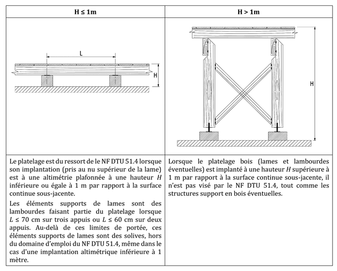
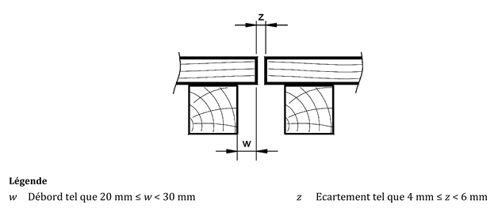
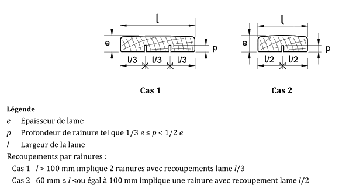
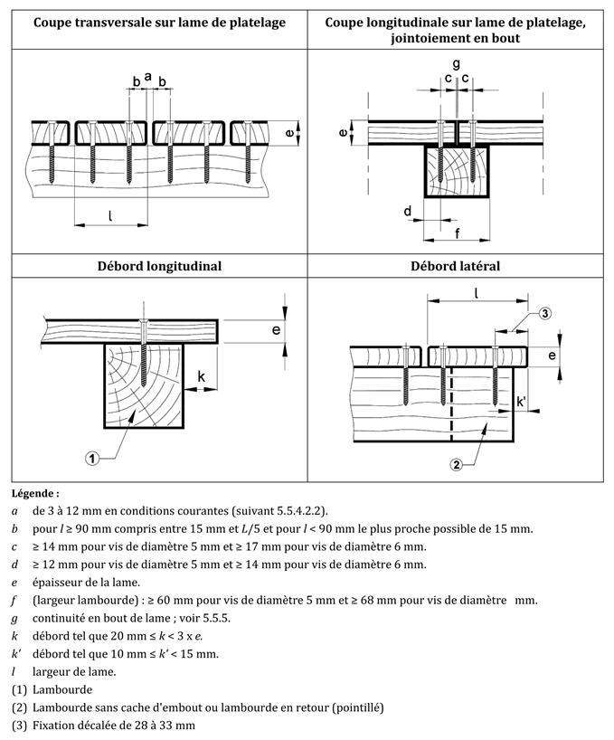
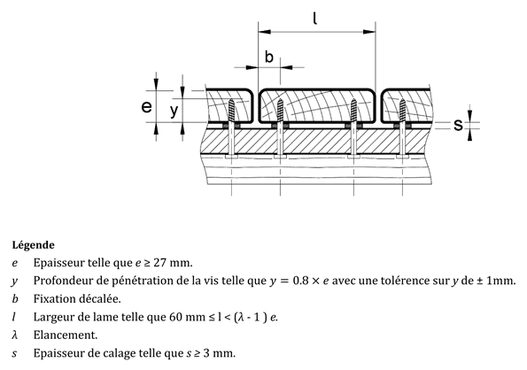
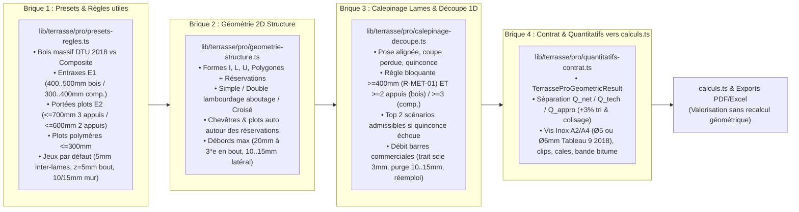

# Dossier d'Étude Technique & Référentiel Normatif — NF DTU 51.4 (Décembre 2018) pour BNA Terrasse Pro

> [!IMPORTANT]
> **Statut de la mission : Étude documentaire, ingénierie normative et spécification moteur uniquement (Zéro modification de code ou de base de données).**
> - **Périmètre normatif** : **NF DTU 51.4 (indice de classement P63-205, édition homologuée de décembre 2018)** — Parties P1-1 (CCT), P1-2 (CGM) et P2 (CCS), complété par **NF B 54-040 (décembre 2018)**, **FD P 20-651**, **NF DTU 31.1**, **NF EN 1991-1-1/AN**, **NF EN 1991-1-4/AN**, **NF EN 1995-1-1 (Eurocode 5)** et un **référentiel Composite (WPC) séparé** sourcé par fabricant (Silvadec, Fiberdeck, Neowood, Océwood).
> - **Séparation stricte Bois massif vs Composite** : Les lames et lambourdes en bois polymères (WPC), bois modifiés thermiquement (TMT), bambous et fixations invisibles par clips sont **explicitement exclus** du NF DTU 51.4 (P1-1 §1). Ils relèvent exclusivement d'un référentiel `PRESCRIPTION_FABRICANT` ou DTA/ATec dédié (§20).

---

## Table des Matières

1. **Inventaire et Critique Documentaire des Sources Exploitées (§1–§2)**
2. **Vérité Normative NF DTU 51.4 (Décembre 2018) & Référentiel Composite par Domaine Métier (§3–§20)**
   - §3. Domaine d'application du NF DTU 51.4 & Frontière NF DTU 31.1
   - §4. Catégories de sollicitations mécaniques (Sollicitations 1, 2, 3)
   - §5. Dimensionnement des lambourdes et des solives
   - §6. Dimensionnement des lames de platelage
   - §7. Types de structure et de lambourdage (Simple, Croisé, Double, Combiné)
   - §8. Continuité en bout de lame (Aboutages $z \in [4, 6]\text{ mm}$ sur simple et double lambourde)
   - §9. Conception courante vs Conception élaborée (avec RLDC sous la lame)
   - §10. Humidité des bois, jeux de pose et cales d'écartement (Tableau 8 de 2018)
   - §11. Fixations (Traversantes par le dessus $\varnothing 5 / \varnothing 6\text{ mm}$, par le dessous $e \ge 27\text{ mm}$, métal, règles de bord)
   - §12. Supports, cales et plots (Béton, Sol brut stabilisé, Plots polymères $\le 30\text{ cm}$, Bois, Métal)
   - §13. Pente, drainage et ventilation ($1/50^{\text{e}}$, plénum $50\text{ mm}$)
   - §14. Durabilité biologique, classes d'emploi et essences (NF DTU 51.4 P1-2 & NF B 54-040)
   - §15. Vent, neige et efforts horizontaux
   - §16. Tolérances de l'ouvrage fini (Tableau 16)
   - §17. Réservations, trémies, contours complexes et chevêtres (Algorithmes géométriques)
   - §18. Optimisation des découpes 1D et gestion des chutes
   - §19 & §20. Séparation Bois massif / Composite & Référentiel Composite Fabricants (Silvadec, Fiberdeck, Neowood, Océwood)
3. **Architecture Cible Allégée du Moteur Terrasse Pro en 4 Briques Terrain & Contrat `TerrasseProGeometricResult` (§21)**
   - Brique 1 — Presets & Règles utiles (`lib/terrasse/pro/presets-regles.ts`)
   - Brique 2 — Moteur géométrique 2D Structure : Lambourdes, Chevêtres & Plots (`lib/terrasse/pro/geometrie-structure.ts`)
   - Brique 3 — Calepinage des Lames & Optimiseur de découpe 1D (`lib/terrasse/pro/calepinage-decoupe.ts`)
   - Brique 4 — Contrat de sortie `TerrasseProGeometricResult` vers `calculs.ts` (`lib/terrasse/pro/quantitatifs-contrat.ts`)

---

## 1. Inventaire et Critique Documentaire des Sources Exploitées

Toutes les sources primaires et secondaires ont été téléchargées, extraites et inspectées intégralement dans le répertoire d'étude [`scratch/dtu51-4-study/`](file:///data/data/com.termux/files/home/.gemini/antigravity-cli/brain/11202fc9-445c-4b21-8bf6-f1048234acc1/scratch/dtu51-4-study):

| Réf. Source | Titre exact & Auteur | Édition / Date | Statut & Usage dans ce dossier | Fichier local inspecté |
| :--- | :--- | :--- | :--- | :--- |
| **S1 — DTU P1-1** | *NF DTU 51.4 P1-1 : Platelages extérieurs en bois — Partie 1-1 : Cahier des clauses techniques types (CCT)* (AFNOR / BNBA, indice P63-205-1-1) | **Décembre 2018** (texte intégral verbatim + 23 figures PNG) | **Source normative primaire n°1 (`NORME_DTU_51_4`)** | [`dtu_51_4_p1-1_complet.md`](file:///data/data/com.termux/files/home/.gemini/antigravity-cli/brain/11202fc9-445c-4b21-8bf6-f1048234acc1/scratch/dtu51-4-study/clean_md/dtu_51_4_p1-1_complet.md) |
| **S2 — DTU P1-2** | *NF DTU 51.4 P1-2 : Platelages extérieurs en bois — Partie 1-2 : Critères généraux de choix des matériaux (CGM)* (AFNOR / BNBA, indice P63-205-1-2) | **Décembre 2018** (texte intégral verbatim) | **Source normative primaire n°2 (`NORME_DTU_51_4`)** | [`dtu_51_4_p1-2_complet.md`](file:///data/data/com.termux/files/home/.gemini/antigravity-cli/brain/11202fc9-445c-4b21-8bf6-f1048234acc1/scratch/dtu51-4-study/clean_md/dtu_51_4_p1-2_complet.md) |
| **S3 — DTU P2** | *NF DTU 51.4 P2 : Platelages extérieurs en bois — Partie 2 : Cahier des clauses administratives spéciales types (CCS)* (AFNOR / BNBA, indice P63-205-2) | **Décembre 2018** (texte intégral verbatim) | **Source normative primaire n°3 (`NORME_DTU_51_4`)** | [`dtu_51_4_p2_complet.md`](file:///data/data/com.termux/files/home/.gemini/antigravity-cli/brain/11202fc9-445c-4b21-8bf6-f1048234acc1/scratch/dtu51-4-study/clean_md/dtu_51_4_p2_complet.md) |
| **S4 — prNF DTU P1-1 (ATIBT)** | *pr NF DTU 51.4-1-1:2017 (F) — Travaux de bâtiment — Platelage extérieur en bois — Partie 1-1 : CCT* (63 pages, incluant les Tableaux 1 à 16 et la formule de $k_h$) | **Août 2017** (version d'enquête finale avant homologation 2018) | **Source de recoupement intégral des tableaux P1-1** (fournit notamment les Tableaux 2, 4, 10, 13 dont les PNG sont 404 sur `dtu.golgoth.org`) | [`atibt_dtu_p1_1.pdf`](file:///data/data/com.termux/files/home/.gemini/antigravity-cli/brain/11202fc9-445c-4b21-8bf6-f1048234acc1/scratch/dtu51-4-study/atibt_dtu_p1_1.pdf) |
| **S5 — Guide FCBA V4** | *Terrasses en bois — Guide de conception et de réalisation* (Matthieu Lambert & Serge Le Nevé — Président de la commission NF DTU 51.4, FCBA / LCB / ATB / ARBUST / FNB / CODIFAB, 92 pages) | **Version 4 — Mars 2020** (mis à jour selon NF DTU 51.4 et NF B 54-040 de décembre 2018) | **Source secondaire officielle de rang 1** : reproduit les tableaux de décembre 2018 (P1-1, P1-2, NF B 54-040) + tableaux Solives (NF DTU 31.1) et Plots | [`guide_fcba.pdf`](file:///data/data/com.termux/files/home/.gemini/antigravity-cli/brain/11202fc9-445c-4b21-8bf6-f1048234acc1/scratch/dtu51-4-study/guide_fcba.pdf) |
| **S6 — Mémento ARBUST** | *Mémento technique — Platelages extérieurs en bois NF DTU 51.4 et NF B 54-040* (ARBUST / FCBA, 20 pages) | **Mai 2019** (conforme à l'édition décembre 2018) | **Source secondaire officielle de synthèse** (Tableaux 1, 5, 8, 9, coupes et règles de bord) | [`memento_arbust.pdf`](file:///data/data/com.termux/files/home/.gemini/antigravity-cli/brain/11202fc9-445c-4b21-8bf6-f1048234acc1/scratch/dtu51-4-study/memento_arbust.pdf) |
| **S7 — Guide Terrasse Nature** | *Guide d'application du DTU 51.4* (Terrasse Nature, 120 pages, pied de page daté du `25/02/13`) | **Février 2013** (**basé sur le NF DTU 51.4 de décembre 2010 !**) | **ÉCARTÉ pour les valeurs normatives 2018** (conservé uniquement pour identifier les pièges d'obsolescence 2010 vs 2018) | [`guide_terrasse_nature.pdf`](file:///data/data/com.termux/files/home/.gemini/antigravity-cli/brain/11202fc9-445c-4b21-8bf6-f1048234acc1/scratch/dtu51-4-study/guide_terrasse_nature.pdf) |
| **S8 — Notices Composite** | Notices officielles **Silvadec** (`PU7 V27` 12/2025 & `PU26 V6`), **Fiberdeck** (`V1.01-2022`), **Neowood** (*Notice Trocosto Composite*), **Océwood** | **2019–2025** | **Sources primaires du référentiel Composite (`PRESCRIPTION_FABRICANT`)** | [`notice_silvadec_pu7.pdf`](file:///data/data/com.termux/files/home/.gemini/antigravity-cli/brain/11202fc9-445c-4b21-8bf6-f1048234acc1/scratch/dtu51-4-study/notice_silvadec_pu7.pdf), [`notice_fiberdeck.pdf`](file:///data/data/com.termux/files/home/.gemini/antigravity-cli/brain/11202fc9-445c-4b21-8bf6-f1048234acc1/scratch/dtu51-4-study/notice_fiberdeck.pdf), [`notice_neowood.pdf`](file:///data/data/com.termux/files/home/.gemini/antigravity-cli/brain/11202fc9-445c-4b21-8bf6-f1048234acc1/scratch/dtu51-4-study/notice_neowood.pdf) |

> [!WARNING]
> **Alerte critique d'obsolescence documentaire (Piège du Guide Terrasse Nature 2013 vs NF DTU 51.4 de décembre 2018)** :
> Le fichier `GUIDE-D-APPLICATION-DTU-51-4-V1.pdf` hébergé par Terrasse Nature porte en pied de toutes ses pages la date `25/02/13` et commente l'ancienne édition **décembre 2010** du DTU 51.4. L'édition **décembre 2018** a profondément modifié :
> 1. **Les catégories de platelage** : suppression des anciens « Type 1 / Type 2 » au profit du croisement **[Sollicitations 1, 2, 3] $\times$ [Conception courante, Conception élaborée]** (P1-1 §5.2.1).
> 2. **Les critères de flèche** : la flèche finale des lames est unifiée à **$5\text{ mm}$** pour toutes les sollicitations (fin de la flèche $3\text{ mm}$ en ERP de 2010) ; la flèche des lambourdes passe à **$L/300$ (instantanée)** et **$L/200$ (finale)** au lieu de $L/400$ en 2010 (P1-1 §5.5.3.6.3, §5.5.4.1, Annexe B §B.5).
> 3. **La classe mécanique minimale des feuillus** : abaissée à **D18** (au lieu de D24 en 2010) pour valoriser le chêne et le châtaignier français (P1-1 §5.5.3.6.3 et §5.5.4.1).
> 4. **L'humidité et les cales de pose** : remplacement de la carte de France d'humidité par 3 plages d'humidité à la pose ($12\text{–}17\%$, $18\text{–}22\%$, $>\text{PSF}$) couplées au **Tableau 8** des cales de pose (P1-1 §5.5.4.2).
> 5. **Les diamètres de vis** : uniquement **$5\text{ mm}$ et $6\text{ mm}$** selon le **Tableau 9** pour $e \in [21, 45]\text{ mm}$ (au lieu de $4{,}5\text{ mm}$ à $8\text{ mm}$ en 2010).

---

## 2. Analyse Technique Approfondie par Domaine Métier (§3 à §22)

### §3. Domaine d'Application du NF DTU 51.4 (Décembre 2018) & Frontière NF DTU 31.1



#### 3.1 Conditions cumulatives d'appartenance au NF DTU 51.4 (P1-1 Avant-propos particulier & Article 1)
Un ouvrage relève intégralement du **NF DTU 51.4 (décembre 2018)** si et seulement si toutes les conditions suivantes sont réunies :
1. **Matériau des lames** : Bois massif ou bois recomposé (Bois Massif Abouté BMA, Bois Massif Reconstitué BMR, Bois Lamellé-Collé BLC) conforme à **NF B 54-040 (décembre 2018)** et **NF DTU 51.4 P1-2 §3.1** ; épaisseur $21\text{ mm} \le e \le 45\text{ mm}$ (Tableau 9 note $a$).
2. **Matériau des lambourdes** : Bois massif abouté ou non, BLC ou BMR conforme à **NF DTU 51.4 P1-2 §3.2**, ou support linéaire bois (NF DTU 31.1), métal (NF DTU 32.1) ou béton (NF DTU 20.1 / 21 / 13.3).
3. **Altimétrie maximale du platelage** : **$H \le 1{,}00\text{ m}$** en tous points par rapport à la surface continue sous-jacente (P1-1 Avant-propos Fig. 1 et Art. 1).
4. **Portée maximale des lambourdes entre appuis ($L_{\text{appui}}$)** :
   - Sur **3 appuis ou plus** : **$L_{\text{appui}} \le 700\text{ mm}$** ($70\text{ cm}$).
   - Sur **2 appuis** : **$L_{\text{appui}} \le 600\text{ mm}$** ($60\text{ cm}$).
   - *Bascule normative* : Au-delà de $70\text{ cm}$ (3 appuis) ou $60\text{ cm}$ (2 appuis), ou si $H > 1{,}00\text{ m}$, les éléments porteurs ne sont plus des lambourdes mais des **solives structurelles** relevant du **NF DTU 31.1** et de l'**Eurocode 5 (NF EN 1995-1-1)** pour le dimensionnement mécanique, tandis que les autres prescriptions du NF DTU 51.4 (durabilité, fixation, planéité, écartements) demeurent applicables dans la limite $e \le 45\text{ mm}$ (P1-1 Avant-propos Fig. 1).
5. **Hauteur maximale sur plots polymères** : **$H_{\text{plot\_sous\_lame}} \le 30\text{ cm}$** ($300\text{ mm}$) entre le sol d'assise du plot et le nu inférieur de la lame (P1-1 Art. 1 & §5.5.3.4.2).
6. **Pente maximale du platelage** : **$\le 5\%$** (P1-1 Art. 1).
7. **Altitude climatique maximale (neige)** :
   - Zones de neige **A à D** : altitude **$\le 1\,700\text{ m}$** ;
   - Zone de neige **E** : altitude **$\le 1\,000\text{ m}$** (P1-1 Art. 1 & §5.3.3).
8. **Zones géographiques** : France métropolitaine et **DROM** (Guyane, Mayotte, Martinique, Réunion, Guadeloupe), avec règles spécifiques DROM sur la classe d'emploi (classe 4 obligatoire, Tableau 3), le vent (Tableau 2) et le calcul du jeu de pose (Tableau 8 non applicable aux DROM, P1-1 §5.5.4.2.2).

#### 3.2 Matrice d'Applicabilité et de Bascule Normative (Moteur ` ApplicabilityChecker`)

| Cas d'entrée utilisateur | Statut vis-à-vis du NF DTU 51.4 | Référentiel applicable dans Terrasse Pro | Comportement attendu du moteur |
| :--- | :--- | :--- | :--- |
| Bois massif, $H \le 1\text{ m}$, $L_{\text{appui}} \le 700\text{ mm}$ (3 appuis) ou $\le 600\text{ mm}$ (2 appuis), vis dessus/dessous | **INCLUS** | `NORME_DTU_51_4` | Validation complète selon NF DTU 51.4 (Décembre 2018). |
| Bois massif, $H \le 1\text{ m}$, mais $L_{\text{appui}} > 700\text{ mm}$ (3 appuis) ou $> 600\text{ mm}$ (2 appuis) | **BASCULE PARTIELLE** (Supports = Solives) | `NORME_ASSOCIEE` (**NF DTU 31.1 / EC5** pour les solives) + `NORME_DTU_51_4` (lames, fixations, durabilité) | Bascule du calcul des porteurs en mode **Solives NF DTU 31.1** (Tableaux Solives FCBA pp. 43–45) ; conservation des règles DTU 51.4 sur les lames. |
| Bois massif, $H > 1{,}00\text{ m}$ | **HORS DTU 51.4 MÉCANIQUE** | `NORME_ASSOCIEE` (**NF DTU 31.1 + NF EN 1995-1-1** + garde-corps NF P 01-012) | Avertissement explicite : structure et platelage du ressort mécanique du NF DTU 31.1 (ouvrage structural). |
| Plots polymères avec hauteur sous lames $> 300\text{ mm}$ | **EXCLUS DTU 51.4** | Hors domaine plots polymères DTU 51.4 (P1-1 Art. 1 & §5.5.3.4.2) | **Rejet explicite** des plots polymères si $H_{\text{sous\_lame}} > 300\text{ mm}$ ; exiger structure porteuse bois/métal/béton. |
| Lames en **bois composite (WPC)** | **EXCLUS DTU 51.4** | `PRESCRIPTION_FABRICANT` (Référentiel Composite dédié §20) | **Bascule stricte** vers le profil fabricant sélectionné (Silvadec, Fiberdeck, Neowood, Océwood) ; interdiction d'appliquer les entraxes ou jeux bois massif. |
| Bois modifié thermiquement (TMT / Rétifié), bambou | **EXCLUS DTU 51.4** | Avis Technique (ATec) / DTA / Cahier des charges fabricant | Avertissement bloquant sans paramètres fabricant/ATec explicites. |
| Fixations invisibles par clips sur bois massif | **EXCLUS DTU 51.4** | DTA / ATec / Prescription fabricant du système de fixation | Signalé comme hors NF DTU 51.4 (seuls le vissage traversant §5.5.6.2 et le vissage par le dessous §5.5.6.3 sont visés). |
| Pose directe sur support surfacique (dalle, étanchéité) **sans calage** | **INTERDIT** | Violation P1-1 Art. 1 & §5.5.3.1 | **Rejet bloquant** (`ERR_LAMBOURDE_SANS_CALAGE`). |
| Platelage participant à la protection d'étanchéité de toiture-terrasse | **EXCLUS DTU 51.4** | Règles Professionnelles CSFE (Juin 2017) / NF DTU 43.1 | Signalement réglementaire spécifique (exigence de trappes de visite, plots sur étanchéité, etc.). |
| Pente $> 5\%$, escaliers, gradins, garde-corps, usages C4/D2 (dancings, scènes, grands magasins) | **EXCLUS DTU 51.4** | NF DTU 31.1 / Eurocode 5 | **Rejet explicite** hors domaine d'application. |

---

### §4. Catégories de Sollicitations Mécaniques (P1-1 §5.2.1, §5.5, §5.6, §5.7 & Annexe B §B.2)

Le NF DTU 51.4 (décembre 2018) définit **3 catégories de sollicitations mécaniques** (issues de la NF EN 1991-1-1 et de son Annexe Nationale NF P 06-111-2/A1), toutes déclinables en **conception courante** ou en **conception élaborée** :

| Catégorie DTU 51.4 | Catégorie Eurocode 1 couverte | Exemples d'ouvrages visés (P1-1 §5.2.1) | Charge répartie $q_k$ (moyen terme) | Charge concentrée $Q_k$ court terme (ou long terme) | Facteur $\psi_2$ (charge répartie) | Flèche finale max Lames | Flèche max Lambourdes (inst. / finale) |
| :--- | :--- | :--- | :---: | :---: | :---: | :---: | :---: |
| **Sollicitations 1** (§5.5) | **Catégorie A** (habitation, résidentiel, balcons) | Ouvrage intégré attenant à ou à proximité d'une habitation individuelle | **$3{,}5\text{ kN/m}^2$** | **$2{,}0\text{ kN}$** ($1{,}25\text{ kN}$ long terme) | **$0{,}3$** | **$5\text{ mm}$** | **$L/300$** / **$L/200$** |
| **Sollicitations 2** (§5.6) | **Catégorie C1** | Espaces équipés de tables : écoles, cafés, restaurants | **$2{,}5\text{ kN/m}^2$** | **$3{,}0\text{ kN}$** ($1{,}35\text{ kN}$ long terme) | **$0{,}6$** | **$5\text{ mm}$** | **$L/300$** / **$L/200$** |
| **Sollicitations 3** (§5.7) | **Catégorie D1** + couvre **B, C2, C3, C5** | Commerces de détail courants (D1), bureaux (B), sièges fixes (C2), circulation sans obstacles / musées (C3), foules importantes / accès bâtiments publics, gares (C5) | **$5{,}0\text{ kN/m}^2$** | **$5{,}0\text{ kN}$** ($2{,}25\text{ kN}$ long terme) | **$0{,}6$** | **$5\text{ mm}$** | **$L/300$** / **$L/200$** |

> [!NOTE]
> **Règle importante sur les charges concentrées de moyen/long terme (P1-1 §5.5.3.6.3 & §5.5.4.1)** :
> Les charges concentrées du DTU sont affectées à la classe de durée de chargement **« court terme »** ($\psi_2 = 0$, $k_{\text{def}} = 0$, $k_{\text{mod}} = 0{,}7$). Les charges concentrées permanentes ou de moyen/long terme (ex. spa, jacuzzi, abri lourd, poteau de pergola) **ne sont pas couvertes par le DTU 51.4** et nécessitent une justification ou des appuis indépendants sous la structure.

---

### §5. Dimensionnement des Lambourdes et des Solives (P1-1 §5.5.3.6, §5.6.4, §5.7.3)

#### 5.1 Distinction géométrique fondamentale (Zéro confusion possible dans le moteur)
- **Entraxe des lambourdes ($E_{\text{lamb}}$)** : distance d'axe en axe entre deux lambourdes parallèles. C'est la **portée des lames de platelage** (issue des Tableaux 7, 12, 15).
- **Portée des lambourdes / Entraxe des appuis de lambourdes ($L_{\text{appui}}$)** : distance d'axe en axe entre deux supports sous une même lambourde (plots béton, plots polymères, cales sur dalle, solives). C'est la valeur lue dans les **Tableaux 4, 5, 6, 10, 11, 13, 14** (plafonnée à $700\text{ mm}$ sur $\ge 3$ appuis et $600\text{ mm}$ sur $2$ appuis dans le cadre du NF DTU 51.4).

#### 5.2 Règles de section minimale des lambourdes en bois massif (P1-1 §5.5.3.6.1, §5.5.3.6.2, §5.5.3.6.3)
1. **Classe mécanique minimale** : **C18** (résineux) et **D18** (feuillus) (P1-1 §5.5.3.6.3).
2. **Section transversale minimale absolue** : **$b \times h \ge 2\,200\text{ mm}^2$** (pour permettre le classement mécanique selon NF B 52-001-1 ; ex. $40 \times 50\text{ mm} = 2\,000\text{ mm}^2$ est **interdit** et marqué `X` dans les Tableaux 4, 10 et 13 !).
3. **Largeur minimale $b_{\min}$ d'une lambourde (vissage traversant par le dessus)** :
   - **Cas 1 — Une seule vis dans la largeur de la lambourde** (partie courante, rive, ou **double lambourdage** où chaque lambourde ne reçoit qu'un bout de lame) :
     - **$b_{\min} = 45\text{ mm}$** pour les lambourdes de classe mécanique **inférieure à D40 et C30** (soit C18, C24, D18, D24, D30, D35) ;
     - **$b_{\min} = 40\text{ mm}$** pour les lambourdes en bois feuillus de classe **$\ge \text{D40}$** (sous réserve que $40 \times h \ge 2\,200\text{ mm}^2$, donc $h \ge 55\text{ mm}$).
   - **Cas 2 — Deux vis dans la largeur d'une seule lambourde (aboutage sur simple lambourde)** :
     - P1-1 §5.5.3.6.1 impose un seuil général d'au moins **$60\text{ mm}$**, mais la **Figure 19 légende `f` (§5.5.6.2.4)** précise la règle géométrique exacte liée aux distances de bord $c$ et $d$ :
       - Pour vis de diamètre **$d_{\text{vis}} = 5\text{ mm}$** : **$b_{\min} \ge 60\text{ mm}$** ($2 \times c + 2 \times d + g_{\max} = 2 \times 14 + 2 \times 12 + 6 = 58\text{ mm} \to 60\text{ mm}$) ;
       - Pour vis de diamètre **$d_{\text{vis}} = 6\text{ mm}$** : **$b_{\min} \ge 68\text{ mm}$** ($2 \times 17 + 2 \times 14 + 6 = 68\text{ mm}$).
   - **Cas 3 — Vissage par le dessous (§5.5.6.3.1)** :
     - La largeur de la lambourde doit être **augmentée de $+10\text{ mm}$** par rapport à la largeur de base du vissage par le dessus (soit $55\text{ mm}$ en partie courante C18/D18–D35, ou $50\text{ mm}$ en $\ge \text{D40}$).
4. **Hauteur minimale $h_{\min}$ d'une lambourde (§5.5.3.6.2)** :
   - **Lames et lambourdes de masse volumique similaire** (ou lames résineux / feuillus $<\text{D40}$) :
     $$h_{\min} = 1{,}5 \times e_{\text{lame}} + 8\text{ mm}$$
     *(Exemple : pour $e = 21\text{ mm}$, $1{,}5 \times 21 + 8 = 39{,}5\text{ mm}$, relevé à $50\text{ mm}$ pour atteindre $45 \times 50 = 2\,250\text{ mm}^2 \ge 2\,200\text{ mm}^2$ ; pour $e = 34\text{ mm}$, $1{,}5 \times 34 + 8 = 59\text{ mm}$).*
   - **Lames de caractéristiques mécaniques $\ge \text{D40}$ posées sur lambourdes de caractéristiques mécaniques inférieures (ex. lame Ipé D40/D50 sur lambourde Pin C24)** :
     $$h_{\min} = 2{,}2 \times e_{\text{lame}}$$
     *(Exemple : lame exotique D40 de $e = 21\text{ mm}$ sur lambourde Pin C24 $\implies h_{\min} = 2{,}2 \times 21 = 46{,}2\text{ mm}$ ; lame D40 de $e = 27\text{ mm}$ sur lambourde Pin C24 $\implies h_{\min} = 2{,}2 \times 27 = 59{,}4\text{ mm} \to 60\text{ mm}$).*
5. **Réduction de portée sur 2 appuis (§5.5.3.6.3, §5.6.4, §5.7.3)** :
   - Tous les tableaux de lambourdes (Tableaux 4, 5, 6, 10, 11, 13, 14) sont calculés sur **3 appuis simples**.
   - Lorsque la lambourde ne repose que sur **2 appuis** (segment court entre deux plots), l'entraxe maximal entre appuis issu du tableau doit subir une **réduction de $25\%$** ($\times 0{,}75$), tout en restant $\le 600\text{ mm}$.

---

### §6. Dimensionnement des Lames de Platelage (P1-1 §5.5.4.1, §5.6.5, §5.7.4 & NF B 54-040)

1. **Critères mécaniques (Eurocode 5, Classe de service 3)** :
   - Classe mécanique minimale : **C18** (résineux) et **D18** (feuillus).
   - Flèche instantanée et flèche finale maximale entre appuis : **$5\text{ mm}$** (quelle que soit la catégorie de sollicitation 1, 2 ou 3).
   - Calcul sur **3 appuis simples** avec coefficient de semi-encastrement de **$0{,}8$** sur les moments et flèches à mi-travée, et facteur de hauteur $k_h = (150/e)^{0{,}2}$ non plafonné à $1{,}3$ (Annexe B §B.1 et §B.4).
2. **Plage normative d'épaisseur et de largeur des lames** :
   - **Épaisseur $e$** : **$21\text{ mm} \le e \le 45\text{ mm}$** (en dessous de $21\text{ mm}$ ou au-dessus de $45\text{ mm}$, le platelage sort du NF DTU 51.4 — cf. NF B 54-040 & Tableau 9 note $a$).
   - **Cas du vissage par le dessous (§5.5.6.3.1)** : épaisseur minimale **$e > 27\text{ mm}$** (Figure 22 indique $e = 27\text{ mm}$ minimum, texte §5.5.6.3.1 dit « supérieure à $27\text{ mm}$ » — voir analyse d'ambiguïté au Livrable F) et largeur minimale **$l \ge 60\text{ mm}$**.
3. **Contrainte d'élancement maximal $\lambda = l / e$ (NF B 54-040 Décembre 2018 & P1-1 Tableau 1)** :
   - Les Tableaux 7, 12 et 15 ne sont exploitables **que si la lame respecte l'élancement maximal $\lambda_{\max} = l / e$ défini pour son essence dans la norme NF B 54-040** (P1-1 §5.5.4.1) :
     - **Élancement de base $\lambda_{\text{base}} = 7$** (épaisseur min $21\text{ mm}$) : Iroko, Teck, Western Red Cedar, Ipé, Padouk, Doussié, Merbau, Robinier, Itauba, Muiraquatiara.
     - **Élancement de base $\lambda_{\text{base}} = 6$** (épaisseur min $21\text{ mm}$) : Mélèze, Douglas, Pin sylvestre, Pin maritime, Épicéa/Sapin, Chêne, Châtaignier, Frêne, Cumaru, Massaranduba, jatoba, Angélique, Guariuba, Badi/Bilinga, Movingui, Tali, Maçaranduba, etc.
     - **Élancement de base $\lambda_{\text{base}} = 4{,}5$** (épaisseur min $25\text{ mm}$) : Bangkiraï (Yellow Balau), Garapa, Cœur dehors, Gombeira.
   - **Minorations obligatoires du coefficient d'élancement $\lambda$** :
     - En **vissage par le dessous** (§5.5.6.3.1) : **$\lambda_{\text{eff}} = \lambda_{\text{base}} - 1$** (donc $l_{\max} = (\lambda_{\text{base}} - 1) \times e$).
     - En **conception élaborée** (§5.2.3 Tableau 1) :
       - Solution 1 (pente face sup $\ge 4\%$ + RLDC) : **$\lambda_{\text{base}}$** ;
       - Solution 2 (pente face sup $\ge 4\%$ sans RLDC) : **$\lambda_{\text{base}} - 1$** ;
       - Solution 3 (face sup horizontale + RLDC) : **$\lambda_{\text{base}} - 1$** ;
       - Solution 4 (face sup horizontale sans RLDC) : **$\lambda_{\text{base}} - 2$**.
4. **Réduction de portée sur 2 appuis (§5.5.4.1 Tableau 7)** :
   - Toute lame ou segment de lame reposant sur **2 appuis seulement** (au lieu de $\ge 3$ appuis) doit voir son entraxe maximal de lambourdes réduit de **$15\%$** ($\times 0{,}85$).
   - **Conséquence critique pour le moteur géométrique** : si un segment de lame coupé (en rive, autour d'une réservation ou en bout de rangée) ne franchit que 2 lambourdes (1 seule travée), la distance entre ces 2 lambourdes ne doit pas dépasser $0{,}85 \times E_{\text{max\_3appuis}}$ !

---

### §7. Types de Structure et de Lambourdage (P1-1 §5.5.3.2, Figures 7, 8, 9)

Le NF DTU 51.4 (§5.5.3.2) définit **4 techniques constructives de lambourdage** que le moteur Terrasse Pro doit modéliser sous forme d'**objets géométriques 2D/3D individualisés** (et non comme un simple multiplicateur de métré) :

1. **Lambourdage simple (§5.5.3.2 a)** :
   - Un seul lit de lambourdes parallèles entre elles, isolées du support par des cales ou plots, sur lesquelles les lames sont vissées perpendiculairement.
   - Possibilité d'ajouter des **entretoises** entre lambourdes pour améliorer la stabilité.
2. **Lambourdage croisé (§5.5.3.2 b, Figure 7)** :
   - Constitué d'un **premier lit inférieur** de lambourdes (ou solives) sur lequel vient se fixer perpendiculairement un **deuxième lit supérieur** de lambourdes recevant les lames.
   - Crée un **« effet plaque »** solidarisant l'ensemble de l'ouvrage.
   - **Recommandé** en cas d'utilisation de bois peu stable (stabilité `PS` selon NF B 54-040), sur plots polymères, avec faible ventilation en sous-face.
   - **Interdit** dans les configurations « lames seules sur support linéaire bois ou métal » (configurations 3 et 7 de la Figure 2, cf. P1-1 §5.2.1).
   - **Impact altimétrique** : $H_{\text{structure}} = h_{\text{cale/plot}} + h_{\text{lit\_1}} + h_{\text{lit\_2}} + e_{\text{cale\_lame}} + e_{\text{lame}}$. Attention : sur plots polymères, la hauteur sous lames ($h_{\text{plot}} + h_{\text{lit\_1}} + h_{\text{lit\_2}}$) doit rester **$\le 300\text{ mm}$** !
3. **Lambourdage double (§5.5.3.2 c, Figure 3 & Figure 8)** :
   - Doublement des lambourdes au droit des jonctions d'extrémités de lames (aboutages), soit **sur toute la ligne de lambourde**, soit par adjonction d'un **chevêtre / lambourde secondaire** d'appui.
   - **Obligatoire en Conception élaborée** (§5.2.3 a, Figure 3).
   - Chaque lambourde de la paire est positionnée en retrait d'au moins **$20\text{ mm}$** de l'extrémité de la lame qu'elle supporte, avec un maximum de **$30\text{ mm}$** en conception élaborée (§5.2.3 a, Fig. 3) ou **$2 \times e_{\text{lame}}$** en conception courante (§5.5.3.2 c).
4. **Combinaison du double lambourdage et du lambourdage croisé (§5.5.3.2 d, Figure 9)** :
   - Le lit supérieur du lambourdage croisé est doublé au droit des aboutages de lames, reposant directement sur le lit inférieur perpendiculaire (ce qui évite d'avoir à poser deux lambourdes sur une même tête de plot).

---

### §8. Continuité en Bout de Lame — Aboutages (P1-1 §5.2.3 a, §5.5.5, Figure 3 & Figure 19)



> [!CAUTION]
> **Divergence interne du NF DTU 51.4 (décembre 2018) sur le jeu $z$ en double lambourdage — Résolution normative** :
> - Le texte de **P1-1 §5.2.3 a)** (conception élaborée, version homologuée décembre 2018) stipule : *« La distance $z$ entre les extrémités des lames doit être comprise entre **4 et 6 mm** »* et **§5.5.5** stipule : *« Dans tous les cas, un jeu supérieur à **6 mm** ne sera pas admis sauf exigence spécifique mentionnée dans les DPM »*.
> - En revanche, la légende graphique de la **Figure 3** (`fig_ACSU_2_3.png`) et la phrase finale de **§5.5.5** ont conservé la mention du projet 2017 (*« compris entre 3 et 8 mm »*).
> - **Règle retenue pour le moteur Terrasse Pro** : En application du plafond impératif de §5.5.5 (*« Dans tous les cas, un jeu supérieur à 6 mm ne sera pas admis »*) et de §5.2.3 a), le moteur retient l'intersection stricte **$z \in [4\text{ mm}, 6\text{ mm}]$** (valeur nominale par défaut : **$5\text{ mm}$**), qui satisfait simultanément toutes les clauses du DTU !

| Paramètre d'aboutage | Simple lambourde (Conception courante uniquement) | Double lambourde (Conception courante ou élaborée) | Source exacte NF DTU 51.4 P1-1 |
| :--- | :--- | :--- | :--- |
| **Admissibilité en Conception élaborée** | **INTERDIT** | **OBLIGATOIRE** | §5.2.3 a) |
| **Jeu longitudinal en bout de lame ($g$ ou $z$)** | **$5\text{ mm} \pm 1\text{ mm}$** (soit **$4 \text{ à } 6\text{ mm}$**) ; toléré entre **$1\text{ mm et } 5\text{ mm}$** uniquement pour bois de durabilité naturelle **Classe 1** (NF EN 350) ; **jamais $> 6\text{ mm}$** hors DPM | **$4 \text{ à } 6\text{ mm}$** en conception élaborée (§5.2.3 a) ; plafond général **$\le 6\text{ mm}$** (§5.5.5) | §5.2.3 a), §5.5.5 |
| **Distance extrémité de lame / bord de lambourde ($w$ / porte-à-faux)** | Débord longitudinal en rive : **$20\text{ mm} \le w \le 3 \times e_{\text{lame}}$** (Fig. 19) | **$20\text{ mm} \le w \le 30\text{ mm}$** (Conception élaborée §5.2.3 a & Fig. 3) ; ou **$20\text{ mm} \le w \le 2 \times e_{\text{lame}}$** (§5.5.3.2 c) | §5.2.3 a), §5.5.3.2 c), Fig. 3, Fig. 19 |
| **Écartement libre entre les 2 lambourdes sous l'aboutage ($e_{\text{inter}}$)** | Sans objet (1 seule lambourde) | **$e_{\text{inter}} = 2 \times w + z \in [44\text{ mm}, 66\text{ mm}]$** (typiquement **$55\text{ mm}$** pour $w = 25\text{ mm}$ et $z = 5\text{ mm}$) | Géométrie déduite de Fig. 3 (§5.2.3 a) |
| **Distance minimale axe-vis / bout de lame ($c$)** | **$\ge 14\text{ mm}$** ($\varnothing 5\text{ mm}$) ; **$\ge 17\text{ mm}$** ($\varnothing 6\text{ mm}$) | **$\ge 14\text{ mm}$** ($\varnothing 5\text{ mm}$) ; **$\ge 17\text{ mm}$** ($\varnothing 6\text{ mm}$) | §5.5.6.2.4 Figure 19 légende `c` |
| **Distance minimale axe-vis / bord de lambourde ($d$)** | **$\ge 12\text{ mm}$** ($\varnothing 5\text{ mm}$) ; **$\ge 14\text{ mm}$** ($\varnothing 6\text{ mm}$) | **$\ge 12\text{ mm}$** ($\varnothing 5\text{ mm}$) ; **$\ge 14\text{ mm}$** ($\varnothing 6\text{ mm}$) | §5.5.6.2.4 Figure 19 légende `d` |
| **Largeur minimale de la lambourde ($f$)** | **$\ge 60\text{ mm}$** ($\varnothing 5\text{ mm}$) ; **$\ge 68\text{ mm}$** ($\varnothing 6\text{ mm}$) | **$\ge 45\text{ mm}$** ($<\text{D40/C30}$) ou **$\ge 40\text{ mm}$** ($\ge \text{D40}$ avec $h \ge 55\text{ mm}$) pour chaque lambourde | §5.5.3.6.1 & Figure 19 légende `f` |
| **Pré-perçage en bout de lame** | **OBLIGATOIRE** (résineux ET feuillus) | **OBLIGATOIRE** (résineux ET feuillus) | §5.5.6.2.2 a) |

---

### §9. Conception Courante (« Piégeante ») vs Conception Élaborée (« Moyenne ») (P1-1 §5.2.2, §5.2.3, Tableau 1, Tableau 3)



Par défaut, si les DPM ne le précisent pas, la conception est **courante** (« piégeante » au sens du FD P 20-651).
Pour qu'un platelage soit qualifié de **conception élaborée** (« moyenne » au sens du FD P 20-651, permettant de passer de la classe d'emploi 4 à la classe d'emploi **3.2** en climat humide/modéré ou **3.1** en climat sec hors DROM selon le **Tableau 3**), il doit **cumuler obligatoirement les 4 dispositions `a + b + c + d`** de **P1-1 §5.2.3** :

1. **Condition `a` — Double lambourdage aux aboutages** :
   - Double lambourde obligatoire sous toute jonction de bouts de lames en partie courante, avec jeu entre bouts de lames $z \in [4, 6]\text{ mm}$ et distance entre extrémité de lame et lambourde $w \in [20, 30]\text{ mm}$ (Figure 3).
2. **Condition `b` — Limitation de la fissuration et du tuilage des lames (Tableau 1 & Figure 4)** :
   - La lame doit correspondre à l'une des **4 solutions du Tableau 1** combinant :
     - **Profil supérieur** : usinage lisse avec pente $\ge 4\%$ (profil bombé, en pente, ou pente du support) ou horizontal ;
     - **Rainures de Libération de Contrainte (RLDC) en sous-face (Figure 4)** : profondeur comprise entre **$1/3$ et $1/2$ de l'épaisseur $e$** ; **1 rainure** à mi-largeur ($1/2 - 1/2$) si $60\text{ mm} \le l \le 100\text{ mm}$ ; **2 rainures** aux tiers ($1/3 - 1/3 - 1/3$) si $l > 100\text{ mm}$ ;
     - **Minoration de l'élancement maximal $\lambda$** : $\lambda_{\text{base}}$ (Sol. 1 : pente $\ge 4\%$ + RLDC), $\lambda_{\text{base}} - 1$ (Sol. 2 : pente $\ge 4\%$ sans RLDC ; Sol. 3 : horizontale + RLDC), $\lambda_{\text{base}} - 2$ (Sol. 4 : horizontale sans RLDC).
3. **Condition `c` — Interface lame / support linéaire (désolidarisation $\ge 3\text{ mm}$ + protection lambourde)** :
   - Mise en place obligatoire de **cales polymères ou dispositifs pérennes de décollement d'épaisseur $\ge 3\text{ mm}$** entre la sous-face de la lame et le support linéaire ;
   - Si le support linéaire est une lambourde en bois, **protection obligatoire de la face supérieure de la lambourde** (bande bitumineuse débordante ou capotage), **sauf** si la lambourde est en bois de durabilité naturelle **Classe 1** (NF EN 350) ou à durabilité conférée compatible **Classe d'emploi 4** (NF EN 335).
   - *Attention (§5.5.6.2.1)* : Les usinages de formes adaptées en sous-face de lame ou sur la face supérieure de la lambourde (ex. lambourde trapézoïdale), bien que bénéfiques, **ne peuvent pas remplacer la cale de décollement de $3\text{ mm}$** pour justifier une conception élaborée !
4. **Condition `d` — Ventilation de la sous-face du platelage ($1/50^{\text{e}}$ + plénum $\ge 50\text{ mm}$)** :
   - Surface totale des dispositifs d'entrée d'air $\ge \mathbf{1/50^{\text{e}}}$ ($2\%$) de la surface totale du platelage (les jeux entre lames comptant pour l'évacuation) ;
   - Hauteur minimale du **plénum** (distance entre le sol en partie courante et la sous-face de la lambourde inférieure) : **$\ge 50\text{ mm}$**.
5. **Disposition `e` (facultative, §5.2.3 e)** : Le vissage par le dessous avec désolidarisation améliore la durabilité mais n'est pas requis pour valider la conception élaborée.

---

### §10. Humidité des Bois, Jeux de Pose et Cales d'Écartement (P1-1 §5.5.4.2, Tableau 8)

1. **Humidité cible à la mise en œuvre (§5.5.4.2.1)** :
   - **Humidité médiane standard** (bois désaubiérés à durabilité naturelle) : **$18\% \text{ à } 22\%$** (entre le minimum de $8\%$ en période sèche en métropole et le Point de Saturation des Fibres $\text{PSF} \approx 30\%$ pour les essences métropolitaines ou $\approx 25\%$ pour les bois tropicaux).
   - **Séchage renforcé** (amélioration de la stabilité) : **$12\% \text{ à } 17\%$**.
   - **Bois à durabilité conférée (traités par autoclave)** : admis à une humidité supérieure au PSF (jusqu'à **$30\%$**).
   - **Dispersion maximale d'humidité d'un même lot à la pose** : **$\le 6\%$** en valeur absolue (mesurée selon NF EN 13183-2 à l'humidimètre à pointes).
2. **Plage réglementaire d'écartement entre lames en service (§5.5.4.2.2)** :
   - À tout moment de la vie en œuvre du platelage (pour des largeurs standards jusqu'à $140\text{ mm}$) :
     $$\mathbf{3\text{ mm} \le j_{\text{service}} \le 12\text{ mm}} \quad (\text{toléré jusqu'à } \mathbf{15\text{ mm}} \text{ en sécheresse extrême})$$
3. **Épaisseur des cales de pose en France métropolitaine (Tableau 8)** :
   - Humidité des lames de **$12\% \text{ à } 17\%$** $\implies$ Cale de pose = **$7\text{ mm}$ (ou $6\text{ mm}$)** ;
   - Humidité des lames de **$18\% \text{ à } 22\%$** $\implies$ Cale de pose = **$5\text{ mm}$ (ou $4\text{ mm}$)** ;
   - Humidité **$> \text{PSF}$** (uniquement bois traité autoclave) $\implies$ Cale de pose = **$3\text{ mm}$ (ou $2\text{ mm}$)**.
4. **Formule de calcul optimisé du jeu de pose et cas des DROM (§5.5.4.2.2)** :
   - Le Tableau 8 **ne s'applique pas aux DROM** (où l'humidité minimale d'équilibre diffère de $8\%$) ni aux largeurs hors standard ($> 140\text{ mm}$).
   - La variation dimensionnelle théorique entre l'humidité de pose $H_{\text{pose}}$ et les bornes extrêmes ($H_{\min} = 8\%$ en métropole ou $H_{\min,\text{DROM}}$ en outre-mer, et $H_{\max} = \text{PSF}$) est :
     $$\Delta L_{\text{théorique}} = \left\lceil \frac{C_r}{100} \times l \times |\Delta H| \right\rceil \quad (\text{arrondi au millimètre supérieur})$$
     où $C_r$ est le coefficient de retrait/gonflement tangentiel moyen en $\% / \%$ d'humidité selon **NF B 54-040** (ex. Pin = $0{,}25\%/\%$, soit $2{,}5/1\,000$).
   - **Abattement d'hystérésis obligatoire** : la plage théorique arrondie à l'unité supérieure fait l'objet d'un **abattement de $2\text{ mm}$** (oscillation réduite de $-2\text{ mm}$ à $-\Delta L_{\text{théorique}} + 2\text{ mm}$ pour un bois posé au PSF).
   - La cale de pose $j_{\text{pose}}$ doit être choisie de telle sorte qu'après application de l'hystérésis, l'écartement en vie en œuvre reste compris dans **$[3\text{ mm}, 12\text{ mm}]$**.
5. **Jeu périphérique contre les ouvrages émergents (Tableau 16)** :
   - **$\ge 8\text{ mm}$** par rapport au point saillant (murs, poteaux, seuils) pour les platelages en bois massif.

---

### §11. Fixations (P1-1 §5.5.6, Tableau 9, Figures 17 à 22 & P1-2 §4.3, Tableau 3)





#### 11.1 Protection anticorrosion et résistance mécanique des organes de fixation (P1-1 §5.5.6.1 & P1-2 §4.3)
- **Fixation des lames par vissage traversant (par le dessus)** : **Acier inoxydable obligatoire** (**Inox A2** à minima en atmosphère extérieure rurale/urbaine normale ; **Inox A4** obligatoire en atmosphère industrielle ou saline/marine agressives, bord de mer, piscine traitée au sel — P1-1 §5.5.6.1 & P1-2 Tableau 3).
- **Fixation des lames par vissage par le dessous (§5.5.6.3.3) et fixation des lambourdes sur supports bois (§5.5.3.5.1)** : L'inox n'est pas obligatoire hors ambiance agressive ; toutes les solutions du **Tableau 3 de P1-2** sont admises (revêtement **Fe/Zn 40c** selon NF EN ISO 2081 ou galvanisation à chaud **Z350** selon NF EN 10346 en atmosphère normale ; **Inox A4** seul admis en atmosphère industrielle/saline agressive).
- **Résistance mécanique minimale des vis de lames (P1-2 §4.3.1 & P1-1 §5.5.6.2.1)** :
  - Rupture en traction de la vis : **$\ge 600\text{ MPa}$** ;
  - Résistance au déboutonnage / arrachement de la tête (bridage du travail naturel du bois pour $e \le 45\text{ mm}$) : **$\ge 50\text{ daN}$** par vis.
  - Les pointes (clous) ne sont admises que pour le maintien des équerres de lambourdes (crantées ou torsadées, rupture traction $\ge 600\text{ MPa}$). **Le clouage des lames de platelage est interdit.**

#### 11.2 Règles du vissage traversant par le dessus (P1-1 §5.5.6.2, Tableau 9, Figures 17, 18, 19)
1. **Types de filetage admis (Figure 17)** :
   - **Vis à double filetage** : le filetage supérieur sous tête doit avoir une longueur **strictement inférieure à l'épaisseur $e$ de la lame** ($L_{\text{filet\_sup}} < e$) ;
   - **Vis à filetage partiel (congé de filet sous tête)** : la partie lisse (congé) sous tête doit avoir une longueur **strictement supérieure à l'épaisseur $e$ de la lame** ($L_{\text{lisse}} > e$).
   - **Interdiction absolue** : les vis à filetage uniforme et total (de la pointe jusqu'à la sous-face de tête) sont **exclues** (§5.5.6.2.1).
2. **Nombre de vis par appui (§5.5.6.2.1)** :
   - **$2\text{ vis}$ dans la largeur de la lame** à chaque croisement lame/lambourde (en partie courante comme en bout de lame) dès que **$l \ge 60\text{ mm}$**.
   - Si $l < 60\text{ mm}$, pose des vis en quinconce avec élargissement adapté du support.
   - En cas de **double lambourdage** aux aboutages, chaque extrémité de lame reçoit 2 vis sur sa lambourde dédiée (soit 4 vis par joint d'aboutage).
3. **Diamètre extérieur filet minimal $d_{\text{vis}}$ (Tableau 9)** :
   - $e \in [21, 23]\text{ mm}$ : **$5\text{ mm}$** (que $\rho < 600$ ou $\rho \ge 600\text{ kg/m}^3$) ;
   - $e \in [24, 27]\text{ mm}$ : **$5\text{ mm}$** si $\rho < 600\text{ kg/m}^3$, **$6\text{ mm}$** si $\rho \ge 600\text{ kg/m}^3$ ;
   - $e \in [28, 45]\text{ mm}$ : **$6\text{ mm}$** (que $\rho < 600$ ou $\rho \ge 600\text{ kg/m}^3$).
4. **Profondeur d'ancrage $S$ dans le support bois et garde $R$ sous la vis (§5.5.6.2.1, Figure 18)** :
   - Les vis ne doivent **jamais traverser totalement la lambourde** (ne jamais dépasser en dessous).
   - **Lames en résineux** : pénétration dans le support bois **$S \ge 1{,}5 \times e$** (tolérance $5\%$) et épaisseur de lambourde restante sous la pointe **$R \ge 8\text{ mm}$** $\implies$ Longueur minimale de vis $L_{\text{vis}} = e + j_{\text{cale\_lame}} + S$ avec $h_{\text{lamb}} \ge S + 8\text{ mm}$.
   - **Lames en feuillu posées sur support en résineux** : pénétration **$S \ge 2{,}2 \times e$** (tolérance $5\%$) et **$R \ge 0\text{ mm}$** (sans dépasser sous la lambourde).
   - **Position de la tête de vis (Figure 18)** : tête émergente obligatoirement bombée ; tête fraisée affleurante ou désaffleurante d'au plus **$\le 2\text{ mm}$** en retrait sous la face supérieure de la lame.
5. **Pré-perçage obligatoire (§5.5.6.2.2)** :
   - **En bout de lame** : **obligatoire** pour toutes les essences (résineux ET feuillus).
   - **En partie courante de la lame** : **obligatoire** pour toutes les lames en **bois feuillu** (tempéré ou tropical).
   - **Dans le support bois (lambourde/solive)** : **obligatoire** en partie courante dès que la masse volumique du support est **$\rho \ge 600\text{ kg/m}^3$**.
   - **Diamètre de pré-perçage** : $\approx 0{,}8 \times d_{\text{vis}}$ pour vis à double filetage ; égal au diamètre du fût lisse sous tête pour vis à filetage partiel, avec fraisage pour tête fraisée.
6. **Règles de bord et de débord (Figure 19, §5.5.6.2.4)** :
   - Distance vis / rive longitudinale de la lame (**$b$**) :
     - Si $l \ge 90\text{ mm}$ : **$15\text{ mm} \le b \le l/5$** ;
     - Si $l < 90\text{ mm}$ : **$b = 15\text{ mm}$** (le plus proche possible de $15\text{ mm}$).
   - Distance vis / bout de lame (**$c$**) : **$\ge 14\text{ mm}$** pour vis $\varnothing 5\text{ mm}$ ; **$\ge 17\text{ mm}$** pour vis $\varnothing 6\text{ mm}$.
   - Distance vis / bord de lambourde (**$d$**) : **$\ge 12\text{ mm}$** pour vis $\varnothing 5\text{ mm}$ ; **$\ge 14\text{ mm}$** pour vis $\varnothing 6\text{ mm}$.
   - Largeur minimale de lambourde sous aboutage simple (**$f$**) : **$\ge 60\text{ mm}$** pour vis $\varnothing 5\text{ mm}$ ; **$\ge 68\text{ mm}$** pour vis $\varnothing 6\text{ mm}$.
   - Débord longitudinal de la lame en rive d'ouvrage (porte-à-faux) : **$20\text{ mm} \le d_{\text{long}} \le 3 \times e$**.
   - Débord latéral de la lame par rapport à l'extrémité de la lambourde (Figure 19 bas droite) : **$10\text{ mm} \le d_{\text{lat}} \le 15\text{ mm}$** (avec fixation décalée à $28\text{–}33\text{ mm}$ sur une lame de $120\text{ mm}$, ou lambourde en retour).

#### 11.3 Règles du vissage par le dessous (P1-1 §5.5.6.3, Figures 20, 21, 22)
- **Épaisseur minimale de lame** : **$e > 27\text{ mm}$** (texte §5.5.6.3.1 ; légende Fig. 22 : $e = 27\text{ mm}$ minimum) et largeur **$l \ge 60\text{ mm}$**.
- **Minoration d'élancement** : $\lambda_{\text{eff}} = \lambda_{\text{base}} - 1$, soit **$l_{\max} = (\lambda_{\text{base}} - 1) \times e$**.
- **Majoration de largeur de lambourde** : **$+10\text{ mm}$** par rapport à la largeur de base du vissage par le dessus (et calcul de portée tenant compte de l'affaiblissement de la lambourde si rainurée/lamée).
- **Profondeur de pénétration $y$ de la vis dans la lame** :
  $$y \ge 20\text{ mm} \quad \text{ET} \quad \frac{4}{5} e \le y \le \frac{5}{6} e$$
  *(Note mathématique : $\frac{5}{6} e \ge 20\text{ mm} \iff e \ge 24\text{ mm}$ ; avec la condition $e > 27\text{ mm}$, pour $e = 28\text{ mm}$, $y \in [22{,}4\text{ mm}, 23{,}3\text{ mm}]$).*
- **Désolidarisation lame / lambourde** : rondelle de désolidarisation de **$5\text{ mm}$ mini** (Figure 22) ou $\ge 3\text{ mm}$ en conception élaborée (§5.2.3 c & e).
- **Pré-perçage de la lambourde** : obligatoire (en alignement en fond de rainure Fig. 20, ou en quinconce avec lamage ponctuel ou vissage arasant Fig. 21).

#### 11.4 Fixation des lames ou lambourdes sur supports métalliques (P1-1 §5.5.3.5.2 & §5.5.6.4)
- **Boulonnage** : tête bombée émergente ou tête noyée dans un lamage (lamage autorisé dans une lame **uniquement si la lame est en bois de durabilité naturelle compatible Classe 4** !). Pré-perçage de la pièce bois à **$d_{\text{boulon}} + 1\text{ mm}$** et du support métal à **$d_{\text{boulon}} + 2\text{ mm}$** pour absorber les dilatations différentielles métal/bois.
- **Vis auto-perceuse** : pré-perçage de la pièce bois à **$d_{\text{vis}} + 2\text{ mm}$**.

---

### §12. Supports, Cales et Plots (P1-1 §3.7, §5.1, §5.5.3.3, §5.5.3.4, §5.5.3.5 & P1-2 §4.2)

#### 12.1 Synthèse des prescriptions par type de support (P1-1 §5.5.3)

| Type de support | Norme de référence du support | Règles d'isolation, de calage et d'ancrage (NF DTU 51.4 P1-1) |
| :--- | :--- | :--- |
| **Interdictions générales** (§5.5.3.1) | Toutes assises | **Cales en bois interdites**. **Pose de lambourde à même le sol interdite**. **Scellement béton sur les chants latéraux des lambourdes interdit** (piège à eau). |
| **Dalle en béton** (§5.5.3.3, Fig. 10 & 11) | NF DTU 13.3 / DTU 13.11 / NF DTU 21 | Pente minimale **$1{,}5\%$** (neuve) ou **$1{,}0\%$** (dalle préexistante, **à condition qu'aucun bandeau, muret ou ouvrage périmétrique n'obstrue la ventilation périphérique**). Cales solidaires de l'ouvrage : épaisseur **$j \ge 10\text{ mm}$** si lambourdes dans le sens de la pente, ou **$j \ge 20\text{ mm}$** si lambourdes perpendiculaires à la pente. Fixation par chevilles traversantes à l'axe ou équerres latérales. |
| **Plots béton ponctuels sur sol drainant** (§5.5.3.4.1, Fig. 12 & 13) | NF DTU 21 | Section minimale du plot béton : **$\ge 300\text{ cm}^2$** (ex. $17{,}5 \times 17{,}5\text{ cm}$ ou $\varnothing 20\text{ cm}$). Distribution alignée ou en quinconce. Règles de bord (Fig. 13) : **$20\text{ mm}$ mini** entre lambourde et bord du plot, **$80\text{ mm}$ mini** en bout de lambourde. Calage de compensation de planéité. |
| **Supports linéaires béton** (longrines, poutrelles, §5.5.3.5.3, Fig. 16) | NF DTU 20.1 / NF DTU 21 | Lambourdes perpendiculaires aux supports béton. **Calage minimal de $5\text{ mm}$** sous lambourdes. Ancrage par fixation traversante ou équerre en respectant les règles de bord du béton. |
| **Supports linéaires bois** (solives, poutres, §5.5.3.5.1) | **NF DTU 31.1** | Lambourdes (ou lames seules) vissées, clouées, tirefonnées, boulonnées ou fixées par équerres latérales. |
| **Supports linéaires métal** (§5.5.3.5.2) | **NF DTU 32.1** | Fixation par équerres (1 équerre par support en alternant d'une face à l'autre, sauf en rive) ou par tige traversante (boulon avec lamage caché sous lame ou vis auto-perceuse). |
| **Plots polymères réglables** (§5.5.3.4.2, §5.6.3, §5.7.2, Fig. 14 & 15) | **NF DTU 51.4 P1-1 & P1-2 §4.2** | Reposent sur dalle béton ou **sol brut stabilisé continu de portance $\ge 0{,}2\text{ MPa}$ ($2\text{ bars}$)** avec géotextile (Fig. 15). **Hauteur maximale sous lames : $\le 30\text{ cm}$ ($300\text{ mm}$)**. Jonction de 2 lambourdes obligatoirement **centrée sur la tête du plot**. Lambourde solidarisée par au moins 1 vis dans l'ailette verticale. **Exigences bois accrues sur plots polymères** : lames obligatoirement **DM1** et stabilité **S ou MS** (bois peu stable `PS` exclu en lambourdage simple, cf. §5.5.3.4.2 & §5.5.3.2 b) ; lambourdes de $\rho \ge 600\text{ kg/m}^3$ à déformation longitudinale $\le 1\text{ mm/m}$ et gauchissement $\le 1\text{ mm/m}$. |

#### 12.2 Spécifications mécaniques et formule de justification des plots polymères (P1-2 §4.2)
Conformément à **NF DTU 51.4 P1-2 §4.2**, tout plot polymère doit respecter :
- **Surface d'assise minimale de l'embase** : **$\ge 300\text{ cm}^2$** (ajourée au maximum à $20\%$, permettant l'évacuation de l'eau).
- **Surface d'appui de la tête de plot** : doit permettre une surface d'appui minimale de **$40\text{ mm} \times 60\text{ mm}$ par lambourde** (soit $80\text{ mm} \times 60\text{ mm}$ si deux lambourdes s'aboutent sur le plot), avec ailette verticale d'au moins **$20\text{ mm} \times 20\text{ mm}$**.
- **Formule de résistance caractéristique minimale en compression verticale (P1-2 §4.2, Équations 1 et 2)** :
  La résistance caractéristique du plot $F_{Rk}$ (déterminée selon NF EN ISO 8986-2) doit vérifier :
  $$F_{Rk} \ge \gamma_M \cdot k_{\text{red}} \cdot \gamma_Q \cdot Q_k$$
  Avec :
  - $\gamma_M = 2{,}5$ (coefficient partiel matériau plastique incluant le vieillissement thermique et le fluage) ;
  - $k_{\text{red}} = 0{,}67$ (coefficient de répartition de la charge concentrée selon NF EN 12871) ;
  - $\gamma_Q = 1{,}5$ (coefficient partiel sur action variable à l'ELU selon NF EN 1990) ;
  - Soit un produit des coefficients égal à **$2{,}5 \times 0{,}67 \times 1{,}5 = 2{,}5125 \approx 2{,}5$**, d'où :
    $$F_{Rk} \ge 2{,}5 \cdot Q_k \implies \begin{cases} \text{Sollicitations 1 } (Q_k = 2{,}0\text{ kN}) : & F_{Rk} \ge \mathbf{5{,}0\text{ kN}} \text{ (soit } \approx 500\text{ daN)} \\ \text{Sollicitations 2 } (Q_k = 3{,}0\text{ kN}) : & F_{Rk} \ge \mathbf{7{,}5\text{ kN}} \text{ (soit } \approx 750\text{ daN)} \\ \text{Sollicitations 3 } (Q_k = 5{,}0\text{ kN}) : & F_{Rk} \ge \mathbf{12{,}5\text{ kN}} \text{ (soit } \approx 1\,250\text{ daN)} \end{cases}$$
- **Vérification de la portance du sol sous plot ($0{,}2\text{ MPa}$ minimum)** :
  Le Guide FCBA (Mars 2020, pp. 49–50) fournit les tableaux de surface minimale de semelle de plot en fonction du couple $(E_1, E_2) = (\text{entraxe lambourdes}, \text{portée entre plots})$ pour ne pas dépasser la contrainte admissible du sol de $0{,}2\text{ MPa}$ (transcrits intégralement au **Livrable B §B.5**).

---

### §13. Pente, Drainage et Ventilation (P1-1 Art. 1, §5.2.3, §5.5.3.3, Annexe C)

1. **Pente maximale de l'ouvrage** : **$\le 5\%$** (P1-1 Art. 1).
2. **Pente minimale de la dalle béton sous-jacente** : **$\ge 1{,}5\%$** en travaux neufs ; **$\ge 1{,}0\%$** sur dalle préexistante sous réserve d'une ventilation périphérique totalement libre (aucun bandeau ni muret périphérique obstruant, P1-1 §5.5.3.3).
3. **Sens d'écoulement préférentiel** : lambourdes orientées dans le sens de la pente (cales $\ge 10\text{ mm}$) ; si lambourdes perpendiculaires à la pente, cales de hauteur **$\ge 20\text{ mm}$** pour laisser passer le flux d'eau sous les lambourdes (§5.5.3.3).
4. **Ventilation en sous-face et plénum** :
   - En **conception élaborée** (§5.2.3 d) : hauteur minimale du plénum (du sol en partie courante à la sous-face de la lambourde inférieure) = **$\ge 50\text{ mm}$**, et section totale d'entrée d'air = **$\ge 1/50^{\text{e}}$ ($2\%$)** de la surface totale du platelage (les interstices entre lames pouvant être comptés pour l'évacuation de l'air).
   - En **conception courante** : l'Annexe C (§C.1.4) identifie le confinement en sous-face (point D) comme source majeure de tuilage et d'attaque fongique ; le calage minimal sur dalle est de $10\text{ mm}$ ou $20\text{ mm}$.

---

### §14. Durabilité Biologique, Classes d'Emploi et Essences (P1-1 §5.4, Tableau 3, P1-2 Tableau 1 & 2, NF B 54-040)

1. **Affectation de la classe d'emploi selon NF EN 335 et FD P 20-651 (P1-1 §5.4.2, Tableau 3)** :
   - **DROM (Climat très humide)** : **Classe 4 obligatoire** (en conception courante comme en conception élaborée).
   - **France métropolitaine — Conception courante (« piégeante »)** :
     - Climat **Humide** ou **Modéré** : **Classe 4** ;
     - Climat **Sec** : **Classe 3.2**.
   - **France métropolitaine — Conception élaborée (« moyenne »)** :
     - Climat **Humide** ou **Modéré** : **Classe 3.2** (le choix d'une solution Classe 4 améliore la pérennité) ;
     - Climat **Sec** : **Classe 3.1**.
   - **Platelages abrités des intempéries (P1-1 §5.4.2.4, Figure 5)** : affectés en **Classe 3.1** (hors DROM) si la hauteur $H$ sous abri et le débord $D$ de la toiture vérifient :
     - **$H \le 6 \times D$** pour une façade protégée des vents de pluie dominants ;
     - **$H \le 2{,}5 \times D$** pour une façade exposée aux vents de pluie dominants.
2. **Cohérence de durabilité Lames / Lambourdes (P1-2 §3.2)** :
   - Les lambourdes doivent avoir une durabilité naturelle ou conférée **au moins égale à celle exigée pour le platelage**, et autant que possible présenter une cohérence de longévité avec les lames (ex. ne pas poser des lames exotiques Classe 4 de durabilité naturelle 1 sur des lambourdes Classe 3.2 non protégées).
3. **Recoupe sur chantier des bois à durabilité conférée (P1-1 §5.4.1)** :
   - En cas de tronçonnage, entaillage, délignage ou perçage d'un bois traité (Classe 3.1, 3.2 ou 4 par préservation), **application obligatoire d'un produit de traitement complémentaire par badigeonnage** sur toutes les surfaces mises à nu.
   - **Tout usinage sur la face supérieure de la lame est proscrit** (§5.4.1 Note).

---

### §15. Vent, Neige et Efforts Horizontaux (P1-1 §5.3.2, §5.3.3, §5.3.4, Tableau 2 & Annexe B §B.6)

1. **Soulèvement au vent des platelages ancrés (§5.3.2.1, Tableau 2)** :
   - La résistance intrinsèque des lames, des lambourdes et du vissage lame/lambourde prescrits par le DTU couvre les sollicitations de vent les plus pénalisantes du territoire national (jusqu'à $-2{,}50\text{ kN/m}^2$ en Guadeloupe selon le **Tableau 2**, calculé avec $c_{p,\text{net}} = -1{,}4$, rugosité $0$, $C_o = 1{,}15$, $H = 1\text{ m}$).
   - En revanche, l'ancrage des lambourdes sur le support doit reprendre l'effort de soulèvement net (réduit du poids propre lames + lambourdes).
2. **Platelages sur plots polymères non ancrés — Conditions de dispense de justification au vent (§5.3.2.2)** :
   Aucune justification au soulèvement au vent n'est requise sur plots polymères non ancrés dans les deux cas suivants :
   - **Cas `a` (Métropole)** : hauteur maximale **$H \le 30\text{ cm}$** par rapport au sol d'assise, quelle que soit la catégorie de rugosité du terrain ;
   - **Cas `b` (DROM hors Guyane et sites exposés)** : présence d'une **protection périmétrique (bandeau, muret...)** dont le nu supérieur est au moins arasant avec le nu supérieur du platelage (empêchant la prise au vent sous le platelage).
3. **Reprise des efforts horizontaux sur plots polymères (§5.3.4)** :
   - Remplacement des plots polymères courants par des **plots ancrés en périphérie du platelage à chaque angle et changement de direction**, ou ancrage sur les murs adjacents via des **muraillères**.

---

### §16. Tolérances de l'Ouvrage Fini (P1-1 §5.4.1, §5.8.1, Tableau 16 & Annexe A §A.2)

Le **Tableau 16** (transcrit intégralement au Livrable B §B.1.16) fixe les **9 tolérances de réception de l'ouvrage fini** :
1. **Planéité locale de surface** : **$5\text{ mm} / 2\text{ m}$** (règle de $2\text{ m}$).
2. **Horizontalité globale (hors pente prévue)** : **$\le 10\text{ mm} / 10\text{ m}$**.
3. **Désaffleurement entre deux lames contiguës** : **$\le 2\text{ mm}$** en tous points.
4. **Variation de l'écartement entre deux lames contiguës** : **$\le 3\text{ mm} / 2\text{ m}$**.
5. **Différence entre le plus grand et le plus petit écartement sur un même ouvrage** : **$\le 5\text{ mm}$**.
6. **Jeu périphérique minimum contre les ouvrages émergents (murs, poteaux...)** : **$\ge 8\text{ mm}$** par rapport au point saillant.
7. **Respect des cotes d'implantation** : **$\pm 1\%$** des dimensions indiquées sur plan d'implantation, **sans dépasser $\pm 30\text{ mm}$**.
8. **Respect de l'implantation en altimétrie** : **$\pm 5\text{ mm}$** (pour un platelage à pente nulle recherchée).
9. **Tuilage maximal de la lame en service** (ajouté dans l'édition homologuée décembre 2018 & Guide FCBA p. 82) : **$\le 2\%$ de la largeur de la lame** (ex. $\le 2{,}8\text{ mm}$ pour une lame de $140\text{ mm}$).
- **Règle de franchise des $3\%$ de lames (P1-1 §5.4.1, §5.8.1 Note 3 & Annexe A §A.2)** :
  Du fait de l'hétérogénéité du matériau bois, il est toléré qu'au plus **$3\%$ des lames totales de l'ouvrage** présentent en service des déformations excédant les seuils de désaffleurement/écartement/tuilage (sans dépasser $+50\%$ des tolérances admises) ou des amorces de dégradation biologique sans insécurité ; le remplacement au-delà ou dans cette franchise relève des clauses du marché (Annexe A §A.2).

---

### §17. Réservations, Trémies, Contours Complexes et Chevêtres (Ingénierie Géométrique du Moteur)

Le NF DTU 51.4 impose des exigences d'appui, de porte-à-faux et de jeu périphérique en tout point du platelage (y compris autour des obstacles et trémies). Pour transformer ces prescriptions normatives en algorithmes géométriques exacts dans Terrasse Pro, nous distinguons les règles issues du DTU (`NORME_DTU_51_4`), les règles métier internes (`REGLE_METIER_INTERNE`) et les hypothèses de calcul (`HYPOTHESE_CALCUL`) :

1. **Modélisation topologique du contour et des réservations (`PolygonWithHoles`)** :
   - Le contour extérieur de la terrasse (ou de chaque zone) est un polygone fermé simple $P_{\text{ext}} = [(x_0, y_0), \dots, (x_{n-1}, y_{n-1})]$ en millimètres, orienté dans le sens trigonométrique, avec **retrait automatique du jeu périphérique $j_{\text{périph}}$** ($\ge 8\text{ mm}$ en bois massif selon Tableau 16 ; $10 \text{ à } 15\text{ mm}$ en composite selon fabricant).
   - Chaque réservation (pilier rectangulaire, arbre circulaire approximé par un polygone régulier inscrit/exscrit à $N \ge 32$ sommets, trémie de spa, regard de visite) est modélisée comme un trou polygonal $H_k$ **dilaté (offset positif) du jeu périphérique $j_{\text{périph}}$** ($\ge 8\text{ mm}$ en bois massif, $10\text{ mm}$ pour caillebotis/trappe selon Silvadec PU7 p. 8 / $5\text{ mm}$ selon Fiberdeck p. 11).
2. **Intersection exacte des rangées de lames avec le domaine (`Clipping 2D`)** :
   - Pour chaque rangée de lame $i$ d'ordonnée transversale $[y_i, y_i + l_{\text{lame}}]$, l'intersection de la bande $[y_i, y_i + l_{\text{lame}}]$ avec $P_{\text{ext}} \setminus \bigcup_k H_k$ produit une liste ordonnée d'**intervalles longitudinaux disjoints** $[x_{i,m}^{\text{start}}, x_{i,m}^{\text{end}}]$.
   - **Règle de délignage longitudinal en rive ou contre réservation** : si une rangée intersecte partiellement une réservation ou la rive finale avec une largeur résiduelle $l_{\text{rés}} < l_{\text{lame}}$, le moteur vérifie que la largeur résiduelle permet le respect des distances de bord de vissage ($2 \times b_{\min} = 30\text{ mm}$, ou $l_{\text{rés}} \ge 60\text{ mm}$ pour 2 vis de face §5.5.6.2.1 ; sinon pose en quinconce avec lambourde élargie ou ajustement du calepinage de départ).
3. **Génération automatique des chevêtres et lambourdes de rive autour des réservations (`FramingGenerator`)** :
   - **Exigence normative (`NORME_DTU_51_4` Fig. 3 & Fig. 19)** : Aucune extrémité de lame coupée contre une réservation ou un bord biais ne peut rester en porte-à-faux de plus de **$3 \times e_{\text{lame}}$** (en rive, Fig. 19) ou **$30\text{ mm}$** (en conception élaborée, Fig. 3), et toute extrémité de lame doit recevoir ses **2 vis de fixation** à $c \ge 14\text{ mm}$ ($\varnothing 5$) ou $17\text{ mm}$ ($\varnothing 6$) du bout de lame et $d \ge 12\text{ mm}$ ou $14\text{ mm}$ du bord de lambourde.
   - **Algorithme de chevêtre (`REGLE_METIER_INTERNE` déduite de `NORME_DTU_51_4` + Notice Neowood p. 20 / Silvadec p. 8)** :
     - Lorsqu'une réservation $H_k$ interrompt une ou plusieurs lames entre deux lambourdes principales d'abscisses $X_p$ et $X_{p+1}$ (dès que le porte-à-faux de la lame coupée dépasse $w_{\max} = \min(30\text{ mm}, 3e)$), le moteur génère automatiquement une **lambourde de chevêtre** parallèle aux lambourdes principales à une distance $w \in [20\text{ mm}, 30\text{ mm}]$ en retrait du bord de la réservation (après jeu périphérique), appuyée sur des plots dédiés ou reprise par équerres sur deux entretoises longitudinales encadrant la réservation.
     - Lorsqu'une réservation interrompt une **lambourde principale**, celle-ci est scindée en deux objets `JoistSegment` distincts, chacun recevant un plot ou appui dédié à son extrémité interrompue (respectant la règle de bord de $80\text{ mm}$ sur plot béton Fig. 13 ou centrage sur plot polymère §5.5.3.4.2).
4. **Règle de longueur minimale d'un segment de lame et nombre minimal d'appuis** :
   - **Dans le NF DTU 51.4 (décembre 2018)** : il n'existe **aucune clause fixant une longueur minimale de lame à $40\text{ cm}$ ($400\text{ mm}$)**. En revanche, le DTU impose que les tableaux d'entraxes (Tableaux 7, 12, 15) sont établis sur **3 appuis simples** et qu'une pose sur **2 appuis** impose une **réduction d'entraxe de $15\%$** (§5.5.4.1). Un segment reposant sur **1 seul appui est mécaniquement interdit** (porte-à-faux $> 3e$).
   - **Dans les notices Composite (`PRESCRIPTION_FABRICANT`)** : Silvadec (`PU7 V27` p. 4 §2.1) prescrit explicitement : *« Dans le cas des lames courtes ($< 80\text{ cm}$), utiliser au moins **trois points d'appui** avec fixation »* (ce qui, à entraxe $40\text{ cm}$, équivaut à une longueur minimale de $80\text{ cm}$ pour franchir 3 lambourdes !).
   - **Statut de la règle des $40\text{ cm}$ dans BNA Terrasse Pro** : Classée officiellement comme **`REGLE_METIER_INTERNE`** paramétrable ($L_{\text{seg,min}} = \max(\text{seuil\_métier}, E_{\text{lamb\_eff}} + 2 \times w_{\text{appui}})$), garantissant que tout segment de lame repose toujours sur **au moins 2 lambourdes** (avec vérification de la réduction de $15\%$ sur 2 appuis en bois massif) ou **3 lambourdes** lorsque la prescription fabricant l'exige.

---

### §18. Optimisation des Découpes 1D et Gestion des Chutes (`CuttingStockOptimizer`)

L'optimisation de découpe des lames et des lambourdes ne relève pas du NF DTU 51.4 mais de l'ingénierie algorithmique du moteur (`REGLE_METIER_INTERNE` & `HYPOTHESE_CALCUL`), soumise aux contraintes géométriques et normatives suivantes :
1. **Paramètres physiques de coupe** :
   - **Trait de scie ($k_{\text{kerf}}$)** : paramétrable, par défaut **$3\text{ mm}$** ($0\text{ mm}$ uniquement si la coupe tombe à l'extrémité exacte de la barre commerciale sans affranchissement).
   - **Affranchissement d'équerrage en bout de lame brute ($t_{\text{trim}}$)** : paramétrable, par défaut **$10\text{ mm}$ à $15\text{ mm}$** sur bois massif brut de sciage ($0\text{ mm}$ sur lames calibrées).
   - **Traitement des coupes sur bois traité Classe 3.1 / 3.2 / 4 (`NORME_DTU_51_4` §5.4.1)** : chaque coupe transversale génère une obligation de badigeonnage de préservation (comptabilisée dans les consommables/alertes d'exécution).
2. **Contraintes d'aboutage et de calepinage lors de la découpe** :
   - Tout aboutage en partie courante doit tomber **exactement au droit d'une lambourde** (simple lambourde $\ge 60/68\text{ mm}$ en conception courante, ou double lambourde en conception élaborée), compte tenu du jeu longitudinal en bout $z \in [4, 6]\text{ mm}$.
   - **Interdiction de réutiliser une chute en milieu de travée** si sa longueur ne lui permet pas d'atteindre l'axe d'aboutage de la lambourde suivante avec l'appui requis ($w \ge 20\text{ mm}$).
   - **Cascade de réemploi inter-rangées (pose à coupe perdue / décalée)** : la chute droite $r_i$ de la rangée $i$ ne peut démarrer la rangée $i+1$ que si :
     1. $r_i \ge L_{\text{seg,min}}$ (franchissement d'au moins 2 appuis avec $E_{\text{lamb}} \le 0{,}85 \times E_{\max,3\text{appuis}}$, ou 3 appuis) ;
     2. Son extrémité droite corrigée tombe sur l'axe d'une lambourde ;
     3. Le décalage des joints d'aboutage entre deux rangées adjacentes est d'au moins **1 travée de lambourde** (`REGLE_METIER_INTERNE` + recommandation esthétique et mécanique FCBA / notices composite).
3. **Séparation stricte des 3 niveaux de quantitatifs (Décision d'architecture verrouillée)** :
   - **Quantité nette géométrique ($Q_{\text{net}}$)** : somme exacte des longueurs/surfaces des segments posés sur le plan ($\sum L_{\text{seg},k}$).
   - **Quantité technique avec découpe ($Q_{\text{tech}}$)** : nombre exact de barres commerciales (lames, lambourdes, solives) issues de l'algorithme de Bin Packing 1D (*First-Fit Decreasing* / *Branch & Bound* exact par longueur commerciale disponible), avec détail des barres entières, des barres coupées, des chutes réemployées et des chutes définitives perdues.
   - **Quantité d'approvisionnement commercial ($Q_{\text{appro}}$)** : $Q_{\text{tech}}$ majoré le cas échéant de la **franchise normative de $3\%$ de lames de tri/déformation** (P1-1 §5.4.1, §5.8.1 Note 3 & Annexe A §A.2) et conditionné en colis/bottes/boîtes indivisibles pour le moteur financier aval.

---

### §19 & §20. Séparation Bois Massif / Composite & Référentiel Composite Fabricants (`PRESCRIPTION_FABRICANT`)

Conformément à **NF DTU 51.4 P1-1 Article 1**, les platelages en bois polymères (WPC / composite) sont **exclus du NF DTU 51.4**. Contrairement au bois massif (qui varie transversalement en fonction de l'humidité hygrométrique), le bois composite **se dilate principalement en longueur sous l'effet de la température thermique** et présente un module d'élasticité plus faible sujet au fluage thermique, interdisant tout emploi structurel en porteur sur plots pour les lambourdes en composite.

Voici le **Référentiel Technique Composite multi-fabricants** sourcé directement sur les notices officielles inspectées (`notice_silvadec_pu7.pdf`, `notice_silvadec_pu26.pdf`, `notice_fiberdeck.pdf`, `notice_neowood.pdf` et documentation technique Océwood) :

| Critère technique | **SILVADEC** (*Notice PU7 V27 — 12/2025* & *PU26 V6 — 10/2019*) | **FIBERDECK** (*Notice V1.01-2022* — Primo, Brooklyn, Heritage, Vintage) | **NEOWOOD** (*Notice Trocosto Composite* — Gammes UltraProtect) | **OCÉWOOD** (*Notice Pose Composite Optima / Boréale*) |
| :--- | :--- | :--- | :--- | :--- |
| **Gammes & Sections des lames** | Élégance, Émotion (monoextrusion), Atmosphère, Nuances (coextrusion) : **$138 \times 23\text{ mm}$** et **$180 \times 23\text{ mm}$** (longueur std $4\,000\text{ mm}$) | Primo ($127 \times 22 \times 2\,200\text{ mm}$), Brooklyn ($138 \times 22 \times 4\,000\text{ mm}$), Heritage ($138 \times 22 \times 4\,000\text{ mm}$), Vintage ($138\text{ ou }210 \times 22{,}5 \times 4\,000\text{ mm}$) | Expression (alvéolaire), Excellence (semi-plein), Extrême (plein) | Optima, Boréale (longueur std $4\,000\text{ mm}$) |
| **Usage couvert & Charges** | Résidentiel & ERP piétonnier : charge répartie max **$500\text{ kg/m}^2$**, charge concentrée max **$200\text{ kg}$** à mi-portée pour entraxe $40\text{ cm}$ (PU7 p. 1). Éléments **non structurels**. | Résidentiel (entraxe $40\text{ cm}$) & Commercial/Public (entraxe réduit à $30\text{ cm}$, p. 5–6). Éléments **non structurels**. | Résidentiel & Commercial/Public (entraxe réduit de $-100\text{ mm}$, p. 1 & 6). Éléments **non structurels**. | Résidentiel & Public (selon fiche gamme). Éléments **non structurels**. |
| **Entraxe maximal des lambourdes (pose à $90^\circ$, usage résidentiel)** | **$400\text{ mm}$ ($40\text{ cm}$) max** d'axe en axe (PU7 p. 1 & 2) | **$400\text{ mm}$ ($40\text{ cm}$) max** d'axe en axe (recommandé $30\text{ ou }40\text{ cm}$, p. 5–6) | **Expression : $350\text{ mm}$ max** ; **Excellence & Extrême : $400\text{ mm}$ max** (p. 6 & 10) | **$350\text{ mm}$ à $400\text{ mm}$ max** selon gamme |
| **Réduction d'entraxe en usage Public/ERP ou pose en diagonale** | Adapter l'entraxe hors classe A ou si angle $\neq 90^\circ$ (PU7 p. 2 ; typ. $20\text{ cm}$ à $45^\circ$) | **$-100\text{ mm}$** (soit **$300\text{ mm}$ max** en usage commercial/public ET en pose diagonale, p. 5–6) | **$-100\text{ mm}$** (soit **$250\text{ mm}$** pour Expression et **$300\text{ mm}$** pour Excellence/Extrême en public ou diagonale, p. 1 & 6) | Réduction obligatoire en pose diagonale ou usage public |
| **Types de lambourdes autorisés / interdits** | Autorisés : Pin Classe 4 / exotique (largeur $\ge 40\text{ mm}$, DTU 51.4), Alu Reversil, Acier, ou **Lambourde composite Silvadec $50 \times 50\text{ mm}$ EXCLUSIVEMENT sur sol plat continu** (dalle béton, cales rigides tous les **$300\text{ mm}$ max**, pose flottante). **Lambourde composite INTERDITE sur plots ou en structure porteuse** (PU7 p. 2–3). | Autorisés : Pin Classe 4 CTB-B+ avec bande bitumineuse (ép. $> 30\text{ mm}$, larg. $> 50\text{ mm}$), ou Alu NIVO $40 \times 60\text{ mm}$. **« L'utilisation de lambourdes composite est à proscrire »** (p. 6). | Lambourde composite **Trocosto** autorisée **uniquement sur sol dur et étanche** (dalle béton, pavés, carrelage) sur plots réglables ou fixes TCC avec **entraxe plots $\le 500\text{ mm}$ max** et entretoises tous les $1\,500\text{ mm}$ (plots réglables) ou $2\,000\text{ mm}$ (plots fixes). **Pose sur sol meuble proscrite** (p. 3–6). | Lambourde bois Classe 4 ou lambourde composite sur dalle béton continue selon notice |
| **Entraxe maximal des plots sous lambourde** | Lambourde Alu Silvadec : **$900\text{ mm}$ max en privé**, **$600\text{ mm}$ max en public** (PU26 p. 1). Lambourde bois : selon NF DTU 51.4. | Lambourde bois ou alu : **$\le 800\text{ mm}$ max** selon hauteur de lambourde (p. 7) | Lambourde composite Trocosto sur sol dur : **$\le 500\text{ mm}$ max** d'axe en axe (p. 5, 7, 12) | Selon section et matériau de lambourde |
| **Jeu latéral entre lames (largeur)** | **$\ge 5\text{ mm}$ minimum** (imposé par les clips inox ou en vissage apparent, PU7 p. 4 & 6) | **$\ge 5\text{ mm}$ minimum** (imposé par le clip Cobra Hybrid 8-18, p. 8) | Imposé par le clip en T / clip bloqueur Neowood | Imposé par le clip Océwood ($\approx 5\text{ mm}$) |
| **Jeu longitudinal en bout de lame (aboutage)** | **$5\text{ mm}$** (avec cale plastique fournie ; **interdiction d'abouter des lames de plus de $4\text{ m}$**, PU7 p. 4 & 6) | Barème thermique (p. 8) : **$0\text{–}10^\circ\text{C} \to 6\text{ / }5\text{ mm}$** ; **$10\text{–}20^\circ\text{C} \to 5\text{ / }4\text{ mm}$** ; **$20\text{–}30^\circ\text{C} \to 4\text{ / }3\text{ mm}$** ; **$>30^\circ\text{C} \to 3\text{ / }2\text{ mm}$** (règle générale : **$5\text{ mm}$**, p. 5 & 8) | Barème thermique (p. 13) : **$5\text{–}10^\circ\text{C} \to 6\text{ mm}$** ; **$11\text{–}20^\circ\text{C} \to 5\text{ mm}$** ; **$21\text{–}30^\circ\text{C} \to 4\text{ mm}$** ; **$>30^\circ\text{C} \to 3\text{ mm}$** (**pose déconseillée si $T < 5^\circ\text{C}$**, p. 1) | **$6\text{ mm}$** en bout de lame (**pose interdite si $T < 5^\circ\text{C}$**) |
| **Jeu périphérique contre mur / obstacle** | **$\ge 15\text{ mm}$ minimum** ($\min 15\text{ mm}, \max 25\text{ mm}$ en longueur et largeur pour lame et lambourde, PU7 p. 3 & 6) | **$\ge 5\text{ mm}$ à $10\text{ mm}$ minimum** contre mur/obstacle (p. 8) | Jeu thermique du tableau ($3\text{ à }6\text{ mm}$ selon $T^\circ$, ou $10\text{ mm}$ périphérique, p. 13) | **$\ge 10\text{ mm}$** minimum contre mur (ou $3\text{ mm/m}$ de terrasse) |
| **Règles d'aboutage des lames et des lambourdes** | **Double lambourdage**, ou lambourde Alu Reversil à 2 rails, ou lambourde bois de largeur **$> 70\text{ mm}$** avec 2 clips simples, ou clip d'aboutage Silvadec (PU7 p. 5–6). Porte-à-faux max : **$\le 25\text{ mm}$** (PU7 p. 4). Jeu aboutage lambourdes composite : **$10\text{ mm}$** (p. 3). | Chaque extrémité de lame supportée par un clip Cobra dédié. | Aboutage sur même lambourde Trocosto avec **2 clips** (1 par bout de lame) + **1 clip bloqueur au milieu de chaque lame** (p. 6 & 15). Jeu aboutage lambourdes : **$6\text{ mm}$** centré sur plot (p. 6–7). | Double lambourdage ou double clip sur lambourde dédiée ; chaque bout de lame fixé |
| **Longueur minimale de lame / Règles de fixation spécifiques** | - **Lames $< 80\text{ cm}$ : au moins $3\text{ points d'appui}$ avec fixation** (PU7 p. 4) ;<br>- **Lames $< 2\text{ m}$ : vissage/pointage à une seule extrémité** en complément des clips (p. 4) ;<br>- **Vissage apparent** : pré-perçage $\varnothing 3{,}5\text{ mm}$ obligatoire, **interdit de visser à moins de $25\text{ mm}$ du bord ou du bout de la lame** (PU7 p. 4 & 6). | Usage exclusif des clips **Cobra Hybrid 8-18** ($\approx 20\text{ clips/m}^2$). Escaliers sur limons : entraxe réduit à **$30\text{ cm}$** (p. 11). | Délignage longitudinal autorisé uniquement sur profil **plein ou semi-plein** (vissage à $50\text{ mm}$ du bord avec pré-perçage $\varnothing 3\text{ mm}$ et fraisage, p. 14 & 19). | Usage exclusif des clips de la marque (garantie conditionnée) |
| **Pente minimale du support & Ventilation** | Pente sol non drainant **$\ge 10\text{ mm/m}$ ($1\%$)** ; pente conseillée lames **$1{,}5\%$** ; hauteur sous lame **$\ge 50\text{ mm}$** ; grille de ventilation $200\text{ cm}^2/\text{ml}$ (PU7 p. 2, 3, 8). | Pente dalle **$\ge 2\%$** ; cales sous lambourdes **$\ge 5\text{ mm}$** (p. 5–6). | Pente chape béton **$\ge 1\%$** minimum (p. 1 & 3). | Pente **$\ge 1\%$ à $1{,}5\%$**, ventilation libre |

---


### §21. Architecture Cible Allégée du Moteur Terrasse Pro (4 Briques Terrain) & Contrat `TerrasseProGeometricResult`

> [!IMPORTANT]
> **Principe directeur du recadrage architectural** :
> - **Source de vérité normative exclusive** : seules les prescriptions vérifiées des **§3 à §20** (NF DTU 51.4 Décembre 2018, NF B 54-040 Décembre 2018 et notices fabricants composites) font foi pour le code.
> - **Pas de sur-ingénierie inutile** : exclusion des calculs analytiques Eurocode 5 hors-tableaux, neige haute montagne, vent cyclonique DROM ou formules différentielles d'hystérésis.
> - **Découpage en 4 briques terrain 100 % utiles au calepinage 2D et au devis**, placées **en amont** de [`calculs.ts`](file:///data/data/com.termux/files/usr/var/lib/proot-distro/containers/ubuntu/rootfs/root/Bna-dashboard/lib/terrasse/calculs.ts) et [`dtu51_4.ts`](file:///data/data/com.termux/files/usr/var/lib/proot-distro/containers/ubuntu/rootfs/root/Bna-dashboard/lib/terrasse/dtu51_4.ts).



---

#### Détail des 4 Briques du Moteur Terrasse Pro

##### Brique 1 — Presets & Règles utiles (`lib/terrasse/pro/presets-regles.ts`)
- **Séparation stricte Bois massif (NF DTU 51.4 Déc. 2018) vs Composite (Prescriptions Fabricants)** :
  - **Sollicitations (Tableau 4 de 2018, §4)** :
    - Sollicitation 1 (privatif courant) : $q_k = 3{,}5\text{ kN/m}^2$, $Q_k = 2{,}0\text{ kN}$ ($F_{Rk,\text{plot}} \ge 5{,}0\text{ kN}$) ;
    - Sollicitation 2 (collectif / ERP sans forte densité) : $q_k = 2{,}5\text{ kN/m}^2$, $Q_k = 3{,}0\text{ kN}$ ($F_{Rk,\text{plot}} \ge 7{,}5\text{ kN}$) ;
    - Sollicitation 3 (public dense) : $q_k = 5{,}0\text{ kN/m}^2$, $Q_k = 5{,}0\text{ kN}$ ($F_{Rk,\text{plot}} \ge 12{,}5\text{ kN}$).
  - **Entraxes lambourdes $E_1$ (portée des lames)** :
    - **Composite** : $E_1 \le 400\text{ mm}$ en résidentiel ($350\text{ mm}$ selon gamme) ; réduit à **$300\text{ mm}$** en ERP/public ou en pose diagonale $45^\circ$ ;
    - **Bois massif** : $400\text{ à } 500\text{ mm}$ (et jusqu'à $600\text{ mm}$ selon section/classe des Tableaux 6 et 7 de 2018, §6), avec **abattement obligatoire de $-15\%$ ($\times 0{,}85$)** lorsque la lame repose sur **2 appuis**.
  - **Portées des lambourdes entre plots $E_2$ (§5 & §12)** :
    - Sur **$\ge 3$ appuis** : $E_2 \le 700\text{ mm}$ (selon Tableaux 5 de 2018) ;
    - Sur **$2$ appuis** : $E_2 \le 600\text{ mm}$ ;
    - **Hauteur maximale sur plots polymères** : $\le 300\text{ mm}$ sous lame (rejet explicite au-delà).
  - **Jeux de pose par défaut (§8, §10 & §20)** :
    - Jeu latéral entre lames : **$5\text{ mm}$** par défaut (ou cale Tableau 8 de 2018 : $3{,}5 / 5 / 6{,}5 / 8\text{ mm}$ en bois massif) ;
    - Jeu d'aboutage en bout de lame : **$z = 5\text{ mm}$** par défaut (borné à $z \in [4, 6]\text{ mm}$ en bois massif selon §8 ; barème thermique $3\text{ à } 6\text{ mm}$ en composite) ;
    - Jeu périphérique contre mur/obstacle : **$10\text{ mm}$** en bois massif / **$15\text{ mm}$** en composite.
  - **Éligibilité des fixations par le dessous en bois massif (§11.3)** :
    - Autorisée uniquement si épaisseur de lame **$e \ge 27\text{ mm}$**, élancement $\lambda \le 5$ ($\le 4$ si PS), et double vissage en rive à chaque extrémité de lame.

##### Brique 2 — Moteur géométrique 2D Structure : Lambourdes, Chevêtres & Plots (`lib/terrasse/pro/geometrie-structure.ts`)
- **Emprises et réservations** :
  - Gestion des formes **en I (rectangle), en L, en U et polygones orthogonaux**, combinées avec les réservations issues de `chantier_terrasse_reservations` (**rectangles, cercles, polygones**).
  - Rejet explicite (jamais de `clamp` silencieux) si une réservation déborde de l'emprise ou si une cote est invalide.
- **Génération d'objets géométriques distincts selon le type de structure (§7 & §8)** :
  - **Simple lambourdage** : lambourde unique de largeur minimale conforme au Tableau 11 de 2018 ($40\text{ mm}$ hors aboutage ; $55\text{ à } 70\text{ mm}$ sous aboutage simple selon essence/pré-perçage) ;
  - **Double lambourdage aux aboutages** : génération de **2 segments de lambourdes accolés distincts** (`DOUBLE_ABOUTAGE_GAUCHE` et `DOUBLE_ABOUTAGE_DROITE`) sur les files d'aboutage (obligatoire en conception élaborée sans RLDC, en composite, ou si la lambourde simple fait moins de $55\text{–}70\text{ mm}$) ;
  - **Lambourdage croisé (double structure)** : couche porteuse primaire inférieure + couche de lambourdes supérieure croisée à $90^\circ$.
- **Encadrement automatique des réservations et maîtrise des porte-à-faux (§6.3, §11.5 & §17)** :
  - Ajout automatique des **chevêtres d'encadrement** et des **plots additionnels** autour de chaque trémie/obstacle ;
  - Respect strict des débords maximaux des lames : **$20\text{ mm}$ à $3 \times e$ maximum en bout de lame** (sans dépasser $100\text{ mm}$), et **$10\text{ à } 15\text{ mm}$ en rive latérale**.

##### Brique 3 — Calepinage des Lames & Optimiseur de découpe 1D (`lib/terrasse/pro/calepinage-decoupe.ts`)
- **Modes de pose** :
  - Pose alignée, pose à coupe perdue (réemploi de chute), et pose en quinconce ($1/2$, $1/3$ ou décalage sur file de lambourde).
- **Règle bloquante anti-micro-pièces sur 100 % des segments générés** :
  - Chaque segment de lame posé (y compris en extrémité de rangée et de part et d'autre d'une réservation) doit impérativement vérifier :
    1. **Longueur nette $\ge 400\text{ mm}$** (`R-MET-01`, règle métier interne) ;
    2. **Nombre d'appuis $\ge 2$ lambourdes** en bois massif (avec vérification que l'entraxe entre ces 2 appuis respecte la réduction de $-15\%$) ;
    3. **Nombre d'appuis $\ge 3$ lambourdes** en composite (et pour toute lame $< 800\text{ mm}$ selon prescription fabricant).
  - Si le motif quinconce demandé viole cette règle sur au moins un segment, le moteur **bloque le motif invalide** et propose automatiquement les **2 meilleurs scénarios admissibles** (par décalage d'origine sur les lambourdes voisines ou passage en coupe perdue optimisée, et/ou comparaison des longueurs commerciales).
- **Optimiseur de découpe 1D (Cutting Stock avec réemploi)** :
  - Débit dans les longueurs commerciales disponibles en intégrant :
    - **Trait de scie (`kerfMm`)** : **$3\text{ mm}$** par coupe ;
    - **Purge d'équerrage en bout de barre brute** : **$10\text{ à } 15\text{ mm}$** ;
    - **Réemploi intelligent des chutes** : toute chute $\ge 400\text{ mm}$ (et couvrant le nombre minimal d'appuis requis) est réinjectée en tête de rangée suivante ou dans le stock de segments courts autour des réservations.

##### Brique 4 — Contrat de sortie `TerrasseProGeometricResult` vers `calculs.ts` (`lib/terrasse/pro/quantitatifs-contrat.ts`)
- **Séparation stricte des 3 niveaux de quantitatifs** :
  1. **Quantités nettes géométriques ($Q_{\text{net}}$)** : surface nette posée ($\text{m}^2$, réservations déduites), linéaire net exact de lames et de lambourdes ($\text{ml}$), nombre exact d'intersections de fixation et de plots.
  2. **Quantités techniques découpées ($Q_{\text{tech}}$)** : nombre exact de barres commerciales débitées par longueur issue du plan de coupe 1D, taux de chute réel ($\%$), liste des chutes réemployées et perdues.
  3. **Quantités d'approvisionnement ($Q_{\text{appro}}$)** : besoin commercial incluant la **marge de tri de $+3\%$** (franchise normative du §5.7 / Tableau 16) et l'arrondi au colisage/conditionnement catalogue.
- **Calcul exact des fixations et accessoires selon NF DTU 51.4 (Décembre 2018) & Fabricants** :
  - **Vis traversantes Inox A2 ou A4** (A4 si bord de mer $\le 3\text{ km}$, piscine ou bois acide) :
    - Diamètre selon **Tableau 9 de décembre 2018 (§11.2)** : **$\varnothing 5\text{ mm}$** pour $21 \le e \le 29\text{ mm}$, et **$\varnothing 6\text{ mm}$** pour $30 \le e \le 45\text{ mm}$ ;
    - Longueur minimale selon ancrage $S \ge 1{,}5 \times e$ (densités similaires, $R \ge 8\text{ mm}$) ou $S \ge 2{,}2 \times e$ (lame feuillu dense $\ge \text{D40}$ sur lambourde résineuse, $R \ge 0\text{ mm}$) ;
  - **Clips composites** : clips courants + **double clip aux aboutages** + clips de départ/fin ;
  - **Accessoires** : cales d'écartement, cales d'assise, et linéaire exact de **bande bitumineuse** de protection des lambourdes.

---

#### Contrat TypeScript Figé (`TerrasseProGeometricResult`)

```typescript
export type RuleNature =
  | 'NORME_DTU_51_4'
  | 'NORME_ASSOCIEE'
  | 'PRESCRIPTION_FABRICANT'
  | 'REGLE_METIER_INTERNE';

export interface Point2D {
  xMm: number;
  yMm: number;
}

export interface PlacedBladeSegment {
  id: string;
  rowIndex: number;
  segmentIndexInRow: number;
  polygonMm: Point2D[];
  lengthNetMm: number;            // >= 400 mm garanti (R-MET-01)
  widthNetMm: number;
  thicknessMm: number;
  supportJoistIds: string[];      // >= 2 appuis (bois) ou >= 3 appuis (composite)
  spanCount: number;
  leftJointType: 'RIVE_MUR' | 'RIVE_LIBRE' | 'RESERVATION' | 'ABOUTAGE_SIMPLE' | 'ABOUTAGE_DOUBLE';
  rightJointType: 'RIVE_MUR' | 'RIVE_LIBRE' | 'RESERVATION' | 'ABOUTAGE_SIMPLE' | 'ABOUTAGE_DOUBLE';
  leftOverhangMm: number;         // <= 3*e en bout
  rightOverhangMm: number;
  sourceCommercialBarId: string;
  isFromOffcutReuse: boolean;
}

export interface PlacedJoistSegment {
  id: string;
  layer: 'PRIMARY_TOP' | 'SECONDARY_BOTTOM_CROSS' | 'CHEVETRE_RESERVATION';
  role: 'COURANTE' | 'RIVE' | 'DOUBLE_ABOUTAGE_GAUCHE' | 'DOUBLE_ABOUTAGE_DROITE' | 'CHEVETRE';
  pairedJoistId?: string;
  startMm: Point2D;
  endMm: Point2D;
  lengthNetMm: number;
  widthMm: number;
  heightMm: number;
  supportIds: string[];
  maxSpanBetweenSupportsMm: number; // <= 700 mm (3 appuis) ou <= 600 mm (2 appuis)
}

export interface PlacedSupportPoint {
  id: string;
  type: 'PLOT_POLYMERE' | 'PLOT_BETON' | 'CALE_SUR_DALLE' | 'PLOT_CHEVETRE';
  centerMm: Point2D;
  heightMm: number;               // <= 300 mm si PLOT_POLYMERE
  supportedJoistIds: string[];
  isJoistSpliceCentered: boolean;
  requiredCapacityFrkKn: number;  // 5.0 kN (Soll 1), 7.5 kN (Soll 2), 12.5 kN (Soll 3)
}

export interface CuttingBarPlan {
  barId: string;
  componentType: 'LAME' | 'LAMBOURDE';
  commercialLengthMm: number;
  endTrimMm: number;              // Purge en bout : 10 à 15 mm
  cuts: Array<{
    segmentId: string;
    cutLengthMm: number;
    kerfMm: number;               // Trait de scie : 3 mm
  }>;
  offcutLengthMm: number;
  offcutStatus: 'REUSED_IN_PLAN' | 'REUSABLE_STOCK' | 'WASTE_SCRAP';
}

export interface DistinctQuantitiesBreakdown {
  /** 1. Quantités nettes géométriques (Q_net) */
  geometricNet: {
    netDeckingAreaM2: number;
    reservationsDeductedAreaM2: number;
    totalBladeNetLinearMeters: number;
    totalJoistNetLinearMetersByLayer: Record<string, number>;
    exactSupportCountByType: Record<string, number>;
    exactFastenerCount: number;
  };
  /** 2. Quantités techniques découpées (Q_tech) */
  technicalCut: {
    bladesByCommercialLength: Array<{ lengthMm: number; count: number; totalLinearMeters: number }>;
    joistsByCommercialLength: Array<{ lengthMm: number; count: number; totalLinearMeters: number }>;
    globalBladeWasteRatePercent: number;
    globalJoistWasteRatePercent: number;
  };
  /** 3. Quantités d'approvisionnement commercial (Q_appro avec +3% marge de tri & colisage) */
  commercialSupply: {
    dtu3PercentSortingMarginBladesCount: number;
    totalBladesToOrderCount: number;
    totalJoistsToOrderCount: number;
    fastenerSpec: {
      type: 'VIS_INOX' | 'CLIP_COMPOSITE';
      stainlessGrade: 'A2' | 'A4';
      diameterMm?: 5 | 6;         // Tableau 9 (Déc. 2018) : Ø5 (e<=29mm) ou Ø6 (30<=e<=45mm)
      minLengthMm?: number;
      doubleClipsAtButtJointsCount?: number;
    };
    fastenerBoxesCount: number;
    spacersOrCalesCount: number;
    bituminousTapeLinearMeters: number;
  };
}

export interface TerrasseProGeometricResult {
  engineVersion: string;          // "terrasse-pro-dtu51.4-2018-v1.0.0"
  framework: 'NF_DTU_51_4_DEC_2018' | 'COMPOSITE_MANUFACTURER';
  solicitationCategory: 1 | 2 | 3;
  conceptionType: 'COURANTE' | 'ELABOREE';
  isValid: boolean;
  blockingErrors: Array<{ code: string; message: string; nature: RuleNature }>;
  warnings: Array<{ code: string; message: string; nature: RuleNature }>;
  geometry: {
    blades: PlacedBladeSegment[];
    joists: PlacedJoistSegment[];
    supports: PlacedSupportPoint[];
  };
  cuttingPlan: CuttingBarPlan[];
  topAdmissibleScenarios?: Array<{
    rank: 1 | 2;
    label: string;
    commercialLengthMm: number;
    poseMode: 'ALIGNEE' | 'COUPE_PERDUE' | 'QUINCONCE';
    wasteRatePercent: number;
    estimatedTotalCostHt?: number;
  }>;
  quantities: DistinctQuantitiesBreakdown;
}
```
